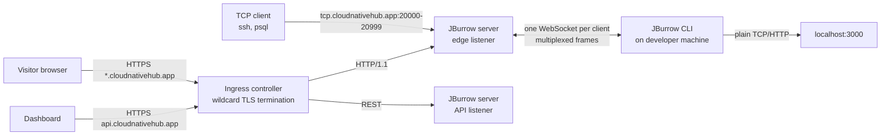
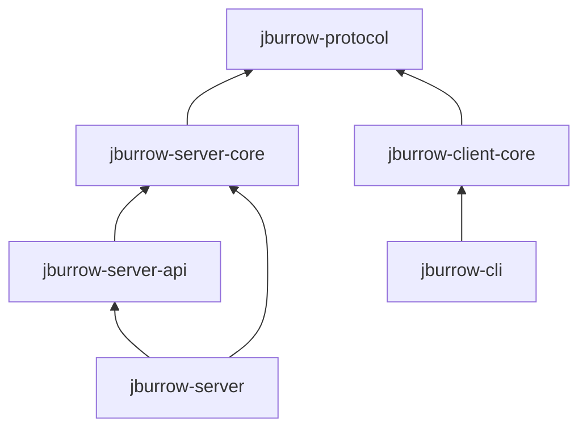

# JBurrow, project brief (v0.1)

An open-source, self-hostable tunneling server (an ngrok-style service) written in Java. One command on a developer's machine turns a local port into a public HTTPS URL or a public TCP port. Built in public, one capability at a time.

Status: design only; license settled (Apache-2.0); phase 0 (foundation) is designed in [`docs/phase-0-foundation/ARCHITECTURE.md`](docs/phase-0-foundation/ARCHITECTURE.md) and ready to build. Phase 0 is a walking skeleton: a Maven reactor and a server connected to its production database and mail provider, carried all the way through the real pipeline (Jenkins, image registry, GitOps commit, ArgoCD, Kubernetes) before any tunnel code is written. The deployment path is proven first so every later step deploys the same way.

## Contents

- [What this is](#what-this-is)
- [Why this project](#why-this-project)
- [Core concepts and where they live](#core-concepts-and-where-they-live)
- [Architecture overview](#architecture-overview)
- [The wire protocol](#the-wire-protocol)
- [Tech stack](#tech-stack)
- [Module catalog](#module-catalog)
- [Clean architecture rules](#clean-architecture-rules)
- [Accounts, tokens and security](#accounts-tokens-and-security)
- [The web dashboard](#the-web-dashboard)
- [Repositories](#repositories)
- [Local development](#local-development)
- [Testing](#testing)
- [CI/CD](#cicd)
- [Production deployment](#production-deployment)
- [Build roadmap](#build-roadmap)
- [Where this brief departs from ROADMAP.md](#where-this-brief-departs-from-roadmapmd)
- [Open source and licensing](#open-source-and-licensing)
- [Open questions and next steps](#open-questions-and-next-steps)

## What this is

A developer runs `jburrow http 3000` and gets back `https://quiet-otter-4f2a.cloudnativehub.app`. Any request to that URL lands on the JBurrow server, travels down a single long-lived connection the CLI opened earlier, and comes out on `localhost:3000` on the developer's machine. The response goes back up the same path. `jburrow tcp 22` does the same for raw TCP: the server allocates a public port (`tcp.cloudnativehub.app:20417`) and every connection to it is piped to the local SSH daemon.

The system has two halves. The **server** runs on a VPS, accepts public traffic, and routes it into the correct client session. The **client** runs on the developer's machine, holds the session open, and forwards traffic to local ports. Around the tunnel engine sit the parts of a usable service: accounts, auth tokens, reserved subdomains, rate limits, abuse controls, metrics, and a web dashboard.

The hosted instance lives on one domain, `cloudnativehub.app`, which carries both the service's own hosts and every tunnel:

| Host | Serves | From phase |
|---|---|---|
| `api.cloudnativehub.app` | REST API | 0 |
| `connect.cloudnativehub.app` | Control WebSocket for the CLI | 1 |
| `tcp.cloudnativehub.app` | TCP tunnel ports `20000-20999` | 1 |
| `*.cloudnativehub.app` | HTTP tunnels | 3 |
| `cloudnativehub.app`, `app.cloudnativehub.app` | Public site and dashboard | 7 |

Every one of those service names is on the subdomain blocklist, so no tunnel can claim them. `.app` is on the browsers' HSTS preload list, so every host under it is HTTPS-only in a browser. That fits this design, since all public HTTP traffic is TLS-terminated at the edge, but it also means a tunnel URL can never be served over plain HTTP.

Throughout this brief, **MVP**, **v1** and **Later** refer to the stages in `ROADMAP.md`. `ROADMAP.md` is the feature list. This document covers how those features get built, where the code lives, and how it is deployed.

## Why this project

Pallet, the sibling build-in-public project, deals with distributed systems: many services, an event backbone, and sagas. JBurrow is deliberately different: **one deployable, a lot of networking**. The interesting problems are in a single process: multiplexing thousands of streams over one connection, flow control so a slow client can't make the server buffer gigabytes, routing by `Host` header and later by TLS SNI, holding a session through network drops and server restarts, and keeping one public IP off abuse blocklists. Splitting this into services would add network hops without solving any of those problems. Distributed patterns stay out until a real need appears (multi-region edges, see Later in the roadmap).

That doesn't make the code less structured. The engineering discipline from Pallet (ADRs, clean architecture enforced by the build, real-dependency integration tests, observability from the first commit) carries over in full. The process boundary is the only thing that disappears.

## Core concepts and where they live

| Concept | Where it lives | Technology |
|---|---|---|
| Stream multiplexing and flow control | `jburrow-protocol` (frames, codec), `jburrow-server-core` and `jburrow-client-core` (stream tables, windows) | Netty, custom binary framing over WebSocket |
| Host-based HTTP routing | `jburrow-server-core` `routing` + `http` features | Netty HTTP codec, in-memory subdomain registry |
| TCP port tunnels | `jburrow-server-core` `tcp` feature | Netty server channels on an allocated port range |
| Session resume and graceful drain | `jburrow-server-core` `session` feature, `jburrow-client-core` reconnect loop | Resume tokens, Postgres-backed subdomain leases, `GOAWAY` frames |
| Backpressure | Every byte path, server and client | Netty channel writability, `autoRead` toggling, per-stream credit windows |
| Accounts, tokens, reservations | `jburrow-server-api` | Spring Boot 4.1, Spring Security, Spring Data JPA, Flyway, PostgreSQL |
| Rate limiting and abuse controls | `jburrow-server-core` `limits`, `jburrow-server-api` `abuse` | Bucket4j (in-memory, single node), subdomain blocklist |
| TLS | At the cluster edge in production; inside the server for self-hosters (v1) | cert-manager with DNS-01 in Kubernetes, acme4j in self-hosted mode |
| Observability | Every module | Micrometer, Prometheus, structured JSON logs, OpenTelemetry later |
| CLI | `jburrow-cli` | picocli, GraalVM native-image, JReleaser |
| Deployment | `Jenkinsfile` here, manifests in a private GitOps repository | Jenkins, GHCR, ArgoCD, k3s |

## Architecture overview

Everything public-facing on the VPS enters through one of two doors. HTTP and HTTPS traffic arrives on 80/443 at the cluster's ingress controller, which terminates TLS with a wildcard certificate and passes plain HTTP/1.1 to the JBurrow server. Raw TCP tunnel traffic arrives on a reserved port range bound directly by the server pod, since an ingress controller can't route arbitrary TCP ports.



### The life of a tunnel

1. **Connect.** The CLI opens a WebSocket to `wss://connect.cloudnativehub.app/v1/connect` and sends `HELLO` (protocol version, capabilities). The server answers with what it supports.
2. **Register.** The CLI sends `REGISTER` carrying its authtoken and the tunnels it wants (`http` with an optional subdomain, `tcp` with an optional previous port). Token verification hits Postgres, so it runs off the Netty event loop on a virtual thread. The result comes back on the event loop. The server claims the subdomain or port, writes a lease row, and replies with the public URLs and a resume token.
3. **Serve.** A public request arrives. The edge resolves `Host` to a session, opens a new stream on that session's connection, and sends `OPEN` with the request head followed by body `DATA` frames. The client opens (or reuses) a connection to the local port, replays the request, and streams the response back as `HEADERS` then `DATA`, ending with `CLOSE`.
4. **Survive.** `PING`/`PONG` every 15 seconds detects a dead connection in under 45 seconds. When the connection drops, the client reconnects with jittered exponential backoff, presents its resume token, and gets back the same URLs.
5. **End.** `jburrow` exits, the session closes, its streams reset, and the lease is released.

### Routing per request, not per connection

The ingress controller keeps a pool of keep-alive connections to the JBurrow server and reuses them for any host under the wildcard. One upstream connection can carry a request for `alpha.cloudnativehub.app` followed by one for `beta.cloudnativehub.app`. The edge therefore resolves the target session **for every request**, not once per TCP connection, and each HTTP request gets its own stream. A WebSocket or other `Upgrade` request is the one exception: after the `101`, that connection is pinned to its stream and becomes an opaque byte pipe in both directions until either side closes.

This is also what makes the client-side inspection API (roadmap section 3) straightforward. The client sees exactly one request head and one response head per stream.

### Backpressure

Every public byte has to pass through one client connection that may be on a slow home network. Without flow control, a fast visitor and a slow client would fill server memory with buffered frames. Two mechanisms prevent it:

- **Per-stream credit windows.** Each side starts with a 256 KiB send window per stream and may not send more `DATA` than its window allows. The receiver returns credit with `WINDOW_UPDATE` as it actually writes bytes to the destination socket. When a stream's window hits zero, the edge stops reading from that visitor's socket (`autoRead = false`). TCP backpressure then pushes back on the visitor.
- **Session-level writability.** When the WebSocket channel's outbound buffer crosses its high watermark, every public channel feeding that session is paused until it drops below the low watermark.

The window accounting is pure Java in the domain layer, so it can be unit-tested exhaustively. Netty only wires the "pause" and "resume" signals.

### Server restarts and deploys

The session registry is in memory, and the TCP listener binds host ports directly, so exactly one server pod runs at a time and a deploy is a short restart, not a rolling update. Two things keep that restart from breaking users' URLs:

- **Graceful drain.** On `SIGTERM` the server marks itself not-ready, stops accepting new sessions, and sends every client `GOAWAY` with a randomized reconnect delay so the reconnects don't all land in the same second. In-flight streams get up to 20 seconds to finish.
- **Durable leases.** Every claimed subdomain and TCP port has a lease row in Postgres (owner account, expiry), refreshed every 30 seconds and kept for a grace period after its session disappears. After a restart, a reconnecting client asking for its previous subdomain or port gets it back, and nobody else can claim it during the grace period. The in-memory registry stays the source of truth for routing; the lease table is only consulted on registration.

A deploy therefore shows up to a user as a few seconds of `502`s followed by the same URL working again.

## The wire protocol

Every message between client and server is a frame:

```
 0                   4        5        6                   10
+-------------------+--------+--------+-------------------+------------------+
| stream id (u32)   | type   | flags  | length (u32)      | payload (length) |
+-------------------+--------+--------+-------------------+------------------+
```

Stream `0` is the control stream. The server allocates every other stream id, since only the server ever sees a new public connection arrive. `DATA` payloads are capped at 64 KiB so one large body can't starve other streams on the same session.

| Type | Stream | Purpose |
|---|---|---|
| `HELLO` | 0 | Protocol version and capability negotiation, both directions |
| `REGISTER` | 0 | Client requests tunnels (authtoken, kinds, requested names/ports, resume token); server replies with assignments |
| `OPEN` | n | Server opens a stream: `tcp` (remote address) or `http` (request head) |
| `HEADERS` | n | Client sends the HTTP response head |
| `DATA` | n | Payload bytes, either direction |
| `WINDOW_UPDATE` | n | Returns flow-control credit |
| `CLOSE` | n | Half-close or reset (flag), with an error code on reset |
| `PING` / `PONG` | 0 | Liveness and round-trip time |
| `GOAWAY` | 0 | Server is draining; carries a reconnect delay |
| `ERROR` | 0 | Session-level error with a stable code, then the session closes |

Control payloads (`HELLO`, `REGISTER`, `OPEN` heads, `HEADERS`, `GOAWAY`, `ERROR`) are JSON, encoded with Jackson 3, so the protocol stays debuggable while it is changing. Moving them to Protobuf is a later, versioned change negotiated through `HELLO` and doesn't need a new frame layout.

The first transport is **one frame per binary WebSocket message** over TLS on 443. That gets through corporate proxies and firewalls that would block an unusual port, and in production it goes through the same ingress as everything else. The frame keeps its own length field even though WebSocket already frames messages, so a raw TCP+TLS transport can be added later with the same codec. The full specification goes into `docs/protocol.md` before the first release so third-party clients are possible (roadmap section 1). Once written, that file is the authority and this section is a summary.

## Tech stack

**Language and build.** Java 21 and Spring Boot 4.1, matching Pallet so the Boot 4 conventions carry over unchanged: modular starters (`spring-boot-starter-webmvc`, not `-web`), Jackson 3 (`tools.jackson.databind.*`, annotations still under `com.fasterxml.jackson.annotation`). Unlike Pallet, JBurrow is **one Maven multi-module reactor** under a single parent POM. Its modules are one product, released together under one version number, so the independent-project-per-service model Pallet needs for 24 services would only add overhead here. The Maven wrapper is committed; nobody needs Maven installed.

**Networking.** Netty 4.2 for everything on the byte path: the edge HTTP listener, TCP tunnel listeners, the WebSocket control channel on the server, and the WebSocket client and local forwarding in `jburrow-client-core`. Spring doesn't sit on the byte path. Netty's event loops are the byte path's thread model, and nothing blocking may run on them. Blocking work (database lookups during `REGISTER`, lease writes) goes to a virtual-thread executor and comes back to the event loop with the result.

**API.** Spring MVC on virtual threads (`spring.threads.virtual.enabled=true`) for the REST API, on its own port, separate from the Netty edge. springdoc-openapi publishes `/v3/api-docs`, which the dashboard generates its types from.

**Persistence.** PostgreSQL with Spring Data JPA and Flyway migrations, in a `jburrow` schema. Tables: accounts, credentials, sessions, authtokens, reserved subdomains, leases, abuse reports, and later custom domains and plans. In production the database is Neon (managed, serverless Postgres), so the node carries no database storage and backups are the provider's job. Locally it is a Postgres container in `docker-compose.yml`. The server only sees a JDBC URL, so self-hosters can use any Postgres. Redis is not in the MVP. With one server process, rate-limit buckets and the session registry belong in memory, and Redis only earns its place when a second node exists (roadmap section 11, Later).

**Mail.** Outbound email (verification, password reset, later alerts) goes through one `OutboundMail` port with an SMTP adapter. Locally that is Mailpit in `docker-compose.yml`, with its inbox at `http://localhost:8025`. In production it is Amazon SES through its SMTP interface, from a sender address on a domain verified in SES. Using SMTP rather than the AWS SDK keeps the open-source server provider-neutral (ADR-0004).

**Security.** Spring Security for the API. Argon2id for passwords (`Argon2PasswordEncoder`, Bouncy Castle). Authtokens are 32 random bytes, so a SHA-256 hash of the token is enough and doubles as its lookup key. A slow hash isn't needed for a secret with that much entropy, and it would make every `REGISTER` expensive.

**Rate limiting.** Bucket4j, in memory, keyed per tunnel, per source IP, and per account.

**TLS.** In Kubernetes the ingress controller terminates TLS with a wildcard certificate that cert-manager issues and renews through a DNS-01 challenge. The server itself speaks plain HTTP. For self-hosters without Kubernetes (v1), the server terminates TLS itself and runs ACME through acme4j. Both live behind one `CertificateSource` port, so neither mode leaks into the tunnel engine.

**CLI.** picocli, compiled to native binaries with GraalVM native-image for Linux, macOS, and Windows on x64 and ARM (v1). A JVM fat JAR remains the fallback for any platform without a native build. From phase 1, when Netty enters the client, every pull request also builds the native binary, so native-image incompatibilities fail the change that introduces them rather than surfacing at release. At v1, users install with one command: `install.sh` through `curl`, a Homebrew tap, or a Scoop bucket, all fed by the same release ([ADR-0006](docs/adr/0006-cli-distribution-native-binaries.md)).

**Observability.** Micrometer with the Prometheus registry on a management port. Spring Boot's built-in structured logging (JSON) on stdout, which the cluster's log collector already ships. Tracing (OpenTelemetry) is Later in the roadmap and arrives through Micrometer Tracing without code changes in the features.

**Testing.** JUnit 5, AssertJ, Mockito, Testcontainers 2.x for Postgres, ArchUnit for the layer rules, and Jazzer for fuzzing the frame decoder. See [Testing](#testing).

## Module catalog

Six modules, matching the layout `ROADMAP.md` section 13 proposes, with two changes. `common` is dropped until two modules actually share code that doesn't belong in `jburrow-protocol`. A bootable `jburrow-server` module is added as the composition root that assembles the server.

`jburrow-protocol` holds frame definitions, the binary codec (Netty `ByteToMessageDecoder`/`MessageToByteEncoder`), control message records, error codes, and version negotiation rules. It has no dependency on anything server- or client-specific, so a third-party client in Java can depend on it alone. It is also the module the fuzzer targets.

`jburrow-server-core` is the tunnel engine: sessions, the subdomain registry, the TCP port allocator, the HTTP edge, stream multiplexing, flow-control windows, rate limits, and drain. It defines the ports it needs from the outside world (`AuthtokenVerifier`, `LeaseStore`, `ReservationLookup`, `TunnelEventPublisher`) and implements none of them. It has no dependency on Spring, JPA, or Postgres.

`jburrow-server-api` holds accounts, login and session management, email verification and password reset, authtokens, reserved subdomains, abuse reports, and the admin API. It implements `jburrow-server-core`'s outbound ports against Postgres, so tunnel registration checks real tokens and real reservations. It also turns `TunnelEventPublisher` events into a server-sent events feed the dashboard uses for its live tunnel list.

`jburrow-server` contains `main()`, Spring configuration, wiring of core's ports to api's adapters, the Netty bootstrap lifecycle tied to Spring's (start after the context is ready, drain before it closes), and the Dockerfile. This is the only module that knows every other server module exists.

`jburrow-client-core` contains the client agent: the WebSocket connection, `HELLO`/`REGISTER`, the stream table, local forwarding, reconnect with backoff and resume, and the local inspection API (v1). It can be embedded in a JUnit test or another Java program without the CLI (the Java SDK in roadmap section 10 grows out of this).

`jburrow-cli` covers commands, flags, the config file (`~/.config/jburrow/config.yml`, mode `0600`), exit codes, and native-image packaging. It contains only CLI code: argument parsing, output formatting, and calls into `jburrow-client-core`.

Dependencies point one way:



The server and client sides never depend on each other. Their only shared contract is the protocol.

## Clean architecture rules

Every server and client module is organized **by feature first, then by layer**, the same shape Pallet's web app uses (`modules/<name>/{domain,application,infrastructure,presentation}`) translated to hexagonal Java:

```
io.jburrow.server.core
├── session/
│   ├── domain/          Session, SessionId, ResumeToken, SessionState: plain Java, no I/O
│   ├── application/     RegisterTunnels, ResumeSession, DrainSessions (use cases)
│   │   └── port/        inbound use-case interfaces, outbound ports (AuthtokenVerifier, LeaseStore)
│   └── adapter/
│       └── netty/       control-channel handler: decodes frames, calls use cases
├── routing/             subdomain registry, host matching, blocklist, random name generation
├── stream/              stream table, credit windows, open/close lifecycle
├── http/                edge listener, per-request routing, header rewriting, limits
├── tcp/                 port allocator, per-tunnel listeners
└── limits/              rate-limit policies and buckets
```

`jburrow-server-api` follows the same shape (`account/`, `auth/`, `token/`, `reservation/`, `lease/`, `abuse/`, `admin/`), with `adapter/web` for controllers and `adapter/persistence` for JPA entities and repositories. Package root is `io.jburrow`.

The rules, each enforced by an ArchUnit test that fails `./mvnw verify`, not left as a convention:

- `domain` depends only on the JDK and other `domain` packages. No Netty, Spring, Jackson, or JPA annotations.
- `application` depends on `domain` and its own `port` interfaces. No Netty, Spring, or JPA. Use cases are plain classes constructed by the composition root.
- `adapter` packages depend on `application`. Netty lives only in `adapter.netty`, Spring MVC only in `adapter.web`, JPA only in `adapter.persistence`.
- A feature reaches another feature only through that feature's `application.port` interfaces, never its `domain` internals or adapters.
- No cycles between features (ArchUnit `slices().should().beFreeOfCycles()`).
- Transactions are applied in the composition root around use cases that need them. No `@Transactional` in `application` code, since it would break the no-Spring rule.

JPA entities are adapter types mapped to and from domain objects. They are never the domain model. That's extra mapping code. In exchange, the tunnel engine and every use case are testable with no container, and the Postgres adapter can be swapped (an in-memory one for the tests in `jburrow-server-core`) without touching a use case.

The API conventions mirror Pallet's: every endpoint is under `/api/v1`. Successful responses use an `ApiResponse<T>` envelope, with `PageResponse<T>` for lists, never a raw Spring `Page`. Every domain error extends one `JBurrowException` hierarchy carrying a stable error code, rendered by a single `@RestControllerAdvice` into `ErrorResponse`. Protocol errors use the same code space, so `TOKEN_REVOKED` means the same thing in a REST response and in an `ERROR` frame.

## Accounts, tokens and security

**Dashboard sessions.** Login creates a server-side session row and returns an opaque 32-byte session token. Only its hash is stored. Every authenticated API call looks up that hash, and revoking a session (roadmap section 4, v1) deletes the row. JWTs were considered and rejected: the roadmap requires session listing and revocation, and a stateless token can't be revoked without rebuilding a server-side table anyway.

**Authtokens.** Created, named, and revoked from the dashboard or API. They are shown once at creation, prefixed `jb_` so secret scanners can recognize them, and stored as SHA-256. The CLI stores the token in its config file with `0600` permissions and sends it only in `REGISTER`, over TLS.

**What the server never logs:** tunnel payloads, `Authorization` and `Cookie` headers, authtokens, session tokens, or request bodies. Request metadata (method, host, status, bytes, duration) is logged at the edge; anything beyond that stays on the developer's machine in the client-side inspection buffer.

**Abuse controls**, roadmap section 6, matter more here than in most projects, because a tunnel service turns the server's IP address into everyone's IP address. One phishing page served through a tunnel can get the whole VPS IP blocklisted. The MVP set: a blocklist of subdomains (`login`, `paypal`, `admin`, `api`, `connect`, `tcp`, `app`, `www`, `mail`, brand names), per-IP and per-account rate limits, request size limits, and timeouts. v1 adds an interstitial warning for unauthenticated browser traffic on free tunnels, an abuse report endpoint, and an admin takedown that kills a session and bans its account in one call.

**Header handling at the edge.** Hop-by-hop headers are stripped. `X-Forwarded-For`, `-Proto`, and `-Host` are set from what the ingress controller passed in, never trusted from the visitor directly. A `Via`-style header identifies the request as tunneled.

## The web dashboard

The frontend is a separate open-source repository (see [Repositories](#repositories)). It includes the dashboard and the public site, and is built on the architecture Pallet's web app uses:

- **Next.js App Router as both UI and backend-for-frontend.** The browser only ever talks to its own origin. Route handlers hold the API session token in an encrypted, `httpOnly`, `SameSite=Lax` cookie and attach it to API calls server-side, so no token ever reaches JavaScript. Unlike Pallet, there is no Redis-backed session store: JBurrow's sessions are already revocable server-side in Postgres, so the cookie only needs to carry the opaque token, and the frontend stays stateless and can scale horizontally.
- **Feature modules with enforced layers.** `src/modules/<name>/{domain,application,infrastructure,presentation}` with a public `index.ts` per module, `src/composition/` as the only place adapters meet ports, and `src/app/` holding routes only. `eslint-plugin-boundaries` makes a wrong import a build error.
- **TanStack Query** as the only server-state cache. No Server Actions for mutations.
- **API types generated** from the server's `/v3/api-docs` with `openapi-typescript`, called through `openapi-fetch`, and kept inside `infrastructure/`.
- **Tests:** Vitest unit and component tests (MSW serving real response envelopes) in CI, and Playwright with axe end to end locally.

MVP scope: sign-up, email verification, login and logout, password reset, authtokens (create, name, revoke, copy-once), reserved subdomains, a live list of active tunnels (server-sent events from the API), and a getting-started page with install and `jburrow login` instructions. v1 adds sessions management, 2FA, custom domains with CNAME verification status, and an admin view. Teams and billing pages arrive with their backend features (Later).

The dashboard has no access to tunnel traffic and never will. Request inspection stays local to the CLI (roadmap section 3), so the hosted service never holds a copy of anyone's request bodies.

## Repositories

| Repository | Visibility | Contents |
|---|---|---|
| [`github.com/Wamitinewton/jburrow`](https://github.com/Wamitinewton/jburrow) | Public | Server, client, protocol, CLI, `Jenkinsfile`, Dockerfile, reference deployment manifests, docs |
| `github.com/Wamitinewton/jburrow-web` (name proposed) | Public | Dashboard and public site, its own `Jenkinsfile` and Dockerfile |
| `github.com/Wamitinewton/homebrew-tap` (from v1) | Public | Homebrew formula for the CLI, written only by the release workflow |
| `github.com/Wamitinewton/scoop-bucket` (from v1) | Public | Scoop manifest for the CLI, written only by the release workflow |
| Private GitOps repository | Private | Production Kubernetes manifests and ArgoCD `Application`, shared with other workloads on the same cluster |

Layout of the main repository:

```
jburrow/
├── pom.xml                      # parent + reactor: pins Spring Boot, Netty, plugin versions
├── mvnw, mvnw.cmd, .mvn/        # Maven wrapper
├── Makefile                     # make up / verify / run / format, wraps compose and mvnw
├── jburrow-protocol/
├── jburrow-server-core/
├── jburrow-server-api/
│   └── src/main/resources/db/migration/   # Flyway
├── jburrow-server/
│   └── Dockerfile
├── jburrow-client-core/
├── jburrow-cli/
├── deploy/
│   ├── compose/                 # self-hosting: server + Postgres, one command
│   └── kubernetes/              # reference manifests with placeholder hosts, for self-hosters
├── docker-compose.yml           # local development dependencies
├── docs/
│   ├── adr/                     # architecture decision records, 0000-template.md first
│   ├── phase-0-foundation/      # ARCHITECTURE.md per phase: the detailed design it implements
│   ├── protocol.md              # wire protocol specification
│   └── self-hosting.md
├── .github/                     # PR checks, CLI release workflow, issue and PR templates
├── Jenkinsfile                  # server image build and deploy
├── PROJECT.md  ROADMAP.md  README.md  CONTRIBUTING.md  SECURITY.md
└── CODE_OF_CONDUCT.md  CHANGELOG.md  LICENSE  NOTICE
```

`deploy/kubernetes/` and the private GitOps repository describe the same shape of deployment. The public copy uses `example.dev` and placeholder registries so anyone can adapt it. The private copy carries the real hostnames, resource budgets, and secret references, and it is the one ArgoCD watches.

## Local development

`make up` starts Postgres and Mailpit through `docker-compose.yml`. `make run` starts the server with the `local` profile:

| Thing | Local address |
|---|---|
| Edge listener (tunnel HTTP + control WebSocket) | `http://localhost:7080` |
| REST API | `http://localhost:7090/api/v1` (OpenAPI UI at `/swagger-ui.html`) |
| Management (health, metrics) | `http://localhost:7091/actuator` |
| TCP tunnel port range | `21000-21099` |
| Postgres | `localhost:5432` (jburrow/jburrow) |
| Mailpit UI | `http://localhost:8025` |

Locally the base domain is `localhost`. Browsers and curl resolve `*.localhost` to the loopback address, so `jburrow http 3000 --server http://localhost:7080` returns `http://<name>.localhost:7080` and it works with no DNS setup. The `local` profile skips email verification and seeds one account and one authtoken, printed at startup, so a new contributor can open a tunnel within a minute of cloning.

The web repository runs against this server with `pnpm dev`.

## Testing

Same split as Pallet: unit tests are `*Test` and run under Surefire; integration tests are `*IntegrationTest` and run under Failsafe in `verify`.

| Level | What it covers | Real dependencies |
|---|---|---|
| Unit | Domain rules: credit windows, port allocation, subdomain validation, resume-token expiry, rate-limit policies | None |
| Codec | Every frame type round-trips; malformed and truncated input is rejected cleanly | None (Netty `EmbeddedChannel`) |
| Fuzz | The frame decoder never throws anything except a protocol error, and never allocates beyond the declared max frame size | None (Jazzer, time-boxed in CI) |
| Architecture | The layer rules in [Clean architecture rules](#clean-architecture-rules) | None (ArchUnit) |
| Persistence | Repositories and Flyway migrations | Postgres (Testcontainers) |
| End to end, in process | Real server and real client in one JVM on ephemeral ports: HTTP, WebSocket passthrough, TCP, reconnect and resume, drain, a slow client that must not grow server heap | Postgres (Testcontainers) |
| Load | Concurrent streams per session, sessions per server, throughput, p99 latency added by the tunnel | A deployed server (Gatling, run by hand, not in CI) |

The in-process end-to-end suite is the most important one and gets built alongside phase 1. Every roadmap feature that touches the byte path lands with an end-to-end test that pushes real bytes through a real tunnel. Postgres is never mocked where a container can stand in for it.

## CI/CD

Two systems, each doing the work it suits.

**GitHub Actions: public checks and CLI releases.** Every pull request, including ones from forks, runs `./mvnw verify` (unit, codec, architecture, persistence, and end-to-end tests) on GitHub's runners. From phase 1, a separate job also compiles the CLI with native-image and runs the binary, publishing nothing. None of this needs secrets or touches the deployment. Tagging a release (`v1.0.0`) runs a matrix that builds native CLI binaries on Linux, macOS, and Windows runners, x64 and arm64, since those binaries can't be cross-compiled from one Linux host. JReleaser then publishes them: the GitHub release with archives and checksums, the Homebrew formula in the tap, and the Scoop manifest in the bucket. `install.sh` downloads from the latest release, so it needs no publishing step of its own.

**Jenkins: server image and deployment.** Jenkins only builds pushes to `main`, never pull requests. Running a stranger's fork on a build agent that holds a Docker socket and registry credentials is not an option for a public repository. The pipeline:

1. Checkout.
2. `./mvnw verify` in a Maven/Temurin 21 container, with the Docker socket mounted for Testcontainers.
3. Build the `jburrow-server` image and push it to GHCR under the personal account that owns this repository, `ghcr.io/wamitinewton/jburrow-server`, tagged with the build number and the short commit SHA. The push authenticates with a JBurrow-only Jenkins credential, a personal access token from that account with `write:packages`. It never reuses a registry credential that belongs to another project on the same Jenkins server. The image is public, so self-hosters pull the same image production runs, and the cluster needs no pull secret for it.
4. Clone the private GitOps repository, update the image tag in the JBurrow deployment manifest, commit, and push. ArgoCD notices and syncs.

**The Jenkinsfile in a public repository must not reveal anything about where it deploys.** It contains no repository URLs, hostnames, IP addresses, organization names, manifest paths, credential IDs that identify other projects, or commit-author emails. Everything deployment-specific is read from parameters set on the Jenkins job (`IMAGE_REPOSITORY`, `GITOPS_REPO_URL`, `GITOPS_BRANCH`, `GITOPS_MANIFEST_PATH`, `GITOPS_COMMIT_NAME`, `GITOPS_COMMIT_EMAIL`) and from Jenkins credentials whose ids are themselves parameters (`REGISTRY_CREDENTIALS_ID`, `GITOPS_CREDENTIALS_ID`). The pipeline fails fast with a clear message if any of them is missing, rather than falling back to a default that would have to be written down. A fork's Jenkinsfile is therefore usable by anyone with their own GitOps repository and points nowhere in particular until it is configured.

The web repository follows the same pattern: GitHub Actions runs `pnpm verify` on pull requests, and Jenkins builds the image on `main`, pushes it to `ghcr.io/wamitinewton/jburrow-web` with the same JBurrow-only credential, and updates its manifest in the same private repository. Build-time public values (`NEXT_PUBLIC_API_URL` and similar) come from Jenkins credentials as build args, not from tracked files.

## Production deployment

JBurrow runs on an existing single-node k3s cluster on a Contabo VPS that also hosts other workloads. The cluster already provides ingress-nginx, cert-manager, ArgoCD, Jenkins, and a Prometheus, Loki, and Grafana stack. JBurrow adds a namespace and one ArgoCD `Application`, and doesn't run its own infrastructure repository.

| Resource | Shape |
|---|---|
| Namespace | `jburrow` |
| Server | `Deployment`, `replicas: 1`, `strategy: Recreate`, `hostNetwork: true`, `dnsPolicy: ClusterFirstWithHostNet`, `terminationGracePeriodSeconds: 30` |
| Server ports | 7080 edge, 7090 API, 7091 management, 20000-20999 TCP tunnels. None of 7080-7091 are opened in the host firewall |
| Services | ClusterIP for edge (7080) and API (7090), so the ingress can reach them |
| Ingresses | `*.cloudnativehub.app` and `connect.cloudnativehub.app` to the edge; `api.cloudnativehub.app` to the API; the web app's host to the frontend |
| Certificate | Wildcard `*.cloudnativehub.app` + apex, from a namespaced cert-manager `Issuer` using DNS-01 |
| Frontend | `Deployment` with an HPA, stateless |
| Secrets | `jburrow-secret` (Neon connection, SES SMTP credentials and sender, later signing keys), DNS-provider API token for the `Issuer` (phase 3), all created by hand and never committed |
| Probes | Startup, liveness, and readiness on the management port; readiness turns false the moment drain starts |

Several of these choices follow directly from the cluster's shape and are worth recording:

- **Why `hostNetwork`.** The TCP tunnel range is hundreds of ports. A Kubernetes `Service` lists ports one at a time, and k3s's built-in load balancer starts one proxy per listed port, so a port range can't be expressed either way. With `hostNetwork`, the server binds the range on the node directly. The cost is that the edge, API, and management ports also land on the host, so they are chosen to avoid ports already in use there (Jenkins already holds 8080, for example), and the host firewall keeps them closed to the internet. Traffic from the ingress controller's pod to a host-network endpoint must be allowed by the firewall. Verify this during the first deploy (allow the pod CIDR to 7080 and 7090 if it is blocked).
- **Why `Recreate`.** Two pods with `hostNetwork` can't both bind the same ports, so a rolling update's surge pod would sit `Pending` forever. `Recreate` stops the old pod (which drains) before starting the new one, and [durable leases](#server-restarts-and-deploys) make that gap tolerable.
- **Why a separate DNS-01 `Issuer`.** The cluster's shared `ClusterIssuer` uses HTTP-01, which can't issue wildcard certificates. `cloudnativehub.app` is registered at Name.com, which cert-manager has no built-in DNS-01 solver for, so before phase 3 its nameservers move to Cloudflare (registration stays at Name.com) and the `Issuer` uses Cloudflare's solver with a scoped API token. Phases 0–2 only need plain `A` records and the existing HTTP-01 issuer, so they work with DNS still at Name.com. The `Issuer` lives in the `jburrow` namespace, so the shared issuer and other workloads are untouched. DNS records for tunnels are DNS-only, not proxied: a CDN proxy would break TCP tunnels and add a second TLS termination.
- **Ingress settings for tunnels.** Request and response buffering off (`proxy-request-buffering: "off"`, `proxy-buffering: "off"`) so streaming responses and server-sent events pass through as they are produced. Read and send timeouts of an hour on the `connect` host so the control WebSocket isn't cut. `proxy-body-size` matches the server's own request size limit, so the limit and its error response come from one place.
- **Firewall.** Open `20000-20999/tcp` on the host for TCP tunnels. 80 and 443 are already open. Nothing else.
- **Resource budget.** The node is shared, so JBurrow gets a fixed budget: server requests 250m CPU and 512 MiB and is limited to 1 CPU and 1 GiB, with the JVM held to 75% of that through `-XX:MaxRAMPercentage`. Netty's direct memory is capped explicitly (`-Dio.netty.maxDirectMemory`) so a buffer leak fails loudly instead of growing past the pod limit.
- **Shared IP.** Every tunnel serves traffic from the same public IP as the other workloads on the node. The abuse controls in [Accounts, tokens and security](#accounts-tokens-and-security) protect them as well as JBurrow, which is why they are MVP and not v1.
- **Monitoring.** A Prometheus scrape target for the management port and a Grafana dashboard (active sessions, streams, bytes per second by tunnel kind, register latency, rejections by reason, JVM and Netty direct memory) are added to the existing monitoring stack. Logs reach Loki through the existing collector with no change.

Bringing JBurrow up on the cluster for the first time (DNS records, namespace, secrets, the DNS-01 `Issuer`, Jenkins job and webhook, ArgoCD registration, verification) is a step-by-step runbook kept privately with the deployment, not in this public repository. `docs/self-hosting.md` covers the generic version for anyone running their own copy.

## Build roadmap

The order follows `ROADMAP.md` section 14, with the walking skeleton added in front so the first tunnel deploys the same way the last one will. Each phase has a "done when" test that must pass on the production cluster, not just on a laptop.

0. **Foundation (walking skeleton).** Reactor, parent POM, the six modules, ArchUnit rules, the server's configuration and API conventions, Postgres (Neon) through Flyway with one reference slice that records every server start, the mail port with SES behind it, health groups, metrics and logs, the Dockerfile, the GitHub Actions PR check, the Jenkinsfile reading every deployment value from job configuration, the manifests in the private GitOps repository, and the ArgoCD `Application`. Done when a push to `main` ends with a new pod `Ready`, `https://api.cloudnativehub.app/api/v1/meta` returning the pushed commit, a smoke-test email delivered through SES, and Neon free to suspend while the pod is idle, with no manual step. Full design: [`docs/phase-0-foundation/ARCHITECTURE.md`](docs/phase-0-foundation/ARCHITECTURE.md).
1. **TCP tunnel, one stream.** `jburrow-protocol` with `HELLO`, `REGISTER`, `OPEN`, `DATA`, `CLOSE`; the control WebSocket; `jburrow tcp <port>` with a static token from configuration; the native-image build check on pull requests. Done when `ssh -p <port> tcp.cloudnativehub.app` reaches a laptop behind NAT.
2. **Multiplexing and flow control.** The stream table, credit windows, `WINDOW_UPDATE`, session writability. Done when 500 concurrent connections share one session, and an end-to-end test with a deliberately slow client shows server heap and direct memory staying flat.
3. **HTTP tunnels.** The edge listener, per-request routing, random and requested subdomains, the blocklist, the wildcard certificate through the DNS-01 `Issuer`. Done when `jburrow http 3000` gives a working `https://<name>.cloudnativehub.app` with a valid certificate.
4. **Staying connected.** `PING`/`PONG`, reconnect with backoff, resume tokens, `GOAWAY` and graceful drain, `Recreate` deploys. Done when a server deploy during an open tunnel ends with the same URL serving again within ten seconds, with no action from the user.
5. **Accounts and persistence.** The account tables on the database phase 0 connected, accounts, email verification through the phase 0 mail port, password reset, sessions, authtokens, reserved subdomains, leases, and `jburrow login`. Static tokens are removed. Done when a new user can sign up, verify, create a token, log in from the CLI, reserve a subdomain, and keep it across a server restart.
6. **Limits, abuse controls, observability.** Rate limits, size limits, timeouts, the admin API (list and kill sessions, ban accounts), metrics, the Grafana dashboard, and JSON logs with payload redaction tested. Done when a load test against a rate-limited tunnel produces `429`s at the configured rate, the Grafana dashboard shows the load as it happens, and the logs from the test contain no payload bytes.
7. **Dashboard MVP** (in the web repository, can start once phase 5's API exists). Done when everything in the dashboard's MVP scope works against production.
8. **Public release, v1.** WebSocket and SSE passthrough, custom domains, the client inspection API, basic auth and IP allow/deny lists, the interstitial, abuse reports, native CLI binaries installable through `install.sh`, Homebrew and Scoop, `docs/protocol.md`, and self-hosted mode with acme4j. Release tag `v1.0.0`.

## Where this brief departs from ROADMAP.md

`ROADMAP.md` was written before the deployment target was settled. Where the two disagree, this brief reflects the current decision, and the roadmap rows should be updated to match:

- **Deployment.** The roadmap's MVP rows for "Docker and docker-compose" deployment and its v1 row for "CI/CD with GitHub Actions" are replaced. Production runs on Kubernetes (k3s) through Jenkins and ArgoCD. GitHub Actions keeps PR checks and CLI release builds. Compose stays as the self-hosting path.
- **TLS in the MVP.** The roadmap puts acme4j and in-app wildcard issuance at MVP. In production, cert-manager does this at the edge, so acme4j moves to v1 as part of self-hosted mode.
- **Frame types.** `HELLO`, `HEADERS`, `WINDOW_UPDATE`, and `GOAWAY` are added to the roadmap's list. Flow control and graceful drain both need them, and the roadmap already requires both.
- **Module layout.** `common` is dropped and `jburrow-server` is added, as described in [Module catalog](#module-catalog).
- **Server hardening (UFW, fail2ban, SSH keys).** Already in place on the host, so it isn't JBurrow work. The JBurrow-specific item is opening the TCP tunnel range.

## Open source and licensing

`ROADMAP.md` left the choice between Apache-2.0 and AGPL-3.0 open. **Settled: Apache-2.0** for both repositories, consistent with Pallet. It allows third-party clients, embedding `jburrow-client-core` in other projects' test suites, and a self-hosting community with the least friction, and its explicit patent grant suits infrastructure code. The argument for AGPL-3.0 on the server modules is that it stops someone from running a closed, modified copy as a competing hosted service. That only matters if a hosted JBurrow becomes a business, and it complicates contributions in the meantime. The license ships in the first commit, since changing it later requires every contributor's agreement.

The repository ships with `LICENSE`, `NOTICE`, `CONTRIBUTING.md` (the reactor build, the layer rules and why ArchUnit enforces them, how to run the end-to-end suite), `SECURITY.md` (private disclosure address, and a statement that tunnel abuse reports go to the abuse endpoint, not the security address), `CODE_OF_CONDUCT.md`, issue and PR templates, and a `CHANGELOG.md` maintained under semantic versioning. Architecture-changing decisions get an ADR in the same pull request, as in Pallet.

Nothing in either public repository may reference the private GitOps repository, other workloads on the shared cluster, the cluster's IP address, or credentials. That includes code, docs, commit messages, and CI configuration. Review for this is part of every pull request that touches `Jenkinsfile`, `deploy/`, or `docs/`.

## Open questions and next steps

**One domain for service and tunnels.** Settled: `cloudnativehub.app` carries both. The cost of one domain, compared with ngrok's split (`ngrok.com` for the service, `ngrok-free.app` for tunnels), has to be managed instead of avoided:

- **Cookies.** The dashboard and API set host-only cookies (no `Domain` attribute), so a tunnel on `x.cloudnativehub.app` can't read or overwrite them, and they never set a cookie on the apex domain. Submitting `cloudnativehub.app` to the Public Suffix List would also stop tunnels from setting cookies for each other. Weigh that before public launch: it is slow to undo, and it makes the apex a "public suffix" for the dashboard too.
- **Reputation.** Safe Browsing usually flags a single host, but repeated abuse can get the whole domain flagged, which would take the dashboard and API down with it. The abuse controls are the mitigation. If they prove insufficient, a separate tunnel domain can be added later: the edge already routes by `Host`, so it is a configuration and DNS change, not a redesign.

**License.** Settled: Apache-2.0, as above.

**Where Postgres runs.** Settled: Neon, a managed Postgres, so the node stays stateless (ADR-0003). Still open is the plan: phase 0's idle behaviour fits a free plan, but from phase 4 lease refreshes keep compute awake while tunnels are open, so revisit it once real usage exists.

**Sender domain.** Production mail starts out from a domain already verified in SES. `cloudnativehub.app` should get its own SES identity (DKIM and SPF records) before sign-up opens to the public, which is a configuration change, not a code change.

**A dedicated IP for tunnel traffic.** Contabo sells additional IPv4 addresses. Binding the TCP tunnel range and a second ingress entry to an IP used only by JBurrow would keep a reputation problem from reaching the node's other workloads at all. The extra cost is a second address and some ingress configuration. Worth deciding before the public launch, not before the MVP.

**TLS passthrough tunnels (v1).** SNI-based passthrough needs the TLS ClientHello before anything terminates it. On this cluster, the options are enabling ingress-nginx's `--enable-ssl-passthrough` (a flag on a controller shared with other workloads, with a small performance cost to all of them), or giving JBurrow its own 443 on the dedicated IP above. The second option is cleaner and is the reason to decide the dedicated-IP question first.

**Raw TCP control transport.** WebSocket on 443 comes first for firewall reach. A raw TLS transport on its own port would remove WebSocket framing overhead and the ingress hop for heavy users. It can wait until load tests show the overhead matters.

**HTTP/2 and gRPC to tunnels (v1).** ingress-nginx speaks HTTP/1.1 to upstreams by default. gRPC needs an `h2c` upstream and an edge that handles HTTP/2 framing, which affects the per-request routing design. It needs an ADR before it gets built.

**Name of the web repository.** `jburrow-web` is proposed.

Next step: build phase 0 as designed in [`docs/phase-0-foundation/ARCHITECTURE.md`](docs/phase-0-foundation/ARCHITECTURE.md). ADR-0001 is written; ADR-0002 to ADR-0005 are written during phase 0.
