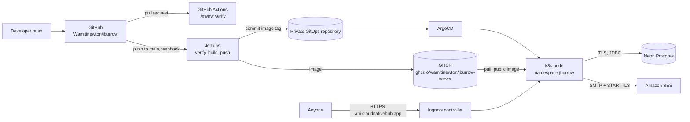
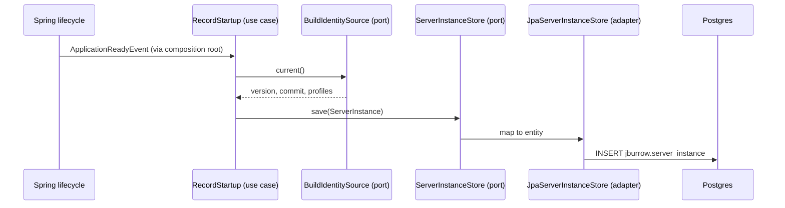

# Phase 0, Foundation: Architecture

Status: proposed design, pre-implementation. This is the first phase of `PROJECT.md` §Build
roadmap: the walking skeleton every later phase deploys on top of.

`PROJECT.md` gives phase 0 one line: a reactor, empty modules, a server answering a health check,
the image, the pipelines and the manifests, done when a push to `main` reaches a `Ready` pod with
no manual step. This document is the full design. It goes one step further than that line in a
deliberate way: the skeleton also connects to its **production database and its production mail
provider**. Neither carries a feature yet, but credentials, networking, TLS to managed services and
scale-to-zero behaviour are cheaper to discover on an empty skeleton than in phase 5 under a real
sign-up flow.

Read first: `PROJECT.md` (all of it, especially §Clean architecture rules, §CI/CD and §Production
deployment) and [ADR-0001](../adr/0001-record-architecture-decisions.md).

## Contents

- [Purpose](#purpose)
- [Goals and non-goals](#goals-and-non-goals)
- [Position in the delivery path](#position-in-the-delivery-path)
- [Runtime view](#runtime-view)
- [Module and package layout](#module-and-package-layout)
- [The reference slice](#the-reference-slice)
- [API conventions](#api-conventions)
- [Persistence](#persistence)
- [Mail](#mail)
- [Configuration](#configuration)
- [Health, lifecycle and shutdown](#health-lifecycle-and-shutdown)
- [Observability](#observability)
- [Build and packaging](#build-and-packaging)
- [Continuous integration and delivery](#continuous-integration-and-delivery)
- [Deployment shape](#deployment-shape)
- [Security](#security)
- [Testing](#testing)
- [Decisions that need an ADR](#decisions-that-need-an-adr)
- [Open questions](#open-questions)
- [Exit criteria](#exit-criteria)

## Purpose

Phase 0 builds the parts of JBurrow that every later feature will run on, and proves them in
production before any tunnel code exists:

- A Maven reactor with the six modules from `PROJECT.md` §Module catalog and layer rules that fail
  the build, not a review.
- A bootable server with its configuration model, profiles, API conventions, health groups,
  graceful shutdown, metrics and structured logs.
- A real connection to Postgres (Neon in production, a container locally) with Flyway migrations
  running on startup.
- A mail port with an SMTP adapter that sends through Mailpit locally and Amazon SES in production.
- One small vertical slice (record each server start, expose it through the API) that exercises
  every layer and every convention, so phase 1 has a working example to copy rather than a
  description to interpret.
- The container image, a GitHub Actions check for pull requests, a Jenkins pipeline for `main`, and
  the Kubernetes deployment in its final shape (host networking, `Recreate`), not a simplified one
  that phase 1 would have to rework.

## Goals and non-goals

**Goals**

- Every later phase adds features, not infrastructure. After phase 0, building and shipping
  phase 1 needs no change to the pipeline, the image, the deployment shape or the configuration
  model.
- A contributor goes from `git clone` to a running server in under five minutes with only Docker
  and a JDK installed.
- The production deployment exercises the same risky edges the finished product will: host
  networking, a managed database across the internet, an external mail provider, and a shared node.
- Nothing in either public repository reveals where or for whom it is deployed (`PROJECT.md`
  §Open source and licensing).

**Non-goals**

- No Netty, no edge listener, no protocol code. The edge port (7080) is reserved, not bound.
- No accounts, tokens, or feature tables. The only table is the reference slice's.
- No TLS inside the server, no ACME, no wildcard certificate. Phase 0 has a single API host,
  covered by the cluster's existing certificate issuer.
- No CLI behaviour beyond `jburrow version`.
- No self-hosting compose file or reference Kubernetes manifests under `deploy/`. Those land with
  self-hosted mode in v1.

## Position in the delivery path



Two systems build this code, and they are kept apart on purpose. GitHub Actions runs every pull
request, including from forks, with no secrets and no route to production. Jenkins builds only
`main`, holds the registry and GitOps credentials, and never runs code from a pull request. See
[Continuous integration and delivery](#continuous-integration-and-delivery).

## Runtime view

One JVM process, one pod. Phase 0 binds two of the three ports `PROJECT.md` defines:

| Port | Listener | Phase 0 | Reached by |
|---|---|---|---|
| 7080 | Netty edge (tunnel HTTP, control WebSocket) | reserved, not bound | phase 1 onward |
| 7090 | Spring MVC API (`/api/v1/**`, OpenAPI) | bound | ingress, `api` host |
| 7091 | Management (`/actuator/**`) | bound | kubelet probes, Prometheus, an operator on the node |

The API and management ports are separate so the management surface is never routable from the
internet, even by an ingress misconfiguration. The ingress only ever points at 7090.

Profiles:

| Profile | Used for | Datasource | Mail | Logs |
|---|---|---|---|---|
| `local` (default) | `make run`, IDE | compose Postgres on `localhost:5432` | compose Mailpit on `localhost:1025` | human-readable console |
| `test` | integration tests | Testcontainers Postgres | Testcontainers Mailpit | console |
| `prod` | the cluster | `SPRING_DATASOURCE_*` from the Secret | `SPRING_MAIL_*` from the Secret | JSON (ECS) on stdout |

`prod` has no defaults for anything that differs between deployments. A missing variable stops the
process at startup with an error that names the placeholder. Spring's binder keeps an unresolvable
placeholder as literal text, so for a validated `jburrow.*` key the error is the validation failure
showing the rejected `${NAME}`. A pod that can't find its
database URL must not start and report healthy.

## Module and package layout

All six modules exist after phase 0. Four of them are empty apart from their `package-info.java`
and the architecture test that keeps them honest:

```
jburrow/
├── pom.xml                                   parent + reactor
├── jburrow-protocol/                         (empty)
├── jburrow-server-core/                      (empty)
├── jburrow-server-api/
│   └── src/main/java/io/jburrow/server/api/
│       ├── shared/
│       │   ├── web/          ApiResponse, ErrorResponse, FieldError,
│       │   │                 ApiPrefixConfiguration, GlobalExceptionHandler
│       │   └── error/        JBurrowException, ErrorCode, NotFoundException
│       ├── instance/         the reference slice (see below)
│       │   ├── domain/       ServerInstance, InstanceId, BuildIdentity
│       │   ├── application/  RecordStartup, DescribeInstance
│       │   │   └── port/     ServerInstanceStore, BuildIdentitySource
│       │   └── adapter/
│       │       ├── persistence/  ServerInstanceEntity, ServerInstanceJpaRepository,
│       │       │                 JpaServerInstanceStore
│       │       └── web/          MetaController, MetaResponse
│       └── mail/
│           ├── domain/       EmailMessage, EmailAddress
│           ├── application/
│           │   └── port/     OutboundMail
│           └── adapter/
│               └── smtp/     SmtpOutboundMail, MailSmokeTest
│   └── src/main/resources/db/migration/V1__server_instance.sql
├── jburrow-server/
│   ├── Dockerfile
│   └── src/main/java/io/jburrow/server/
│       ├── JBurrowServerApplication.java
│       └── config/           JBurrowProperties, WebConfiguration, UseCaseConfiguration,
│                             TransactionalUseCases, BuildIdentityConfiguration
├── jburrow-client-core/                      (empty)
└── jburrow-cli/
    └── src/main/java/io/jburrow/cli/         JBurrowCli (picocli root), VersionCommand
```

`jburrow-server` is the composition root. It constructs use cases as plain objects, hands them
their port implementations, and applies transactions around the ones that need them
(`TransactionalUseCases` wraps a use case in a `TransactionTemplate`). Nothing under `domain` or
`application` carries a Spring annotation.

**The layer rules** are ArchUnit tests, written in phase 0 while there is almost nothing to
violate them, so the first violation shows up as a failed build and not as a habit:

| Rule | Checked in |
|---|---|
| `..domain..` depends only on `java..`, other `..domain..` packages and `shared.error`, which is held to the same rule | `jburrow-server`, `jburrow-cli` |
| `..application..` depends only on `java..`, its own feature's `domain`, `..application.port..` and `shared.error` | same |
| Netty types only in `..adapter.netty..`; Spring Web only in `..adapter.web..` and `shared.web`; JPA only in `..adapter.persistence..`; Jakarta Mail and Spring Mail only in `..adapter.smtp..` | same |
| A feature reaches another feature only through its `application.port` package | same |
| No cycles between `io.jburrow.server.*.*` feature slices | same |
| No `@Transactional`, `@Component`, `@Service` or `@Autowired` under `..domain..` or `..application..` | same |
| No `io.jburrow.client..` class in the server modules, and no `io.jburrow.server..` class in the client modules | Maven dependencies (structural), plus one ArchUnit rule each side |

The rules live in one `JBurrowArchitectureRules` class in `jburrow-server`'s test sources and are
applied to every `io.jburrow.server..` and `io.jburrow.protocol..` class. `jburrow-cli` holds the
client-side equivalent. Each module owns its tests, so no extra module is needed for this.

## The reference slice

Phase 0 needs at least one feature that goes through every layer. Without it the layer rules,
transactions, persistence mapping, error handling and the API envelope would all be untested
designs when phase 1 starts. The slice is small, but it is useful in operations, not just as an
example:

- **On startup**, `RecordStartup` writes a `server_instance` row: a random instance id, the build
  version, the git commit, the active profiles, and the time it started. This proves that the
  production database is reachable, that Flyway ran, and that writes commit. Over time the table
  becomes a deploy history: every start of every build, in order.
- **`GET /api/v1/meta`** returns the running instance's id, version, commit and start time through
  `DescribeInstance`. This is the public check that a deploy landed: after Jenkins finishes, the
  commit in this response is the commit that was pushed.



`ServerInstance` is a record in `domain`. `ServerInstanceEntity` is the JPA type in
`adapter.persistence` and is mapped both ways. A domain object is never annotated. The slice also
carries the one failure path every feature will need: `DescribeInstance` throws `NotFoundException`
if the current instance's row is missing (only possible if the startup write failed), and the
handler renders it as the documented `ErrorResponse`.

A failed startup write logs at `ERROR` and does not stop the process: the API stays useful for
diagnosis, and `/api/v1/meta` reports the problem as a `404` with code `INSTANCE_NOT_RECORDED`.
Readiness is not affected (see [Health, lifecycle and shutdown](#health-lifecycle-and-shutdown)).

## API conventions

The conventions `PROJECT.md` §Clean architecture rules lists, built once in `shared/`:

- **Prefix.** `jburrow.api.prefix` (default `/api/v1`) is added to every `@RestController` under
  `io.jburrow` through `WebMvcConfigurer.configurePathMatch`. A controller maps `/meta`, never
  `/api/v1/meta`.
- **Success.** `ApiResponse<T>(boolean success, String message, T data)`, built through
  `ApiResponse.ok(message, data)`. `PageResponse<T>` exists from the first paginated endpoint,
  not before.
- **Errors.** Every domain error extends `JBurrowException(ErrorCode code, String message)`.
  `ErrorCode` is an enum of stable, documented strings (`INSTANCE_NOT_RECORDED`, `VALIDATION_FAILED`,
  `INTERNAL_ERROR`), each mapped to an HTTP status. One `GlobalExceptionHandler` renders
  `ErrorResponse(boolean success, String code, String message, List<FieldError> fieldErrors,
  Instant timestamp, String path)`. A new error is a new enum constant, never a new handler. An
  unexpected exception becomes `INTERNAL_ERROR` with no stack trace or message from the exception
  in the body.
- **OpenAPI.** springdoc serves `/v3/api-docs` and `/swagger-ui.html` on the API port.

## Persistence

**Production: Neon.** A managed, serverless Postgres reached over the internet with TLS. The
server only sees a JDBC URL, a username and a password, so the provider is a deployment choice
and self-hosters can point at any Postgres. Settings that matter for Neon specifically:

- **Direct endpoint, not the pooled one.** Neon's `-pooler` host runs PgBouncer in transaction
  mode, which breaks session-level features Flyway and the JDBC driver rely on. One pod with a
  small Hikari pool doesn't need a server-side pooler.
- **`sslmode=require`** in the URL. The JDBC driver sends SNI, which Neon uses to route to the
  right endpoint.
- **Small pool that drains when idle.** `maximum-pool-size: 5`, `minimum-idle: 0`,
  `idle-timeout: 2m`, `connection-timeout: 15s`, `keepalive-time: 0`. Neon suspends compute after a
  few idle minutes. A pool that holds connections open, or a probe that queries the database every
  ten seconds, would keep compute running around the clock and use up the plan's compute
  allowance with no traffic at all. With these settings the database sleeps while nothing uses it,
  and the first query after a sleep takes a little longer while compute wakes up. The 15-second
  connection timeout covers that.
- **Region** close to the node, since every query crosses the internet.

From phase 4 the lease refresh writes every 30 seconds while a tunnel is open, so compute stays
awake while JBurrow is actually in use and sleeps when it isn't. Neon's compute usage is a
dashboard worth watching after that phase ships.

**Locally:** `postgres:17-alpine` in `docker-compose.yml`, database, user and password all
`jburrow`, with a named volume.

**Schema and migrations.** Everything lives in a `jburrow` schema, not `public`
(`spring.flyway.schemas: jburrow`, `spring.flyway.default-schema: jburrow`, Hibernate
`default_schema: jburrow`). Flyway runs on startup, before the API accepts traffic. `ddl-auto` is
`validate`, so a mismatch between an entity and the migrations fails startup, not a request.
`open-in-view` is off. Migrations are append-only: an applied migration is never edited.

```sql
-- V1__server_instance.sql
create table server_instance (
    instance_id  uuid        primary key,
    version      text        not null,
    git_commit   text        not null,
    profiles     text        not null,
    started_at   timestamptz not null
);
create index ix_server_instance_started_at on server_instance (started_at desc);
```

Migrations must stay backward compatible with the previous release. With `Recreate`, old and new
code never run at the same time, but a rollback runs old code against the new schema.

## Mail

Phase 0 builds the outbound mail port and adapter so phase 5 (email verification, password reset)
only adds templates and calls.

- **Port:** `OutboundMail.send(EmailMessage)`, where `EmailMessage` holds a recipient
  `EmailAddress`, a subject, a plain-text body and an optional HTML body. The sender is not part of
  the message: every message goes out from the configured sender, so a feature can't send as an
  arbitrary address by accident.
- **Adapter:** `SmtpOutboundMail`, on Spring's `JavaMailSender` (`spring-boot-starter-mail`). It
  builds a MIME message with `From: "<from-name>" <from-address>`, and when
  `jburrow.mail.ses-configuration-set` is set it adds the `X-SES-CONFIGURATION-SET` header so the
  production sends are tracked under their own SES configuration set. Send failures become a
  `MailDeliveryException` (a `JBurrowException`, code `MAIL_DELIVERY_FAILED`). Retrying is the
  caller's decision, made per feature in phase 5.
- **Locally:** Mailpit on `localhost:1025`, with its inbox UI at `http://localhost:8025`.
- **Production:** Amazon SES through its **SMTP interface**
  (`email-smtp.<region>.amazonaws.com:587`, STARTTLS, SMTP credentials for an IAM principal
  allowed `ses:SendRawEmail`, generated by SES or derived from an existing access key),
  sending from an address on a domain already verified in SES (DKIM, SPF and DMARC in place).
  Each deployment configures its own sender address and display name.

**Why SMTP and not the SES SDK.** One adapter covers Mailpit, SES and whatever a self-hoster uses,
the open-source server carries no AWS SDK, and SES's SMTP interface supports the parts JBurrow
needs (verified-domain sending, DKIM, configuration sets via header). If a feature ever needs
something SMTP can't express, an SES API adapter goes behind the same port. ADR-0004 records this.

**Smoke test.** `MailSmokeTest` is an `ApplicationRunner` that does nothing unless
`jburrow.mail.smoke-test-recipient` is set. When it is set, it sends one message ("JBurrow mail
check", with the version and commit) at startup and logs the outcome. An operator sets it once to
prove a new deployment's sender identity and credentials actually deliver, checks the inbox and
the message headers (DKIM pass, the expected `From`), and removes it. There is no HTTP endpoint
that sends mail. That would be one more thing to protect.

**Health.** Spring's mail health indicator (an authenticated SMTP connection check) is on and
appears under `/actuator/health`. It is deliberately excluded from readiness: an SES problem must
not take the API, and later the tunnels, out of service. Mail failures are a feature-level error,
not a reason to stop routing traffic.

## Configuration

All JBurrow-specific settings are under `jburrow.*`, bound to one `@ConfigurationProperties`
record tree (`JBurrowProperties`), `@Validated`, so a bad value fails startup with the key in the
message. Infrastructure settings use Spring's own keys, so they can be set through the
environment with Spring's standard names.

| Key | Environment variable | Default (`local`) | `prod` |
|---|---|---|---|
| `spring.datasource.url` | `SPRING_DATASOURCE_URL` | `jdbc:postgresql://localhost:5432/jburrow` | required |
| `spring.datasource.username` | `SPRING_DATASOURCE_USERNAME` | `jburrow` | required |
| `spring.datasource.password` | `SPRING_DATASOURCE_PASSWORD` | `jburrow` | required |
| `spring.mail.host` | `SPRING_MAIL_HOST` | `localhost` | required |
| `spring.mail.port` | `SPRING_MAIL_PORT` | `1025` | required |
| `spring.mail.username` | `SPRING_MAIL_USERNAME` | (none) | required |
| `spring.mail.password` | `SPRING_MAIL_PASSWORD` | (none) | required |
| `jburrow.mail.from-address` | `JBURROW_MAIL_FROM_ADDRESS` | `no-reply@jburrow.localhost` | required |
| `jburrow.mail.from-name` | `JBURROW_MAIL_FROM_NAME` | `JBurrow` | `JBurrow` |
| `jburrow.mail.ses-configuration-set` | `JBURROW_MAIL_SES_CONFIGURATION_SET` | (none) | optional |
| `jburrow.mail.smoke-test-recipient` | `JBURROW_MAIL_SMOKE_TEST_RECIPIENT` | (none) | optional, set temporarily |
| `jburrow.api.prefix` | `JBURROW_API_PREFIX` | `/api/v1` | `/api/v1` |
| `server.port` | `SERVER_PORT` | `7090` | `7090` |
| `management.server.port` | `MANAGEMENT_SERVER_PORT` | `7091` | `7091` |

`prod` also sets `spring.mail.properties.mail.smtp.auth=true`,
`mail.smtp.starttls.enable=true`, `mail.smtp.starttls.required=true`, and connection, read and
write timeouts of 10 seconds, so a slow SMTP host can't hang a request thread indefinitely.

No secret appears in a tracked file. `application.yaml` and `application-prod.yaml` hold
placeholders only. Real values come from the environment, which in the cluster comes from one
Kubernetes Secret.

## Health, lifecycle and shutdown

Actuator runs on the management port with `health`, `info` and `prometheus` exposed. Health
details are shown, because the port is never reachable from outside the node.

| Group | Contains | Used by |
|---|---|---|
| `liveness` | `livenessState` | kubelet liveness probe |
| `readiness` | `readinessState` only | kubelet readiness probe |
| (all) | adds `db`, `mail`, `diskSpace` | operators, `curl localhost:7091/actuator/health` on the node |

The database is not in readiness, for two reasons. A Neon suspend or a short network problem
shouldn't take the API out of service when most requests (and in later phases, all tunnel traffic)
don't touch the database. And a readiness probe running a query every ten seconds would keep Neon
compute awake permanently. Database reachability is still enforced where it matters: Flyway runs at
startup, so a pod that can't reach the database never becomes ready the first time.

Startup is covered by a `startupProbe` (up to two minutes) so liveness never kills a slow first
start.

Shutdown is graceful: `server.shutdown: graceful`,
`spring.lifecycle.timeout-per-shutdown-phase: 20s`, a 5-second `preStop` sleep so the ingress
stops sending traffic before the server stops accepting it, and
`terminationGracePeriodSeconds: 30`. Phase 4 adds tunnel draining to this same lifecycle (`GOAWAY`
to clients, in-flight streams allowed to finish).

## Observability

- **Metrics:** Micrometer with the Prometheus registry at `/actuator/prometheus`, with common tags
  `application=jburrow-server` and `instance=<instance id>`. Phase 0 exports what Boot provides
  (JVM, HTTP server, Hikari, Tomcat) plus one JBurrow metric to prove the naming convention,
  `jburrow_build_info{version,commit}` = 1. The pod carries `prometheus.io/scrape`, `/port` and
  `/path` annotations so a Prometheus that discovers pods by annotation scrapes it with no
  configuration change.
- **Logs:** Spring Boot's structured logging, ECS format, on stdout in `prod`
  (`logging.structured.format.console: ecs`), with `service.name`, `service.version` and the
  instance id (`service.node.name`) on every line. Human-readable logs in `local`. The instance id
  is drawn into the environment by an `EnvironmentPostProcessor` before logging starts, rather
  than put in MDC, so lines from every thread carry it, and the `InstanceId` bean reads the same
  value.
- **What is never logged:** passwords, SMTP credentials, the datasource password, message bodies.
  Email recipients are logged masked (`j***@example.com`).
- **Build identity:** `spring-boot-maven-plugin`'s `build-info` goal and
  `git-commit-id-maven-plugin` write `build-info.properties` and `git.properties`. The commit
  also goes into `build-info.properties` as `build.commit`, from the `jburrow.git.commit` Maven
  property, which defaults to the git plugin's abbreviated commit and is overridden with `-D` in
  the image build, whose context has no `.git`. `build-info.properties` alone feeds
  `/api/v1/meta`, the metric above and the startup log line, so a container and a local build
  report the commit the same way; `git.properties` only adds detail to `/actuator/info` when it
  exists.

## Build and packaging

- **Reactor:** one parent POM, parented to `spring-boot-starter-parent` (4.1.x), Java 21, all
  plugin and dependency versions pinned in `<properties>` and `<dependencyManagement>`. Module
  POMs carry no versions.
- **Quality gates bound to `verify`:** Spotless (Palantir Java Format), Surefire for `*Test`,
  Failsafe for `*IntegrationTest`, ArchUnit through the tests, the Maven Enforcer plugin
  (dependency convergence, Java 21, Maven 3.9+, banned `junit:junit` and `commons-logging`
  before 1.3; Spring Framework 7 depends on 1.3, which routes to SLF4J).
  SpotBugs with FindSecBugs and OWASP Dependency-Check sit behind a `security` profile, as in
  Pallet, because the dependency-check database download is too slow for every build.
- **Image:** a multi-stage `jburrow-server/Dockerfile`. The build stage runs `./mvnw -pl
  jburrow-server -am package -DskipTests` with a BuildKit cache mount for `~/.m2`. The runtime
  stage is `eclipse-temurin:21-jre`, extracts Spring Boot's layers (`-Djarmode=tools extract
  --layers --launcher`) so dependency layers are cached between builds, runs as a non-root user
  (uid 10001), sets `TZ=UTC`, exposes 7090 and 7091, and has no `HEALTHCHECK` since Kubernetes
  probes do that job. It carries `org.opencontainers.image.source=https://github.com/Wamitinewton/jburrow`,
  which links the GHCR package to the repository, plus `revision` and `version` labels. The
  commit comes in as the `GIT_COMMIT` build argument (see Build identity). The POM version is
  not overridden at build time; `VERSION` only sets the `version` label, and `make image` reads
  it from the root POM. `.dockerignore` keeps `.git`, `target`, IDE and agent settings,
  `docs/workflows`, `DEPLOY.md` and env files out of the build context, so nothing private can
  reach a layer of the public image.
- **JVM flags** come from the deployment, not the image: `-XX:MaxRAMPercentage=75.0
  -XX:+ExitOnOutOfMemoryError`.
- **CLI:** `jburrow-cli` builds a runnable fat JAR in phase 0 (`java -jar jburrow-cli.jar version`).
  Native images arrive in v1.

## Continuous integration and delivery

**GitHub Actions (`.github/workflows/verify.yml`)** runs on every pull request and every push to
`main`: checkout, Temurin 21 with the Maven cache, `./mvnw -B verify`. Docker is available on the
hosted runner, so the Testcontainers suites run there too. Permissions are `contents: read`, no
secrets are referenced, and third-party actions are pinned to commit SHAs, kept current by
Dependabot. A second job, `image`, builds the server image from `jburrow-server/Dockerfile` after
`verify` passes and never pushes it, so a broken Dockerfile fails on the pull request rather than on
Jenkins. A fork's pull request gets the same checks as a maintainer's and can't reach anything else
([ADR-0005](../adr/0005-ci-trust-boundary-public-repository.md)).

**Jenkins (`Jenkinsfile`)** builds `main` only:

1. Validate the job parameters (below), then check out, refuse any branch other than `main`, and
   record the short commit SHA.
2. `./mvnw -B verify` in `maven:3.9-eclipse-temurin-21`, with the Docker socket mounted for
   Testcontainers. JUnit reports published.
3. `docker build` in a Docker CLI container that ships buildx (the Dockerfile needs BuildKit,
   and an agent's own CLI may not have it), then push
   `${IMAGE_REPOSITORY}:${BUILD_NUMBER}-${SHORT_SHA}` and `${IMAGE_REPOSITORY}:main`, logging in
   with `REGISTRY_CREDENTIALS_ID` under a per-build `DOCKER_CONFIG` so the login never touches
   the agent's shared Docker configuration.
4. Clone `GITOPS_BRANCH` of `GITOPS_REPO_URL` with `GITOPS_CREDENTIALS_ID`, replace the image tag
   on every `image:` line for `${IMAGE_REPOSITORY}` in `GITOPS_MANIFEST_PATH`, commit as
   `GITOPS_COMMIT_NAME` / `GITOPS_COMMIT_EMAIL` with the message `ci: deploy jburrow-server ${tag}`,
   and push, rebasing and retrying if another pipeline pushed first. A manifest with no matching
   `image:` line fails the build instead of passing without deploying. The token reaches git through
   a credential helper, never the clone URL.

The values in capitals are Jenkins **job parameters**, configured on the job, not in the file. The
pipeline's first stage checks that each one is non-empty and fails with the missing name otherwise.
The Jenkinsfile declares no `parameters {}` block: a declared block would replace the job's
configured defaults on the first run. Shell steps that see a secret are single-quoted, so Groovy
never interpolates one into a command line. Nothing about the deployment target appears in the
repository.

## Deployment shape

The generic shape. A real deployment's hostnames, secrets and cluster details live with that
deployment, not here.

| Resource | Phase 0 shape |
|---|---|
| Namespace | `jburrow` |
| Deployment | `replicas: 1`, `strategy: Recreate`, `hostNetwork: true`, `dnsPolicy: ClusterFirstWithHostNet`, `terminationGracePeriodSeconds: 30`, container ports 7090 and 7091 |
| Resources | requests `100m` CPU / `384Mi`, limits `1` CPU / `1Gi` |
| Probes | startup, liveness and readiness on `7091`, `/actuator/health/{liveness,readiness}` |
| Environment | `SPRING_PROFILES_ACTIVE=prod`, `JAVA_TOOL_OPTIONS`, everything else from one Secret via `envFrom` |
| Service | ClusterIP, port 80 to 7090 |
| Ingress | the API host to the Service, TLS from the cluster's existing HTTP-01 issuer |
| Image pull | public image, no pull secret |

**Why host networking already.** Phase 1 needs it for the TCP tunnel port range (`PROJECT.md`
§Production deployment). Adopting it in phase 0 means the risky parts are discovered now, on a
skeleton with no users: the firewall must let the ingress controller's pod network reach 7090
and Prometheus reach 7091 on the node's address. The chosen ports must also be free on the host,
and `Recreate` must work with a single pod. Phase 1 then only adds a port to the container and a
firewall rule.

**Firewall rule this needs:** allow the cluster's pod CIDR to TCP 7090 and 7091 on the node. Do
not open those ports to the internet. The deployment's own runbook has the exact command.

## Security

- No secrets in the repository, the image, or the build log. Jenkins masks credentials, and the
  `prod` profile only references environment variables.
- The management port is unreachable from the internet by design (not in the Service, not in the
  ingress, closed in the host firewall).
- The container runs as non-root with a read-only root filesystem (`/tmp` is an `emptyDir`), no
  added capabilities, and `allowPrivilegeEscalation: false`. Host networking doesn't need
  privileges for ports above 1024.
- The production SMTP credential can only send, and only as the configured sender address
  (enforced with an IAM policy condition on `ses:FromAddress`).
- The database role owns only the `jburrow` schema in its own database.
- Pull requests from forks never run on infrastructure that holds credentials.

## Testing

| Test | Kind | Proves |
|---|---|---|
| `JBurrowArchitectureTest` (server), `ClientArchitectureTest` (cli) | ArchUnit, `*Test` | the layer rules, on the real classes and on a fixture class that breaks each rule (the fixture must fail) |
| `ServerInstanceTest`, `RecordStartupTest`, `DescribeInstanceTest` | unit | domain invariants; use cases against in-memory port implementations |
| `GlobalExceptionHandlerTest` | `@WebMvcTest` slice | each `ErrorCode` renders its status and body; an unexpected exception leaks no message |
| `JBurrowPropertiesTest` | unit (binder) | invalid values fail with the key named |
| `ServerInstancePersistenceIntegrationTest` | Testcontainers Postgres | Flyway applies on an empty database, the entity round-trips, `ddl-auto: validate` passes |
| `JBurrowServerApplicationIntegrationTest` | full context, Testcontainers Postgres + Mailpit | startup writes a row; `GET /api/v1/meta` returns it in the envelope; management port answers health; API port does not serve `/actuator` |
| `SmtpOutboundMailIntegrationTest` | Testcontainers Mailpit | a message arrives with the configured `From`, subject, both bodies, and the configuration-set header when set; a refused connection becomes `MailDeliveryException` |
| `MailSmokeTestTest` | unit | sends nothing unless the recipient is set |
| `VersionCommandTest` | unit | `jburrow version` prints the build version and commit |

Containers are shared per test JVM (a single `@TestConfiguration` with `@ServiceConnection`
beans), so the integration suite pays the container startup once.

## Decisions that need an ADR

Written during phase 0, each in the checkpoint that first depends on it:

| ADR | Decision |
|---|---|
| 0002 | One deployable, one Maven reactor, hexagonal feature modules with ArchUnit-enforced layers |
| 0003 | Managed Postgres (Neon) in production, configured for scale-to-zero, with the database kept out of readiness |
| 0004 | Outbound mail through SMTP behind a port; Amazon SES's SMTP interface in production, Mailpit locally |
| 0005 | CI trust boundary for a public repository: GitHub Actions verifies pull requests with no secrets, Jenkins builds and deploys `main` only, and deployment details are job parameters |

## Open questions

- **DNS for phase 3.** The API host is `api.cloudnativehub.app`. Phase 0 only needs that one
  `A` record and the cluster's HTTP-01 issuer, so the domain's DNS can stay at its registrar
  (Name.com) for now. Wildcard certificates in phase 3 need DNS-01, which cert-manager can't do
  against Name.com, so the nameservers move to Cloudflare before then.
- **Sender domain.** Production mail initially goes out from a domain that is already verified in
  SES. `cloudnativehub.app` should get its own SES identity before public sign-up, and the sender
  address then becomes a configuration change.
- **Neon plan.** Phase 0's idle behaviour fits a free plan. From phase 4, lease refreshes keep
  compute awake while tunnels are open. Revisit the plan when real usage exists.

## Exit criteria

Phase 0 is done when all of these hold, on the production cluster:

- [ ] A push to `main` produces, with no manual step: a green Jenkins build, a new image tag in
      GHCR, a commit in the GitOps repository, an ArgoCD sync, and a new pod `1/1 Running`.
- [ ] `https://api.cloudnativehub.app/api/v1/meta` returns the pushed commit's SHA in the `ApiResponse`
      envelope.
- [ ] A new `server_instance` row exists in Neon for that start.
- [ ] `curl localhost:7091/actuator/health` on the node shows `db` and `mail` `UP`.
- [ ] A smoke-test email from the production sender arrives with DKIM passing, and the smoke-test
      setting is removed afterwards.
- [ ] Prometheus shows the `jburrow-server` target as up with `jburrow_build_info` present.
- [ ] Neon compute suspends after a few idle minutes while the pod keeps running and stays
      `Ready`.
- [ ] A pull request opened from a fork runs the GitHub Actions check and nothing else.
- [ ] `git grep` across the repository finds no hostname, IP address, organization or repository
      name that belongs to the deployment.
- [ ] ADR-0002 to ADR-0005 are written and indexed.
