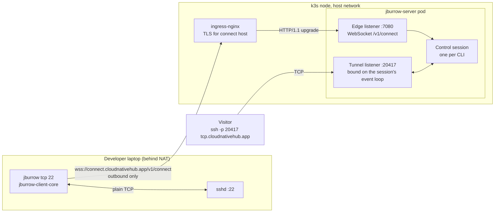
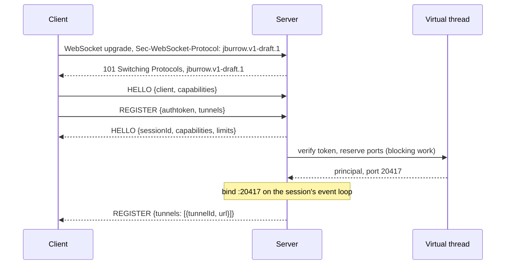

# Phase 1, TCP Tunnel: Architecture

Status: implemented; phase 1 is complete and runs in production. Second phase of `PROJECT.md` §Build
roadmap, built on the phase 0 walking skeleton.

`PROJECT.md` gives phase 1 one line: `jburrow-protocol` with `HELLO`, `REGISTER`, `OPEN`, `DATA`,
`CLOSE`; the control WebSocket; `jburrow tcp <port>` with a static token; the native-image check on
pull requests; done when `ssh -p <port> tcp.cloudnativehub.app` reaches a laptop behind NAT. This
document is the full design.

Phase 1 is where the **wire protocol** is designed, and the protocol is the one part of JBurrow
that third parties will build against. A mistake in the frame layout, the versioning scheme or the
error model is either carried for ever or fixed with a breaking change. So this phase specifies
the protocol completely, byte by byte, including the frame types later phases will use, in
[`docs/protocol.md`](../protocol.md); §The wire protocol below explains its shape. This document
specifies the phase 1 server and client that implement it. The parts of the protocol that phases 2
to 4 add (flow control, HTTP response heads, drain) get their frame type numbers here and their
behaviour in those phases' own designs. Nothing in this phase's frame layout has to change for them.

Read first: `PROJECT.md` (all of it, especially §Architecture overview, §The wire protocol, §Module
catalog and §Clean architecture rules), [`docs/phase-0-foundation/ARCHITECTURE.md`](../phase-0-foundation/ARCHITECTURE.md)
(the server, configuration, observability and deployment this phase extends), and
[ADR-0002](../adr/0002-single-deployable-hexagonal-modules.md) and
[ADR-0006](../adr/0006-cli-distribution-native-binaries.md).

## Contents

- [Purpose](#purpose)
- [Goals and non-goals](#goals-and-non-goals)
- [Where this phase departs from PROJECT.md](#where-this-phase-departs-from-projectmd)
- [Runtime view](#runtime-view)
- [The wire protocol](#the-wire-protocol)
  - [Transport](#transport)
  - [Versioning and evolution](#versioning-and-evolution)
  - [Frame layout](#frame-layout)
  - [Frame types](#frame-types)
  - [Control payloads](#control-payloads)
  - [Session lifecycle](#session-lifecycle)
  - [Streams](#streams)
  - [Liveness](#liveness)
  - [Errors](#errors)
  - [Receiver rules](#receiver-rules)
  - [Protocol limits](#protocol-limits)
  - [Specification and conformance vectors](#specification-and-conformance-vectors)
- [Module and package layout](#module-and-package-layout)
- [Concurrency model](#concurrency-model)
- [The edge listener](#the-edge-listener)
- [Control sessions](#control-sessions)
- [TCP tunnels](#tcp-tunnels)
- [The data path](#the-data-path)
- [Backpressure in phase 1](#backpressure-in-phase-1)
- [Authentication in phase 1](#authentication-in-phase-1)
- [Admission and limits](#admission-and-limits)
- [Lifecycle and shutdown](#lifecycle-and-shutdown)
- [The client](#the-client)
- [The CLI](#the-cli)
- [Layer rules](#layer-rules)
- [Configuration](#configuration)
- [Observability](#observability)
- [Memory budget](#memory-budget)
- [Security and threat model](#security-and-threat-model)
- [Failure modes](#failure-modes)
- [Testing](#testing)
- [Build, CI and packaging](#build-ci-and-packaging)
- [Deployment changes](#deployment-changes)
- [Decisions that need an ADR](#decisions-that-need-an-adr)
- [Extension points](#extension-points)
- [Open questions](#open-questions)
- [Exit criteria](#exit-criteria)

## Purpose

Phase 1 turns the skeleton into a tunnel. At the end of it:

- A developer runs `jburrow tcp 22` on a laptop behind NAT and gets back
  `tcp://tcp.cloudnativehub.app:20417`. Anyone who connects to that address reaches the laptop's
  SSH daemon, through one outbound WebSocket the CLI opened.
- The wire protocol is specified, versioned and fuzzed, with conformance vectors a third-party
  client can test against.
- The byte path has a concurrency model, a buffer ownership discipline and a memory bound that
  every later phase keeps. Phase 2 adds multiplexing to it and phase 3 adds HTTP; neither changes
  how a byte gets from a socket to a frame.
- The CLI builds as a GraalVM native binary on every pull request (ADR-0006), now that Netty is in
  the client.

## Goals and non-goals

**Goals**

- A protocol that is unambiguous: for every byte sequence a peer can receive, this document says
  whether it is valid and, if not, which error it produces. No behaviour is left to the
  implementation.
- Fail closed. Anything a receiver doesn't understand is an error, never silently skipped, because
  extensions are negotiated, not guessed.
- Bytes are never copied on the server's relay path, and every buffer has exactly one owner.
- Memory per session is bounded by configuration, not by how fast a visitor sends or how slowly a
  client reads.
- A half-closed TCP connection behaves the same through the tunnel as it does directly (`shutdown`
  of one direction, reset propagation).
- A dead client is noticed within the idle timeout, and its port is released.
- The session engine and the protocol rules are testable without sockets, Spring or a database.

**Non-goals**

- More than one concurrent stream per session. That is phase 2, together with flow control. Phase
  1 is correct with one stream and refuses a second (see [Backpressure in phase 1](#backpressure-in-phase-1)).
- HTTP tunnels, subdomains, host routing and the wildcard certificate (phase 3).
- Reconnect, resume tokens, `GOAWAY` and drain (phase 4). In phase 1, a lost connection ends the
  CLI with a clear message and a distinct exit code.
- Accounts, real authtokens, reservations and leases (phase 5). Phase 1 authenticates with static
  tokens from configuration.
- Per-IP rate limits and the admin API (phase 6). Phase 1 has global and per-token caps only.
- HTTP proxy support in the CLI (`HTTPS_PROXY`), IPv6 tunnels, compression of any kind.

## Where this phase departs from PROJECT.md

Two pieces move forward from later phases, because phase 1 deploys to a public IP that real
people will use, and without them it would leak resources or memory:

| Moved into phase 1 | From | Why it can't wait |
|---|---|---|
| `PING`/`PONG` and idle detection | phase 4 | A laptop that sleeps or loses Wi-Fi leaves a half-open TCP connection. Without liveness, the server keeps that session and its public port for ever, and the port pool drains a port at a time. Reconnect, resume and `GOAWAY` stay in phase 4. |
| Session-level writability backpressure | phase 2 | Without it, a fast visitor and a slow client fill the server's direct memory with queued frames. With one stream per session it is the complete backpressure mechanism; phase 2 adds per-stream credit windows on top. |

Three details of `PROJECT.md` §The wire protocol are refined:

- The **protocol version is negotiated in the WebSocket subprotocol**, not in `HELLO`. `HELLO`
  carries capabilities and limits. See [Versioning and evolution](#versioning-and-evolution).
- **`CLOSE` has a fixed payload format**: empty for a half-close, an ASCII error code for a reset.
  `DATA` has no flags.
- **Protocol error codes live in `jburrow-protocol`**, in their own enum, sharing one code space
  with the REST `ErrorCode` by rule rather than by sharing a class. See [Errors](#errors).

`PROJECT.md`'s build roadmap entries for phases 1, 2 and 4 and its wire protocol section are updated
in the same change as this document.

## Runtime view

Phase 1 binds the third port phase 0 reserved, and the TCP tunnel range:

| Port | Listener | Phase 1 | Reached by |
|---|---|---|---|
| 7080 | Netty edge: the control WebSocket at `/v1/connect` | bound | ingress, `connect` host |
| 7090 | Spring MVC API | bound (unchanged) | ingress, `api` host |
| 7091 | Management | bound (unchanged) | probes, Prometheus |
| 20000–20999 | TCP tunnel listeners, one per active tunnel | bound on demand | anyone on the internet |

Locally the tunnel range is `21000–21099` and the connect URL is `ws://localhost:7080/v1/connect`.



The CLI only ever makes an outbound connection, so it works from behind NAT and most firewalls. The
visitor connects straight to the node: an ingress controller can't route an arbitrary TCP port, and
`hostNetwork` (phase 0) lets the server bind the port on the node directly.

## The wire protocol

[`docs/protocol.md`](../protocol.md) is the normative specification of `jburrow.v1-draft.1` and
the authority on the wire. This section keeps the reasoning behind the protocol's shape and the
notes that concern JBurrow's implementation rather than the wire. Every normative rule and table
lives only in the specification, linked from the subsection that discusses it.
[ADR-0007](../adr/0007-wire-protocol-v1.md) records the decisions.

### Transport

Specified in [protocol.md §3](../protocol.md#3-transport): the connect URL, the client's TLS
requirements, the upgrade request and the order in which the server checks it, the refused-upgrade
JSON, and the rule of one frame per binary WebSocket message.

**Why WebSocket on 443.** It gets through networks that block unusual ports and through
TLS-inspecting corporate proxies, it reuses the cluster's ingress and certificates, and Netty has a
mature implementation on both sides. Its cost is a few bytes of framing per message and client-side
masking. The frame keeps its own length field so a raw TCP+TLS transport can be added later with
the same codec ([Extension points](#extension-points)).

**Why the transport refuses so much.** `permessage-deflate` is never negotiated because compressing
attacker-chosen bytes in the same context as a secret (the authtoken) is the CRIME/BREACH pattern,
and tunnel payloads are often already compressed or encrypted. An upgrade carrying `Origin` is
refused because browsers always send one and the CLI never does, so no web page can turn a browser
into a tunnel client. The client offers only ALPN `http/1.1` because offering `h2` could let the
ingress negotiate HTTP/2, where WebSocket needs RFC 8441 support the path doesn't have. And
liveness uses protocol `PING`/`PONG` frames rather than WebSocket pings, so it works the same over a
future transport without WebSocket.

### Versioning and evolution

Specified in [protocol.md §4](../protocol.md#4-versioning-and-capabilities). The protocol evolves
on two levels, the same split HTTP/2 uses between ALPN and `SETTINGS`: the major version is the
WebSocket subprotocol and names the framing and the semantics, and within a version change is
additive and negotiated through capabilities in `HELLO`. A version mismatch therefore fails the
upgrade with a clear error before any frame is exchanged, and a new optional JSON field needs no
negotiation at all.

Until JBurrow v1.0.0 the token carries a draft number, and phases 2 to 4 each expect to bump it
once. Before v1.0.0 the server accepts exactly the draft it implements, and a client of a different
draft gets `UNSUPPORTED_PROTOCOL_VERSION` with the list of supported tokens, which the CLI turns
into "this server speaks protocol draft 2; upgrade jburrow". That is honest about what a draft is:
an old CLI and a new server are not expected to work together until the protocol is frozen.

A future raw TCP transport replaces the subprotocol with a fixed connection preface (as HTTP/2's
`PRI * HTTP/2.0` preface does), naming the same version string.

### Frame layout

Specified in [protocol.md §5](../protocol.md#5-frame-format). Ten bytes rather than HTTP/2's nine:
a 32-bit length is `PROJECT.md`'s layout, and a byte per frame is noise next to a 64 KiB payload.
The length field is redundant inside a WebSocket message but required for a stream transport
later, and checking that it agrees with the message length catches truncation and framing bugs
early. The reserved bit is kept for client-initiated streams in a later version.

### Frame types

Specified in [protocol.md §6](../protocol.md#6-frame-types), with the registry and an example of
every frame type this draft sends.

- **Every assigned type is decoded from the first draft**, including `HEADERS`, `WINDOW_UPDATE` and
  `GOAWAY`, which `jburrow.v1-draft.1` reserves for phases 2 to 4, so the fuzzer covers the whole
  frame grammar from the start. `WINDOW_UPDATE`'s payload is fixed now; `HEADERS` and `GOAWAY` get
  their payloads in phases 3 and 4. A draft 1 session treats receiving any of the three as
  `PROTOCOL_ERROR`, because no peer of this draft may send them.
- **An empty `DATA` frame is an error**: it means nothing, and allowing it would let a peer make
  the other side do work for free. The 64 KiB cap keeps one large write from holding the
  connection, and it is the largest read the relay ever makes, so one socket read is exactly one
  frame.
- **Every stream ends with `CLOSE`.** A `FIN` flag on `DATA` would save one frame per stream but
  give two encodings for the same event. `CLOSE` has a fixed payload: empty for a half-close, a
  registered stream-scope code for a reset, so a peer can't invent codes.

### Control payloads

Specified in [protocol.md §7](../protocol.md#7-control-payloads): the encoding rules, the field
conventions, and a field table and an example for each payload.

**Why strict JSON.** JSON keeps the protocol readable in a packet capture while it changes every
phase. Strictness keeps it a contract: nothing is coerced, `null` is never valid for a known field,
duplicate keys and trailing content are rejected, and the parser limits apply to the whole document,
ignored values included. Ignoring unknown keys is the one leniency, and it is what lets a later draft
add an optional field without a version bump. Errors name the field by its path and never quote the
payload, since a payload may hold the authtoken.

**Why the payloads carry what they carry.** The client's local target is not part of `REGISTER`:
the server never needs it, and a tunnel owner's internal addresses are none of the server's
business. The server sends `limits` rather than hard-coding them, so an operator can tune a server
and phase 2 can raise `maxConcurrentStreams` without a protocol change. `ERROR` has a code for
programs and a message for people, and a client decides on the code alone.

**Notes on the reference parser** (`ControlJson`, `WireValueModule`, the records in
`io.jburrow.protocol.control`):

- Strict UTF-8, the byte order mark and `0x00` bytes are checked before Jackson sees the payload.
  Jackson's byte parser accepts overlong sequences, skips a byte order mark, and switches to UTF-16
  or UTF-32 when it finds a zero byte near the start.
- The specification's units for the parser limits are Jackson's: string lengths in UTF-16 code
  units, key lengths in UTF-8 bytes, number lengths as the digits of the integer part, fraction and
  exponent together, and nesting with the top-level object as level 1. The specification states
  them exactly, so another implementation can match them.
- The payload is read twice. The first pass reads every token and materializes every string, so
  the syntax rules and parser limits hold for the whole payload before any field is bound. Jackson
  measures a skipped string (the value of an unknown key) only when its recycled text buffer has to
  grow, so without this pass a long string in one payload let a later payload pass an over-long
  string through an ignored key. The second pass binds the records, which validate themselves in
  their constructors as they are bound, so between a wrong JSON type and a field rule the
  specification leaves the reported code open. Both end the session, and a second validation pass
  would buy nothing.

### Session lifecycle

Specified in [protocol.md §8](../protocol.md#8-sessions): the states, the frame ordering table,
the handshake deadline, registration and closing.

**Pipelining.** The client sends `REGISTER` right behind `HELLO` without waiting for the server's
`HELLO`, which makes session setup one round trip after the WebSocket upgrade, the same idea as TLS
1.3's 1-RTT handshake and HTTP/2's connection preface. The server processes stream 0 in order, so
a `HELLO` it rejects discards the `REGISTER` behind it.

On the server, the blocking part of registration runs off the event loop
([Concurrency model](#concurrency-model), [Control sessions](#control-sessions)):



**The handshake deadline covers token verification**, so a slow verifier (Postgres from phase 5)
can't hold a connection open. The server's default is 10 seconds (`jburrow.edge.handshake-timeout`).

### Streams

Specified in [protocol.md §9](../protocol.md#9-streams): stream ids, the state machine and its
complete event table, closed versus never-opened ids, opening, and the mapping to TCP.
`StreamLifecycle` in `jburrow-protocol` is that table, shared by both sides.

- **Frames for a closed stream are discarded silently.** After a reset, frames the peer sent
  before it learned of the reset are still arriving, and treating them as errors would turn every
  reset into a session failure.
- **Opening is optimistic**, as in HTTP/2 and yamux: the server sends the visitor's bytes right
  behind `OPEN` without waiting for the client to connect locally, which saves a round trip per
  connection. The client holds those bytes, bounded ([The client](#the-client)).
- **Half-closure is preserved**, so `ssh`, `nc -N` and anything else that closes one direction first
  behaves the same through the tunnel as directly.
- **Stream ids run out after `2^31 - 1` `OPEN`s**, 24 days at one new connection per millisecond.
  Phase 1 ends the session with `INTERNAL_ERROR`; phase 4 replaces that with a `GOAWAY` so the client
  reconnects instead.

### Liveness

Specified in [protocol.md §11](../protocol.md#11-liveness). `Liveness` in `jburrow-protocol`
implements the rules for both sides.

- **Every frame received is proof of life**, not only `PONG`, so a busy session never needs a
  `PING`.
- **Paused reading pauses the clock.** Without this rule, a visitor that stops reading (an SSH
  client suspended with Ctrl-Z) would make the server stop reading the client, never see the
  client's `PONG`, and kill a healthy session.
- **A paused side keeps pinging.** Pausing the clock alone only moves the failure: the peer, still
  reading, hears nothing and ends the session after the idle timeout. A local service that stops
  reading makes the client pause, and the server drops it; a visitor that stops reading makes the
  server pause, and the client drops it. So a paused side sends a `PING` every ping interval, which
  the peer counts as proof of life. `SlowReaderIntegrationTest` found this, with a stall twice the
  idle timeout in each direction. The paused side still can't notice its peer dying until it reads
  again, which is what the visitor or local service it waits on decides.
- **15 and 45 seconds** match `PROJECT.md` §The life of a tunnel, and keep the connection well
  inside ingress and NAT idle timeouts, which are minutes at the shortest. The server announces them
  in its `HELLO` (`jburrow.edge.ping-interval`, `jburrow.edge.idle-timeout`) instead of both sides
  hard-coding them.
- **`PING`s are rate-limited** (burst 5, one per second sustained, `PING_RATE_EXCEEDED` beyond),
  because every `PING` forces a write, and an unlimited rate is a cheap way to make the server work.

### Errors

Specified in [protocol.md §12](../protocol.md#12-errors): where codes appear, the registry with
each code's scope, upgrade status and close code, and the rules for using them.
`io.jburrow.protocol.wire.ErrorCode` is the registry in code, and `ErrorCodeTest` checks it against
the table row for row. Every new code is a constant there and a row in the specification's registry.

The WebSocket close code is advisory, for intermediaries and logs, and a peer decides on the
`ERROR` code alone, because intermediaries may rewrite or drop close frames. A released code is
never renamed or given a new meaning. Later phases add codes (`FLOW_CONTROL_ERROR` in phase 2,
`TOKEN_REVOKED` in phase 5, and so on).

**One code space, two enums.** `PROJECT.md` requires protocol errors and REST errors to share one
code space, so `TOKEN_REVOKED` means the same thing in an `ERROR` frame and a REST response. The
REST `ErrorCode` lives in `jburrow-server-api`, which a client may never see, so the protocol needs
its own enum in `jburrow-protocol`. The shared space is enforced by a test in `jburrow-server`
(which sees both): the names the two enums have in common must be exactly a declared set, today
`NOT_FOUND`, `VALIDATION_FAILED` and `INTERNAL_ERROR`. Adding a code that collides with the other
enum fails the build until someone decides whether it is the same error (add it to the set) or a
different one (rename it).

### Receiver rules

Specified in [protocol.md §13](../protocol.md#13-receiver-rules): nine ordered steps, each with its
error. The order guarantees the decoder never allocates or parses anything a bad header could make
expensive, and it makes the code a broken message produces deterministic, which is what lets the
conformance vectors name one expected code.

Steps 1 to 8 depend only on the bytes and are `FrameCodec`'s job (with `WebSocketFrameDecoder`
refusing text messages); the direction check is part of step 4, so a frame type the peer's role
never sends fails in the codec, before any session sees it. Step 9 is the session's job.

### Protocol limits

Specified in [protocol.md §14](../protocol.md#14-limits). The values the server announces and
enforces come from [Configuration](#configuration); the rest are fixed by the protocol and live in
`FrameLimits`, `ControlJson` and the control records.

### Specification and conformance vectors

- **`docs/protocol.md`** is the normative specification, with a change log of draft numbers
  numbered by section. Its examples are generated by the codec, not typed:
  `ProtocolDocumentExamplesTest` encodes each example's frame and compares it with the hex between
  the document's `<!-- example:<name> -->` markers, decodes the hex back, and checks the JSON shown
  with a control frame against its payload. The document can't drift from the codec.
- **Conformance vectors** live in `jburrow-protocol/src/test/resources/io/jburrow/protocol/vectors/`
  as JSON files: each vector is a hex-encoded WebSocket message and either the decoded frame it must
  produce or the error code it must raise. `ConformanceVectorsTest` runs every vector, and
  `docs/protocol.md` §15 links to the files so a third-party implementation can run the same ones. A
  bug found by the fuzzer or in production becomes a vector.
- **Changing the protocol** starts in `docs/protocol.md`: the rule, a change-log row (and a draft
  bump if the change is wire-incompatible), then the code, the vectors and the seed corpus in the
  same change.

## Module and package layout

Phase 1 fills three of the four empty modules and adds two features to `jburrow-server-api`.

```
jburrow-protocol/                      io.jburrow.protocol
├── wire/        FrameType, FrameFlags, FrameLimits, StreamIds, ErrorCode, ErrorScope,
│                ProtocolException, ProtocolVersion (subprotocol tokens)
├── control/     Hello, ClientInfo, ServerHello, ServerInfo, SessionLimits, Register,
│                TunnelRequest, TunnelKind, Registered, RegisteredTunnel, Open, RemoteAddress,
│                ErrorBody, UpgradeRefusal: records, validated in their constructors
├── stream/      StreamState, StreamLifecycle, StreamEvent, StreamOutcome
├── liveness/    Liveness, LivenessAction
└── adapter/
    ├── jackson/ ControlJson: the strict mapper for control payloads
    └── netty/   Frame (sealed) and its records, FrameCodec, WebSocketFrameDecoder,
                 WebSocketFrameEncoder
   src/main/resources/META-INF/native-image/io.jburrow/jburrow-protocol/reflect-config.json
   src/test/…/testsupport/  ScriptedPeer, NettyLeakDetection (published as the test-jar)
   src/test/resources/io/jburrow/protocol/vectors/*.json

jburrow-server-core/                   io.jburrow.server.core
├── tunnel/
│   ├── domain/       Session, SessionState, SessionId, Principal, Tunnel, TunnelId,
│   │                 StreamTable, StreamAdmission, PingRateLimit
│   ├── application/  RegisterTunnels, Registration, PlannedTunnel, RegistrationPolicy,
│   │   │             SessionAdmission, HandshakeTicket
│   │   └── port/     AuthtokenVerifier, TunnelMetrics
│   └── adapter/netty/
│       ├── edge/     EdgeServer, EdgeSettings, EdgeTransport, EdgeChannelInitializer,
│       │             ConnectRequestFilter, ClientAddressResolver, UpgradeErrorResponses
│       ├── control/  ControlSessionInitializer, ControlSessionHandler, SessionContext,
│       │             LivenessHandler, SessionCloser, SessionRegistry, TunnelListeners,
│       │             SessionStreams
│       └── tcp/      NettyTunnelListeners, TunnelListener, VisitorHandler, StreamRelay,
│                     Backpressure
└── portpool/
    ├── domain/       PortRange, PortPool
    └── application/  PortReservationService
        └── port/     PortReservations, Reservation, PortPoolSnapshot

jburrow-server-api/                    io.jburrow.server.api
└── token/
    ├── domain/       Authtoken, AuthtokenHash
    └── adapter/staticconfig/  StaticAuthtokenVerifier, StaticTokenEntry

jburrow-server/                        io.jburrow.server
├── config/           EdgeConfiguration (constructs the engine), EdgeServerLifecycle
│                     (SmartLifecycle), JBurrowProperties (+ edge, tcp, auth)
└── observability/    MicrometerTunnelMetrics, EdgeHealthIndicator

jburrow-client-core/                   io.jburrow.client
├── JBurrowClient, ClientSettings, TunnelHandle, TunnelStartException
│                     the embeddable API, no Netty in signatures
└── tunnel/
    ├── domain/       ClientSession, ClientSessionState, LocalTarget, TunnelSpec,
    │                 ActiveTunnel, PendingData, TunnelClosed
    ├── application/  port/ TunnelEvents (what the CLI listens to)
    └── adapter/netty/ NettyTunnelClient, ControlConnection, ControlFrameHandler,
                       ClientLivenessHandler, ClientTls, UpgradeFailures, Dialer,
                       LocalConnector, LocalRelayHandler

jburrow-cli/                           io.jburrow.cli
├── TcpCommand, ConsoleOutput, JsonLinesOutput, ExitCodes, ServerUrl
└── src/main/resources/META-INF/native-image/…   picocli-codegen output and any extra config
```

Why the server engine is one feature, `tunnel`, rather than the `session/`, `stream/`, `tcp/`
split sketched in `PROJECT.md` §Clean architecture rules: the layer rules let a feature reach
another only through its `application.port`, and ports can't carry Netty types. The edge handler,
the control session, the tunnel listener and the relay all hand Netty channels to each other on one
event loop, so splitting them into features would mean wrapping every channel in a Netty-free
interface for no gain. What can be separated cleanly is: the protocol rules (stream lifecycle,
liveness) moved to `jburrow-protocol`, where both sides share them, and the port pool, the one
piece of state shared across sessions, which is its own Netty-free feature that phase 5's leases
extend. Inside `tunnel.adapter.netty`, sub-packages keep the edge, the control session and the TCP
listeners apart.

The `token` feature lives in `jburrow-server-api` because phase 5 replaces its static adapter with
a Postgres one, and `jburrow-server-core` implements no ports.

## Concurrency model

This is the most important decision in the server, recorded in
[ADR-0008](../adr/0008-byte-path-concurrency-model.md). It is what makes the
engine both fast and free of locks.

**Transport.** On Linux the server uses Netty's native epoll transport
(`MultiThreadIoEventLoopGroup` with `EpollIoHandler`, `netty-transport-native-epoll` for
`linux-x86_64` and `linux-aarch_64`), and NIO everywhere else, chosen at startup and logged.
`jburrow.edge.transport` can force `nio`. io_uring is deliberately not used: container runtimes'
default seccomp profiles commonly block its system calls, and its benefit doesn't show at this
scale. The client always uses NIO, which works the same on every platform and under native-image.

**Threads.**

| Thread pool | Size | Runs |
|---|---|---|
| Edge boss group | 1 | accepts connections on 7080 |
| Edge worker group | `jburrow.edge.io-threads`, default the number of available processors (minimum 2) | every session, every tunnel listener, every visitor connection |
| Virtual threads | unbounded, one per task | blocking work: token verification, port reservation, later database calls |

**One session, one event loop, for life.** When the WebSocket upgrade completes, the session's
channel is already registered on a worker event loop. Every tunnel listener the session creates is
bound on **that same event loop** (its `ServerBootstrap` uses the session's event loop as both
parent and child group), so every visitor connection to that tunnel is also on that loop. As a
result:

- All of a session's state (its `Session` domain object, its stream table, its listeners, its
  visitor channels) is touched by exactly one thread. None of it is synchronised, and none of it
  needs to be. Domain objects in `tunnel.domain` are documented as not thread-safe and confined.
- A byte from a visitor to the client never crosses a thread: read on the loop, framed on the loop,
  written on the loop.
- Backpressure between a visitor channel and the session channel is a direct method call
  (`setAutoRead`) with no race.

The cost is that one busy session can't spread over several cores. A session is one TCP connection
to one client, so it couldn't anyway: the WebSocket is the bottleneck, not the event loop.

**Blocking work leaves the loop.** Nothing that blocks runs on an event loop. Token verification
(Postgres from phase 5) and port reservation run on a virtual-thread executor, and their result
returns with `eventLoop.execute(...)`. Whatever happened meanwhile is checked on return: if the
session closed while a virtual thread was verifying its token, the reservation it made is released
on the spot. The executor is created once by the composition root and handed to the engine.

**Shared state across loops** is only what has to be global, each piece behind its own small
synchronisation: the port pool (`synchronized`, touched only at registration and teardown), the
session registry and admission counters (`ConcurrentHashMap` and atomic counters). The relay path
never touches any of them.

## The edge listener

`EdgeServer` binds `jburrow.edge.bind-address:jburrow.edge.port` (`0.0.0.0:7080`). The pipeline of
an accepted connection, in order:

| Handler | Job |
|---|---|
| Request deadline | The upgrade must complete within 10 seconds of the connection opening (`jburrow.edge.request-timeout`, slow-loris protection). A deadline for the whole request, not a read timeout, which a client sending a byte at a time would reset for ever. Removed after the upgrade. |
| `HttpServerCodec` | Initial line ≤ 4,096 bytes, headers ≤ 8,192 bytes. |
| `HttpObjectAggregator` | ≤ 1,024 bytes of body. An upgrade request has none. |
| `ClientAddressResolver` | Resolves the client's address (below) and stores it on the channel. |
| `ConnectRequestFilter` | Refuses anything that isn't a valid connect request, with the [refused-upgrade JSON](../protocol.md#35-a-refused-upgrade). Checks, in the order of [protocol.md §3.3](../protocol.md#33-the-upgrade-request): method `GET`, path `/v1/connect` (query ignored, path undecoded), `Host` equals `jburrow.edge.connect-host` (ASCII case-insensitive, port ignored), no `Origin`, an offered subprotocol is supported, the server isn't shutting down, the session and handshake caps have room, and the request is a valid RFC 6455 opening handshake, so Netty never answers with its own plain-text error. A request that isn't valid HTTP/1.1 is refused with `PROTOCOL_ERROR` first. A passing request takes a `HandshakeTicket`, released by the channel's close future and nowhere else. |
| `WebSocketServerProtocolHandler` | The upgrade. Subprotocol `jburrow.v1-draft.1`, extensions off, masked client frames required, mask mismatch refused, maximum frame payload 65,546, handshake timeout 10 s, close on protocol violation, `Pong` frames dropped. |
| `WebSocketFrameAggregator` | Reassembles fragmented messages, ≤ 65,546 bytes. |
| `WebSocketFrameDecoder` / `WebSocketFrameEncoder` | Binary message ↔ `Frame` (`jburrow-protocol`). |
| `LivenessHandler` | [Liveness](#liveness) for this session. |
| `ControlSessionHandler` | The session. |

The upgrade-phase handlers (deadline, client address, filter) are removed and the aggregator added
when Netty fires the handshake-complete event; the last three are the session's own (see
[Control sessions](#control-sessions)). Channel options on accepted
connections: `TCP_NODELAY` on (interactive protocols like SSH depend on it), write-buffer
watermarks from [Backpressure](#backpressure-in-phase-1).

**Client address.** In production the edge is reached through the ingress controller, so the TCP
peer is the controller's pod. `ClientAddressResolver` takes the address from `X-Forwarded-For`,
but only when the TCP peer is inside `jburrow.edge.trusted-proxies` (CIDRs, default loopback only).
It walks the header from the right and takes the first address that isn't a trusted proxy, which is
the address the trusted proxy itself saw. Anything else would let a client choose its own logged
address. If every entry is a trusted proxy, the leftmost is used; an entry that isn't an IP literal
ends the walk and the TCP peer is used instead. The resolved address is used in logs and, from phase 6, in per-IP limits.

`connect` is the only host the edge answers in phase 1. Phase 3 adds tunnel hosts to the same
listener, dispatched on `Host` before this filter.

## Control sessions

`ControlSessionHandler` owns one `SessionContext`: the `Session` domain object, the session's
channel, its tunnel listeners and its visitor channels. It reacts to frames by calling the domain,
and to the domain's decisions by doing I/O.

**`HELLO`.** `Session.onHello` checks the state and records the client info. The handler replies
with the server `HELLO`: a fresh `sessionId` (a random UUID; not a secret, it appears in logs), the
server identity, the empty capability intersection and the limits from configuration.

**`REGISTER`.** `Session.onRegister` moves the session to `Registering` (a duplicate is rejected
here). The handler hands `RegisterTunnels` to the virtual-thread executor. `RegisterTunnels`:

1. Checks the request against the limits (`TUNNEL_LIMIT_EXCEEDED`).
2. Verifies the authtoken through the `AuthtokenVerifier` port (`AUTHTOKEN_INVALID`).
3. Admits the session for the principal through `SessionAdmission`
   (`SESSION_LIMIT_EXCEEDED`).
4. Reserves a port per tunnel through the `PortReservations` port (`PORT_UNAVAILABLE`,
   `PORT_POOL_EXHAUSTED`), releasing what it reserved if a later step fails.
5. Returns a `Registration` (principal, reservations) or a rejection with its code.

Back on the event loop, the handler checks the session is still `Registering`. If it isn't (the
client disconnected meanwhile), it releases everything the registration took. Otherwise it binds a
tunnel listener per reservation on the session's event loop (see [TCP tunnels](#tcp-tunnels)), and
when every bind succeeds it sends the `REGISTER` reply and moves the session to `Established`. A
rejection sends `ERROR` with the code, and the `ref` of the tunnel concerned for a port refusal
(`ProtocolException.ref()`), and closes.

`SessionAdmission` counts a connection from its upgrade through a `HandshakeTicket`. Admission in
step 3 is never undone by `RegisterTunnels`: a refusal always closes the connection, and the edge
releases the ticket when the connection closes, whatever state it reached. A ticket released while
its registration is still running (the client disconnected) makes the admission a no-op, and the
handler releases the registration's ports when the result comes back.

**Errors in the handler.** A `ProtocolException` from the codec or the domain becomes `ERROR` with
its code and closes the session. Any other exception becomes `ERROR INTERNAL_ERROR`, is logged with
the session id, and closes the session. A message from a peer never reaches a log in full.

**Ending a session.** `SessionCloser` is the one place a session ends, so every path behaves the
same. A session error resets each open stream with `CLOSE RST CANCELLED`, sends `ERROR`, then the
code's WebSocket close frame, and the connection closes when the client answers with its own close
frame, or after 2 seconds if it doesn't (a client that stopped reading can't keep a session alive by
never taking the `ERROR`). An `ERROR` from the
client is logged with its code, its message cut to 200 characters with control characters
replaced, and the session closes without an `ERROR` in reply; it counts as `client_closed`, with the
client's code in `jburrow_protocol_errors_total{side=remote}`. A message longer than 65,546 bytes is
refused by Netty's WebSocket decoder with status 1009 and no `ERROR`, as protocol.md §3.6 allows.
Teardown runs when the connection closes, whatever ended it: the tunnel listeners are closed first,
and the registration's ports are released only once every listener has closed.

**Liveness starts with the server's `HELLO`.** Until then the client has no intervals, and a
server `PING` before its `HELLO` would break the frame order, so the handshake deadline is the only
clock for a session that hasn't said `HELLO`.

`SessionRegistry` keeps every live `SessionContext` by session id, for the shutdown sweep and, in
phase 6, the admin API.

## TCP tunnels

**The port pool.** `PortPool` (`portpool.domain`) holds the configured range
(`jburrow.tcp.port-range`, `20000-20999` in production) and the state of every port in it:
free, reserved, or in quarantine. It is plain Java, synchronised, with an injected random generator
and clock so its tests are deterministic.

- **Reserve a requested port**: granted if it is in range and free, however recently it was
  released, so a client restarted with `--remote-port` gets its port back; otherwise
  `PORT_UNAVAILABLE`. A quarantined port is not free.
- **Reserve any port**: a port chosen uniformly at random among free ports released more than
  `jburrow.tcp.reuse-delay` (60 s) ago, falling back to any free port when none qualify;
  `PORT_POOL_EXHAUSTED` when none is free. Random, not sequential, so a released port isn't handed
  straight to the next user: someone still reconnecting to an old tunnel's address shouldn't land on
  a stranger's service.
- **Release** returns a port to the pool and records when.
- **Quarantine**: a port whose bind failed with "address in use" is held out of the pool for 10
  minutes. Something else on the host is using it, and handing it out again immediately would fail
  again. When the quarantine ends the port counts as released at that moment.
- **Holders**: every reservation gets a new holder number, and a release or quarantine acts only
  when its holder still holds the port, so a late or duplicate release never frees a port someone
  else now holds.

`PortReservationService` implements the `PortReservations` port over the pool. In phase 5 it gains a
`LeaseStore` port so reservations survive restarts; nothing in `tunnel` changes.

**Binding.** For each reservation the session binds a `TunnelListener`: a `ServerBootstrap` with
the session's event loop as parent and child group, `SO_REUSEADDR` on (so a port with connections
in `TIME_WAIT` from its previous tunnel can be bound again), **never `SO_REUSEPORT`** (it would let
a second listener share the port and receive its connections), backlog 128, bound to
`jburrow.tcp.bind-address`. Binding is asynchronous. If a bind fails with "address in use" and the
port wasn't explicitly requested, the port is quarantined and the session reserves another, up to 3
attempts; a requested port fails with `PORT_UNAVAILABLE`. On Linux the epoll transport reports
"address in use" as its errno (`EADDRINUSE`) rather than as a `java.net.BindException`, so both are
recognised.

The control session and the TCP side meet at two interfaces in `control`, so neither sub-package
depends on the other's classes: `TunnelListeners` (bind, unbind), which `NettyTunnelListeners`
implements, and `SessionStreams` (the client's `DATA` and `CLOSE`, read-batch completion,
writability, cancelling every stream), which the session's `StreamRelay` implements.

**Accepting a visitor.** A `VisitorHandler` on the accepted channel (`TCP_NODELAY`, half-closure
allowed, `autoRead` off until the stream exists):

1. If the session isn't `Established`, or the stream table is full (`maxConcurrentStreams`, 1 in
   phase 1), the connection is closed at once and counted as refused.
2. Otherwise the session allocates the next stream ID, records the stream as `Open`, sends `OPEN`
   with the tunnel id and the visitor's address, and turns `autoRead` on.

From there the [data path](#the-data-path) and [backpressure](#backpressure-in-phase-1) take over.

**Unbinding.** When the session closes, it resets each open stream (`CLOSE RST CANCELLED` if the
connection is still writable), closes each visitor channel with `RST`, closes each listener, waits
for the listener's close future, and then releases the port. A port is never released while its
listener might still be bound.

## The data path

**Server, visitor to client.** The visitor channel reads into a pooled direct buffer of at most
64 KiB (`AdaptiveRecvByteBufAllocator`, maximum 65,536). `StreamRelay` turns that buffer into a
`DATA` frame without copying it: the encoder allocates a 10-byte header and combines it with the
payload in a `CompositeByteBuf`, and the WebSocket encoder writes both without copying, since
server-to-client WebSocket frames aren't masked. The relay writes on `channelRead` and flushes on
`channelReadComplete`, so a burst of reads becomes one flush.

**Server, client to visitor.** The WebSocket decoder hands the frame decoder a reassembled message.
The `DATA` frame's payload is a retained slice of that message, not a copy. The relay writes it to
the visitor channel and flushes on the session channel's `channelReadComplete`.

**Client.** The mirror image, with one unavoidable copy: client-to-server WebSocket frames must be
masked (RFC 6455), and masking rewrites every byte.

**Buffer ownership.** Every `Frame` that holds a buffer is `ReferenceCounted`, and the rule is
Netty's: whoever holds a message last releases it. Concretely:

| Step | Owner after the step |
|---|---|
| Visitor read | `VisitorHandler`, then passed to the encoder in the `DATA` frame |
| `DATA` frame written | the WebSocket encoder (released after the write) |
| WebSocket message decoded | the frame decoder retains a slice for `DATA`, then releases the message |
| `DATA` frame received | `ControlSessionHandler`, then passed to the visitor channel's `write` |
| Any frame dropped (closed stream, error) | released at the point of the decision |

Every test runs with Netty's leak detector at `PARANOID` and fails on any leak report (see
[Testing](#testing)).

## Backpressure in phase 1

With at most one stream per session, the session's TCP connection itself is the right unit of
flow control, and Netty's channel writability expresses it exactly:

| When | Server does |
|---|---|
| The session channel's outbound buffer passes its high watermark (512 KiB) | stops reading the visitor (`autoRead` off) |
| It drops below its low watermark (128 KiB) | reads the visitor again |
| The visitor channel's outbound buffer passes its high watermark (128 KiB) | stops reading the session channel, and pauses liveness |
| It drops below its low watermark (32 KiB) | reads the session again, resumes liveness |

The client applies the same rules between its control connection and the local socket. TCP's own
flow control then carries the pressure end to end: a slow visitor stops the server reading the
client, the client's socket buffer fills, the client stops reading its local service, and the local
service's writes block. No queue grows anywhere.

This is the complete mechanism for one stream. For many streams it isn't: pausing the whole
connection for one slow visitor stalls every other stream on it, and two streams that depend on
each other (an application that won't read one connection until another makes progress) would
deadlock. That is why phase 1 refuses a second stream instead of accepting it, and why phase 2 adds
per-stream credit windows (`WINDOW_UPDATE`) before raising `maxConcurrentStreams`.

## Authentication in phase 1

Phase 1 has no accounts. It authenticates with **static tokens** from configuration, enough to let
a handful of named testers in and keep everyone else out.

- **Token format** (the same format phase 5's real authtokens use): `jb_` followed by 43 characters
  of unpadded base64url, the encoding of 32 random bytes. `jb_` lets secret scanners recognise
  leaked tokens.
- **Configuration holds hashes, not tokens.** `jburrow.auth.static-tokens` is a list of
  `name:sha256hex` entries, where the hash is the SHA-256 of the full token string. Even the
  Kubernetes Secret never holds a usable token. `make authtoken NAME=alice` prints a new token and
  the entry to add.
- **Verification** hashes the presented token and compares it with each configured hash using
  `MessageDigest.isEqual` (constant time). A slow hash isn't needed: a 256-bit random token can't be
  guessed, so SHA-256 is enough (`PROJECT.md` §Tech stack). Tokens longer than 256 characters or not
  matching the format are rejected before hashing.
- **The principal** is the entry's name. Session limits, logs and metrics count per principal, so
  one tester's runaway script can't take everyone's sessions.
- **Locally**, the `local` profile configures one entry, `local`, for the documented development
  token `jb_LOCAL-DEVELOPMENT-ONLY-unlocks-localhost-00` (hash
  `4e17d8906601750429e1cb705e2457eb786a348254390c98f634325c899d825f`). It unlocks a server on the
  developer's own machine and nothing else. The `prod` profile has no default entries; with none
  configured, every `REGISTER` fails with `AUTHTOKEN_INVALID`.

`StaticAuthtokenVerifier` implements `AuthtokenVerifier`. Phase 5 adds a Postgres-backed verifier
and removes the static one; the engine doesn't change.

The port returns the owner's name (`Optional<String>`), not a `Principal`, and `RegisterTunnels`
builds the `Principal`. The verifier lives in another feature, features reach each other only
through ports, and `Principal` is engine domain that `Session` uses, so it can't move into the
port package. This is the same shape as the port pool, whose `Reservation` lives in its port.

Each entry is checked when `AuthConfiguration` builds the verifier, not by a `@Pattern` on the
property: a bind failure prints the rejected value, and an operator who pasted a token where its
entry belongs would find it in the startup log. The failure names the key and the entry's
position, never its value.

## Admission and limits

Per-IP rate limits are phase 6. Phase 1 still faces the internet, so it bounds everything with
caps:

| Cap | Default | When exceeded |
|---|---|---|
| Concurrent sessions, server-wide | 200 | upgrade refused, `503 SERVER_AT_CAPACITY` |
| Concurrent handshaking connections (upgraded, not yet established) | 64 | upgrade refused, `503 SERVER_AT_CAPACITY` |
| Sessions per principal | 3 | `ERROR SESSION_LIMIT_EXCEEDED` |
| Tunnels per session | 1 | `ERROR TUNNEL_LIMIT_EXCEEDED` |
| Concurrent streams per session | 1 | visitor connection closed, counted |
| Upgrade request time | 10 s | connection closed |
| Handshake time | 10 s | `ERROR HANDSHAKE_TIMEOUT` |
| `PING`s | burst 5, 1/s | `ERROR PING_RATE_EXCEEDED` |

Without a token, a stranger can hold at most one handshake slot for at most 10 seconds per
connection, and the handshake cap bounds how many at once. With a token, a principal holds at most
3 sessions with 1 tunnel each.

## Lifecycle and shutdown

`EdgeServerLifecycle` in `jburrow-server` is a `SmartLifecycle` around `EdgeServer`:

- **Start** after the web server, in the last lifecycle phase, so the edge only accepts tunnels
  once the rest of the application is up. A bind failure on 7080 fails startup.
- **Stop** first, before the web server:
  1. Close the edge's server channel. New connections are refused by the kernel; upgrades already
     in progress get `503 SERVER_SHUTTING_DOWN`.
  2. Every session resets its streams with `CANCELLED`, sends `ERROR SERVER_SHUTTING_DOWN`, closes
     its tunnel listeners and releases its ports.
  3. Wait up to 5 seconds for all session channels to close.
  4. Shut down the event loop groups (no quiet period, 5-second timeout).

The whole stop fits well inside phase 0's 20-second shutdown phase timeout and the pod's 30-second
grace period. Phase 4 replaces step 2 with `GOAWAY` and a real drain.

`EdgeHealthIndicator` reports the edge as `UP` while its server channel is bound and open. It is
shown under `/actuator/health` and kept out of readiness, as phase 0 keeps every dependency out of
readiness: a bound edge is a startup condition, and startup already fails without it.

## The client

`jburrow-client-core` is a library first. The CLI is its first user; a JUnit test or the Java SDK
(roadmap §10) are the next ones, so its public API has no Netty in it:

```java
JBurrowClient client = JBurrowClient.builder()
        .server(URI.create("wss://connect.cloudnativehub.app/v1/connect"))
        .authtoken(token)
        .tunnel(TunnelSpec.tcp("default", LocalTarget.of("localhost", 22)).remotePort(20417))
        .events(listener)              // TunnelEvents: established, stream opened/closed, closed
        .build();
TunnelHandle handle = client.start();  // returns when REGISTER is answered; TunnelStartException otherwise
handle.closed();                       // completes when the session ends, with the reason
handle.close();                        // orderly: WebSocket close 1000
```

`TunnelClosed`, the reason a session ended, lives in the client's domain rather than beside `TunnelHandle`:
`TunnelEvents` reports it too, and the application layer may not depend on the API package.

**Connection.** `NettyTunnelClient` runs a single-threaded NIO event loop group. The control
connection, every local connection and every timer of a session live on that one thread, the same
confinement as the server. TLS uses the JDK provider with the system trust store,
`endpointIdentificationAlgorithm("HTTPS")` set explicitly (not left to Netty's default), SNI from
the URL's host, TLS 1.3 and 1.2, and ALPN `http/1.1`. The upgrade request sends
`Sec-WebSocket-Protocol: jburrow.v1-draft.1` and `User-Agent: jburrow-cli/<version> (<os>; <arch>)`
and no `Origin`. A refused upgrade is mapped to its code by reading the response's JSON body, which
the client reads before Netty's handshaker does: `WebSocketClientHandshakeException` keeps a
refusal's status and headers but not its body. Host names, the server's and every local target's,
are resolved on a virtual thread, never on the event loop, and each address a name resolves to is
tried in turn, so `localhost` reaches a service listening on only one of `::1` and `127.0.0.1`.

**Handshake.** `HELLO` and `REGISTER` are sent back to back. The first frame the client accepts is
the server's `HELLO`; it adopts the server's limits and liveness intervals from it. The
`REGISTER` reply completes `start()`. An `ERROR` before that fails `start()` with the code.

**Streams.** On `OPEN`, the client checks the stream ID and the tunnel id (an unknown tunnel is
`PROTOCOL_ERROR`), but not `maxConcurrentStreams`, which binds the server (protocol.md §8.5). It
reports the stream as opened, with the visitor's address, and connects to the tunnel's local target
(`TCP_NODELAY`, half-closure allowed, 10-second connect timeout). Until the connection is up, `DATA` for the stream is held in a
`PendingData` buffer. Past 256 KiB pending, the client stops reading the control connection (and
pauses its liveness clock) until the connect resolves. On success the pending bytes are written and
the relay starts; on failure they are released and the stream is reset with
`LOCAL_SERVICE_UNREACHABLE`.

**Ending.** The session ends on `close()`, on an `ERROR`, on a heartbeat timeout, or when the
connection drops. `closed()` completes with the reason (a code, or `CONNECTION_LOST` for a
dropped connection, a client-side reason that never appears on the wire). There is no reconnect in
phase 1.

## The CLI

```
jburrow tcp [--server <url>] [--authtoken <token>] [--remote-port <port>]
            [--output human|json] <[host:]port>
```

| Option | Default | Environment |
|---|---|---|
| `<[host:]port>` | host `localhost` | |
| `--server` | `wss://connect.cloudnativehub.app/v1/connect` | `JBURROW_SERVER` |
| `--authtoken` | none (required) | `JBURROW_AUTHTOKEN` |
| `--remote-port` | any free port | |
| `--output` | `human` | |

The environment variable is the recommended way to pass the token: a command-line argument is
visible to every user of the machine through the process list. Phase 5's `jburrow login` adds the
configuration file.

**Human output** (ASCII only, so Windows consoles render it):

```
jburrow 0.2.0, protocol jburrow.v1-draft.1
Forwarding  tcp://tcp.cloudnativehub.app:20417 -> localhost:22

12:01:07  203.0.113.9:51234  opened
12:03:44  203.0.113.9:51234  closed   in 3.1 KB  out 41.0 KB  2m37s
```

**JSON output** writes one JSON object per event to stdout (`registered`, `stream_opened`,
`stream_closed`, `closed`), for scripts and for the native smoke test. Every run whose arguments
parse ends with exactly one `closed` event, including a session that never started. Its `reason`
is how the session ended (`USER_CLOSED`, `SERVER_ERROR`, `HEARTBEAT_TIMEOUT`, `CONNECTION_LOST`,
`LOCAL_ERROR`), why it never started (`CONNECT_FAILED`, `TLS_FAILED`, `UPGRADE_REFUSED`,
`SERVER_ERROR`, `TIMEOUT`, `LOCAL_ERROR`), `USAGE_ERROR`, or `INTERNAL_ERROR`; its `code` is the
protocol error code, or `null`.

**Exit codes**:

| Code | Meaning |
|---|---|
| 0 | Stopped by the user (Ctrl-C, `SIGTERM`) |
| 1 | Internal error |
| 2 | Usage error (bad argument, `ws://` to a non-loopback host, missing token) |
| 3 | Authentication failed (`AUTHTOKEN_INVALID`) |
| 4 | Could not connect, or the connection was lost (network, TLS, a refused upgrade without a code, `NOT_FOUND`, `HANDSHAKE_TIMEOUT`, `HEARTBEAT_TIMEOUT`, `SERVER_SHUTTING_DOWN`, `SERVER_AT_CAPACITY`, `INTERNAL_ERROR`) |
| 5 | Registration refused (`PORT_UNAVAILABLE`, `PORT_POOL_EXHAUSTED`, a limit, `VALIDATION_FAILED`) |
| 6 | Protocol mismatch or violation (`UNSUPPORTED_PROTOCOL_VERSION`, `PROTOCOL_ERROR`, `FRAME_SIZE_ERROR`, `FORBIDDEN_ORIGIN`, `PING_RATE_EXCEEDED`): upgrade the CLI, or report a bug |

Every protocol error code has an exit code, the same whether the session failed to start or ended
later. A new code in `ErrorCode` doesn't compile in the CLI until it is given one.

## Layer rules

Phase 1 is the first real test of the phase 0 ArchUnit rules, and two of them need to change. Both
changes and their fixtures land with the checkpoint that first needs them, and ADR-0007 records why.

| Rule | Change |
|---|---|
| New: `PROTOCOL_MODEL_IS_PURE` | Classes in `io.jburrow.protocol..` outside `..adapter..` depend only on `java..` and other such protocol classes. The protocol model is the shared contract; it stays free of Netty and Jackson. |
| `DOMAIN_IS_PURE`, `APPLICATION_IS_PURE` (server and client) | May also depend on the protocol model (the classes `PROTOCOL_MODEL_IS_PURE` covers). It is pure Java and the shared vocabulary of both sides; mapping it into a second copy in each core would duplicate the protocol for nothing. |
| `NETTY_ONLY_IN_ADAPTERS` | Added to the client rules (`ClientArchitectureTest`), which phase 0 didn't need. |
| Importer | Both architecture tests also exclude `*-tests.jar` from the imported classes. The protocol test-jar contains Netty test support that would otherwise be checked as production code. |
| `FEATURES_TALK_VIA_PORTS`, `NO_FEATURE_CYCLES` | `io.jburrow.protocol` is no feature, adapters included. It is the contract both sides share, so an engine adapter uses `FrameCodec` and `ControlJson` directly rather than through a port. A fixture proves it is allowed. |

Domain and application code doesn't log. Adapters do, through SLF4J, which both core modules gain
as a dependency.

## Configuration

New `jburrow.*` keys, bound into `JBurrowProperties` and validated at startup:

| Key | Environment variable | `local` | `prod` |
|---|---|---|---|
| `jburrow.edge.port` | `JBURROW_EDGE_PORT` | `7080` | `7080` |
| `jburrow.edge.bind-address` | | `0.0.0.0` | `0.0.0.0` |
| `jburrow.edge.connect-host` | `JBURROW_EDGE_CONNECT_HOST` | `localhost` | required |
| `jburrow.edge.transport` | | `auto` | `auto` |
| `jburrow.edge.io-threads` | | available processors, ≥ 2 | same |
| `jburrow.edge.trusted-proxies` | `JBURROW_EDGE_TRUSTED_PROXIES` | `127.0.0.1/32,::1/128` | required |
| `jburrow.edge.max-sessions` | | `200` | `200` |
| `jburrow.edge.max-handshaking` | | `64` | `64` |
| `jburrow.edge.max-sessions-per-principal` | | `3` | `3` |
| `jburrow.edge.request-timeout` | | `10s` | `10s` |
| `jburrow.edge.handshake-timeout` | | `10s` | `10s` |
| `jburrow.edge.ping-interval` / `idle-timeout` | | `15s` / `45s` | same |
| `jburrow.edge.session-write-buffer` | | `128KB-512KB` (low-high) | same |
| `jburrow.edge.visitor-write-buffer` | | `32KB-128KB` | same |
| `jburrow.tcp.port-range` | `JBURROW_TCP_PORT_RANGE` | `21000-21099` | required |
| `jburrow.tcp.bind-address` | | `0.0.0.0` | `0.0.0.0` |
| `jburrow.tcp.public-host` | `JBURROW_TCP_PUBLIC_HOST` | `localhost` | required |
| `jburrow.tcp.reuse-delay` | | `60s` | `60s` |
| `jburrow.auth.static-tokens` | `JBURROW_AUTH_STATIC_TOKENS` | the `local` entry | required, comma-separated `name:sha256hex` |

Validation rules include: `idle-timeout` at least twice `ping-interval`, and `ping-interval` at
least 1 second; low watermark below high; `max-handshaking` at most `max-sessions`; a port range
inside `1024-65535` that doesn't contain the edge, API or management port; bind addresses and
trusted proxies as IP literals and CIDRs, never names; unique static token names; hashes of exactly
64 lower-case hex characters. Rules within `jburrow.*` are checked by the binder; the API and
management ports are Spring's own keys, so `EdgeConfiguration` checks the range against them.

The JVM settings gain `-Dio.netty.maxDirectMemory` (see [Memory budget](#memory-budget)), set by
the deployment, not the image.

## Observability

**Metrics**, through a `TunnelMetrics` port the engine calls and a Micrometer adapter in
`jburrow-server` implements (the engine has no Micrometer dependency):

| Metric | Type | Labels |
|---|---|---|
| `jburrow_sessions_active` | gauge | |
| `jburrow_session_handshakes_total` | counter | `result` (`established` or the error code) |
| `jburrow_sessions_closed_total` | counter | `reason` (error code, `client_closed`, `connection_lost`) |
| `jburrow_register_duration_seconds` | timer (histogram) | `result` |
| `jburrow_streams_active` | gauge | `kind` |
| `jburrow_streams_opened_total` | counter | `kind` |
| `jburrow_stream_resets_total` | counter | `code`, `side` (`local`, `remote`) |
| `jburrow_visitor_connections_refused_total` | counter | `reason` |
| `jburrow_tunnel_bytes_total` | counter | `kind`, `direction` (`inbound` = visitor to client) |
| `jburrow_frames_total` | counter | `type`, `direction` |
| `jburrow_protocol_errors_total` | counter | `code`, `side` |
| `jburrow_backpressure_pauses_total` | counter | `direction` |
| `jburrow_tcp_ports` | gauge | `state` (`reserved`, `free`, `quarantined`) |
| `jburrow_netty_direct_memory_bytes` | gauge | |

No metric is labelled with a session id, tunnel id, port, address or principal. Those are
unbounded and identifying; they belong in logs.

**Logs** (adapters only, structured key-values, ECS in `prod`):

| Event | Level | Fields |
|---|---|---|
| Session established | INFO | session id, principal, client name and version, client address, tunnels (kind, port) |
| Session closed | INFO | session id, reason code, duration, streams served, bytes in and out |
| Stream closed | INFO | session id, stream id, visitor address, bytes in and out, duration, how it ended |
| Session error | WARN | session id, code, frame type where relevant |
| Refused upgrade | INFO | client address, code |
| Internal error | ERROR | session id, exception |

Never logged: tunnel payload bytes, the authtoken, the full text of a control payload from a peer.
Control records redact `authtoken` in `toString`, so an accidental log of a `Register` can't leak
it.

## Memory budget

The pod is limited to 1 GiB and the JVM to 75% of that. Direct memory, where the byte path lives,
is capped with `-Dio.netty.maxDirectMemory=268435456` (256 MiB), so a leak fails loudly with an
allocation error instead of growing until the pod is killed.

| Per established session, worst case | Bytes |
|---|---|
| Session channel outbound, high watermark plus one frame | 512 KiB + 64 KiB |
| One inbound WebSocket message being decoded | 64 KiB |
| Visitor channel outbound, high watermark plus one frame | 128 KiB + 64 KiB |
| One visitor read in flight | 64 KiB |
| **Total** | **≈ 0.9 MiB** |

200 sessions use at most about 180 MiB of direct memory, inside the 256 MiB cap. 64 handshaking
connections add at most about 5 MiB. Watermarks are soft limits: one write can pass the high
watermark by at most one frame, which the table already counts.

The table counts the bytes buffers hold. `jburrow_netty_direct_memory_bytes` reports more: Netty's
allocator reserves memory in chunks (512 KiB at a time in the end-to-end tests) and keeps freed
chunks to reuse, so the gauge moves in steps and sits a few MiB above what is held. Read it for
growth over time, not against the table. `SlowReaderIntegrationTest` bounds both: the bytes held,
through the leak detector's count, and the gauge, loosely.

## Security and threat model

| Threat | Mitigation | Proven by |
|---|---|---|
| A stranger opens tunnels | Static tokens, stored as hashes, compared in constant time | Control session tests with no, wrong and valid tokens |
| A token leaks from logs | Never logged; redacted from `toString`; only its hash in configuration | Log capture test greps for the token |
| A token leaks on the wire | `ws://` refused off loopback; certificate and host name verified; no compression | Client TLS tests against a server with a mismatched certificate |
| Malformed or hostile frames crash or bloat the server | Strict validation order; sizes checked before parsing; fuzzed decoder; JSON limits | Codec tests, conformance vectors, fuzzing |
| A peer exhausts memory by sending faster than it's read | Writability backpressure; 64 KiB frames; direct memory cap | End-to-end slow-reader test watching direct memory |
| Connection floods hold resources | Upgrade and handshake timeouts; session and handshake caps | Edge tests |
| A `PING` flood | `PING` rate limit | Control session test |
| A browser page drives tunnels | `Origin` refused at upgrade | Edge test |
| A client spoofs its address in logs | `X-Forwarded-For` honoured only from trusted proxies | `ClientAddressResolver` tests |
| A released port serves a stranger to an old tunnel's visitors | Random allocation avoiding recently released ports | `PortPool` tests |
| Another listener hijacks a tunnel port | `SO_REUSEPORT` never set | Listener test binds a second socket and expects failure |
| A tunnel exposes the operator's other services | Tunnels bind only inside the configured range, outside the edge, API and management ports | Configuration validation test |
| A tester's laptop exposes a service to the internet | Intended: that is the product. The CLI prints the public address prominently | — |

## Failure modes

| Scenario | Behaviour |
|---|---|
| The laptop sleeps or loses its network | The server hears nothing for 45 s, logs `HEARTBEAT_TIMEOUT`, unbinds the tunnel and releases the port. The CLI, when it wakes, sees the same and exits with code 4. |
| The local service isn't running | Each visitor connection is reset with `LOCAL_SERVICE_UNREACHABLE`; the visitor sees a closed connection. The session stays up. |
| A visitor reads slowly | The server stops reading the client, the client stops reading the local service; memory stays flat. |
| A second visitor while one is connected | Its connection is closed at once and counted. (Phase 2 lifts this.) |
| The server is deployed while a tunnel is open | The CLI receives `SERVER_SHUTTING_DOWN` and exits with code 4. The user runs it again; with `--remote-port` they get the same port if no one took it. (Phase 4 reconnects automatically.) |
| ingress-nginx reloads its configuration (any ingress change on the cluster) | Old nginx workers keep existing connections until their shutdown timeout, then cut them. The session is lost and the CLI exits with code 4. Phase 4's reconnect absorbs it; until then it is a known limitation. |
| A tunnel port is taken by another process on the host | The bind fails; the port is quarantined for 10 minutes and another is tried, up to 3 times. |
| Token verification is slow (phase 5) | It runs on a virtual thread; the handshake timeout bounds it. |
| The client disconnects while its token is being verified | The registration result arrives to a closed session and its reservations are released immediately. |
| Direct memory runs out (a leak) | Allocation fails with an `OutOfDirectMemoryError` on the session that hit it, that session ends with `INTERNAL_ERROR`, and the metric and logs show it. |
| An old CLI connects to a new server | `UNSUPPORTED_PROTOCOL_VERSION`, exit code 6, with the message to upgrade. |

## Testing

| Test | Kind | Proves |
|---|---|---|
| `FrameCodecTest`, `ConformanceVectorsTest` | codec, `EmbeddedChannel` | every type round-trips; every vector decodes or fails with its code; nothing leaks |
| `ControlJsonTest` | unit | every encoding rule: unknown keys ignored, duplicates, trailing content, coercion, limits, nulls rejected |
| control record tests | unit | every field rule; `toString` never contains the authtoken |
| `StreamLifecycleTest`, `LivenessTest` | unit | the complete state × event tables, including paused time |
| `FrameCodecFuzzTest`, `ControlJsonFuzzTest`, `StreamLifecycleFuzzTest` | Jazzer | the decoder only ever produces a frame or a `ProtocolException`, leaves its input's reference count alone, and what it returns round-trips; the stream table holds for any event sequence |
| `SeedCorpusTest` | unit | the fuzz seed corpus holds every conformance vector |
| `NativeImageMetadataTest` | unit | every control record is in `reflect-config.json` |
| `PortPoolTest`, `SessionTest`, `RegisterTunnelsTest`, `SessionAdmissionTest` | unit | domain rules and use cases against in-memory ports |
| `AuthtokenTest`, `StaticAuthtokenVerifierTest` | unit | format, hashing, constant-time comparison, configuration parsing |
| `ConnectRequestFilterTest`, `ClientAddressResolverTest` | `EmbeddedChannel` | every refusal and its JSON body; proxy trust |
| `ControlSessionIntegrationTest` | real edge on an ephemeral port, `ScriptedPeer` client | the session state machine over a real socket: ordering, pipelining, timeouts, every `ERROR` |
| `TcpTunnelIntegrationTest` | real edge, `ScriptedPeer` client, real visitor sockets | `OPEN`, relay, half-close both ways, reset both ways, refused second stream, port release |
| `ClientSessionIntegrationTest` | real client, `ScriptedPeer` server | the client's state machine and its reactions to every server behaviour |
| `TunnelEndToEndIntegrationTest` | full server context (Testcontainers Postgres) + real client | bytes through a real tunnel: echo, 64 MiB with a checksum, half-close, local service down, bad token, server shutdown |
| `SlowReaderIntegrationTest` | full server + real client | a slow reader on either end: the direct memory buffers hold stays under the per-session budget, and the session outlives a stall twice the idle timeout |
| `HeartbeatIntegrationTest` | full server + `ScriptedPeer`, and real client | a client that goes silent is dropped within the idle timeout and its port is free again; an idle real client stays connected |
| `TunnelMetricsIntegrationTest`, `LogHygieneIntegrationTest` | full server + real client + `ScriptedPeer` | every metric and log line in [Observability](#observability) moves and carries its fields; no label is an identifier; no token, hash of one, payload byte or client `HELLO` text is logged outside its line |
| `TcpCommandTest` | unit, CLI against a `ScriptedPeer` server | output, JSON events, exit codes |
| `ErrorCodeSpaceTest` | unit | the protocol and REST enums overlap exactly in the declared set |
| architecture tests | ArchUnit | the rules in [Layer rules](#layer-rules), each with a failing fixture |

**`ScriptedPeer`** is a test utility in the protocol test-jar: a real WebSocket peer, on the real
codec, that can play either side and send any sequence of frames, including invalid ones written
as raw bytes. It is how the server is tested against a misbehaving client and the client against a
misbehaving server, without either side's own implementation hiding a bug.

**Leak detection.** The protocol test-jar installs a `ResourceLeakDetectorFactory` before any test
runs (through a JUnit `LauncherSessionListener`) whose detectors record every leak report instead
of only logging it. Netty's detector runs at `PARANOID`. An extension fails the test class if any
leak was recorded. A leak's trace keeps where the buffer was allocated, retained, released and
touched, but not every read and write (`io.netty.leakDetection.acquireAndReleaseOnly`): WebSocket
masking reads and writes eight bytes at a time, and capturing a stack for each made the end-to-end
suite fifty times slower. Pass `-Dio.netty.leakDetection.acquireAndReleaseOnly=false` to record every
access while chasing a leak. The same factory counts the direct bytes live buffers hold, which is
how the slow-reader test measures memory without the allocator's chunk reservations. Netty's `LeakListener` is per detector instance, which is why the factory is
installed rather than a listener attached.

**End to end.** `TunnelEndToEndIntegrationTest` and its neighbours live in `jburrow-server`'s test
sources, with `jburrow-client-core` as a **test-scoped** dependency. That is the only place a server
module sees client code, and the architecture tests don't import test classes. Tunnel listeners in
these tests use a high port range, one per test class; the pool's quarantine-and-retry makes an
occasional collision with another process harmless. Liveness tests use the protocol's shortest
timings, a 1-second ping interval and a 2-second idle timeout.

**Fuzzing.** Jazzer (`com.code-intelligence:jazzer-junit`) `@FuzzTest`s in `jburrow-protocol`. In
an ordinary build they replay their seed corpus (the conformance vectors plus every past finding)
as regression tests. A separate CI job fuzzes each target for a fixed time, one JVM per target,
since Jazzer fuzzes one target per JVM. The frame decoder target decodes every input twice, as it
is and with its length field corrected: nearly every mutation breaks receiver rule 3, so without
the second form the fuzzer would rarely reach the rules after it.

## Build, CI and packaging

- **Dependencies** (versions managed by Spring Boot 4.1.1's BOM, which pins Netty 4.2.17.Final
  and Jackson 3.1.5; anything not managed is pinned in the parent POM):
  `jburrow-protocol` gains `netty-codec-http` and `tools.jackson.core:jackson-databind`; both cores
  gain `slf4j-api`; `jburrow-server-core` gains `netty-transport-native-epoll` with classifiers
  `linux-x86_64` and `linux-aarch_64`; `jburrow-client-core` gains `netty-handler` (TLS);
  `jburrow-protocol` publishes a test-jar; `jburrow-cli` gains `picocli-codegen` as an annotation
  processor and a `native` profile with `org.graalvm.buildtools:native-maven-plugin` (1.1.14);
  `jazzer-junit` (0.30.0) is test-scoped in `jburrow-protocol`.
- **GitHub Actions** (`verify.yml`) gains two jobs, both with read-only permissions and no
  secrets (ADR-0005):
  - `native`: GraalVM for JDK 21 (`graalvm/setup-graalvm`, pinned by SHA), builds the CLI
    binary, runs `jburrow version`, then runs `scripts/native-smoke.sh`: start Postgres and the
    server from the JVM build, open a tunnel with the native binary to a local echo service, push
    bytes through it, and check they come back. This proves the native binary's networking,
    not just its start-up (ADR-0006's phase 1 commitment).
  - `fuzz`: each fuzz target for 2 minutes with `JAZZER_FUZZ=1`. A finding fails the job and
    uploads the crashing input.
- **Image**: `EXPOSE 7080` is added. Nothing else changes; the epoll native library ships inside
  its jar.

## Deployment changes

The generic shape, as in phase 0. The deployment's own runbook has the real values.

| Resource | Phase 1 change |
|---|---|
| Deployment | container port 7080; the TCP range needs no declaration under `hostNetwork`; `JAVA_TOOL_OPTIONS` gains `-Dio.netty.maxDirectMemory=268435456`; resources move to `PROJECT.md`'s budget: requests 250m / 512Mi, limits 1 CPU / 1Gi |
| Secret | adds `JBURROW_EDGE_CONNECT_HOST`, `JBURROW_EDGE_TRUSTED_PROXIES` (the cluster's pod CIDR), `JBURROW_TCP_PORT_RANGE`, `JBURROW_TCP_PUBLIC_HOST`, `JBURROW_AUTH_STATIC_TOKENS` |
| Service | a second ClusterIP Service for the edge, port 80 to 7080, next to phase 0's API Service |
| Ingress | a second ingress, the connect host to the edge Service, TLS from the existing HTTP-01 issuer, `proxy-read-timeout` and `proxy-send-timeout` of 3600 |
| DNS | `connect` and `tcp` `A` records to the node |
| Host firewall | the pod CIDR to 7080 (as for 7090 in phase 0); the world to `20000-20999/tcp` |

## Decisions that need an ADR

| ADR | Decision | Written in |
|---|---|---|
| 0007 | Wire protocol v1: WebSocket transport with one frame per binary message; the 10-byte frame header and type registry; major version in the WebSocket subprotocol with draft numbering until v1.0.0, capabilities in `HELLO` within a version; strict receivers that fail closed; JSON control payloads under fixed limits; protocol error codes in `jburrow-protocol` sharing one code space with REST by test; the protocol model as pure Java the core layers may depend on | the wire model checkpoint |
| 0008 | Byte-path concurrency: one event loop per session for its whole life, tunnel listeners and visitor channels pinned to it, no locks on the relay path, blocking work on virtual threads, epoll on Linux and NIO elsewhere, no io_uring, zero-copy relay with single-owner buffers, a capped direct memory budget | the edge listener checkpoint |

## Extension points

Each later phase plugs into a place this design already has:

| Phase | Adds | Where |
|---|---|---|
| 2 | `WINDOW_UPDATE` with a 256 KiB initial window per stream; `maxConcurrentStreams` raised; a draft bump | `StreamLifecycle` gains window accounting; `StreamTable` grows; the relay pauses a visitor on its own window instead of the whole session |
| 3 | `HEADERS`; HTTP tunnels; host routing on the edge | the edge dispatches on `Host` before `ConnectRequestFilter`; `TunnelKind.HTTP`; `OPEN` gains an HTTP request head |
| 4 | `GOAWAY`, reconnect with backoff, resume tokens, drain | `GOAWAY` payload defined; `REGISTER` gains `resume`; shutdown step 2 becomes a drain; the client gains a reconnect loop |
| 5 | Real authtokens, leases | a Postgres `AuthtokenVerifier`; `PortReservations` backed by a `LeaseStore` |
| 6 | Per-IP rate limits, admin API | `ClientAddressResolver`'s address; `SessionRegistry` for listing and killing sessions |
| later | Raw TCP+TLS transport | the same codec behind a length-prefixed stream decoder and a connection preface |
| later | `HTTPS_PROXY` support in the CLI | Netty's `HttpProxyHandler` in front of the client's TLS handler; `absoluteUpgradeUrl` |

## Open questions

- **Testers on networks that cut long connections.** Some corporate and mobile networks drop
  WebSocket connections after a fixed time regardless of traffic. Phase 1 has no reconnect, so those
  testers see exit code 4 repeatedly. If it happens often, pulling the plain reconnect loop (without
  resume) forward from phase 4 is the fix.
- **Visitor address in `OPEN`.** Sending the visitor's address to the tunnel owner is what other
  tunnel services do (through `X-Forwarded-For` for HTTP), and the CLI's connection log needs it.
  Whether a privacy-conscious mode should withhold it is a v1 question.
- **One public IP for tunnels and the cluster's other workloads.** Unchanged from `PROJECT.md`
  §Open questions; TCP tunnels are the first public exposure of it.

## Exit criteria

Phase 1 is done when all of these hold:

- [ ] From a network other than the laptop's, `ssh -p <port> <user>@tcp.cloudnativehub.app` reaches
      the SSH daemon of a laptop behind NAT running the **native** `jburrow tcp 22`.
- [ ] A 100 MiB `scp` through that tunnel completes and its checksum matches.
- [ ] With the laptop's network cut, the server logs `HEARTBEAT_TIMEOUT` within 50 seconds and the
      port is free again.
- [ ] A deploy during an open tunnel ends the CLI with exit code 4 and the shutdown message, and
      `jburrow tcp 22 --remote-port <port>` gets the same port back.
- [ ] Prometheus shows `jburrow_sessions_active`, `jburrow_tunnel_bytes_total` and
      `jburrow_netty_direct_memory_bytes` for the production pod.
- [x] The `verify`, `native` and `fuzz` jobs are green on `main`.
- [x] `docs/protocol.md` is written with its conformance vectors, and `PROJECT.md` §The wire
      protocol points at it.
- [x] ADR-0007 and ADR-0008 are written and indexed.
- [x] `git grep` across the repository finds no hostname, IP address, organization or repository
      name that belongs to the deployment.
