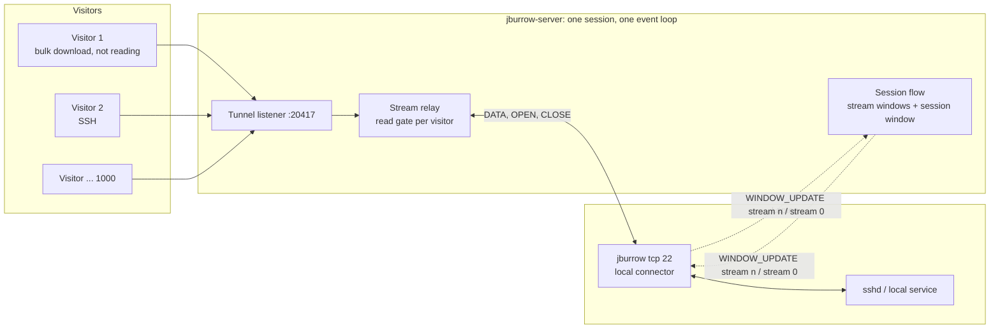

# Phase 2, Multiplexing and Flow Control: Architecture

Status: designed, not yet built. Third phase of `PROJECT.md` §Build roadmap, built on phase 1's TCP
tunnel and wire protocol.

`PROJECT.md` gives phase 2 one line: many streams per session, per-stream credit windows and
`WINDOW_UPDATE` on top of phase 1's session writability; done when 500 concurrent connections share
one session, and an end-to-end test with a deliberately slow client shows server heap and direct
memory staying flat. This document is the full design.

Phase 1 carried one stream per session and said why it couldn't carry more
([phase 1 §Backpressure in phase 1](../phase-1-tcp-tunnel/ARCHITECTURE.md#backpressure-in-phase-1)):
pausing the whole connection for one slow visitor stalls every other stream on it, and two streams
that depend on each other deadlock. Phase 2 removes that limit. It adds flow control to the protocol
as a second draft, `jburrow.v1-draft.2`, and changes how both sides apply backpressure. A slow
destination now holds back only its own stream, and the memory a session can make the server hold
stays the same whether one stream is open or a thousand.

Read first: `PROJECT.md` (§Backpressure, §The wire protocol, §Clean architecture rules),
[`docs/phase-1-tcp-tunnel/ARCHITECTURE.md`](../phase-1-tcp-tunnel/ARCHITECTURE.md) (everything this
phase changes is described there first, especially §Concurrency model, §The data path, §Backpressure
in phase 1 and §Memory budget), [`docs/protocol.md`](../protocol.md),
[ADR-0007](../adr/0007-wire-protocol-v1.md) and [ADR-0008](../adr/0008-byte-path-concurrency-model.md).

## Contents

- [Purpose](#purpose)
- [Goals and non-goals](#goals-and-non-goals)
- [Where this phase departs from PROJECT.md](#where-this-phase-departs-from-projectmd)
- [Runtime view](#runtime-view)
- [Protocol draft 2](#protocol-draft-2)
  - [Why a new draft](#why-a-new-draft)
  - [Announced windows](#announced-windows)
  - [Sending](#sending)
  - [Receiving](#receiving)
  - [Returning credit](#returning-credit)
  - [Violations](#violations)
  - [Windows and stream states](#windows-and-stream-states)
  - [What else changes in the specification](#what-else-changes-in-the-specification)
- [The flow control model](#the-flow-control-model)
- [Choosing the windows](#choosing-the-windows)
- [Module and package layout](#module-and-package-layout)
- [Concurrency model](#concurrency-model)
- [The server](#the-server)
  - [Admitting streams](#admitting-streams)
  - [Visitor to client: the read gate](#visitor-to-client-the-read-gate)
  - [Client to visitor: credit on delivery](#client-to-visitor-credit-on-delivery)
  - [What phase 1 code goes away](#what-phase-1-code-goes-away)
- [The client](#the-client)
- [Head-of-line blocking and deadlock](#head-of-line-blocking-and-deadlock)
- [Liveness](#liveness)
- [Layer rules](#layer-rules)
- [Configuration](#configuration)
- [Observability](#observability)
- [Memory budget](#memory-budget)
- [Performance](#performance)
- [Security and threat model](#security-and-threat-model)
- [Failure modes](#failure-modes)
- [Testing](#testing)
- [Build, CI and packaging](#build-ci-and-packaging)
- [Deployment changes](#deployment-changes)
- [Decisions that need an ADR](#decisions-that-need-an-adr)
- [Extension points](#extension-points)
- [Open questions](#open-questions)
- [Exit criteria](#exit-criteria)

## Purpose

At the end of phase 2:

- One `jburrow tcp` session carries up to 1,000 visitor connections at once. A visitor that stops
  reading slows only its own connection. The others keep their speed, and an SSH session stays
  interactive next to a stalled bulk transfer through the same tunnel.
- The protocol has flow control, specified byte by byte in `docs/protocol.md` as
  `jburrow.v1-draft.2`, with conformance vectors and a fuzzed model of the window rules that both
  sides share.
- The most memory a session can make the server hold is set by configuration and doesn't depend on
  the number of streams. A client that stops reading, or a visitor that stops reading, leaves the
  server's heap and direct memory flat.
- Two streams that depend on each other (an application that won't read one connection until
  another makes progress) can't deadlock a session, as they could if phase 1's model carried more
  than one stream.

## Goals and non-goals

**Goals**

- **Isolation between streams.** Backpressure on a stream reaches that stream's source and nothing
  else, in both directions.
- **A memory bound per session that doesn't depend on stream count.** Per-stream windows alone would
  let a session hold its stream limit times the stream window. A session window caps the total.
- **No buffering of unsent data.** Phase 1's relay never held bytes it hadn't sent. Phase 2 keeps
  that: a source is read only as far as it can be sent. The single exception is one byte per stream,
  forced by the epoll transport ([The read gate](#visitor-to-client-the-read-gate)).
- **The rules are pure Java that both sides share**, tested exhaustively and fuzzed, like phase 1's
  stream lifecycle and liveness. Netty only carries out the decisions.
- **Fail closed.** A peer that sends past a window broke the protocol, and the receiver says so at
  the first frame that does.
- **Fairness without a scheduler.** Streams that compete for a session's credit get it roughly in
  turn, through the event loop's own I/O order, with no priority queue to maintain.

**Non-goals**

- Window auto-tuning (growing a fast stream's window to match the path's bandwidth-delay product).
  The protocol allows it, since a receiver may always grant more credit than it was given back, but
  the reference implementation uses fixed windows until the load test shows they limit someone
  ([Open questions](#open-questions)).
- Stream priorities or weights. HTTP/2 dropped its priority scheme (RFC 9113) for being little used
  and hard to get right. Fair turns are enough for TCP tunnels.
- More than one tunnel per session (roadmap §1, v1), HTTP tunnels (phase 3), reconnect and `GOAWAY`
  (phase 4), accounts (phase 5).
- Per-IP limits on visitor connections (phase 6). Phase 2 adds a server-wide stream cap only
  ([Admitting streams](#admitting-streams)), and §Security and threat model says what that leaves
  open until then.

## Where this phase departs from PROJECT.md

`PROJECT.md` §Backpressure describes per-stream credit windows of 256 KiB and session-level
writability that pauses every public channel of a session. This design keeps both and changes three
things:

| Change | Why |
|---|---|
| A **session window** on top of the stream windows: `WINDOW_UPDATE` on stream 0 returns credit for the whole session, as in HTTP/2 and QUIC. | With stream windows alone, a session can make the server hold `maxConcurrentStreams × 256 KiB`, 250 MiB at 1,000 streams, from one client's data written slowly to its visitors. The session window caps it at 512 KiB. |
| **Each side announces its own receive windows** in its `HELLO`, instead of both using a fixed 256 KiB. | A window protects the receiver's memory, so the receiver chooses it, as HTTP/2's `SETTINGS_INITIAL_WINDOW_SIZE` does. A third-party client on a small device can announce smaller windows; an operator can tune the server's. |
| **A slow visitor or local service no longer stops the connection being read.** Phase 1 paused the whole session; phase 2 withholds credit for that stream only. Session writability stays, but only as a cap on how much each source may be read. | Pausing the connection is what causes head-of-line blocking and the deadlock between dependent streams ([Head-of-line blocking and deadlock](#head-of-line-blocking-and-deadlock)). |

Two smaller additions: a server-wide cap on concurrent streams, since raising the per-session limit
from 1 to 1,000 multiplies the visitor connections a server can be asked to hold; and the session
write buffer drops from `128KB-512KB` to `64KB-256KB` to keep the per-session budget near phase 1's
([Memory budget](#memory-budget)).

`PROJECT.md` §Backpressure, its build roadmap entry for phase 2 and its status line are updated in
the same change as this document.

## Runtime view

No new port, listener or host. What changes is how many visitor connections share one session, and
the credit that flows back against the data:



Visitor 1's stalled download fills its own stream window and stops there. Visitor 2's keystrokes
keep their own credit and get through.

## Protocol draft 2

[`docs/protocol.md`](../protocol.md) is updated to `jburrow.v1-draft.2` in this phase and is the
authority on the wire. This section is the design behind it: the rules the specification will hold
normatively, and the reasoning that won't go there. [ADR-0009](../adr/0009-flow-control.md)
records the decisions.

### Why a new draft

A peer of draft 1 sends `DATA` whenever it has bytes. A draft 2 receiver treats `DATA` past a
window as a session error, so the two can't talk to each other, and the change has to be a new
subprotocol token rather than a capability (ADR-0007: anything new that isn't an optional JSON field
needs a capability or a new version, and before v1.0.0 incompatible changes bump the draft). Before
v1.0.0 a server speaks exactly one draft, so the phase 2 server refuses draft 1 clients with
`UNSUPPORTED_PROTOCOL_VERSION`, and the CLI tells the user to upgrade. Testers get the new CLI before
the server is deployed ([Deployment changes](#deployment-changes)).

### Announced windows

Both `HELLO`s gain a required `windows` object: **this side's receive windows**, which is the credit
its peer starts with.

| Field | Type | Rule |
|---|---|---|
| `windows` | object | The sender's receive windows. |
| `windows.stream` | integer (32-bit) | 65,536 to 2^31 − 1. The window each new stream starts with, for `DATA` towards the sender of this `HELLO`. |
| `windows.session` | integer (32-bit) | At least `windows.stream`, at most 2^31 − 1. The session window, for `DATA` towards the sender of this `HELLO` on all streams together. |

```json
{
  "sessionId": "0b8e5c1e-7c55-4c46-9a3e-2f1d0c9e4b7a",
  "server": { "name": "jburrow-server", "version": "0.3.0" },
  "capabilities": [],
  "limits": { "maxFramePayload": 65536, "maxTunnels": 1, "maxConcurrentStreams": 1000,
              "pingIntervalMs": 15000, "idleTimeoutMs": 45000 },
  "windows": { "stream": 262144, "session": 524288 }
}
```

- **Why a minimum of 64 KiB.** A one-byte window is legal in HTTP/2, and it makes the peer send
  one-byte frames, each with a 10-byte header, a WebSocket header and a credit round trip. A window
  at least as large as the largest `DATA` payload means a sender with credit can always fill a
  frame, and a peer can't force the other side into byte-at-a-time work by announcing a tiny window.
- **Why the session window must be at least the stream window.** A smaller one would make the
  stream window meaningless. Requiring it catches a misconfiguration at the `HELLO` instead of
  leaving it to show up as poor throughput.
- **Fixed for the session.** HTTP/2 lets `SETTINGS` change the initial window mid-connection, and
  the result (windows that go negative, retroactive adjustment of every open stream) is one of the
  most error-prone parts of RFC 9113. Here the initial windows never change. A receiver that wants
  a larger window grants extra credit with `WINDOW_UPDATE`, which needs no special rule.
- The pipelined handshake still works. The client sends its `HELLO` (with its windows) first, and no
  `DATA` flows in either direction until the session is established, so each side knows the other's
  windows before it may send.

### Sending

A sender keeps two credits towards its peer: one per stream, starting at the peer's
`windows.stream`, and one for the session, starting at the peer's `windows.session`.

- A `DATA` frame of `n` bytes may be sent only when `n` is at most the stream's credit **and** at most
  the session's credit. Sending it takes `n` from both.
- Only `DATA` is flow-controlled. `OPEN`, `CLOSE`, `WINDOW_UPDATE` and the stream 0 frames are not,
  so a sender with no credit can still close or reset a stream, answer a `PING` and return credit.
- A sender may always send less than its credit allows. Credit is permission, not obligation.
- **`OPEN` and optimistic data.** The server may still send a visitor's first bytes right behind
  `OPEN` (protocol.md §9.4), now up to the client's stream window. Phase 1's client had to stop
  reading the connection when it held too much for a stream it was still connecting. The window
  makes that unnecessary: the client holds at most its own `windows.stream` per connecting stream,
  by construction.

### Receiving

A receiver keeps, per stream and for the session, how much its peer may still send: its window minus
what has arrived, plus what it has given back.

- `DATA` that arrives counts against the session window first, then against its stream's window.
- `DATA` for a stream that is **closed** (in flight when it closed, protocol.md §9.3) still counts
  against the session window. The receiver discards it and counts it as released at once, so its
  session credit comes back ([Returning credit](#returning-credit)). Without this rule, every reset
  would leak session credit, and after enough resets the session would stall for good. HTTP/2 has
  the same rule for the same reason.
- `DATA` that ends in a stream error (protocol.md §9.2: `DATA` after the peer's own `CLOSE`) also
  counts against the session window and is released at once.

### Returning credit

A receiver gives credit back with `WINDOW_UPDATE`: on a data stream for that stream's window, on
stream 0 for the session window.

- **Credit is returned for released bytes.** A byte is released when the receiver no longer holds
  it: written to its destination socket, or discarded. Credit given back when bytes merely arrive
  would bound nothing. Credit given back when they are released makes each window the most a
  receiver can be made to hold.
- **When.** A receiver MUST return session credit once the session's unreturned released bytes reach
  half its session window, and stream credit once a stream's reach half its stream window. It MAY
  return credit sooner. Half the window is the standard trade-off (Netty's HTTP/2 flow controller and
  yamux both use it): updates stay rare, one for every 128 KiB on a stream, and the sender never runs
  dry while the receiver is draining.
- **No deadlock.** With that rule a sender's credit never stays at zero while the receiver holds
  nothing: when a receiver has released everything and returned nothing, it is holding back less
  than half the window, so the sender still has more than half. [The flow control
  model](#the-flow-control-model)'s fuzz target proves it for any interleaving.
- **More than released.** A receiver MAY grant more credit than it has released, to let a fast
  stream use a bigger window. That is the hook for auto-tuning later. It may never take credit back.
- **Not for a stream the peer has finished.** Once a receiver has received the peer's `CLOSE` on a
  stream, no more `DATA` comes on it, and the receiver sends no further `WINDOW_UPDATE` for that
  stream. Session credit for its released bytes still goes back on stream 0.

### Violations

Every violation of a window is a session error with a new code, **`FLOW_CONTROL_ERROR`** (session
scope, close code 1002):

| Received | Error |
|---|---|
| `DATA` longer than the session's remaining window | `FLOW_CONTROL_ERROR` |
| `DATA` longer than its stream's remaining window | `FLOW_CONTROL_ERROR` |
| `WINDOW_UPDATE` that takes a credit past 2^31 − 1 | `FLOW_CONTROL_ERROR` |

HTTP/2 makes a stream-window overrun a stream error. This protocol makes it a session error, because
no timing can make a correct sender overrun a window. A receiver's view of its peer's credit only
grows when it sends an update, and the sender's view only grows when the update arrives, so the
sender's view is never larger. An overrun is always a bug, and the protocol's rule for bugs is to
fail at the first bad frame (ADR-0007).

### Windows and stream states

The stream state table (protocol.md §9.2) gains two columns. `WINDOW_UPDATE` on a data stream:

| State | `WINDOW_UPDATE` received | `WINDOW_UPDATE` sent |
|---|---|---|
| Open | credit added | allowed |
| HalfClosedLocal | accepted, credit ignored (this side sends no more `DATA`) | allowed |
| HalfClosedRemote | credit added | MUST NOT (the peer sends no more `DATA`) |
| Closed | discarded | MUST NOT |

A `WINDOW_UPDATE` for a stream id that was never opened is `PROTOCOL_ERROR`, like every other frame
(§9.3). On stream 0 it is allowed in any state once the session is established. Before that no
`DATA` has flowed, so there is no credit to return, and it is `PROTOCOL_ERROR` under the frame order
rules (§8.2).

### What else changes in the specification

| Section | Change |
|---|---|
| §1 change log | The draft 2 row. |
| §4.1 | `jburrow.v1-draft.2` is this document. |
| §6 registry, §6.6 | `WINDOW_UPDATE` is sent by both sides on stream 0 or a data stream, and is defined (no longer "layout only"). A new example for stream 0. |
| §7.3, §7.4 | `windows` in both `HELLO`s, with examples regenerated by the codec. |
| §8.2 | `WINDOW_UPDATE` allowed in both directions once established; still `PROTOCOL_ERROR` before. |
| §8.5 | The limits paragraph mentions that windows bound the receiver's memory. |
| §9.2 | The two new columns above. |
| §9.4 | Optimistic data bounded by the client's stream window; the "stop reading when holding too much" text goes. |
| new §10 Flow control | Windows, sending, receiving, returning credit, violations: the rules above. Liveness becomes §11, Errors §12, Receiver rules §13, Limits §14, Conformance §15, Security considerations §16, Reference implementation §17. Every `§10`–`§16` reference in code and docs moves with them. |
| Liveness | Notes that a side using windows has no stream-level reason to stop reading the connection. The pausing rules stay, for peers that pause anyway. |
| Errors | `FLOW_CONTROL_ERROR`: session, close code 1002. |
| Receiver rules | Step 5: `WINDOW_UPDATE` may be on any stream. Step 9: the window checks. |
| Limits | Rows for the two windows and their bounds. |
| Security considerations | Windows bound what a peer can make a receiver hold; the 64 KiB minimum stops a peer forcing tiny frames. |

`FrameType.StreamKind` gains `ANY` for `WINDOW_UPDATE`, and `Frame.WindowUpdate` accepts stream 0.
The conformance vectors gain `WINDOW_UPDATE` on stream 0 as valid for both roles, and the draft 1
`HELLO` vectors are regenerated with `windows`.

## The flow control model

PROJECT.md: "The window accounting is pure Java in the domain layer, so it can be unit-tested
exhaustively." Both sides need exactly the same accounting, so, like `StreamLifecycle` and
`Liveness` in phase 1, it lives in the protocol model, in a new package `io.jburrow.protocol.flow`,
and each side's domain holds it.

```java
/** What this side may still send towards its peer, on one stream or the session. */
public final class SendCredit {
    public long available();
    void spend(int bytes);              // more than available: IllegalStateException, a bug in the caller
    void grant(int increment);          // from WINDOW_UPDATE; past 2^31 - 1: ProtocolException FLOW_CONTROL_ERROR
}

/** What the peer may still send towards this side, and the credit this side owes it. */
public final class ReceiveWindow {
    public int size();
    public int remaining();             // the peer's credit, in this side's view
    public int held();                  // received and not yet released
    public int unreturned();            // released, credit not yet sent back
    void receive(int bytes);            // more than remaining: ProtocolException FLOW_CONTROL_ERROR
    int release(int bytes);             // written or discarded; returns the increment to send now, 0 if none
    void stopReturning();               // the peer finished sending: no further increments
}

/** One stream's two directions. */
public final class StreamFlow {
    public SendCredit send();
    public ReceiveWindow receive();
}

/** One session's accounting: its own windows, the peer's, and the session-level credit both ways. */
public final class SessionFlow {
    public SessionFlow(int localStream, int localSession, int remoteStream, int remoteSession);
    public StreamFlow openStream();
    public SendCredit sessionSend();
    public ReceiveWindow sessionReceive();
    public int sendable(StreamFlow stream);                      // min of stream and session credit
    public void onSent(StreamFlow stream, int bytes);
    public void onSessionUpdate(int increment);                  // WINDOW_UPDATE on stream 0
    public void onStreamUpdate(StreamFlow stream, int increment);
    public void onReceived(StreamFlow stream, int bytes);        // session window checked first
    public Credit onDiscarded(int bytes);                        // closed or reset stream: received and released at once
    public Credit onReleased(StreamFlow stream, int bytes);      // stream null: its entry is gone; session credit only
    public void onPeerFinished(StreamFlow stream);               // the peer's CLOSE arrived
}

/** The WINDOW_UPDATEs to send: a session increment, a stream increment, either or both zero. */
public record Credit(int session, int stream) {}
```

- **Every call is a decision, every return is what to send.** The model never sends, schedules or
  reads a clock. That keeps it testable without sockets and identical on both sides.
- **`SessionFlow` is the only way in.** `SendCredit` and `ReceiveWindow` change only through
  package-private methods, so outside `io.jburrow.protocol.flow` they are read-only views: an adapter
  can ask how much it may send, and can't do its own arithmetic on credit. A call that throws changes
  nothing.
- **Release is checked.** `release` of more than `held()` throws `IllegalStateException`. The
  adapters release each byte exactly once, on write completion (success or failure) or on discard,
  and a double release is a bug the tests must catch, because it would hand the peer credit for
  memory still in use.
- **`Windows`** is the control record (`io.jburrow.protocol.control.Windows`) that both `HELLO`
  records carry, validated in its constructor like every control record. It arrives with the wire
  changes, after the model, so `SessionFlow` takes the four sizes as integers.
- **The fuzz target** (`SessionFlowFuzzTest`) simulates two peers with a queue of frames in flight
  each way, any number of streams, and an adversarial order of sends, deliveries, releases, resets
  and closes. It checks four invariants at every step: no receiver ever holds more than its windows;
  a sender following the model never triggers `FLOW_CONTROL_ERROR`; credit is conserved (sender's
  credit + data in flight + held + unreturned + updates in flight = window, per stream and per
  session); and when the receiver releases everything it holds, every sender still sending has more
  than half of each window back (no deadlock, and credit returned at half the window).

`StreamLifecycle` gains the two `WINDOW_UPDATE` events of the table above, and stays the authority
on stream state. Flow accounting sits next to it in each stream's entry, not inside it, so the state
machine's tests and fuzz target stay as they are.

## Choosing the windows

| Window | Server receives (announced by the server) | Client receives (announced by the client) |
|---|---|---|
| Stream | 256 KiB | 256 KiB |
| Session | 512 KiB | 1 MiB |

**Stream, 256 KiB** is `PROJECT.md`'s figure and yamux's default. With credit returned at half, a
stream sends at most a window per round trip, so a stream's throughput is at most its window divided
by the round-trip time:

| Client ↔ server round trip | One stream (256 KiB) | Server-bound session (1 MiB) | Client-bound session (512 KiB) |
|---|---|---|---|
| 20 ms | 12.5 MiB/s | 50 MiB/s | 25 MiB/s |
| 50 ms | 5 MiB/s | 20 MiB/s | 10 MiB/s |
| 100 ms | 2.5 MiB/s | 10 MiB/s | 5 MiB/s |
| 200 ms | 1.25 MiB/s | 5 MiB/s | 2.5 MiB/s |

"Server-bound" is visitor-to-client traffic, limited by the client's windows; "client-bound" is the
other way. Phase 1's exit test measured 0.55 MiB/s through the tunnel, set by the laptop's uplink,
which every row above exceeds. A tester with a fast uplink and a long round trip will be limited by
these windows, which is what auto-tuning ([Extension points](#extension-points)) would lift.

**Measured** ([Performance](#performance) has the setup): one stream echoing 64 MiB, so carrying data
both ways at once, with `netem` delay on every hop:

| Round trip | Measured, each direction | Window ÷ round trip |
|---|---|---|
| 0 (loopback) | 115 MiB/s | — |
| 20 ms | 7.0 MiB/s | 12.5 MiB/s |
| 50 ms | 3.0 MiB/s | 5 MiB/s |
| 100 ms | 1.51 MiB/s | 2.5 MiB/s |
| 200 ms | 0.76 MiB/s | 1.25 MiB/s |

Throughput falls exactly as one over the round trip, so the stream window is the limit where
predicted, at a steady 56–61% of window ÷ round trip for a stream busy in both directions. The
measurements don't separate the cause of the gap, which a one-direction run would. Every row is
still above the 0.55 MiB/s that phase 1 measured through production, so **auto-tuning is not needed
for phase 3**. It becomes worth building when a tester's measured rate through production falls
below what their link carries without the tunnel.

**Server session, 512 KiB.** This is the number that bounds the server's memory. It is two stream
windows, so two visitors draining at full speed don't hold each other back, and it keeps the
per-session budget at phase 1's level ([Memory budget](#memory-budget)). A larger session window
would let more stalled visitors sit in it before the rest of the session feels it (see
[Head-of-line blocking and deadlock](#head-of-line-blocking-and-deadlock)), at 512 KiB of direct
memory per session per doubling. The trade is between memory and how many stalled visitors a session
absorbs; it isn't a throughput question at the uplink speeds above. The load test found the boundary
exactly where this predicts: one visitor that never reads leaves the session's other streams
unaffected, and two stop its client-to-visitor direction
([Head-of-line blocking and deadlock](#head-of-line-blocking-and-deadlock)). **512 KiB stays.** 1 MiB
would move the boundary from two stalled visitors to four, which an attacker meets as easily, at
twice the direct memory per session. Per-source limits (phase 6) are the defence.

**Client session, 1 MiB.** The client is a developer's machine with memory to spare and one session.
A larger window lets visitor uploads to the local service run faster on long round trips, and the
server's memory doesn't depend on it.

## Module and package layout

Nothing new at module level. New and changed packages, as phase 1's layout with the changes marked:

```
jburrow-protocol/                      io.jburrow.protocol
├── wire/        ErrorCode (+ FLOW_CONTROL_ERROR), FrameType (StreamKind.ANY for WINDOW_UPDATE),
│                ProtocolVersion (CURRENT = jburrow.v1-draft.2)
├── control/     Hello, ServerHello (+ windows), Windows (new)
├── stream/      StreamEvent (+ WINDOW_UPDATE_RECEIVED, WINDOW_UPDATE_SENT), StreamLifecycle
├── flow/        new: SendCredit, ReceiveWindow, StreamFlow, SessionFlow, Credit
└── adapter/netty/  Frame.WindowUpdate (stream 0 allowed), FrameCodec (step 5),
                    CreditBoundedRecvByteBufAllocator (new)

jburrow-server-core/                   io.jburrow.server.core
├── tunnel/domain/       Session (+ SessionFlow, window events), StreamTable (entries carry
│                        StreamFlow), StreamAdmission (+ SERVER_STREAM_LIMIT)
├── tunnel/application/  StreamQuota (new): the server-wide stream cap
└── tunnel/adapter/netty/
    ├── control/  ControlSessionHandler (WINDOW_UPDATE dispatch), SessionStreams (+ onWindowUpdate),
    │             ControlSessionInitializer (announced windows and limits from settings),
    │             LivenessHandler (pause and resume removed)
    ├── edge/     EdgeSettings (+ windows, stream caps)
    └── tcp/      StreamRelay (read gate, credit on delivery), VisitorHandler (carry slot),
                  Backpressure (removed; its job moves into the read gate)

jburrow-client-core/                   io.jburrow.client
├── ClientSettings (+ windows)
└── tunnel/
    ├── domain/        ClientSession (+ SessionFlow, window events), PendingData (removed)
    └── adapter/netty/ ReadGate (new), LocalConnector (credit on delivery), LocalRelayHandler
                       (carry slot, no pending limit), ClientLivenessHandler (pause and resume
                       removed)

jburrow-server/                        io.jburrow.server
├── config/        JBurrowProperties (+ stream window, session window, max concurrent streams,
│                  max streams), EdgeConfiguration (budget check at startup)
└── observability/ MicrometerTunnelMetrics (+ flow blocked counter, new refusal reason)

jburrow-cli/       ExitCodes (FLOW_CONTROL_ERROR → 6)
scripts/load/      StreamLoad.java (new): the many-streams load driver, run by hand
```

**Why the credit-bounded allocator is in `jburrow-protocol`.** Both sides read a source only as far
as its credit allows, with the same Netty mechanism and the same epoll subtlety
([The read gate](#visitor-to-client-the-read-gate)). `jburrow-protocol`'s `adapter.netty` is
already the Netty code both sides share (the codec), and ADR-0002 gives server and client no other
shared module. The allocator is one class that knows nothing about sessions: it caps a read at what
an `IntSupplier` says may be sent.

## Concurrency model

ADR-0008 is unchanged and phase 2 depends on it more than phase 1 did. A session's flow state (its
`SessionFlow`, every `StreamFlow`, the read gate of every visitor) is confined to the session's
event loop, together with every visitor channel. So:

- A credit check and the read it allows happen on one thread, with no gap in which another stream
  could spend the same credit.
- Returning credit is a write-completion listener on a visitor channel, which Netty runs on that
  channel's event loop: the session's loop. It touches the session's flow state directly.
- Resuming a hundred visitors when session credit arrives is a hundred `setAutoRead(true)` calls in
  a loop, with no locks.

**One new piece of global state**: `StreamQuota`, the server-wide count of open streams, an
`AtomicInteger` taken when a visitor is admitted and given back when its stream ends. ADR-0008
allows global state that has to be global, behind its own small synchronisation. The relay's byte
path never touches it: only admission and stream end do.

## The server

### Admitting streams

`VisitorHandler.channelActive` asks, in order:

1. Is the session established? Otherwise `NOT_ESTABLISHED`, as in phase 1.
2. Is the session below `maxConcurrentStreams` (1,000)? Otherwise `STREAM_LIMIT`.
3. Does `StreamQuota` have room (`jburrow.edge.max-streams`, 4,000)? Otherwise
   `SERVER_STREAM_LIMIT`.

A refused visitor is closed at once, unannounced, as in phase 1 (protocol.md §8.5). The quota is
taken last so a refusal at step 2 doesn't touch shared state, and it is released by the stream's end
on every path, which the tests check by counting the quota back to zero after every scenario.

Why a server-wide cap: phase 1 could hold at most 200 visitor connections (200 sessions × 1 stream).
Phase 2's per-session limit allows 200,000. Each costs a file descriptor, a few KiB of heap for the
channel and its pipeline, and kernel socket memory that cgroup v2 charges to the pod. The kernel
memory is what sets the cap: a visitor held back by credit parks up to its receive buffer in the
server's kernel, 64 KiB with `jburrow.tcp.visitor-receive-buffer` at its default, so 4,000 streams
come to 250 MiB ([Memory budget](#memory-budget), ADR-0010). The load test's first choice of 20,000
would have needed about 2.3 GiB at the kernel's default buffers.

### Visitor to client: the read gate

Phase 1 read a visitor whenever the session channel was writable. Phase 2 reads a visitor only as far
as it can send right now. For each visitor:

```
sendable = min(stream credit, session credit, session channel headroom, 65,536)
```

where headroom is `Channel.bytesBeforeUnwritable()`: how much more the session channel's outbound
buffer takes before it crosses its high watermark. Session writability, phase 1's mechanism, becomes
one term of the same minimum.

- **A visitor is read only while `sendable > 0`.** When its own read takes `sendable` to 0, its
  `autoRead` goes off at once; when a `WINDOW_UPDATE` or a writability change raises it again,
  `autoRead` goes back on. When `sendable` falls to 0 for every visitor at once (session credit or
  headroom ran out), visitors are paused lazily: each one the next time it is actually read
  ([The one-byte carry](#visitor-to-client-the-read-gate), below), so an idle visitor is never touched.
- **Reads are capped at `sendable`.** `CreditBoundedRecvByteBufAllocator` wraps phase 1's
  `AdaptiveRecvByteBufAllocator` (64 bytes to 64 KiB). Its handle's `guess()` is the adaptive guess
  capped at `sendable`, and it allocates the read buffer with that capacity, so a socket read never
  returns more than can be sent. It doesn't let reads that the cap cut short shrink the adaptive
  guess: those reads were short because of credit, not because the visitor sent little. A visitor's
  read becomes one `DATA` frame, sent at once, with nothing left over.
- **One read per visitor per loop turn** (`maxMessagesPerRead` 1). When many visitors compete for
  session credit, each gets one read of up to 64 KiB before any gets a second. That is the fairness
  guarantee. It costs nothing measurable at 64 KiB per read, and it replaces the scheduler HTTP/2
  implementations keep for the same purpose.
- **Who is waiting for what.** A visitor blocked by its own stream credit is resumed by its stream's
  `WINDOW_UPDATE`. A visitor blocked by session credit or headroom joins a line, the relay's
  `blockedOnSession` set. When stream 0's `WINDOW_UPDATE` arrives or the session channel becomes
  writable again, visitors in line are resumed, in line order, until what the resumed ones may send
  adds up to all the session can send. The rest stay paused and keep their place. Neither event
  scans visitors that aren't waiting.
- **A share with a floor** (ADR-0010). Whoever the event loop reads first after a resume takes the
  credit, so the order of reads would decide who is served. Epoll reads resumed visitors in the
  order they were resumed; NIO reads ready channels in an order of its own, the same every time,
  which the gate doesn't control. So each visitor resumed from the line may take at most
  `max(16 KiB, credit / visitors in line)` in its first read, or all the credit if less is left. The
  cap lifts once that read is sent or held. The floor keeps frames large: without it, a 512 KiB
  grant to 1,000 visitors would be split into frames of about 500 bytes, which the load test found
  cost 8 times the CPU and 22% of the link ([Performance](#performance)). Resuming only the visitors
  the credit covers is what makes the floor work. A visitor resumed past the credit would be read
  anyway and give up a byte to the carry, which goes out later as a one-byte frame, so every
  visitor in line would still cost a read and a frame per grant.
- **A re-check for unused credit.** A resumed visitor may have less to send than its share, or
  nothing, and then no event tells the gate the credit is still there. So after a partial resume, or
  a visitor giving up its turn, the gate looks again 1 ms later, on the session's event loop, and resumes the next paused visitors if
  credit is unused. Visitors resumed earlier and not yet read are skipped, since they may be idle.
  At most one re-check is pending per session. Without it, the rest of the line would wait, with
  credit unused, behind a resumed visitor that had nothing to send, until a `WINDOW_UPDATE` that may
  never come.
- **Turns rotate.** A visitor keeps its place in line, through any number of resumes and one-byte
  pauses, until a read of its own is sent; then it leaves, and rejoins at the back if that read spent
  what it could send. Without this, visitors would re-block in the order they were read, and on
  epoll the same visitor would head the line at every grant. With the floor, fairness holds across
  grants rather than within each one: a line of 1,000 takes about 31 grants of 512 KiB to come round.
- **One read per turn.** A visitor resumed from the line whose read leaves it credit still goes to
  the back, waiting for its `TURN`, if any visitor in line is still paused, and the re-check is
  scheduled so the credit it leaves isn't stranded. Without this, NIO could read the same visitor
  twice before the others resumed with it, and `ReadGateIntegrationTest` saw one of ten visitors take
  1.9 times its share. A visitor with no one paused behind it keeps reading. A turn isn't counted in
  `jburrow_flow_blocked_total`, since the visitor wasn't short of credit.

**The one-byte carry.** A visitor can be read when its `sendable` is 0, in two ways. One is
deliberate: when session credit or headroom runs out, pausing every visitor of the session at once
would cost a system call per visitor (on epoll, `setAutoRead(false)` is an `epoll_ctl`), most of them
idle. So the relay pauses none of them in advance. The other is forced: when session credit runs out
partway through an event-loop turn, visitors that epoll already reported readable in that turn are
read anyway, because Netty checks `autoRead` before asking epoll, not before each ready channel it
was handed. Either way the read can't be zero bytes: Netty's native read returns 0 for a buffer of
capacity 0, and on epoll 0 means end of input, which would half-close the visitor. So the allocator
never guesses below 1. A visitor read with `sendable` at 0 gives up at most one byte, which is held
in its stream's carry slot; the visitor is paused and joins `blockedOnSession`; and the byte goes out
first, as a one-byte `DATA`, when credit returns. Nothing else is ever held unsent, and only visitors
that actually had data pay for a pause. NIO doesn't have the zero-byte problem, but both transports
follow the same rule so behaviour doesn't depend on the transport. An integration test drives both
paths with a minimal session window and many visitors sending at once, on both transports, and checks
the server never overruns a window ([Testing](#testing)).

**A `FIN` on epoll.** Netty's epoll transport reads a source that has sent `FIN` (`EPOLLRDHUP`) to
the end of its input in one turn, whatever `autoRead` is and whatever the allocator's
`continueReading` answers. A visitor that half-closes while held back is therefore read past its
credit, however the gate sized the turn's first read. Those bytes are not lost or refused: they join
its carry, in order, and go out as credit returns, ahead of its `CLOSE`. The allocator recognises
the drain (a second read in one turn can be nothing else) and reads it in full-sized chunks rather
than byte by byte, so it doesn't tie up the event loop. What such a visitor holds is at most what the
kernel had already received for it, its socket receive buffer, which the pod was charged for already.
**Carried bytes are copied onto the heap** (unpooled, so they are freed once sent) and the read's
direct buffer released at once. With the share floor, most of a long line stays paused across
grants, so many visitors can half-close while held back: `SlowClientIntegrationTest`'s 500 uploads
drained 27 MB into direct memory before the copy, far past the per-session budget, and 112 KiB after
it. The bytes move from kernel memory to the heap, so the pod's total doesn't change
([Memory budget](#memory-budget)). The copy is off the steady path: only bytes that can't be sent
are carried. NIO has no such drain: a paused visitor's `FIN` is read when it is next resumed.

A visitor's `FIN` still becomes `CLOSE`, once any carried bytes have gone out ahead of it, since a
half-close must follow the stream's last byte. A reset discards the carried bytes and needs no
credit, so a stream can always be reset at once.

### Client to visitor: credit on delivery

The client's `DATA` is checked and accounted by `Session.onDataReceived` (lifecycle first, then the
session and stream windows, raising `FLOW_CONTROL_ERROR` on an overrun). An accepted payload is
written to the visitor channel with a promise. The promise's listener calls `Session.onReleased` with
the payload's length when the write completes, successfully or not, and sends any `WINDOW_UPDATE` the
returned `Credit` names, with `writeAndFlush`: updates are rare enough (one per 128 KiB per stream,
one per 256 KiB per session) that coalescing their flushes would buy nothing.

- **A slow visitor holds back only itself.** Its writes don't complete, so its stream's credit isn't
  returned, so the client stops sending on that stream after 256 KiB. The session channel keeps being
  read for every other stream.
- **A closed stream gives its session credit back.** Writes queued to a visitor that is reset or
  closed fail, their listeners release the bytes, and the session credit returns. `DATA` that arrives
  for a closed stream is released as it is discarded.
- **Buffer ownership** is phase 1's (phase 1 §The data path). The listener releases credit, not
  buffers: Netty releases a written buffer itself.

### What phase 1 code goes away

| Phase 1 | Phase 2 |
|---|---|
| `Backpressure`: a visitor that can't take more stops the session channel being read and pauses liveness | Removed. The visitor's stream window does that job for its stream alone. Session writability moves into the read gate. |
| `jburrow.edge.visitor-write-buffer` | Removed. What a visitor channel holds is bounded by the stream window, so its watermarks no longer drive anything. |
| `LivenessHandler.pause` and `resume` | Removed, along with their callers. The server never stops reading a client for flow control any more. `Liveness`'s pausing rules stay in the protocol model, which the specification still allows. |
| Second visitor refused (`maxConcurrentStreams` 1) | 1,000 streams per session, 4,000 per server. |
| Tunnel listener backlog 128 | 1,024, as the edge's. A burst of visitors beyond the accept queue loses each handshake's last ACK while the visitor already thinks it is connected, and waits seconds for the kernel's retries: `ManyStreamsIntegrationTest`'s 500 connections at once found it. The kernel caps the backlog at `net.core.somaxconn` (4,096 by default since Linux 5.4). |

## The client

The client is the server's mirror, with "visitor" read as "local connection", as in phase 1.

- **`ClientSession`** holds a `SessionFlow`, created when the server's `HELLO` arrives (it carries the
  server's windows). Each stream's entry carries its `StreamFlow` next to its lifecycle.
- **`HELLO`** carries `ClientSettings.windows()`, by default 256 KiB and 1 MiB. They aren't CLI flags:
  nobody running `jburrow tcp` needs to tune them, and an embedding application can set them through
  the builder (`JBurrowClient.Builder.windows`).
- **Local reads** go through the same `CreditBoundedRecvByteBufAllocator` with the same `sendable`
  minimum (stream credit, session credit, control channel headroom, and `limits.maxFramePayload`
  instead of 65,536). Phase 1's loop that split a large read into frames goes, since no read is
  larger than one frame. The gate is the client's own `ReadGate`, of the same shape and rules as the
  server's: the two sides share no module but the protocol (ADR-0002). The client is always on NIO,
  so epoll's forced reads never happen there, but lazy pausing still gives up one byte to a carry,
  and the rule is the same.
- **Server `DATA`** is written to the local connection with a promise, and credit goes back on
  completion. While the local connection is still being made, payloads wait in the stream's queue as
  in phase 1. The queue is bounded by the client's stream window, because the server can't send more
  until the client releases something, and nothing is released until the connection exists and the
  bytes are written. So **`PendingData` is removed**, and with it the rule that stopped reading the
  control connection when a connecting stream held too much. If the connection fails, the queued
  payloads are released, their session credit is returned, and the stream is reset with
  `LOCAL_SERVICE_UNREACHABLE`, as before.
- **A local service that stops reading** holds back its own stream's credit. The client keeps reading
  the control connection, keeps answering `PING`s, and every other stream keeps flowing.

## Head-of-line blocking and deadlock

| Scenario | Phase 1 model with many streams | Phase 2 |
|---|---|---|
| One visitor stops reading a large response | The server stops reading the client: every stream of the session stalls | That stream's credit runs out after 256 KiB; the others are unaffected |
| A local service stops reading one stream's upload | The client stops reading the server: every stream stalls | That stream's credit runs out; the others are unaffected |
| Two streams that depend on each other (a protocol that won't read connection A until it has written to connection B) | Deadlock: B's bytes queue behind A's paused connection | No deadlock: B has its own credit |
| A visitor sends faster than the client can take | Session writability pauses every visitor | The read gate pauses visitors as the session channel's headroom and session credit run out, and resumes them in turn as they return |
| Several visitors stall at once, together holding the server's whole session window (two at the defaults) | — | The client-to-visitor direction of that session stalls until one of them reads or goes. The other direction, and every other session, is unaffected |

The last row is the limit of any memory-bounded design. A receiver that holds at most `S` bytes per
session can be filled by `S / W` streams that each hold a full window `W` and never drain. Raising
`S` raises the memory bound; lowering `W` lowers per-stream throughput. An attacker who controls
enough visitor connections can always do this to one tunnel, as they can open its stream limit's
worth of connections and hold them. The defences are per-source limits on visitor connections, which
are phase 6. What phase 2 guarantees is that this attack can't reach another session or the server's
memory.

The load test shows the boundary sharply. A probe echoing 64 bytes every 100 ms beside one visitor
that uploads and never reads kept a p99 of 6.2 ms (5.6 ms with no stalled visitor). With two such
visitors, the server's session window ÷ its stream window, the probe got one echo in 45 s, and the
same with twenty. The session recovered as soon as the stalled visitors closed.

## Liveness

Liveness rules don't change. Their inputs do: in phase 1 a side stopped reading the connection when
one stream backed up, and the "paused reading pauses the clock" and "a paused side keeps pinging"
rules existed for that. In phase 2 neither side ever stops reading the connection for flow control.
Credit is withheld instead, so `PING`s and `PONG`s are always read promptly and the clock never needs
pausing.

The rules stay in the specification and in `Liveness`, because a third-party implementation may still
pause, and they still apply to it. The reference handlers' `pause` and `resume` methods go, since
nothing calls them. `SlowReaderIntegrationTest` (a stall twice the idle timeout in each direction)
stays, and now passes because the connection is never paused rather than because the clock is.

## Layer rules

No rule changes. `io.jburrow.protocol.flow` is protocol model: pure Java that `PROTOCOL_MODEL_IS_PURE`
already covers and that both cores' `domain` layers may depend on (ADR-0007).
`CreditBoundedRecvByteBufAllocator` is in `io.jburrow.protocol.adapter.netty`, where Netty is
allowed. `StreamQuota` is in `tunnel.application` and uses only `java.util.concurrent`.

## Configuration

| Key | Environment variable | `local` | `prod` | Notes |
|---|---|---|---|---|
| `jburrow.edge.stream-window` | | `256KB` | `256KB` | announced as `windows.stream`; 64 KiB to 2 GiB − 1 |
| `jburrow.edge.session-window` | | `512KB` | `512KB` | announced as `windows.session`; at least `stream-window` |
| `jburrow.edge.max-concurrent-streams` | | `1000` | `1000` | announced as `limits.maxConcurrentStreams`; was a constant, 1 |
| `jburrow.edge.max-streams` | | `4000` | `4000` | server-wide; at least `max-concurrent-streams`. With the receive buffer, sets the kernel memory held-back visitors can park |
| `jburrow.tcp.visitor-receive-buffer` | | `32KB` | `32KB` | `SO_RCVBUF` on tunnel listeners, inherited by visitors; Linux doubles it. `0` leaves it to the kernel; otherwise 4 KB to 4 MB |
| `jburrow.edge.session-write-buffer` | | `64KB-256KB` | same | was `128KB-512KB` |
| `jburrow.edge.visitor-write-buffer` | | removed | removed | |

None needs a value in the production Secret. Validation is in `JBurrowProperties`, as in phase 1:
the window bounds, `session-window ≥ stream-window`, `max-streams ≥ max-concurrent-streams`, the
receive buffer's bounds.

**The budget check.** At startup `EdgeConfiguration` computes the per-session worst case from these
values ([Memory budget](#memory-budget)), multiplies it by `max-sessions`, adds the handshaking
connections, and compares the total with Netty's direct memory limit
(`PlatformDependent.maxDirectMemory()`). It logs the arithmetic at INFO, and at WARN if the total
exceeds 90% of the limit. It doesn't fail startup, because the worst case needs every session
saturated at once and an operator may knowingly overcommit, but nobody can configure past the budget
without being told. A second line states the kernel memory visitors' receive buffers can take,
`max-streams × 2 × visitor-receive-buffer` (`4000 streams × 64 KiB = 250 MiB of kernel memory`),
at INFO, or at WARN when the buffer is left to the kernel and nothing bounds it. That memory is
outside the JVM, so there is no limit to compare it with from inside; [Memory budget](#memory-budget)
has the pod-level sum.

## Observability

| Metric | Change |
|---|---|
| `jburrow_flow_blocked_total` | **new** counter, label `scope` (`stream`, `session`): a visitor paused because that credit ran out. A high `session` rate means clients are slower than their visitors; a high `stream` rate means visitors are slower than clients. |
| `jburrow_visitor_connections_refused_total` | new `reason` value `server_stream_limit` |
| `jburrow_protocol_errors_total` | new `code` value `FLOW_CONTROL_ERROR` |
| `jburrow_frames_total` | `WINDOW_UPDATE` now appears, by direction |
| `jburrow_backpressure_pauses_total` | `direction=inbound` only (session headroom); `outbound` is no longer emitted, since a slow visitor no longer pauses the session |

Still no metric is labelled with a session, stream, tunnel, port, address or principal.

**Logs.** The "stream closed" INFO line gains `blockedMs`: how long the stream spent with no credit
to send, which tells an operator whether a slow transfer was the visitor's fault or the client's. The
"session closed" line gains `maxStreams`, the most streams it had open at once.

## Memory budget

The pod limit, the JVM settings and the 256 MiB direct memory cap are phase 1's.

| Per established session, worst case | Bytes |
|---|---|
| Client `DATA` received and not yet written to visitors: the server's session window | 512 KiB |
| One message from a client that overruns its window, held until it is rejected | 64 KiB |
| Session channel outbound buffer: high watermark plus one frame | 256 KiB + 64 KiB |
| **Total** | **≈ 0.88 MiB** |

200 sessions use at most about 175 MiB, and 64 handshaking connections about 4 MiB more: 179 MiB of
the 256 MiB cap, the same 70% as phase 1, now with up to 1,000 streams per session instead of 1.

Why the outbound buffer is bounded so tightly: a visitor read is capped at the session channel's
headroom, so the outbound buffer passes its high watermark by at most one frame, however many
visitors become readable at once. Phase 1's buffer could pass it by one frame per readable visitor
in the same event-loop turn, which was harmless with one visitor and wouldn't have been with a
thousand.

**Also not in this table**: on epoll, a visitor that sends `FIN` while held back is read to the end
at once ([A `FIN` on epoll](#visitor-to-client-the-read-gate)), and what it sent past its credit is
carried until credit returns: at most its socket receive buffer, 64 KiB with
`jburrow.tcp.visitor-receive-buffer` at its default (with the kernel's own sizing it would be about
128 KiB, and up to `net.ipv4.tcp_rmem`'s maximum, 6 MiB, for a fast reader). It was already in the
pod's kernel memory, and moves to the heap, which has room for it (below).

**Not in this table**: kernel socket buffers. Credit is returned when a write reaches a visitor's
socket, so what the kernel holds for a slow visitor is outside the window. Linux sizes a socket's
send buffer to its traffic, up to `net.ipv4.tcp_wmem`'s maximum (4 MiB by default), and cgroup v2
charges it to the pod. A visitor that reads fast enough to grow its buffer and then stops leaves that
buffer full. Phase 1 had the same exposure with one visitor per session; with 20,000 it matters.

**Measured**, with 1,000 visitors on one session that upload continuously and never read, after
60 s (`ss -tm` on the tunnel port): the server's visitor sockets held **124.5 MB in their receive
queues**, each at its default 128 KiB `rcvbuf`, and **nothing in their send queues**. A visitor
without credit isn't read, so what it sends waits in the server's kernel. Almost nothing reaches
such visitors: after the first two, the session window stops the client-to-visitor direction, and
their own receive buffers took the rest. So the kernel memory that grows with stream count is the
receive side, about 125 KB per held-back visitor, not send buffers, and **`SO_SNDBUF` isn't needed**.
At the 20,000 streams first planned, the receive side would come to about 2.3 GiB, over the pod's
1 GiB limit, so ADR-0010 bounds both factors. `jburrow.tcp.visitor-receive-buffer` (32 KiB, so
64 KiB once Linux doubles it) caps each visitor, and `max-streams` drops to 4,000: **250 MiB** at
most. The buffer is set on the listening socket, so a visitor has it from the handshake on and its
window is scaled to match. The cost is the kernel's receive auto-tuning for visitors: a visitor's
upload is capped at about its usable buffer ÷ its round trip, roughly 0.6 MiB/s at 50 ms and
160 KiB/s at 200 ms. Downloads to visitors aren't affected.

**The pod**, worst case at the defaults, against its 1 GiB limit:

| | Bytes |
|---|---|
| Heap, held to 30% of the pod by the deployment (`-XX:MaxRAMPercentage=30.0`), including what visitors' drained receive buffers move into it | 307 MiB |
| Direct memory, capped (`-Dio.netty.maxDirectMemory`); 179 MiB budgeted above | 256 MiB |
| Visitors' receive buffers, `max-streams × 64 KiB` | 250 MiB |
| The JVM's own memory: metaspace, code cache, thread stacks, GC structures | the rest, about 200 MiB |

The heap needs about 47 MiB at 4,000 streams (below). The rest is room for carried bytes: in the
worst case, every visitor half-closes while held back, and its receive buffer, up to 64 KiB, moves
from the kernel to the heap, 250 MiB at 4,000 streams. That leaves the receive-buffer row empty as
it fills the heap, so the two rows are one allowance, not two, and 307 MiB covers both with little
to spare. Phase 1's 75% gave the heap 768 MiB it never used, which is the memory kernel socket
buffers need. The sessions'
own socket buffers on the edge are outside this table, as they were in phase 1, and are the next
thing to measure. The figures for kernel memory and the JVM's non-heap memory are estimates until
the load test's rows 4 and 6 are run again with these settings.

**Heap.** Per stream the server keeps a channel, its pipeline, a `VisitorHandler`, a lifecycle and a
`StreamFlow`, and nothing that grows with the bytes carried. The slow-client test measures heap
after garbage collection at two points of a long transfer and requires it not to grow between them.
**Measured**: 2.8 KiB of heap per open stream after a full collection (35.9 MiB idle, 38.7 MiB with
1,000 streams open), so 4,000 streams need about 11 MiB on top of an idle server's 36 MiB.

## Performance

- **Per-byte cost.** Unchanged from phase 1 in the steady state: one read, one frame, no copy. Flow
  control adds two integer subtractions per frame and one write-completion listener per `DATA`
  written to a visitor or local connection.
- **Credit traffic.** One `WINDOW_UPDATE` (14 bytes on the wire plus WebSocket framing) per 128 KiB
  per stream, and one per 256 KiB on stream 0. Less than 0.02% of the data.
- **Pausing at scale.** Turning `autoRead` off and on is a system call per visitor on epoll. When a
  session's credit or headroom runs out, only the visitors that are actually read are paused (each
  after a one-byte read), and only as many waiting visitors as the credit covers are resumed; idle
  visitors cost nothing. The load test found that the share without a floor cost more than the
  pausing does (below).
- **Latency.** An interactive stream (SSH) next to bulk streams waits at most one turn of reads, each
  at most 64 KiB, before its next frame is read.

**Measured** with [`scripts/load/StreamLoad.java`](../../scripts/load/README.md) on a laptop (Intel
i5-8365U, 4 cores, Linux 6.19, JDK 21.0.11), with the server on epoll under phase 1's JVM settings
(768 MiB heap, 256 MiB direct memory). The server, the JVM CLI, the echo service and the driver ran
on loopback in one network namespace, so `tc` shaped only their traffic:

| Scenario | Result |
|---|---|
| 500 visitors × 1 MiB each way, one session | Every checksum matched; 44.8 MiB/s both ways; connect p99 5.8 ms; completion p99 22.3 s |
| A 64-byte echo every 100 ms, beside 0, 1, 2 and 20 visitors that never read | p99 5.6 ms, 6.2 ms, then stalled with two or more ([Head-of-line blocking and deadlock](#head-of-line-blocking-and-deadlock)) |
| One stream at round trips of 0 to 200 ms | Throughput ∝ 1 / round trip, at 56–61% of window ÷ round trip ([Choosing the windows](#choosing-the-windows)) |
| 1,000 visitors that never read, 60 s | 124.5 MB in the server's socket receive queues, none in send queues ([Memory budget](#memory-budget)) |
| 1,000 visitors × 256 KiB each way, client link 20 Mbit | 1.83 MiB/s (77% of the link); server 15.2% of a core, CLI 14.0%; 1.71 million packets on the link |
| 10 visitors × 25 MiB each way, same link | 2.36 MiB/s (99% of the link); server 1.9% of a core, CLI 2.5%; 35,000 packets |
| 1,000 visitors held open | 2.8 KiB of heap per stream after a full collection |

The two link-limited rows carry the same bytes; the difference between them is the cost of 1,000
visitors competing for session credit. Pausing doesn't account for it. The **equal share** does:
each visitor resumed from a line of 1,000 may take one thousandth of the credit returned, so `DATA`
frames averaged **247 bytes** client to server and **540 bytes** server to client, against 14 KB
and 23 KB with 10 visitors. That means 48 times the packets, a quarter of the bytes on the link spent
on headers, and 8 times the CPU. Both sides' read gates followed the same rule, so both paid for it.
ADR-0010 puts a 16 KiB floor under the share and resumes only the visitors the credit covers
([The read gate](#visitor-to-client-the-read-gate)), so a 512 KiB grant goes out in about 32 frames
instead of 1,000. `ReadGateIntegrationTest` checks the frame size with 100 visitors; the link-limited
row is to be measured again.
- **Opening many streams at once.** The client resolves each local target on a virtual thread
  (phase 1), so 500 simultaneous `OPEN`s resolve in parallel without blocking the event loop.

## Security and threat model

Phase 1's threats and mitigations stand. Phase 2 changes these:

| Threat | Mitigation | Proven by |
|---|---|---|
| A client sends more than the server can buffer, on one stream or many | Stream and session windows; overrun is `FLOW_CONTROL_ERROR` at the first frame | `FlowControlIntegrationTest`, `SessionFlowTest`, fuzzing |
| A client announces tiny windows to make the server do byte-at-a-time work | 64 KiB minimum window, enforced at `HELLO` (`VALIDATION_FAILED`) | `WindowsTest`, vectors |
| A client announces huge windows so the server queues unbounded data for it | The server's sending is capped by its own session channel headroom, whatever the client announces | `ReadGateIntegrationTest` |
| A client grants credit past 2^31 − 1 to wrap the server's counter | `FLOW_CONTROL_ERROR`; counters are `long` internally | `SendCreditTest` |
| Credit leaks through resets until a session stalls for ever | Discarded and failed writes release session credit; conservation fuzzed | `SessionFlowFuzzTest`, `ManyResetsIntegrationTest` |
| Visitors open connections until the server runs out of descriptors or memory | `max-concurrent-streams` per session, `max-streams` per server | `StreamAdmissionIntegrationTest` |
| Visitors to one tunnel stall to stop its other visitors | Contained to that session's client-to-visitor direction ([Head-of-line blocking and deadlock](#head-of-line-blocking-and-deadlock)); per-source limits are phase 6 | `HeadOfLineIntegrationTest` (contained, not prevented) |
| A slow visitor makes the client stop reading the server, so the session times out | The client never stops reading the control connection for flow control | `SlowReaderIntegrationTest` |

## Failure modes

| Scenario | Behaviour |
|---|---|
| A visitor stops reading a large download | Its stream stops after 256 KiB in flight. The client stops reading that stream's local connection. Everything else continues. |
| The client's network is slow | Session credit and the session channel's headroom run out; visitors are paused in turn and resumed as credit returns. Server memory stays at its budget. |
| The local service stops reading an upload | The client withholds that stream's credit; the server stops reading that visitor. |
| A buggy client sends past a window | `ERROR FLOW_CONTROL_ERROR`, the session closes, the CLI exits with code 6. |
| A buggy server sends past the client's window | The client sends `ERROR FLOW_CONTROL_ERROR` and closes the session; the CLI exits with code 6. |
| A phase 1 CLI connects to the phase 2 server | `UNSUPPORTED_PROTOCOL_VERSION`, exit code 6: "This server speaks jburrow.v1-draft.2; upgrade jburrow." |

`FLOW_CONTROL_ERROR` joins exit code 6 (protocol mismatch or violation: upgrade the CLI, or report a bug)
next to `PROTOCOL_ERROR`, extending phase 1's exit code table
([phase 1 §The CLI](../phase-1-tcp-tunnel/ARCHITECTURE.md#the-cli)), which is otherwise unchanged.
| 1,001st visitor to a session | Closed at once, counted as `stream_limit`. |
| 20,001st visitor to the server | Closed at once, counted as `server_stream_limit`. |
| The session ends with many streams open | Each is reset with `CANCELLED`, as in phase 1; queued writes fail, their credit is released into a session that is gone, and nothing is sent. |
| Many visitors become readable as session credit runs out | Each one read with no credit gives up at most one byte, is paused, and waits its turn; idle visitors aren't touched. |
| A visitor sends the rest of an upload and `FIN` while held back | On epoll it is read to the end at once and what it sent past its credit is carried; on NIO it is read when resumed. Either way every byte goes out as credit returns, then `CLOSE`. |

## Testing

| Test | Kind | Proves |
|---|---|---|
| `SendCreditTest`, `ReceiveWindowTest`, `SessionFlowTest` | unit | every rule above, including the half-window update threshold, release checks and overflow |
| `StreamLifecycleTest` | unit | the two new columns, cell by cell |
| `SessionFlowFuzzTest` | Jazzer | no overrun, no unbounded holding, credit conservation, no deadlock, for any interleaving of two peers |
| `WindowsTest`, control record and `ControlJsonTest` additions | unit | `windows` field rules; `HELLO` without `windows` is `VALIDATION_FAILED` |
| `ConformanceVectorsTest`, `ProtocolDocumentExamplesTest` | codec | draft 2 vectors and examples |
| `CreditBoundedRecvByteBufAllocatorTest` | unit | the cap, the one-byte floor, adaptive guesses not shrunk by capped reads |
| `SessionTest`, `StreamTableTest`, `StreamQuotaTest` | unit | window events through the server domain; the server-wide cap |
| `FlowControlIntegrationTest` | real edge, `ScriptedPeer` client | the server never sends past the client's windows; it resumes on `WINDOW_UPDATE` for the stream and for stream 0; it returns credit as it writes to visitors, at half the window; every violation is `FLOW_CONTROL_ERROR`; `WINDOW_UPDATE` before established is `PROTOCOL_ERROR`; credit returns for discarded and reset streams |
| `ReadGateTest` (server and client) | unit, embedded channels | the gate's rules one by one: sizing, lazy pausing and the carry, the equal share and its 16 KiB floor, resuming only the visitors the credit covers, the re-check for unused credit, turns and one read per turn |
| `ReadGateIntegrationTest` | real edge, `ScriptedPeer`, many visitors | the one-byte carry under a forced race with a 64 KiB session window and 50 visitors, on epoll and NIO; outbound buffer never more than one frame over its high watermark; turns are fair across grants (every visitor within half of its fair share over 50 grants); 100 visitors in line still get frames averaging at least a quarter of the floor |
| `TunnelListenerTest` additions | real sockets | every visitor inherits the listener's receive buffer, on epoll and NIO |
| `StreamAdmissionIntegrationTest` | real edge | per-session and server-wide caps, quota back to zero after every scenario |
| `ClientSessionIntegrationTest` additions | real client, `ScriptedPeer` server | the client mirror of the above; queued data before connect bounded by the window; control connection never paused |
| `ManyStreamsIntegrationTest` | full server + real client | 500 concurrent visitors, 1 MiB each way, checksums, one session |
| `HeadOfLineIntegrationTest` | full server + real client | a stalled 64 MiB download beside an echo stream: the echo stays under 100 ms per round trip; then the stalled visitor reads and finishes intact |
| `DependentStreamsIntegrationTest` | full server + real client | two streams whose local service won't read A until it has written to B: completes |
| `SlowClientIntegrationTest` | full server + real client | phase 2's exit test: 500 streams with the client's control connection throttled; direct bytes held stay under the per-session budget, and heap after GC doesn't grow between the first and last quarter of the transfer |
| `ManyResetsIntegrationTest` | full server + real client | 10,000 streams opened and reset mid-transfer: the session's credit is whole at the end |
| `SlowReaderIntegrationTest`, `TunnelEndToEndIntegrationTest`, `HeartbeatIntegrationTest` | existing | still green on draft 2 |
| `TunnelMetricsIntegrationTest`, `LogHygieneIntegrationTest` | existing, extended | the new metric and fields |
| `ErrorCodeSpaceTest` | existing | `FLOW_CONTROL_ERROR` doesn't collide with a REST code |

`ScriptedPeer` gains windows: it announces them in its `HELLO`, tracks the other side's credit, and
fails the test the moment the implementation under test sends past it. A conformance test is only as
good as its peer's strictness.

**Load test.** `scripts/load/StreamLoad.java` is a single-file Java program (`java StreamLoad.java`,
no build, no dependencies) that opens N concurrent connections to a tunnel, sends a set number of
bytes on each, reads them back from an echo service, checks each checksum, and reports connect and
completion latency percentiles and total throughput. It can add connections that upload and never
read, and a probe that times small echoes beside them. It runs by hand, against a local server and
against production, and is the instrument for the exit criteria; [Performance](#performance) has
its local results.

## Build, CI and packaging

- No new dependency. Jazzer gains the `SessionFlowFuzzTest` target in the `fuzz` job.
- `reflect-config.json` gains `Windows`; `NativeImageMetadataTest` already requires it.
- `scripts/native-smoke.sh` opens 50 concurrent streams through the native binary instead of one, so
  the native image's multiplexing is proven on every pull request.
- The CLI's version line shows `protocol jburrow.v1-draft.2`.

## Deployment changes

No new resource, port, Secret key or DNS record. What a deploy has to get right:

- **Order.** The new server refuses every phase 1 CLI. Build the native binary from the phase 2 commit
  and give it to the testers before the server is deployed, and tell them that the old one stops
  working at the deploy.
- **Settings.** All new keys have defaults. The two startup budget lines in the log (direct memory and
  visitor receive buffers) confirm the arithmetic on the production pod.
- **JVM.** The deployment's `JAVA_TOOL_OPTIONS` holds the heap to 30% of the pod
  (`-XX:MaxRAMPercentage=30.0`, was 75%), so the pod's memory has room for kernel socket buffers
  ([Memory budget](#memory-budget)). `-Dio.netty.maxDirectMemory` stays at 256 MiB.
- **Watch.** `jburrow_netty_direct_memory_bytes`, `jburrow_flow_blocked_total` and the pod's memory
  during the exit test, as the evidence for [Memory budget](#memory-budget).

The deployment runbook's phase 2 section has the steps.

## Decisions that need an ADR

| ADR | Decision | Written in |
|---|---|---|
| 0009 | Flow control: credit windows per stream and per session, as in HTTP/2 and QUIC; each side announces its own receive windows, fixed for the session; credit returned for released bytes, at half the window; every overrun a session error; sources read only as far as they can be sent, paused lazily with a one-byte carry; no read pausing of the control connection for flow control; protocol draft 2 | the flow control model checkpoint |
| 0010 | A 16 KiB floor on the read gate's share, resuming only the visitors the credit covers, with a re-check for unused credit; `SO_RCVBUF` on tunnel listeners, 32 KiB; `max-streams` 4,000; the heap held to 30% of the pod | the load test's decisions, before the production rollout |

## Extension points

| Phase | Adds | Where |
|---|---|---|
| 3 | HTTP tunnels | Each HTTP request and response is a stream and flows under the same windows; `HEADERS` is a control payload and isn't flow-controlled, so a response head always gets through |
| 4 | `GOAWAY` and drain | Streams finishing during a drain keep their credit; draining needs no flow-control change |
| later | Window auto-tuning | A receiver policy in `SessionFlow`: grant extra credit to a stream whose updates keep finding its sender out of credit while its destination drains. No wire change |
| later | Raw TCP+TLS transport | Unchanged: windows are per session, not per transport |
| 6 | Per-source visitor limits | The visitor's address is already in `VisitorHandler`; a per-source count sits next to `StreamQuota` |

## Open questions

The load test settled auto-tuning (not for phase 3, [Choosing the windows](#choosing-the-windows)),
`SO_SNDBUF` (not needed, [Memory budget](#memory-budget)) and the server session window (512 KiB
stays). It raised two more, both settled by ADR-0010: visitor receive buffers against the pod's
memory ([Memory budget](#memory-budget)), and small frames when many visitors share a session's
credit ([The read gate](#visitor-to-client-the-read-gate)). One stays open:

- **Paused readers on HTTP tunnels (phase 3).** Two visitors that stop reading are enough to stop a
  session's client-to-visitor direction. With raw TCP that takes deliberate stalling. With HTTP it
  happens in ordinary use: a browser stops reading a media response once it has buffered enough.
  Phase 3's design has to answer that, because per-source limits don't.

## Exit criteria

Phase 2 is done when all of these hold:

- [ ] On production, from a network other than the laptop's, `StreamLoad` opens **500 concurrent
      connections** to one native `jburrow tcp` session forwarding to a local echo service, sends
      1 MiB on each, and gets every byte back with matching checksums. The server logs one session
      with 500 streams served.
- [ ] `SlowClientIntegrationTest` is green: with 500 streams and a throttled client, the direct memory
      the server holds stays within the per-session budget, and heap after GC doesn't grow.
- [ ] On production, with one visitor stalled on a large download through the tunnel, an SSH session
      through the same tunnel stays interactive.
- [ ] A 100 MiB transfer through the phase 2 tunnel, from the same laptop and network as phase 1's
      exit test, is no slower than phase 1's measured 0.55 MiB/s.
- [ ] During the 500-stream test, `jburrow_netty_direct_memory_bytes` stays below the budget the
      startup log printed.
- [ ] The `verify`, `native` and `fuzz` jobs are green on `main`.
- [ ] `docs/protocol.md` is `jburrow.v1-draft.2` with its vectors, and ADR-0009 is written and
      indexed.
- [ ] `git grep` across the repository finds no hostname, IP address, organization or repository
      name that belongs to the deployment.
