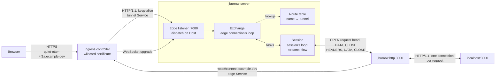

# Phase 3, HTTP Tunnels: Architecture

Status: designed, not yet built. Fourth phase of `PROJECT.md` §Build roadmap, built on phase 2's
multiplexed sessions and flow control.

`PROJECT.md` gives phase 3 one line: host routing on the edge listener, per-request routing, random
and requested subdomains, the blocklist, the wildcard certificate through the DNS-01 `Issuer`; done
when `jburrow http 3000` gives a working `https://<name>.cloudnativehub.app` with a valid
certificate. This document is the full design.

Phases 1 and 2 built a tunnel for bytes: a visitor's TCP connection is one stream, and the server
never looks inside it. An HTTP tunnel is different in three ways. The visitor isn't a TCP connection
the server accepted for one tunnel, but a request arriving from the ingress controller on a
connection it reuses for any host, so the server routes **each request** by its `Host` header and
gives each its own stream ([PROJECT.md §Routing per request, not per
connection](../../PROJECT.md#routing-per-request-not-per-connection)). The server and client both
parse HTTP, so a stream carries a request head, a response head and two message bodies, not
HTTP/1.1 bytes. And browsers stop reading responses in ordinary use, which phase 2 left as its one
open question ([phase 2 §Open
questions](../phase-2-multiplexing/ARCHITECTURE.md#open-questions)).

Read first: `PROJECT.md` (§Routing per request, not per connection, §Accounts, tokens and security,
§Production deployment), [`docs/phase-2-multiplexing/ARCHITECTURE.md`](../phase-2-multiplexing/ARCHITECTURE.md)
(§The read gate, §Client to visitor: credit on delivery, §Head-of-line blocking and deadlock,
§Memory budget), [`docs/phase-1-tcp-tunnel/ARCHITECTURE.md`](../phase-1-tcp-tunnel/ARCHITECTURE.md)
(§The edge listener, §Concurrency model), [`docs/protocol.md`](../protocol.md) (§4 Versioning and
capabilities), [ADR-0007](../adr/0007-wire-protocol-v1.md), [ADR-0008](../adr/0008-byte-path-concurrency-model.md),
[ADR-0009](../adr/0009-flow-control.md) and [ADR-0010](../adr/0010-share-floor-and-visitor-receive-buffers.md).

## Contents

- [Purpose](#purpose)
- [Goals and non-goals](#goals-and-non-goals)
- [Where this phase departs from PROJECT.md](#where-this-phase-departs-from-projectmd)
- [Runtime view](#runtime-view)
- [The `http` capability](#the-http-capability)
  - [Why a capability, not a new draft](#why-a-capability-not-a-new-draft)
  - [Registering an HTTP tunnel](#registering-an-http-tunnel)
  - [One stream per request](#one-stream-per-request)
  - [Heads](#heads)
  - [Bodies](#bodies)
  - [`HEADERS`](#headers)
  - [Violations](#violations)
  - [What else changes in the specification](#what-else-changes-in-the-specification)
- [Subdomains](#subdomains)
- [Module and package layout](#module-and-package-layout)
- [Concurrency model](#concurrency-model)
- [The edge](#the-edge)
  - [Dispatch on `Host`](#dispatch-on-host)
  - [An exchange](#an-exchange)
  - [Request headers the edge sets](#request-headers-the-edge-sets)
  - [Response headers the edge changes](#response-headers-the-edge-changes)
  - [Visitor to client: demand reads](#visitor-to-client-demand-reads)
  - [Client to visitor: credit on delivery across loops](#client-to-visitor-credit-on-delivery-across-loops)
  - [Paused readers](#paused-readers)
  - [Error pages](#error-pages)
- [The client](#the-client)
- [The CLI](#the-cli)
- [Layer rules](#layer-rules)
- [Configuration](#configuration)
- [Observability](#observability)
- [Memory budget](#memory-budget)
- [Performance](#performance)
- [Security and threat model](#security-and-threat-model)
- [Failure modes](#failure-modes)
- [Testing](#testing)
- [Build, CI and packaging](#build-ci-and-packaging)
- [Deployment changes](#deployment-changes)
- [Decisions that need an ADR](#decisions-that-need-an-adr)
- [Extension points](#extension-points)
- [Open questions](#open-questions)
- [Exit criteria](#exit-criteria)

## Purpose

At the end of phase 3:

- `jburrow http 3000` prints `https://quiet-otter-4f2a.cloudnativehub.app`, and a browser anywhere
  loads the developer's local web application through it, with a valid wildcard certificate.
  `--subdomain myapp` asks for `https://myapp.cloudnativehub.app` instead.
- Every request is routed by its `Host` header to the right session, even when the ingress sends
  requests for different tunnels down the same upstream connection.
- Request and response bodies stream in both directions under phase 2's flow control: a 100 MiB
  upload or download holds no more server memory than a 1 KiB one, and server-sent events reach the
  browser as the local service produces them.
- A browser that stops reading a response (a paused video, a background tab) holds back only that
  response, not every other request on the tunnel.
- Names that would help phishing, and the service's own host names, can't be claimed.
- Phase 2 CLIs keep working for TCP tunnels. HTTP is a capability that both sides negotiate, so the
  deploy breaks no tester.

## Goals and non-goals

**Goals**

- **Routing per request.** The edge resolves the target session for every request, never once per
  connection.
- **Streams carry messages, not HTTP/1.1 bytes.** Each side parses HTTP once, at its own edge, and
  the protocol carries the parsed heads and the bodies. Neither side has to trust the other's
  framing, request smuggling can't cross the tunnel, and a later HTTP/2 edge or local connection
  fits without a wire change.
- **No new buffering.** Phase 2's rule holds: a source is read only as far as it can be sent. A
  request body is read from the ingress only in amounts the stream already has credit for.
- **Flow state stays on the session's event loop.** The edge connection a request arrives on is on
  another loop, because the ingress reuses it across tunnels. Everything the flow model decides is
  still decided on one thread ([Concurrency model](#concurrency-model)).
- **Ordinary browser behaviour can't stall a tunnel.** A response that stops draining gives its share
  of the session window back, within a server-wide memory bound ([Paused readers](#paused-readers)).
- **Fail closed, with a page a person can read.** A request that can't be served gets a short HTML
  page with a stable error code, never a hung connection or Netty's own error text.

**Non-goals**

- WebSocket and other `Upgrade` passthrough. `PROJECT.md` puts it in phase 8 (v1), with SSE.
  Server-sent events need nothing special and work in phase 3; an `Upgrade` request gets a `501`
  page ([Extension points](#extension-points) has the hook).
- HTTP/2 or gRPC to the local service, HTTPS local targets, keep-alive pooling of local
  connections, trailers.
- Custom domains, basic auth, IP allow and deny lists, the interstitial (v1).
- Rate limits and per-IP limits (phase 6). Phase 3 adds one request size limit, because the
  ingress's default would otherwise refuse uploads over 1 MiB ([Configuration](#configuration)).
- Reserved subdomains that survive a session, and leases (phase 5). A requested name is held only
  for the session that claimed it, and briefly after it ([Subdomains](#subdomains)).
- Reconnect, `GOAWAY` and drain (phase 4).
- More than one tunnel per session (v1). A session is an HTTP session or a TCP session.

## Where this phase departs from PROJECT.md

| Change | Why |
|---|---|
| HTTP tunnels are the **`http` capability of `jburrow.v1-draft.2`**, not a third draft. | The change is additive: a peer that doesn't offer `http` sees nothing new. ADR-0007 says a version grows within itself through capabilities, and a draft bump would break every phase 2 CLI again for no wire reason ([Why a capability](#why-a-capability-not-a-new-draft)). |
| Streams carry **parsed messages**: the request head in `OPEN`, the response head in `HEADERS`, message bodies in `DATA`, the end of a body as `CLOSE`. `PROJECT.md` says `OPEN` carries the request head and `HEADERS` the response head, and leaves body framing open. | Neither side forwards the other's framing, which closes request smuggling across the tunnel and keeps HTTP/2 open later. |
| HTTP exchanges live under `tunnel/adapter/netty/http`, with a new `routing` feature for names. `PROJECT.md`'s package sketch has `http/` and `routing/` as features. | An exchange is a stream of a session, so it belongs with the stream table it uses; making it a feature would put a port between every frame and its session. Names, the blocklist and the route table have no Netty in them and are a feature of their own. |
| A **second Kubernetes Service** for tunnel traffic, next to the edge Service the connect host uses. | The ingress pools upstream connections per Service. Separate pools mean an upstream connection never carries tunnel requests and then the control WebSocket, so each kind gets the socket settings it needs ([Dispatch on `Host`](#dispatch-on-host)). |
| **Host header rewriting** (`ROADMAP.md` §1, v1) in part: `jburrow http --host-header rewrite`, in the client only. | Development servers increasingly refuse requests for hosts other than `localhost` (Vite's `allowedHosts`, Django's `ALLOWED_HOSTS`). It needs no wire change, and without it the first thing many testers try fails. |
| **One request body limit** (`jburrow.http.max-request-body`), ahead of phase 6's limits. | The ingress refuses bodies over 1 MiB unless told otherwise. `PROJECT.md` wants the limit and its error in one place, the server, so the ingress's limit is lifted and the server's applies. |
| **`Set-Cookie` `Domain` attributes are removed** at the edge. | A tunnel on `x.cloudnativehub.app` could otherwise set cookies for the whole domain, the dashboard's included. `PROJECT.md` §Open questions has the cookie concern; this is its first defence. |
| **Parking**: a response that stops draining has its bytes taken out of the session window, within a server-wide budget. | Phase 2's open question. Per-source limits don't answer it ([Paused readers](#paused-readers)). |

`PROJECT.md` §The wire protocol, §Production deployment (Services) and its build roadmap entry for
phase 3 are updated in the same change as this document.

## Runtime view



One upstream connection from the ingress can carry a request for `alpha` and then one for `beta`.
Each request is one exchange, routed on its own, and its stream belongs to whichever session holds
that name.

## The `http` capability

[`docs/protocol.md`](../protocol.md) gains the capability in this phase and is the authority on the
wire. This section is the design behind it. [ADR-0011](../adr/0011-http-tunnels.md) records the
decisions.

### Why a capability, not a new draft

protocol.md §4.2 already has the mechanism: a capability may introduce "a frame type, flag, field,
field value or error code", which may not be sent in a session unless the server listed the
capability in its `HELLO`. Everything phase 3 adds is one of those:

| Addition | Kind |
|---|---|
| `HEADERS` (type `0x04`, already assigned) | a frame type, now defined |
| `"http"` | a field value of `tunnels[].kind` and `OPEN.kind` |
| `tunnels[].subdomain` in `REGISTER` | a field |
| `request` in `OPEN` | a field |
| `SUBDOMAIN_UNAVAILABLE`, `SUBDOMAIN_FORBIDDEN`, `LOCAL_SERVICE_ERROR` | error codes |

A client that doesn't offer `http` can't ask for an HTTP tunnel (`"http"` stays an unknown kind for
it, `VALIDATION_FAILED`, exactly as today), never receives an `OPEN` it can't read, and may not send
`HEADERS`, so every receiver rule of draft 2 holds for it unchanged. The server keeps speaking exactly
one draft, as protocol.md §4.1 requires before v1.0.0. Phase 2 CLIs keep working through the deploy, and testers can
upgrade when they want HTTP tunnels.

The reference client offers `http`, and the server answers with it. `ProtocolVersion` gains a list of
the capabilities each side supports, and `Session` records the negotiated set when the server's
`HELLO` goes out (server) or arrives (client). Every check below that says "in a session with `http`"
reads that set.

### Registering an HTTP tunnel

`REGISTER`, client to server, gains one field and one kind:

| Field | Type | Rule |
|---|---|---|
| `tunnels[].kind` | string | `"tcp"`, or `"http"` in a session with `http`. |
| `tunnels[].subdomain` | string | Optional, `"http"` only. `[a-z0-9][a-z0-9-]{1,61}[a-z0-9]` with no `--`: 3 to 63 characters. Asks for this name. Without it, the server chooses. |
| `tunnels[].remotePort` | integer | `"tcp"` only. On an `"http"` entry it is `VALIDATION_FAILED`. |

`subdomain` on a `"tcp"` entry is `VALIDATION_FAILED`. An `"http"` entry in a session without `http`
is `VALIDATION_FAILED` too, before any check of §8.4: the session's codec refuses it, and
`RegisterTunnels`, which is given the session's negotiated capabilities, refuses it again so the rule
holds of the use case on its own. Checking the name against the blocklist and the route table is the
server's job (§8.4's order gains it after the port step: every port is reserved before any name is
claimed), and refusals are tunnel-scoped session errors carrying the entry's `ref`, as
`PORT_UNAVAILABLE` is:

| Code | Scope | Close code | Meaning |
|---|---|---|---|
| `SUBDOMAIN_UNAVAILABLE` | session | 1008 | The requested name is in use, or held for someone else ([Subdomains](#subdomains)). |
| `SUBDOMAIN_FORBIDDEN` | session | 1008 | The requested name is reserved or blocked on this server. |

The reply's entry for an HTTP tunnel:

```json
{
  "ref": "default",
  "tunnelId": "5d0f4f0e-31a6-4a39-8d51-0c0f7f1f6c23",
  "kind": "http",
  "publicHost": "quiet-otter-4f2a.example.dev",
  "publicPort": 443,
  "url": "https://quiet-otter-4f2a.example.dev"
}
```

`url`'s rule becomes per kind. For `"tcp"`, unchanged: `tcp://<publicHost>:<publicPort>`. For
`"http"`: `https://<publicHost>` or `http://<publicHost>`, followed by `:<publicPort>` unless the port
is that scheme's default (443 or 80). The scheme is the server's to choose
(`jburrow.http.public-scheme`, `http` on a developer's machine).

### One stream per request

An HTTP tunnel's stream is one exchange: one request and its response.

| Server sends | Client sends |
|---|---|
| `OPEN` with `kind: "http"` and the request head | |
| `DATA`: the request body, if any | `HEADERS`: the response head, once, before any `DATA` |
| `CLOSE`: the request body is complete | `DATA`: the response body, if any |
| | `CLOSE`: the response body is complete |

Either side may reset the stream at any point, with the codes of draft 2 and one new one:

| Code | Scope | Meaning |
|---|---|---|
| `LOCAL_SERVICE_ERROR` | stream | The local service's response wasn't valid HTTP/1.1, or its connection ended before the response did. |

Both directions are independent, as for a TCP stream. A response may start before the request body
ends: a local service can answer `413` to an upload it won't take. When the client's response is
complete while the request body is still arriving, the client sends `CLOSE` and then `CLOSE RST
CANCELLED`, so the server stops sending the body. Frames on one connection arrive in order, so the
reset can't overtake the response.

### Heads

`OPEN` gains `request`, present when `kind` is `"http"` and absent otherwise:

| Field | Type | Rule |
|---|---|---|
| `request.method` | string | An HTTP token (RFC 9110 §5.6.2), 1 to 32 characters, case kept. Not `CONNECT`. |
| `request.target` | string | Origin form (`/path?query`, starting with `/`), or `*` for `OPTIONS`. 1 to 4,096 characters, visible ASCII. Sent as the edge received it, never decoded or normalised. |
| `request.headers` | array | The header fields, in order: each a two-element array `[name, value]`. |
| `request.body` | string | `"empty"`, `"length"` or `"chunked"` ([Bodies](#bodies)). |

```json
{
  "tunnelId": "5d0f4f0e-31a6-4a39-8d51-0c0f7f1f6c23",
  "kind": "http",
  "remote": { "address": "203.0.113.9", "port": 51234 },
  "request": {
    "method": "POST",
    "target": "/api/items?page=2",
    "headers": [
      ["host", "quiet-otter-4f2a.example.dev"],
      ["content-type", "application/json"],
      ["content-length", "27"],
      ["x-forwarded-for", "203.0.113.9"],
      ["x-forwarded-proto", "https"],
      ["x-forwarded-host", "quiet-otter-4f2a.example.dev"],
      ["via", "1.1 jburrow"]
    ],
    "body": "length"
  }
}
```

**Header fields**, in both heads:

- A **name** is an HTTP token in **lower case**, 1 to 256 characters. Lower case is what HTTP/2 and
  HTTP/3 require, so a later HTTP/2 side needs no conversion, and comparing names needs no case
  folding.
- A **value** is 0 to 4,096 characters from U+0009, U+0020 to U+007E and U+0080 to U+00FF: the field
  value's bytes, each as the code point of the same number (ISO 8859-1), so non-ASCII bytes that HTTP
  allows (`obs-text`) survive and the JSON stays valid UTF-8. No CR, LF or NUL, and no leading or
  trailing whitespace. 4,096 is draft 2's limit on any JSON string (protocol.md §7.1), which a longer
  value would break as `PROTOCOL_ERROR` before its field rule is checked; the edge answers `431` for
  one.
- The list keeps order and duplicates. `set-cookie` can't be joined with commas, so it is never
  joined, and nothing else is either.
- **Connection-specific fields are forbidden**: `connection`, `keep-alive`, `proxy-connection`,
  `transfer-encoding`, `te`, `trailer`, `upgrade`. Each side removes them, and those `connection`
  names, before it builds a head. A head that carries one is `VALIDATION_FAILED`.
- **`host`** appears exactly once in a request head.
- The whole `OPEN` or `HEADERS` payload stays within draft 2's 16,384-byte control payload limit. The
  edge encodes the head first and answers `431` if it doesn't fit; the client answers `502` the same
  way for a response head ([Error pages](#error-pages)).

### Bodies

A body is the bytes of the message body, with its HTTP/1.1 framing removed: no chunk sizes, no
trailers. `body` says how the receiver should frame it again for its own connection:

| `body` | Meaning | Rule |
|---|---|---|
| `"empty"` | No body. The sender's `CLOSE` follows at once. | A request may carry `content-length: 0`; a response may carry any `content-length` when it answers `HEAD` or is `304`. Otherwise no `content-length`. |
| `"length"` | A body of known length. | Exactly one `content-length` header, decimal digits, at most 2^53 − 1. The `DATA` on the stream adds up to exactly that. |
| `"chunked"` | A body of unknown length, ended by `CLOSE`. | No `content-length`. The receiver frames it as `transfer-encoding: chunked`, or for a response it can't send that way, closes its connection after it. |

Responses to `HEAD`, and `1xx`, `204` and `304` responses, are always `"empty"`, whatever their
headers say, as HTTP/1.1 itself requires (RFC 9112 §6.3). Trailers are dropped in phase 3: the
receiver of a chunked body ends it with an empty trailer section.

### `HEADERS`

`HEADERS` (`0x04`) is defined in a session with `http`. Client to server, on a data stream of an HTTP
tunnel, JSON, at most 16,384 bytes, not flow-controlled (like every control payload, so a response
head always gets through, whatever the windows):

| Field | Type | Rule |
|---|---|---|
| `status` | integer | 200 to 599, or 100 to 199 except 101. |
| `headers` | array | As in the request head. |
| `body` | string | As in the request head. Absent for a `1xx`. |

```json
{
  "status": 200,
  "headers": [
    ["content-type", "text/html; charset=utf-8"],
    ["content-length", "1043"]
  ],
  "body": "length"
}
```

- **Exactly one final response.** A `HEADERS` with a status of 200 or more is the response head and
  is sent once. Before it, the client may send any number of `1xx` heads (`103 Early Hints`); the
  edge passes them on. A client receives no `Expect` header (the edge answers `100 Continue` itself,
  [An exchange](#an-exchange)), so it never has to send `100`.
- **`101` is reserved** for the `Upgrade` passthrough of a later phase. In phase 3 it is
  `VALIDATION_FAILED`.
- A `204` or `304` head is always `"empty"`, which the head can check on its own. A response to
  `HEAD` is too, which needs the request: the stream's rules check it, as `VALIDATION_FAILED`.
- The server never sends `HEADERS`. A server that receives it outside a session with `http`, or on a
  TCP tunnel's stream, raises `PROTOCOL_ERROR`, as draft 2 does for every `HEADERS`.

### Violations

Each of these is a session error, by draft 2's rule that a bug fails at the first bad frame:

| Received | Error |
|---|---|
| `HEADERS` in a session without `http`, or on a TCP tunnel's stream, or from the server | `PROTOCOL_ERROR` |
| `"http"`, or one of the three new codes, in a session without `http` | as anything unknown: `VALIDATION_FAILED` in a payload, `PROTOCOL_ERROR` in a `CLOSE` reset |
| A second final `HEADERS` on a stream, or a `1xx` after the final one | `PROTOCOL_ERROR` |
| `DATA` or `CLOSE` from the client on an HTTP stream before its final `HEADERS` | `PROTOCOL_ERROR` |
| `DATA` on a stream whose `body` is `"empty"`; more `DATA` than a `"length"` body's `content-length`, or `CLOSE` before it is reached | `PROTOCOL_ERROR` |
| A head breaking a field rule above, or a final head that isn't `"empty"` in answer to `HEAD` | `VALIDATION_FAILED` |
| `HEADERS` after the client's own `CLOSE` on the stream | `STREAM_CLOSED`, a stream error, as `DATA` is (§9.2) |

A client whose local service sends fewer bytes than its `content-length` and closes doesn't send
`CLOSE`. That would break the rule above. It resets with `LOCAL_SERVICE_ERROR`.

### What else changes in the specification

| Section | Change |
|---|---|
| §1 change log | A row for the `http` capability: additive, draft 2 unchanged for peers that don't offer it. |
| §4.2 | Defines `http`, the first capability. "Draft 2 defines no capabilities" goes. |
| §6 registry, §6.4 | `HEADERS` is sent by the client in a session with `http`, and is defined. |
| §7.5, §7.6 | `subdomain`, `"http"`, the per-kind `url` rule, with examples generated by the codec. |
| §7.7 | `request`, with an example. |
| new §7.9 `HEADERS` | The response head. |
| new §7.10 Header fields | The field rules, shared by both heads. |
| §8.3 | A `REGISTER` asking for an HTTP tunnel waits for the server's `HELLO`. |
| §8.4 | The subdomain step after the port step. |
| new §9.7 Streams and HTTP | One stream per exchange, bodies, `body` framing, the response-before-request-end rule. |
| §12 | The three new codes. |
| §13 | Step 4: a server receives `HEADERS` only in a session with `http`. Step 8: `HEADERS` is parsed. A new step 10: the HTTP stream rules of [Violations](#violations). |
| §14 | Head limits. |
| §16 | Smuggling, header injection, cookies. |

The conformance vectors gain `REGISTER`, its reply, `OPEN` and `HEADERS` for HTTP, valid and invalid,
each with and without the capability negotiated. Each vector names the capabilities its session has.

## Subdomains

The `routing` feature in `jburrow-server-core` holds everything about names. It is plain Java: no
Netty, and nothing the edge needs to hold a lock for.

- **`SubdomainName`** is a validated label: the rule of `tunnels[].subdomain`. The edge parses `Host`
  into one, so the route table never sees an unchecked string. It lives in the protocol model
  (`io.jburrow.protocol.control`), beside the rule it applies, rather than in the `routing` feature:
  `routing.domain` needs it and may only depend on domain packages and the protocol model, `tunnel`
  needs it and may only reach `routing` through its ports, and the client can check `--subdomain`
  with it before sending.
- **Random names** are `<adjective>-<animal>-<4 hex digits>`, like `PROJECT.md`'s
  `quiet-otter-4f2a`: two lists of 256 short, plain words each, so 2^32 names. A random name that is
  taken or held is drawn again, up to 8 times, and then `INTERNAL_ERROR`, since at tester scale that
  means a bug, not a full space. A test checks that no word, and no join of two words, matches the
  blocklist.
- **The blocklist** has two parts. **Reserved names** are refused exactly: the service's own hosts
  (`api`, `app`, `connect`, `tcp`, `www`, `mail`, `admin`, `status`, `docs`), the names people expect the
  operator to answer on (`abuse`, `support`, `security`, `root`), the label of
  `jburrow.edge.connect-host` and of `jburrow.tcp.public-host` when they are under the HTTP domain,
  and `jburrow.http.reserved-names`. **Blocked terms** are refused anywhere in a name: `login`,
  `signin`, `verify`, `account`, `secure`, `wallet`, `bank`, and the brand names phishing uses most
  (`paypal`, `apple`, `google`, `microsoft`, `amazon`, `facebook`, `instagram`, `netflix` and the
  like, kept in one reviewed list). Matching a term inside a name blocks some honest names
  (`accounting-demo`); a phishing page served from one of them would put the whole domain at risk,
  which is the larger cost. Both lists are compared after lower-casing, which `SubdomainName` already
  requires.
- **The route table** (`SubdomainRoutes`) maps a name to its tunnel. A claim is *active* while the
  tunnel exists, and *held* for `jburrow.http.name-hold` (60 s) after it ends, for the principal that
  had it: only that principal may claim the name while it is held, and random names skip it. So a
  tester whose CLI restarts gets the URL back with `--subdomain`, and nobody can take over a URL in the
  seconds after its owner's session drops. Phase 5's leases replace the hold with a durable
  reservation; phase 4's resume builds on it.
- **Generic in principal and tunnel.** `SubdomainRoutes<P, T>` and its ports take the claimant and the
  tunnel as type parameters, and only compare them with `equals`. The composition root makes a
  `SubdomainRoutes<Principal, TunnelId>`. Naming `tunnel.domain`'s types instead would have `routing`
  reach into another feature's domain, and once registration uses routing's ports the two features
  would form a cycle; both are build failures under the layer rules.
- **Claims** are made by `RegisterTunnels`, all or nothing with any port it reserves, as in phase 1,
  and released when the session ends. The table is a `ConcurrentHashMap` with a per-name compare and
  set, touched at registration, session end and per request (a lookup). ADR-0008 allows global state
  that has to be global behind its own small synchronisation; a lookup never blocks.

## Module and package layout

New and changed packages; unchanged ones are as phase 2 left them.

```
jburrow-protocol/                         io.jburrow.protocol
├── wire/         ErrorCode (+ SUBDOMAIN_UNAVAILABLE, SUBDOMAIN_FORBIDDEN, LOCAL_SERVICE_ERROR),
│                 Capability (new: HTTP), ProtocolVersion (+ supported capabilities)
├── control/      TunnelKind (+ HTTP), TunnelRequest (+ subdomain), RegisteredTunnel (url per kind),
│                 Open (+ request), HttpRequestHead, HttpResponseHead, HeaderFields, BodyFraming,
│                 SubdomainName (new)
├── stream/       StreamEvent (+ HEADERS_RECEIVED, HEADERS_SENT), HttpExchangeRules (new: the
│                 ordering and body-length rules of an HTTP stream)
├── flow/         SessionFlow (+ reserve, refund, park), ReceiveWindow (+ parked bytes)
└── adapter/
    ├── jackson/  header field arrays, BodyFraming
    └── netty/    Frame.Headers (new), FrameCodec (HEADERS with capability context)

jburrow-server-core/                      io.jburrow.server.core
├── routing/      new feature
│   ├── domain/       Blocklist, NameGenerator, Claim
│   └── application/  SubdomainRoutes; port/ SubdomainClaims, RouteLookup, ClaimRefused
├── tunnel/domain/    Session (+ capabilities, HTTP stream rules), StreamTable (+ exchange entries)
├── tunnel/application/ RegisterTunnels (+ names), PlannedTunnel (sealed: Tcp with a port, Http with a
│                       name), RegistrationPolicy (+ HTTP public domain, scheme, port), ParkingBudget (new)
└── tunnel/adapter/netty/
    ├── edge/     EdgeChannelInitializer (head phase only), HostDispatcher (new), ConnectPipeline
    │             (new: phase 1's connect handlers, installed per request), RequestDeadline (new:
    │             re-armed per exchange), EdgeSettings (+ http,
    │             capabilities), HttpSettings (new), EngineDependencies (+ the RouteLookup port)
    ├── control/  ControlSessionHandler (HEADERS dispatch), SessionStreams (+ HEADERS), SessionRegistry
    │             (+ find by tunnel id), ControlSessionInitializer (a codec per session)
    ├── tcp/      NettyTunnelListeners (gives each session its exchanges), TunnelStreams (new: a session's
    │             streams of both kinds, routed by stream)
    └── http/     new: ExchangeHandler (edge connection's loop), SessionExchange (session's loop, one per
                  exchange), SessionExchanges (session's loop, one per session), ExchangeGate, Parking,
                  DemandReadAllocator, RequestHeads, ResponseHeads, EdgeErrorPage, EdgeError,
                  ErrorPageExchange (a page, with the body discarded), ExchangeRequest (a routed head),
                  ExchangeEnded (the event that hands the connection back), ExchangeServices and
                  ExchangeSessions (what the edge routes with)

jburrow-server/                           io.jburrow.server
├── config/       JBurrowProperties (+ jburrow.http.*), EdgeConfiguration (+ parking in the budget)
└── observability/ MicrometerTunnelMetrics (+ HTTP and parking metrics)

jburrow-client-core/                      io.jburrow.client
├── ClientSettings (+ capabilities), JBurrowClient.Builder (+ http tunnel)
└── tunnel/
    ├── domain/        TunnelSpec (+ HTTP: subdomain, host header), ClientSession (+ HTTP rules)
    └── adapter/netty/ LocalExchangeHandler (new), LocalConnector (HTTP pipeline), ReadGate (unchanged)

jburrow-cli/      HttpCommand (new), output (+ request lines and events)
scripts/load/     StreamLoad.java (+ --http)
scripts/          http-echo-server.py (new), native-smoke.sh (+ an HTTP tunnel)
```

**Why heads are records in the protocol model.** Both sides build and check them, and the rules
(lower-case names, forbidden fields, framing) are the protocol's. Keeping them in `control` puts them
next to `Open` and lets `ControlJson` and the vectors cover them like every other payload. Netty's
`HttpRequest` and `HttpResponse` stay in the adapters, which convert.

## Concurrency model

ADR-0008 pins a TCP visitor to its session's event loop: the tunnel listener is the session's, so its
accepted channels register there. An HTTP exchange can't be pinned. Its edge connection belongs to
the ingress and serves requests for any tunnel, one after another, so it lives on whichever edge loop
accepted it. [ADR-0012](../adr/0012-http-exchanges-across-event-loops.md) records how the two loops
share an exchange:

| State | Owned by | Touched from the other loop by |
|---|---|---|
| The edge connection, its pipeline, its codec, its `autoRead` | the edge connection's loop | a task: "read once, up to `n` bytes", "write this", "flush" |
| The stream's lifecycle, its `StreamFlow`, the session's `SessionFlow`, the exchange gate, parking | the session's loop | a task: "this content arrived", "this write completed", "this read finished" |
| The route table | neither (concurrent map) | lookups from edge loops, claims from registration |

- **A task per crossing, nothing shared.** Each side posts a task to the other's loop with what it
  learnt, and never reads the other's state. `ExchangeHandler` (edge side) and `SessionExchange`
  (session side) are the two halves, and only `SessionExchange` calls the domain.
- **Writes keep their order.** The session's loop hands every write to the edge channel to the edge
  loop as a task, response content included, in the order it makes them, so a response's head, its body
  and its end can't reorder. Netty would run a write from another thread as a task too, but a session and
  an edge connection can share a loop, and there a direct write would overtake tasks already posted. The
  write's completion listener runs on the edge loop and posts the release back.
- **Considered and rejected: moving the edge channel to the session's loop per exchange.** Netty can
  deregister and re-register a channel, but its pipeline would change loops between requests,
  half-finished work on the old loop would race the new one, and the next request on the same
  connection may be for another session. Tasks cost a queue offer per crossing and keep every rule
  ADR-0008 states.
- **The cost is three hops per request** (the head, at least one read, the end) and one per response
  write. At 64 KiB per write that is far below the per-byte cost ([Performance](#performance)).

## The edge

### Dispatch on `Host`

Phase 1's pipeline ran the connect checks on every connection. Phase 3 splits it in two:

| Handler | Job |
|---|---|
| Request deadline | As phase 1, re-armed for each request ([An exchange](#an-exchange)). |
| `HttpServerCodec` | Initial line ≤ 4,096 bytes, headers ≤ 8,192 bytes, content chunks ≤ 16 KiB. Validates headers. |
| `HostDispatcher` | New. For each request head: exactly one `Host`, parsed, lower-cased, port dropped. Equal to `jburrow.edge.connect-host`: installs the connect pipeline (phase 1's aggregator, `ClientAddressResolver`, `ConnectRequestFilter`, the WebSocket handlers) behind itself and passes the request on. `<label>.<jburrow.http.domain>` with a valid label: hands the request to the HTTP exchange handler. Anything else: a `404` page, `TUNNEL_NOT_FOUND`. |

- **One exchange at a time.** After a request head the dispatcher stops reading the connection until
  the exchange is over (the body is read only on demand, below), so a pipelined second request is
  never read early and never needs buffering. The ingress doesn't pipeline to upstreams; this is what
  makes the edge safe if something else does.
- **Mixed connections still work.** A connection may serve tunnel requests and then the connect
  upgrade. The dispatcher installs the connect pipeline only between exchanges, so phase 1's checks
  run unchanged. A connect request is the last request on its connection either way: it upgrades,
  or phase 1's filter refuses it and closes the connection, as protocol.md §3.5 requires. In
  production it doesn't happen: the wildcard ingress uses its own Service, so the ingress never
  pools a tunnel connection with a connect one ([Deployment changes](#deployment-changes)).
- **Held, not read early.** The read that completes a head can also hold a pipelined request
  behind it. The dispatcher keeps anything decoded after a request's end, at most one read's worth,
  until the exchange ends, then dispatches it as if it had just been read. While an exchange waits for
  its response with nothing held, the dispatcher keeps one read outstanding: NIO only notices a
  visitor's `FIN` while a read is, and without it a visitor that gives up on a slow response would hold
  its stream until the response is written. What that read brings is held like the rest.
- **Socket settings per kind.** When a connection first carries an exchange, it gets
  `jburrow.http.socket-buffer` (16 KiB, so 32 KiB once Linux doubles it) as `SO_SNDBUF` and
  `SO_RCVBUF`. That bounds the kernel memory an exchange can park ([Memory budget](#memory-budget))
  and costs no throughput on the hop from the ingress, which is inside the node. A control session
  keeps the kernel's auto-tuning, which it needs across the internet.

### An exchange

`ExchangeHandler`, on the edge connection's loop, takes a request head through these steps; any step
that fails answers with an [error page](#error-pages) and the exchange ends:

1. **Checks** the edge can make alone: `Upgrade` → `501`, `UPGRADE_NOT_SUPPORTED`. A target not in
   origin form (or `*` for `OPTIONS`), or `CONNECT` → `400`. Both `content-length` and
   `transfer-encoding`, more than one `content-length`, or a `transfer-encoding` other than exactly
   `chunked` → `400`, `BAD_REQUEST`. A `content-length` over `jburrow.http.max-request-body` → `413`.
2. **Route.** `RouteLookup.find(name)`, then the tunnel's session from `SessionRegistry`. No active
   claim, or a session that has ended → `404`, `TUNNEL_NOT_FOUND`.
3. **Build the head** (`RequestHeads`): connection-specific fields removed, the edge's own fields set
   ([below](#request-headers-the-edge-sets)), `Expect` removed, `body` from the request's framing.
   Encoded over the limit → `431`, `REQUEST_HEADERS_TOO_LARGE`.
4. **Hand over** to the session's loop. `SessionExchange` admits the stream with phase 2's checks
   (established, `max-concurrent-streams`, `StreamQuota`; a refusal → `503`, `TUNNEL_BUSY`, with
   `Retry-After: 1`), sends `OPEN`, and starts the response timer.
5. **`Expect: 100-continue`.** Once the stream is open the edge sends `100 Continue` itself, as the
   origin would. The client never sees `Expect`.
6. **Bodies**, both ways at once ([demand reads](#visitor-to-client-demand-reads), [credit on
   delivery](#client-to-visitor-credit-on-delivery-across-loops)).
7. **Response head.** `HEADERS` arrives on the session's loop; the response's headers are adjusted
   ([below](#response-headers-the-edge-changes)), framed from `body`, and written. A `1xx` is written
   as an informational response. No final head within `jburrow.http.response-timeout` (60 s) of
   `OPEN` → the stream is reset with `CANCELLED` and the visitor gets `504`, `RESPONSE_TIMEOUT`.
8. **End.** The client's `CLOSE` writes the end of the response. The connection stays open for the
   next request if the request body was read to its end, the visitor didn't ask to close, and the
   response was framed by length or chunks; otherwise it closes once the response is flushed.

**Timers.** A new connection must deliver its first head within `jburrow.edge.request-timeout`
(10 s), as in phase 1. Between exchanges the deadline is `jburrow.http.keep-alive-timeout` (75 s),
longer than the ingress's own upstream keep-alive (60 s by default), so the ingress, which knows when
it is about to reuse a connection, is the one that closes an idle one. Once a head has arrived there
is no read timeout: the ingress has its own for visitors, and a slow upload that the tunnel itself
holds back mustn't be cut by the edge. A connect request is the exception: as in phase 1, the
deadline keeps running until its upgrade completes, so a connect request whose small body trickles
in is still closed in time. On a connection that served exchanges first, it restarts at
`request-timeout` from the connect head.

**If the stream ends early.** A reset from the client before the final head becomes a `502` page
(`LOCAL_SERVICE_UNREACHABLE` or `LOCAL_SERVICE_ERROR`, from the reset's code). After the head has
been written there is no way to report an error to the visitor in HTTP/1.1, so the edge closes the
connection without ending the body, which the ingress and the browser see as a truncated response.
The visitor's connection closing resets the stream with `CANCELLED`.

### Request headers the edge sets

`PROJECT.md` §Accounts, tokens and security: the forwarding headers are set from what the ingress
passed in, never trusted from the visitor. The edge removes every `forwarded`, `x-forwarded-*` and
`x-real-ip` field it received, and adds:

| Field | Value |
|---|---|
| `x-forwarded-for` | The visitor's address, resolved by phase 1's `ClientAddressResolver` rules (the rightmost address that isn't a trusted proxy). One address, the same as `OPEN.remote.address`. |
| `x-forwarded-proto` | `x-forwarded-proto` from a trusted proxy if it is `http` or `https`; otherwise `http`. |
| `x-forwarded-host` | The `Host` the visitor asked for. |
| `via` | `1.1 jburrow`, after any `via` already present, so the local service can tell the request came through a tunnel. |

`host` is kept as the visitor sent it; `--host-header rewrite` changes it on the client
([The client](#the-client)). The local service therefore gets the head exactly as `OPEN` describes
it, apart from that one option, which keeps the later inspection API honest.

### Response headers the edge changes

Only two things, both for the domain's sake rather than the tunnel's:

- **`set-cookie`'s `Domain` attribute is removed**, so every cookie a tunnel sets is host-only. A
  cookie for the parent domain would reach the dashboard and every other tunnel, which is the cookie
  tossing `PROJECT.md` §Open questions warns about. The rest of the cookie is untouched.
- **Framing** is the edge's: `content-length` from a `"length"` head, `transfer-encoding: chunked` for
  `"chunked"`, nothing for `"empty"`.

Nothing is added. The response the browser gets is the local service's.

### Visitor to client: demand reads

Phase 2's read gate reads a TCP visitor only as far as its stream may send, using a
`RecvByteBufAllocator` that asks the flow state how much that is. For an exchange that can't work: the
allocator runs on the edge loop, and the flow state is on the session's loop. So the request body is
read **on demand**, with the credit taken first:

1. On the session's loop, when the request body is incomplete and no read is outstanding,
   `ExchangeGate` asks the flow model for a **reservation**: `SessionFlow.reserve(stream, 16 KiB)`
   takes up to 16 KiB of stream and session credit at once (and no more than the session channel's
   headroom allows), the same minimum phase 2's gate uses. Reserved credit is spent: no other stream
   can take it.
2. A grant of `g > 0` bytes posts a task to the edge loop: read once, into a buffer of exactly `g`
   bytes (`DemandReadAllocator`, one read per demand, so `maxMessagesPerRead` is 1 while an exchange
   is reading).
3. `HttpServerCodec` decodes the read. Decoded body content is never larger than the bytes read, so
   it fits the reservation. Each content is posted to the session's loop and sent as `DATA` at once,
   against the reservation, with nothing left over.
4. When the read is done the edge posts how much body it produced, and the session's loop refunds
   the rest of the reservation (`SessionFlow.refund`), then reserves again.
5. A grant of 0 puts the exchange in phase 2's line for session credit, or waits for its stream's
   `WINDOW_UPDATE`, exactly as a TCP visitor does. Turns and resumes follow phase 2's rules; the 16 KiB
   demand is the share floor of ADR-0010, so each turn is one demand.

**Before the stream exists.** The head is read with `autoRead` on and 4 KiB reads. The
`DemandReadAllocator` that sizes them, and later the demands, is installed when the connection is
accepted: Netty makes a channel's read handle on its first read and keeps it, so an allocator set when
the connection first carries an exchange would never be asked. A connection that becomes a control
session switches it to Netty's own sizing at the upgrade. The read that
completes a head can carry the first bytes of its body: at most one read, under 4 KiB. They are
copied onto the heap, as phase 2's carry is, and sent first, under the first reservation.

**The reservation is the flow model's**, not the adapter's arithmetic (phase 2's rule): `reserve`
and `refund` are `SessionFlow` methods, checked like `release` (a refund of more than is reserved
throws), and the fuzz target gains them. A stream that ends with a reservation outstanding refunds
it at once, which returns the session's part. Reserving doesn't touch the wire: the peer can't tell a
reserved byte from one that hasn't been read yet.

### Client to visitor: credit on delivery across loops

As phase 2: the client's `DATA` is checked and accounted on the session's loop, written to the edge
channel with a promise, and released when the write completes, successfully or not. The difference
is where the listener runs: on the edge loop, so it posts the release to the session's loop, which
calls `Session.onReleased` and sends any `WINDOW_UPDATE` the returned `Credit` names.

Writes to an edge channel are flushed once per read burst of the session channel, as the TCP relay
does: the session's loop collects the exchanges it wrote to and flushes each at `channelReadComplete`.

### Paused readers

Phase 2 measured the limit: the server's session window is two stream windows, so two visitors that
stop reading stop the session's client-to-visitor direction, until they read again or go. With a TCP
tunnel that takes deliberate stalling. With HTTP it is ordinary: a browser stops reading a video once
it has buffered enough, and a page left in a background tab keeps its long download open. In front of
the edge the ingress's buffer, its send timeout and the kernel absorb some of this, but once their
buffers are full, the response's credit stops coming back, and two such responses would freeze every
other request on the tunnel for as long as the ingress keeps them open (60 s of no progress, by
default).

**Parking.** A response that stops draining is taken out of the session window:

- An HTTP stream is **stalled** when it holds bytes (received, not yet written to its edge channel)
  and none of its writes has completed for `jburrow.http.park-after` (1 s).
- A stalled stream is **parked** if the server's parked total plus the bytes it holds stays within
  `jburrow.http.max-parked` (16 MiB) and its session's within `jburrow.http.max-parked-per-session`
  (2 MiB). Parking asks the flow model to treat the stream's held bytes as released **for the
  session window only** (`SessionFlow.park`), and sends the session credit that frees at once. The
  bytes stay where they are, queued to the edge channel. The stream's own credit doesn't come back
  until they are written, so a parked stream can never hold more than its stream window.
- When a parked stream's writes complete, its stream credit returns as usual and no session credit
  does, since that was returned already. Parked bytes are released first, since they arrived first.
  Once it holds nothing parked, it is an ordinary stream again.
- A stream that ends while it holds parked bytes is marked as gone in the model
  (`SessionFlow.onRemoved`), and its remaining releases still go through its `StreamFlow`, so a
  parked byte never returns session credit twice and a gone stream returns no stream credit.
- A stalled stream that doesn't fit the budget stays unparked and behaves as in phase 2. The budget is
  the memory bound; `jburrow_flow_park_refused_total` says when it binds.

**Why this is allowed.** protocol.md §10.4 lets a receiver grant more credit than it has released.
Parking does exactly that, so it needs no wire change and the client can't tell. What it changes is
the server's memory bound, from the session window to the session window plus the session's parked
bytes, which [Memory budget](#memory-budget) accounts for.

**Why not something simpler.**

| Alternative | Why not |
|---|---|
| A larger server session window | Raises every session's worst case to buy room that only stalled sessions use. 200 sessions × 2 MiB more is 400 MiB of direct memory. |
| Smaller stream windows for HTTP sessions | 64 KiB, the protocol's minimum, moves the boundary from two stalled responses to eight and caps a download at 64 KiB per round trip: 0.64 MiB/s at 100 ms. Parking keeps 256 KiB windows and handles any number of stalls up to its budget. |
| Resetting a stalled stream | Breaks a paused video, which a browser resumes by reading on. |
| Parking TCP streams too | A TCP visitor that stalls is rare in honest use and deliberate otherwise, and the budget would go to whoever stalls first. Phase 6's per-source limits are the TCP answer. The model doesn't care about the kind, so opting TCP in later is a configuration change. |

The fuzz target gains parking: the conservation invariant counts parked bytes as released in the
session's column and as held in the stream's, and a new invariant holds that no stream holds more than
its stream window and the parked total is never more than the stream windows of the streams that
parked. The model knows nothing of time or budgets, so a caller that caps what it parks caps memory.

### Error pages

An exchange the edge can't complete is answered with a short HTML page:

```
HTTP/1.1 404 Not Found
content-type: text/html; charset=utf-8
cache-control: no-store
jburrow-error: TUNNEL_NOT_FOUND
```

The page names the host, says in one sentence what happened and what the tunnel owner can do, and
shows the code. It loads nothing: no script, no style sheet, no image. The codes are the server's
(`EdgeError`, in `tunnel/adapter/netty/http`), not the protocol's, since no peer ever receives one,
and `ErrorCodeSpaceTest` covers them with the others:

| Code | Status | When |
|---|---|---|
| `TUNNEL_NOT_FOUND` | 404 | No tunnel has this name, or the host isn't a tunnel host. |
| `BAD_REQUEST` | 400 | A request the edge won't forward ([An exchange](#an-exchange), step 1). |
| `REQUEST_TOO_LARGE` | 413 | The body is larger than `jburrow.http.max-request-body`. A chunked body that passes it mid-stream resets the stream and gets the page if no response has started. |
| `REQUEST_HEADERS_TOO_LARGE` | 431 | The head doesn't fit a control payload. |
| `UPGRADE_NOT_SUPPORTED` | 501 | An `Upgrade` request. |
| `LOCAL_SERVICE_UNREACHABLE` | 502 | The client couldn't connect to its local service. |
| `LOCAL_SERVICE_ERROR` | 502 | The local service's response wasn't valid, or its head was too large. |
| `TUNNEL_BUSY` | 503 | A stream cap refused the request. `Retry-After: 1`. |
| `SERVER_SHUTTING_DOWN` | 503 | The server is stopping. `Retry-After` as for a refused upgrade. |
| `RESPONSE_TIMEOUT` | 504 | No response head within `jburrow.http.response-timeout`. |

## The client

The client gains an HTTP stream type next to the TCP one, on the same control loop, with the same
read gate.

- **`OPEN` with `request`.** The client resolves and connects to the tunnel's local target as for TCP
  (on a virtual thread, phase 1), with Netty's `HttpClientCodec` in the local connection's pipeline:
  initial line ≤ 4,096 bytes, headers ≤ 12 KiB. One local connection per request, closed when the
  exchange ends. Pooling is an open question for [Performance](#performance).
- **The request.** `LocalExchangeHandler` writes the head from `OPEN`: the fields as given,
  `content-length` or `transfer-encoding: chunked` from `body`, and with `--host-header rewrite`,
  `host` set to the local target's `host:port`. `DATA` becomes body content, `CLOSE` the end of the
  body. Server `DATA` waits in the stream's queue while the connection is being made, bounded by the
  client's stream window, as in phase 2.
- **The response.** A `1xx` from the local service becomes a `1xx` `HEADERS`, except `101`, which can't
  happen because the client never forwards `Upgrade`, and is treated as invalid. The final response
  becomes `HEADERS` (connection-specific fields removed, `body` from the response's framing and the
  request's method), then body content as `DATA` and its end as `CLOSE`. A response head that encodes
  over 16,384 bytes, invalid HTTP, or a connection that ends early becomes `CLOSE RST
  LOCAL_SERVICE_ERROR`; a refused connection `LOCAL_SERVICE_UNREACHABLE`.
- **Flow.** The local connection is read through phase 2's `ReadGate` and
  `CreditBoundedRecvByteBufAllocator`, which cap a read at what the stream may send. The codec's
  decoded content is never more than the bytes read, so a read still fits one frame and its credit.
  The client has no loop crossing: its local connections are on its control loop (phase 1).
- **`HELLO`** offers `http`. A server that doesn't answer with it can't have HTTP tunnels, and
  `jburrow http` reports that the server doesn't support them (exit code 6). A client that wants an
  HTTP tunnel sends its `REGISTER` only once the server's `HELLO` has arrived and listed `http`:
  `"http"` is something the capability introduces, which protocol.md §4.2 forbids before the
  session has it, and the reference codec refuses to encode it until then. That costs HTTP sessions
  one round trip at setup; TCP sessions still register at once.
- **`JBurrowClient.Builder`** gains `http(localTarget)` with `subdomain` and `hostHeader`, and
  `TunnelHandle` reports each completed exchange (method, path, status, bytes, duration) to
  `TunnelEvents`, which is what the CLI prints. The path is reported on the developer's own machine
  only; the server never logs it ([Observability](#observability)).

## The CLI

```
jburrow http [host:]port [--subdomain <name>] [--host-header rewrite] [--authtoken ...]
             [--server ...] [--output text|json]
```

```
$ jburrow http 3000
Forwarding  https://quiet-otter-4f2a.cloudnativehub.app -> http://localhost:3000

14:02:11  GET  /                      200   3.4 KiB    12 ms
14:02:11  GET  /assets/app.js         200  88.0 KiB    31 ms
14:02:14  POST /api/items             201     52 B      8 ms
```

- **`--subdomain`** is lower-cased before it is sent; anything else that breaks the name rule is a
  usage error (exit code 2) before connecting.
- **Exit codes** are phase 1's. `SUBDOMAIN_UNAVAILABLE` and `SUBDOMAIN_FORBIDDEN` are refused
  registrations (5), with the reason; a server without `http` is a protocol mismatch (6).
- **`--output json`** adds a `request` event per exchange, with the fields of the line above.
- A request line is printed when its response ends. A request whose stream is reset prints `—` as
  its status and the reset's reason.

## Layer rules

One new feature, `routing`, under the existing rules: `routing.domain` is plain Java,
`routing.application` uses only the JDK, its domain and the protocol model, and the `tunnel` feature
reaches it through `routing.application.port` (`SubdomainClaims` for registration, `RouteLookup` for
the edge, and `ClaimRefused`). `SubdomainName`, which both features and both layers use, is in the
protocol model, and the ports are generic in the principal and tunnel, so `routing` depends on nothing
in `tunnel` ([Subdomains](#subdomains)). The
ArchUnit suite gains fixtures for both directions: `routing` reaching into `tunnel`, and `tunnel`
reaching `routing.domain` directly. The protocol model's new records are pure, as
`PROTOCOL_MODEL_IS_PURE` requires.

## Configuration

| Key | Environment variable | `local` | `prod` | Notes |
|---|---|---|---|---|
| `jburrow.http.domain` | `JBURROW_HTTP_DOMAIN` | `localhost` | required | Tunnels are `<name>.<domain>`. Browsers and curl resolve `*.localhost` to the loopback address |
| `jburrow.http.public-scheme` | | `http` | `https` | the scheme in `url` |
| `jburrow.http.public-port` | | `7080` | `443` | the port in `url`, left out when it is the scheme's default |
| `jburrow.http.reserved-names` | `JBURROW_HTTP_RESERVED_NAMES` | empty | empty | added to the built-in reserved names |
| `jburrow.http.name-hold` | | `60s` | `60s` | `0s` turns the hold off |
| `jburrow.http.max-request-body` | | `100MB` | `100MB` | |
| `jburrow.http.response-timeout` | | `60s` | `60s` | to the final response head; must be below the ingress's read timeout |
| `jburrow.http.keep-alive-timeout` | | `75s` | `75s` | idle time between exchanges; must be above the ingress's upstream keep-alive |
| `jburrow.http.socket-buffer` | | `0` | `16KB` | `SO_SNDBUF` and `SO_RCVBUF` of an edge connection that carries exchanges; `0` leaves it to the kernel. Loopback's segments are about 64 KiB, larger than a 16 KB buffer, which Linux then advertises as a zero window until its persist timer fires, so `local` leaves it to the kernel; on the ingress's hop segments are about 1.4 KiB |
| `jburrow.http.park-after` | | `1s` | `1s` | |
| `jburrow.http.max-parked` | | `16MB` | `16MB` | server-wide; `0` turns parking off |
| `jburrow.http.max-parked-per-session` | | `2MB` | `2MB` | at most `max-parked` |

Validation, in `JBurrowProperties` as before: the domain is a lower-case DNS name of at least two
labels (or `localhost`); `connect-host` and `tcp.public-host` are either outside the domain or one
label under it, and that label is then reserved; the scheme is `http` or `https`; the port is 1 to
65,535; the reserved names follow the name rule; the durations are positive except `name-hold`, which
may be `0s`; `max-request-body` is positive; `socket-buffer` is `0` or 4 KB to 4 MB, the bounds of
`jburrow.tcp.visitor-receive-buffer`, for the same reason; the parked limits are not negative, and the
per-session one is at most the server-wide one. A service host two or more labels under the domain is
refused rather than ignored: the wildcard tunnel ingress can't reach it. The `prod` profile has no
default for `domain`, so a deployment that forgets it fails at startup with the key in the message.

**The budget check** at startup adds the parked budget to its direct memory line, and the socket
buffer term to its kernel line ([Memory budget](#memory-budget)).

## Observability

| Metric | Change |
|---|---|
| `jburrow_http_requests_total` | **new** counter, labels `status` (`1xx` … `5xx`) and `origin` (`tunnel` for a response from the local service, `edge` for an error page) |
| `jburrow_http_edge_errors_total` | **new** counter, label `code` (the error page's code) |
| `jburrow_http_response_head_seconds` | **new** histogram: `OPEN` to the final `HEADERS` |
| `jburrow_flow_parked_bytes` | **new** gauge: bytes parked server-wide |
| `jburrow_flow_parked_total`, `jburrow_flow_park_refused_total` | **new** counters: streams parked, and stalled streams the budget had no room for |
| `jburrow_subdomain_claims_total` | **new** counter, label `outcome` (`random`, `requested`, `unavailable`, `forbidden`) |
| `jburrow_streams_opened_total`, `jburrow_tunnel_bytes_total` | label `kind` gains `http` |
| `jburrow_protocol_errors_total` | `code` gains the three new codes |

Still no metric is labelled with a session, stream, tunnel, name, host, path, address or principal.

**Logs.** An INFO line per exchange, as `PROJECT.md` asks ("method, host, status, bytes, duration"):
tunnel id, host, method, status, request and response body bytes, duration to the head and in total,
and whether the edge or the tunnel answered. **Never the target**: a path or query string often holds
a token, so the edge never logs one. Never a header value, a cookie or a body. `LogHygieneIntegrationTest`
sends requests carrying a secret in the path, the query, an `authorization` header, a cookie and the
body, in both directions, and fails if the secret appears in any log line. The "tunnel registered"
line gains the public host. Phase 6 revisits the volume of per-request lines if Loki needs it.

## Memory budget

Phase 2's per-session worst case (0.88 MiB) and its 200 sessions are unchanged, because an
exchange's bodies flow under the same windows. What phase 3 adds:

| Server-wide, worst case | Bytes | Where |
|---|---|---|
| Phase 2: 200 sessions × 0.88 MiB + 64 handshakes | 179 MiB | direct |
| Parked response bytes, `max-parked` | 16 MiB | direct |
| **Direct total** | **195 MiB of 256 MiB (76%)** | |
| Request body bytes read with their head, one read of < 4 KiB per exchange, × 4,000 streams | < 16 MiB | heap, until the stream can send |
| A request head being decoded, ≤ 12 KiB per edge connection | transient | direct; the ingress sends heads whole |

**Kernel memory.** An exchange can park bytes in the kernel on both sides of its edge connection: a
held-back upload in the receive queue, a stalled response in the send queue. With
`jburrow.http.socket-buffer` at 16 KB each is at most 32 KiB, so 64 KiB per exchange and 250 MiB at
4,000 streams, the same as phase 2's allowance for TCP visitors (ADR-0010): a stream is either a TCP
visitor or an exchange, and `max-streams` counts both. Without the setting, the send side alone could
grow to `tcp_wmem`'s maximum (4 MiB) for every stalled response, against the node's `tcp_mem`, which
other workloads share.

**Heap.** An exchange keeps its channel's pipeline (already counted per edge connection), a lifecycle,
a `StreamFlow` and a few small objects for its two halves: measured in checkpoint 10 against phase 2's
2.8 KiB per stream.

The pod's 1 GiB still covers it: heap, direct memory and kernel buffers as phase 2 sized them, with the
parked budget inside the direct memory cap.

## Performance

- **Per byte**, unchanged: one read, one frame, one write. Decoding HTTP is the codec's, once per side.
- **Per request**: one `OPEN` (a JSON head, typically under 1 KiB), one `HEADERS`, one `CLOSE` each
  way, a route lookup (two concurrent map reads), and the loop crossings of [Concurrency
  model](#concurrency-model). A local connection per request costs a loopback connect, which a
  developer's machine does in tens of microseconds.
- **Uploads** go in 16 KiB demands, one crossing each way per demand. On the in-node hop from the
  ingress that is enough to fill any tester's uplink; checkpoint 10 measures it against phase 2's TCP
  rate.
- **Many small requests** (a page loading 50 assets at once) become 50 streams in parallel. Each is a
  stream under the same caps as phase 2, so the browser's own parallelism limits it long before the
  stream caps do.

Checkpoint 10 measures, with `StreamLoad --http` against `scripts/http-echo-server.py`: requests per
second for small requests, upload and download throughput against phase 2's TCP numbers, the probe
beside stalled responses with parking on and off, and heap per open exchange.

## Security and threat model

Phases 1 and 2's threats and mitigations stand. HTTP tunnels add:

| Threat | Mitigation | Proven by |
|---|---|---|
| Request smuggling between the ingress and a local service | Neither side forwards HTTP framing; the edge refuses ambiguous framing (both length and chunked, repeated lengths, other codings); bodies are re-framed by length or chunks on the far side | `EdgeRequestValidationTest`, `SmugglingIntegrationTest` |
| Header injection (CR or LF in a value) to split a request or response | Header field rules, checked in the records' constructors on both sides; Netty validates on decode | `HeaderFieldsTest`, vectors |
| A visitor sets `X-Forwarded-For` to choose the address the local service sees | Every forwarding field the visitor sent is removed; the edge sets them from trusted proxies only | `ForwardedHeadersIntegrationTest` |
| A tunnel sets a cookie for the whole domain (cookie tossing against the dashboard or other tunnels) | `Domain` removed from every `set-cookie` | `ResponseHeadsTest`, `HttpTunnelIntegrationTest` |
| Phishing on a convincing name | Reserved names and blocked terms; random names by default; phase 6 and v1 add rate limits, the interstitial and takedown | `BlocklistTest`, `NameGeneratorTest` |
| A URL taken over the moment its owner's session drops | The name is held for its principal for 60 s | `SubdomainRoutesTest` |
| A host that isn't a tunnel host reaching a tunnel, or the connect host reaching one | `Host` parsed into a `SubdomainName` or refused; the connect host is matched first and its label reserved | `HostDispatcherTest` |
| A visitor holds an upload open slowly to tie up server memory | Bodies are read only against reserved credit; nothing beyond one read of under 4 KiB is held | `DemandReadIntegrationTest` |
| Visitors stall responses to freeze a tunnel | Parking, within the per-session and server-wide budgets; past them, phase 2's containment | `PausedReadersIntegrationTest` |
| A client returns huge or endless response heads | 16,384-byte control payload limit; `1xx` heads count against nothing, so a client that sends `1xx` forever is cut by the response timeout | `HttpStreamRulesTest`, `ResponseTimeoutIntegrationTest` |
| The local service sees the visitor's address | Sent in `x-forwarded-for` and `OPEN.remote`, as every tunnel service does; whether to withhold it stays a v1 question (phase 1 §Open questions) | |

## Failure modes

| Scenario | Behaviour |
|---|---|
| A request for a name nobody holds | `404` page, `TUNNEL_NOT_FOUND`. |
| The CLI has stopped; its name is held | `404`, the same page: the hold reserves the name, it doesn't serve it. |
| The local service isn't running | The client resets with `LOCAL_SERVICE_UNREACHABLE`; `502` page. The CLI prints the line with the reason. |
| The local service crashes mid-response | The client resets with `LOCAL_SERVICE_ERROR`; the edge closes the visitor's connection without ending the body. |
| The local service takes longer than 60 s to answer | `504` page; the stream is reset with `CANCELLED`, and the client closes its local connection. |
| The visitor goes away mid-request | The edge resets the stream with `CANCELLED`; the client closes its local connection. |
| A browser pauses a video | The response parks after 1 s; other requests on the tunnel are unaffected. The ingress's send timeout eventually closes the visitor's connection, and the stream ends. |
| Many paused responses past the budget | The extra ones aren't parked; past two of them the session's responses stall, as in phase 2, until one drains or closes. `jburrow_flow_park_refused_total` counts it. |
| A WebSocket upgrade through the tunnel | `501` page, `UPGRADE_NOT_SUPPORTED`. |
| A phase 2 CLI | TCP tunnels as before. It can't ask for an HTTP tunnel. |
| `jburrow http` against a server without HTTP tunnels | Exit code 6, "This server doesn't support HTTP tunnels." |
| `--subdomain` in use | Exit code 5, "The subdomain myapp is in use." |
| The server is stopping | New requests get `503`, `SERVER_SHUTTING_DOWN`; open exchanges end with their sessions. Phase 4 adds the drain. |

## Testing

| Test | Kind | Proves |
|---|---|---|
| `CapabilityTest`, `HelloTest` additions | unit | negotiation: the server's list is the intersection; nothing of `http` is accepted without it |
| `HeaderFieldsTest`, `HttpRequestHeadTest`, `HttpResponseHeadTest`, `BodyFramingTest` | unit | every field rule, including ISO 8859-1 values and forbidden fields |
| `HttpExchangeRulesTest` | unit | the stream rules of [Violations](#violations), cell by cell |
| `ControlJsonTest`, `ConformanceVectorsTest`, `ProtocolDocumentExamplesTest` additions | codec | the new payloads and vectors, with and without the capability |
| `HttpExchangeFuzzTest` | Jazzer | random sequences of frames on an HTTP stream never reach an undefined state |
| `SessionFlowFuzzTest` additions | Jazzer | reservations, refunds and parking keep every invariant |
| `SubdomainNameTest`, `BlocklistTest`, `NameGeneratorTest`, `SubdomainRoutesTest` | unit | names, the blocklist, random names against the blocklist, claims, holds and their expiry |
| `RegisterTunnelsTest` additions | unit | HTTP registration, all or nothing with ports, the new refusals |
| `HostDispatcherTest`, `EdgeRequestValidationTest`, `RequestHeadsTest`, `ResponseHeadsTest` | unit, embedded channels | dispatch, refusals, the headers the edge sets and removes |
| `HttpTunnelIntegrationTest` | full server + real client | `GET`, `POST` with length and chunked bodies, `HEAD`, `204`, `304`, `103`, cookies, query strings, many requests on one keep-alive connection for two tunnels alternately |
| `DemandReadIntegrationTest` | real edge, `ScriptedPeer` client | the edge never sends past the client's windows, never reads more than it has reserved, refunds what it didn't use |
| `PausedReadersIntegrationTest` | full server + real client | ten stalled responses beside a probe: with parking, the probe stays under 100 ms per request; with parking off, it stalls past two, as in phase 2 |
| `LargeBodiesIntegrationTest` | full server + real client | 100 MiB up and down with checksums, heap and direct memory flat |
| `ServerSentEventsIntegrationTest` | full server + real client | each event reaches the visitor within 100 ms of the local service writing it |
| `SmugglingIntegrationTest`, `ForwardedHeadersIntegrationTest` | full server + real client | the threats above |
| `ResponseTimeoutIntegrationTest`, `ErrorPagesIntegrationTest` | full server + real client | every page and its status |
| `MixedConnectionIntegrationTest` | real edge | tunnel requests then a connect upgrade on one connection; a request for each of two tunnels on one connection |
| `Phase2ClientIntegrationTest` | real edge, `ScriptedPeer` client without `http` | a client that doesn't offer `http` gets TCP tunnels exactly as before |
| `TunnelMetricsIntegrationTest`, `LogHygieneIntegrationTest` | existing, extended | the new metrics; no path, query, header value, cookie or body in any log line |
| `ErrorCodeSpaceTest` | existing, extended | the new protocol codes and the edge's codes don't collide with REST codes or each other |
| ArchUnit fixtures | architecture | the `routing` feature's boundaries |

Every byte-path integration test runs on epoll and NIO, as in phase 2.

## Build, CI and packaging

- No new dependency: the edge already has `netty-codec-http`, and `jburrow-client-core` gets it
  through `jburrow-protocol`.
- `reflect-config.json` gains the new control records; `NativeImageMetadataTest` already requires
  every one.
- `scripts/native-smoke.sh` adds an HTTP tunnel: `scripts/http-echo-server.py` as the local service,
  50 concurrent requests with bodies through the native binary, every checksum compared.
- The fuzz job gains `HttpExchangeFuzzTest`.

## Deployment changes

The generic shape; the deployment's own runbook has the real values.

| Resource | Phase 3 change |
|---|---|
| DNS | The zone moves to a provider cert-manager has a DNS-01 solver for, if it isn't at one. A wildcard `A` record to the node, DNS only (a CDN proxy would add a second TLS termination and break server-sent events' timing). |
| Issuer | A namespaced cert-manager `Issuer` using DNS-01 with an API token scoped to the zone, in its own Secret. |
| Certificate | `*.<domain>` and the apex, from that `Issuer`. |
| Service | A second ClusterIP Service for tunnel traffic, port 80 to 7080, so the ingress pools tunnel connections apart from control ones. |
| Ingress | The wildcard host to the tunnel Service, TLS from the wildcard certificate, `proxy-request-buffering: "off"`, `proxy-buffering: "off"`, `proxy-body-size: "0"` (the server's limit applies), `proxy-read-timeout` and `proxy-send-timeout` of 120 s (above `response-timeout`), upstream keep-alive left at its default. Exact hosts (`api`, `connect`) keep their own ingresses, which the controller prefers over the wildcard. |
| Secret | adds `JBURROW_HTTP_DOMAIN`; `JBURROW_HTTP_RESERVED_NAMES` if the deployment has names of its own to protect. |
| Firewall | None: 80 and 443 are already open. |

**Order.** The certificate before the ingress, so the wildcard host never serves the ingress's default
certificate. The server can deploy before or after testers have a new CLI, since phase 2 CLIs keep
working.

## Decisions that need an ADR

| ADR | Decision | Written in |
|---|---|---|
| 0011 | HTTP tunnels as the `http` capability of draft 2; one stream per exchange; heads as JSON in `OPEN` and `HEADERS` with lower-case names, ISO 8859-1 values and no connection-specific fields; bodies without framing, re-framed from `body`; trailers and `101` reserved; routing per request by `Host`; the blocklist and the name hold | the wire checkpoint |
| 0012 | HTTP exchanges across event loops: flow state on the session's loop, the edge connection on its own, tasks between them; request bodies read on demand against reservations in the flow model; parking stalled responses within a budget; per-kind socket buffers and a separate Service for tunnel traffic | the flow checkpoint |

## Extension points

| Phase | Adds | Where |
|---|---|---|
| 4 | `GOAWAY` and drain | Open exchanges finish during the drain; new requests during it get `503` with `Retry-After`. The name hold becomes the resume window |
| 5 | Reserved subdomains, leases | `SubdomainClaims` backed by a `LeaseStore`; a reserved name is refused to other principals instead of held |
| 6 | Rate limits per tunnel and per IP, request size and time limits | The exchange's step 2, next to the route lookup, with the visitor's address already resolved |
| 8 | WebSocket and `Upgrade` passthrough | A `101` `HEADERS` turns the stream into a byte pipe: the edge removes its HTTP codec, the client its, and the stream continues as a TCP stream does |
| 8 | Custom domains | A second kind of route key next to `SubdomainName`, checked at `HostDispatcher` |
| v1 | Header rewriting and injection | The client's request builder (`--host-header` already lives there) |
| v1 | Inspection API | `TunnelEvents` already sees each exchange's head and body on the client |
| later | HTTP/2 to local services, gRPC | Heads are already HTTP/2-shaped; trailers need a `HEADERS` after the body |
| later | Keep-alive pool to the local service | `LocalConnector` |

## Open questions

- **WebSocket passthrough sooner.** Development servers with hot reload (Vite, Next.js) open a
  WebSocket from the page. Without it the page still loads, but hot reload doesn't work through the
  tunnel. If testers miss it, the `101` hook above is small enough to pull forward from phase 8.
- **The parking budget.** 16 MiB server-wide and 2 MiB per session are estimates. Checkpoint 10
  measures how much a paused video actually holds, with the ingress in front.
- **A connection per request to the local service.** Cheap on Linux and macOS. On Windows, thousands
  of short connections can run out of ephemeral ports in `TIME_WAIT`. A pool is the fix if a tester
  hits it.
- **A separate tunnel domain**, and the Public Suffix List (`PROJECT.md` §Open questions). HTTP
  tunnels are what make them real: the first phishing report decides how soon.

## Exit criteria

Phase 3 is done when all of these hold:

- [ ] From a network other than the laptop's, `curl https://<name>.cloudnativehub.app/` reaches a
      local web server through a **native** `jburrow http 3000` on a laptop behind NAT, and `curl`
      accepts the certificate without `-k`. The certificate is the wildcard one from the DNS-01
      `Issuer`.
- [ ] A browser on that other network loads a real development application through the tunnel,
      assets included, and the CLI prints a line per request.
- [ ] `jburrow http 3000 --subdomain <name>` gets `https://<name>.cloudnativehub.app`; a second
      session asking for the same name is refused with `SUBDOMAIN_UNAVAILABLE`; `--subdomain paypal-login`
      is refused with `SUBDOMAIN_FORBIDDEN`.
- [ ] A 100 MiB download and a 100 MiB upload through the tunnel match their checksums, and neither
      is slower than phase 2's TCP tunnel from the same laptop and network.
- [ ] With four downloads through the tunnel stalled by their readers, small requests to the same
      tunnel keep answering, and `jburrow_flow_parked_bytes` shows the stalled bytes parked.
- [ ] Server-sent events from the local service reach the browser as they are written.
- [ ] A phase 2 CLI still runs `jburrow tcp 22` against the phase 3 server.
- [ ] A host under the domain that no tunnel holds gets the `404` page.
- [ ] The `verify`, `native` and `fuzz` jobs are green on `main`.
- [ ] `docs/protocol.md` defines the `http` capability with its vectors, and ADR-0011 and ADR-0012
      are written and indexed.
- [ ] `git grep` across the repository finds no hostname, IP address, organization or repository
      name that belongs to the deployment.
