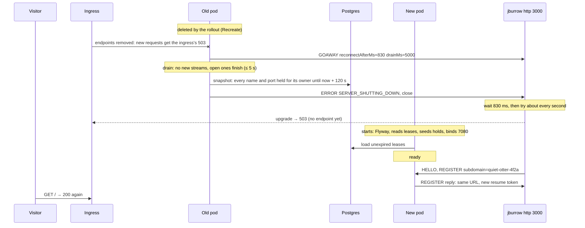

# Phase 4, Staying Connected: Architecture

Status: designed, not yet built. Fifth phase of `PROJECT.md` §Build roadmap, built on phase 3's HTTP
tunnels and phase 2's multiplexed sessions.

`PROJECT.md` gives phase 4 one line: reconnect with backoff, resume tokens, `GOAWAY` and graceful
drain, `Recreate` deploys; done when a server deploy during an open tunnel ends with the same URL
serving again within ten seconds, with no action from the user. This document is the full design.

Until now a session lives exactly as long as one WebSocket connection. Whatever ends the connection
ends the tunnel: a deploy, an ingress-nginx reload anywhere on the cluster, a laptop changing
networks. The CLI exits with code 4 and the user runs it again, hoping nobody took the URL meanwhile.
Phase 4 makes the tunnel outlive the connection. The client reconnects by itself and asks for the
same names and ports. The server keeps them for their owner across the gap, including a gap where
the server process itself is replaced. A deploy warns the client before cutting it off.

Read first: `PROJECT.md` (§How a tunnel works, §Server restarts and deploys, §Production deployment),
[`docs/phase-3-http-tunnels/ARCHITECTURE.md`](../phase-3-http-tunnels/ARCHITECTURE.md) (§Subdomains,
§Extension points), [`docs/phase-1-tcp-tunnel/ARCHITECTURE.md`](../phase-1-tcp-tunnel/ARCHITECTURE.md)
(§Lifecycle and shutdown, §The client, §Failure modes), [`docs/protocol.md`](../protocol.md) (§4.2,
§6.10, §8.4, §8.6, §11), [ADR-0003](../adr/0003-managed-postgres-neon.md),
[ADR-0007](../adr/0007-wire-protocol-v1.md), [ADR-0008](../adr/0008-byte-path-concurrency-model.md),
[ADR-0011](../adr/0011-http-tunnels.md) and [ADR-0013](../adr/0013-four-gib-production-pod.md).

## Contents

- [Purpose](#purpose)
- [Goals and non-goals](#goals-and-non-goals)
- [Where this phase departs from PROJECT.md](#where-this-phase-departs-from-projectmd)
- [Runtime view](#runtime-view)
- [What survives a gap, and how](#what-survives-a-gap-and-how)
- [The `resume` capability](#the-resume-capability)
  - [Why a capability, again](#why-a-capability-again)
  - [`GOAWAY`](#goaway)
  - [Resume tokens](#resume-tokens)
  - [Registration with a resume token](#registration-with-a-resume-token)
  - [What else changes in the specification](#what-else-changes-in-the-specification)
- [Holds: the resume window](#holds-the-resume-window)
- [Durable leases](#durable-leases)
- [The drain](#the-drain)
- [The restart budget](#the-restart-budget)
- [The client](#the-client)
  - [Reconnecting](#reconnecting)
  - [When to give up](#when-to-give-up)
  - [Asking for the same names](#asking-for-the-same-names)
  - [The API](#the-api)
- [The CLI](#the-cli)
- [The response timeout](#the-response-timeout)
- [Module and package layout](#module-and-package-layout)
- [Concurrency model](#concurrency-model)
- [Layer rules](#layer-rules)
- [Configuration](#configuration)
- [Observability](#observability)
- [Memory budget](#memory-budget)
- [Security and threat model](#security-and-threat-model)
- [Failure modes](#failure-modes)
- [Testing](#testing)
- [Build, CI and packaging](#build-ci-and-packaging)
- [Deployment changes](#deployment-changes)
- [Decisions that need an ADR](#decisions-that-need-an-adr)
- [Extension points](#extension-points)
- [Open questions](#open-questions)
- [Exit criteria](#exit-criteria)

## Purpose

At the end of phase 4:

- A server deploy during an open tunnel needs nothing from the user. `jburrow http 3000` prints that
  it lost the connection, reconnects when the new server is up, and keeps
  `https://quiet-otter-4f2a.example.dev`, a name the server chose, not the user. A visitor polling the
  URL sees it fail for at most ten seconds.
- The same holds for `jburrow tcp 22`: the same public port after the deploy. SSH connections that
  were open are cut, because a TCP connection can't move between processes, but a new `ssh` works as
  soon as the tunnel is back.
- When an ingress-nginx reload cuts every WebSocket on the cluster, tunnels come back in about a
  second, with the same URLs.
- A laptop that changes networks gets its tunnel back as soon as it notices, without waiting for the
  server to time out its old, silent session.
- Nobody else can take a URL or port while its owner is reconnecting, even across a server restart.
- Phase 3 and phase 2 CLIs keep working. They don't reconnect, exactly as before.

## Goals and non-goals

**Goals**

- **The tunnel outlives the connection.** Names and ports belong to their owner for a resume window
  after any session ends, in memory and in Postgres, so a new session, on this process or the next
  one, gets them back.
- **No wait on Postgres in the byte path or the handshake.** Leases are written behind and read once,
  at startup. A Neon wake-up or outage can delay neither a registration nor a request. Postgres was
  already required to start the server (Flyway); it is still not required to keep it running.
- **The client never guesses.** The server says when it is going away and how long to wait; the
  client's own backoff covers everything else, with jitter so clients don't reconnect in lockstep.
- **The gap is budgeted.** Every step between "the old pod stops serving" and "the URL serves again"
  has a target and a lever ([The restart budget](#the-restart-budget)), measured in production before
  the phase exits.
- **Additive on the wire.** Resume is a capability of draft 2, as `http` is. No CLI breaks at the
  deploy.

**Non-goals**

- **No gap at all.** One pod with host networking and `Recreate` means a window where no server
  exists. Removing it needs two processes that can both serve a tunnel's ports, which is the
  multi-node work `ROADMAP.md` puts later ([Extension points](#extension-points)).
- Moving open streams to the new server. A visitor's TCP connection, an HTTP exchange in flight and a
  server-sent event stream all end at the deploy.
- Buffering or replaying requests that arrive during the gap (webhook relay, `ROADMAP.md` §1,
  Later). Visitors get the ingress's `503` during the gap.
- Accounts, reserved subdomains that last beyond the resume window, `jburrow login` (phase 5).
- Rate limits on reconnects or handshakes per principal or per address (phase 6).
- WebSocket passthrough (phase 8), unchanged by this phase.

## Where this phase departs from PROJECT.md

| Change | Why |
|---|---|
| A **resume token identifies the client's previous session**, so the server can end it if it is still open. It is never stored, and a token from before a restart means nothing to the new process. `PROJECT.md` says the client "presents its resume token, and gets back the same URLs". | Across a restart, the names come back from holds by owner, seeded from Postgres, and the client asks for them by name ([What survives a gap](#what-survives-a-gap-and-how)). Storing tokens would put a secret in the database and buy nothing a hold doesn't already give. What only a token can do is end a session the server still thinks is alive. |
| **Leases are a snapshot per server process**, written behind on a timer and on change, and **read once at startup** to seed the holds. `PROJECT.md` has a lease row written at registration, refreshed every 30 s and consulted on registration. | A registration that waits on a lease write waits on Neon, which may be asleep for a second or two, or down. The in-memory table stays the truth, as `PROJECT.md` already says; the snapshot only has to survive the process. |
| **Leases arrive in phase 4**, not with accounts in phase 5. | The exit criterion is a restart. `PROJECT.md` §Open questions already expects lease refreshes from phase 4. Phase 5 adds reservations next to them. |
| **Ports are held for their owner** after a session ends, as phase 3 holds names. | Otherwise a TCP tunnel's port is anyone's the moment its session drops, and "the same port after a deploy" depends on luck. |
| `jburrow.http.name-hold` becomes **`jburrow.session.resume-window`**, 120 s, for names and ports. | One window for everything a session claims. 60 s is shorter than a slow deploy with an image pull; 120 s has margin and still frees an abandoned name quickly. |
| **The drain lasts at most 5 s**, and refuses new streams. `PROJECT.md` gives in-flight streams up to 20 s. | With one pod, every second of drain is a second of the gap. Five seconds finishes ordinary requests; long streams (SSH sessions, event streams, large downloads) can't survive a restart however long the drain is ([The drain](#the-drain)). |
| **No `preStop` sleep**, and probes every second. | The sleep exists so other pods take over before this one stops; with one pod nothing takes over, and the ingress drops the pod from its upstreams at deletion anyway, so the sleep only lengthens the gap. A 10-second readiness period can add up to 10 seconds by itself ([The restart budget](#the-restart-budget)). |
| The **response timeout counts from the end of the request body**, not from `OPEN`. | Phase 3's open question: a large upload over a slow link got `504` after 60 s although the local service was fine ([The response timeout](#the-response-timeout)). |

`PROJECT.md` §How a tunnel works (steps 2, 4 and 5), §Server restarts and deploys, §The wire protocol
and the phase 4 entry of §Build roadmap are updated in the same change as this document.

## Runtime view

A deploy, with one HTTP tunnel open and a visitor polling it:



An ingress reload or a dropped Wi-Fi connection looks the same from the client, without the
`GOAWAY` and with the same server process on the other side.

## What survives a gap, and how

| Gap | What the server still has | What brings the tunnel back |
|---|---|---|
| The connection drops, the server sees it (an ingress reload, a client crash) | The session has ended; its names and ports are **held** for its owner for the resume window | The client reconnects and asks for them by name; held claims yield to their owner |
| The connection drops, the server doesn't see it yet (the laptop changed networks; the old connection is silent but open) | The old session, still **active** until its idle timeout (45 s) | The client presents the old session's **resume token**; the server ends that session first, which puts its claims on hold, and then registers the new one |
| The server is replaced (a deploy, a crash, a node restart) | Nothing in memory; the old process wrote its claims to Postgres | At startup the new process **seeds holds from the leases**; the client asks for its names; held claims yield to their owner |

The three mechanisms are independent, and each is small:

- **Holds** are phase 3's, extended to ports and given one window ([Holds](#holds-the-resume-window)).
- **Resume tokens** do one thing: name a live session to end ([Resume tokens](#resume-tokens)).
- **Leases** carry the holds across a process ([Durable leases](#durable-leases)).

Who the owner is stays the principal of the authtoken. Every reconnect verifies the authtoken again,
and nothing in this phase lets a client claim a name without it.

## The `resume` capability

[`docs/protocol.md`](../protocol.md) gains the capability in this phase and is the authority on the
wire. [ADR-0014](../adr/0014-reconnect-and-resume.md) records the decisions.

### Why a capability, again

Everything phase 4 sends is what protocol.md §4.2 lets a capability introduce:

| Addition | Kind |
|---|---|
| `GOAWAY` (type `0x0A`, already assigned and reserved) | a frame type, now defined |
| `resume` in `REGISTER` | a field |
| `resumeToken` in the `REGISTER` reply | a field |
| `SESSION_REPLACED` | an error code |

A client that doesn't offer `resume` never receives `GOAWAY` and gets `ERROR SERVER_SHUTTING_DOWN`
at a deploy, as today. Draft 2 stays the only draft the server speaks, and phase 2 and phase 3 CLIs
keep working through the deploy that brings this in. `Capability` gains `RESUME`; the server enables
it with `http` from the checkpoint that lands the drain.

### `GOAWAY`

Server to client, stream 0, no flags, once per session, only once the session is established. A
JSON payload:

| Field | Type | Rule |
|---|---|---|
| `reconnectAfterMs` | integer (64-bit) | 0 to 60,000. After the connection closes, wait at least this long before connecting again. |
| `drainMs` | integer (64-bit) | 0 to 300,000. The most time the server keeps the session open for the streams already open. |

```json
{ "reconnectAfterMs": 830, "drainMs": 5000 }
```

After `GOAWAY` the server opens no new stream on the session. The client keeps sending `DATA`,
`HEADERS`, `CLOSE` and `WINDOW_UPDATE` for streams already open, which finish normally. The session
ends with `ERROR SERVER_SHUTTING_DOWN` once its streams have closed or `drainMs` has passed, as a
session ends today. The client doesn't close first: closing early cuts its own open streams for
nothing, because there is nowhere else to go until the new server is up.

Rules, checked by the client: a second `GOAWAY`, a `GOAWAY` before the `REGISTER` reply, and an
`OPEN` after `GOAWAY` are `PROTOCOL_ERROR`. A server that is stopping while a session is still in its
handshake sends that session `ERROR SERVER_SHUTTING_DOWN` instead.

`reconnectAfterMs` is the server's way to spread reconnects. Each session gets its own value, drawn
uniformly from `[0, jburrow.drain.reconnect-spread]` (2 s), so a thousand sessions don't arrive at the
new server in the same 100 ms. It is a lower bound: the client adds its own schedule on top.

### Resume tokens

The `REGISTER` reply of a session with `resume` carries a new token:

```json
{
  "tunnels": [ { "ref": "default", "kind": "http", "url": "https://quiet-otter-4f2a.example.dev", "...": "..." } ],
  "resumeToken": "jbr_AAECAwQFBgcICQoLDA0ODxAREhMUFRYXGBkaGxwdHh8"
}
```

- **Format**: `jbr_` and 43 characters of base64url without padding: 32 bytes from `SecureRandom`.
  47 characters in all. `ResumeToken` in the protocol model checks the shape, and its `toString` shows
  `jbr_***`.
- **Lifetime**: the session's. A token is valid while the session it was issued to is open on this
  server process. Using it ends that session, so a token works at most once. Every registration issues
  a new one.
- **Storage**: the server keeps only the token's SHA-256, in the session and in an index of live
  sessions. The client keeps it in memory only. Nothing writes it to disk on either side.
- **Not a credential**: a `REGISTER` with a token still carries the authtoken and is verified exactly
  as before. A token whose session belongs to another principal is ignored. A leaked token without
  the authtoken does nothing.

### Registration with a resume token

`REGISTER`, client to server, gains `resume`: the token from the previous session's reply. Optional,
and only in a session with `resume`. A client that has a token waits for the server's `HELLO` before
sending `REGISTER`, as an HTTP client already does, since `resume` is a field the capability
introduces.

protocol.md §8.4 gains one step, after the authtoken and before the session limit:

| # | Check | Refused with |
|---|---|---|
| 1 | No more tunnels than `limits.maxTunnels`. | `TUNNEL_LIMIT_EXCEEDED` |
| 2 | The authtoken is valid. | `AUTHTOKEN_INVALID` |
| **2a** | **With `resume`: if the token names a live session of the same owner, that session ends with `SESSION_REPLACED`, and the server waits until its tunnels are removed and their names and ports are held.** | never refuses |
| 3 | The token's owner may open another session. | `SESSION_LIMIT_EXCEEDED` |
| 4 | Each tunnel can be created … a requested `remotePort` that another owner holds fails. | `PORT_UNAVAILABLE`, `PORT_POOL_EXHAUSTED` |
| 5 | With `http`, each requested `subdomain` may be claimed. | `SUBDOMAIN_FORBIDDEN`, `SUBDOMAIN_UNAVAILABLE` |

Step 2a comes before step 3 because the stale session still counts against the owner's session limit
(3 per principal). An unknown token, an expired one and one of another owner are all treated the same:
the step does nothing, and the registration goes on. The reply doesn't say whether a session was
replaced; the client compares URLs.

Ending the old session is on its own event loop, and the registration runs on a virtual thread
([Concurrency model](#concurrency-model)). Step 2a waits for the old session's tunnels to be released,
at most `SessionCloser.FORCE_CLOSE_TIMEOUT` plus one second. A TCP tunnel's listener must be closed
before its port can be bound again, so "released" means the listeners are closed, not only that the
close was asked for. If the wait times out, registration goes on, and a still-bound port is refused
as `PORT_UNAVAILABLE`, which the client retries.

The old session gets `ERROR SESSION_REPLACED`:

| Code | Scope | Close code | Meaning |
|---|---|---|---|
| `SESSION_REPLACED` | session | 1000 | A newer session of the same client presented this session's resume token. |

Usually nobody reads it: the old connection is the silent one the client abandoned. It is sent anyway,
so a connection that was alive after all ends with a reason rather than a reset.

### What else changes in the specification

- §1 change log: a draft 2 row for `resume`.
- §4.2: the capability table gains `resume`.
- §6.10: `GOAWAY` defined, with the capability; outside it, unchanged ("may not be sent").
- §7: `GOAWAY`'s payload; `REGISTER.resume`; the reply's `resumeToken`.
- §8.1: a session with `resume` has a Draining state between Established and Closing.
- §8.4: step 2a; step 4's held ports.
- §8.6: a fourth way a session ends, "after a drain".
- §12: `SESSION_REPLACED`.
- §13: `GOAWAY` is assigned and sent by the server in a session with `resume`; otherwise unchanged.
- §7.11: `GOAWAY`'s payload.
- §14 and §16: the token's and `GOAWAY`'s limits; the token as a security consideration.
- §15: vectors: `GOAWAY`, a `REGISTER` with `resume`, a reply with `resumeToken`, `ERROR
  SESSION_REPLACED`; each token without the capability, dropped as an unknown key whatever its value;
  and the invalid ones (a token of the wrong shape, `GOAWAY` fields out of range, `SESSION_REPLACED`
  without the capability). Where a `GOAWAY` may come (not without the capability, not twice, no
  `OPEN` after it) is step 9 of §13, which vectors don't cover by design: `ClientSessionResumeTest`
  and `SessionResumeFuzzTest` do.

## Holds: the resume window

Phase 3's route table holds a name for its principal after its tunnel ends. Phase 4 makes that the
resume window, and gives ports the same:

- **One window**, `jburrow.session.resume-window` (120 s), for names and ports. `jburrow.http.name-hold`
  is removed; `0s` still turns holds off, for tests.
- **Ports.** `PortPool` records, for a held port, its principal and the end of its hold. A held port is
  never drawn at random, and a request for it by anyone else is `PORT_UNAVAILABLE`. When the hold ends
  the port is free, and since it was released at least 120 s earlier, the 60-second reuse delay is
  already over. A request by its owner reserves it at once. `portpool` stays independent of `tunnel`:
  the pool and its port are generic in the principal, as `routing`'s are.
- **Snapshot and seed.** Both tables gain two operations for the lease keeper: `snapshot(now)`, every
  active and held claim with its principal and, for a hold, its end; and `seedHold(key, principal,
  until)`, which adds a hold at startup and says whether it did. Seeding never replaces an active claim
  or a hold, and a seeded hold for a port outside the configured range is dropped; the seeding logs
  what it dropped.
- **A change counter.** Each table counts its changes (`version()`), so the lease keeper can tell when
  it has something new to write without being told by registration.

Who may take what:

| The key is | Its owner asks | Someone else asks | A random draw |
|---|---|---|---|
| Active (a live tunnel) | refused, unless step 2a ended that tunnel's session | refused | skips it |
| Held (within the window) | granted | refused | skips it |
| Hold expired, or free | granted | granted | may draw it |

## Durable leases

A lease is one row: a name or a port, its principal, whether it is active, and when it stops
counting. The table is a snapshot of the in-memory claims of one server process.

```sql
create table tunnel_lease (
    instance_id uuid        not null,
    kind        text        not null check (kind in ('name', 'port')),
    lease_key   text        not null,
    principal   text        not null,
    active      boolean     not null,
    expires_at  timestamptz not null,
    primary key (instance_id, kind, lease_key)
);

create index ix_tunnel_lease_expires_at on tunnel_lease (expires_at);
```

`V2__tunnel_lease.sql`, in `jburrow-server-api`, beside `V1__server_instance.sql`. `instance_id` is
the process's instance id, the one `server_instance` records, but without a foreign key:
`server_instance` is written only once the application is ready, and a failure to write it is
tolerated, so a lease written before it, or without it, must not fail.

**Writing.** `LeaseKeeper` in `jburrow-server-core` takes snapshots of the route table and the port
pool. Every second, a scheduler in the composition root calls `tick()`, which writes when either
table's version changed or `jburrow.lease.refresh` (30 s) has passed with leases to keep. A write
replaces this process's rows in one transaction: delete every row with this `instance_id`, insert the
snapshot. An active claim's `expires_at` is now + `refresh` + `resume-window`, so a server that dies
without a word leaves its claims counting for at most 2.5 minutes after its last write. A held claim's
is the end of its hold. A write that fails is logged and counted; the next tick tries again with a new
snapshot. Nothing waits for it.

With no lease to keep and nothing changed, `tick()` writes nothing, so a server with no tunnels lets
Neon suspend (ADR-0003). With tunnels open, the refresh keeps Neon's compute awake, which `PROJECT.md`
§Open questions already notes.

**Reading.** Once, at startup, after Flyway and before the edge binds: every unexpired row of any
process, the latest `expires_at` winning if two rows name the same key. Each becomes a hold until its
`expires_at`, whether it was active or held when written: an active row of a process that is gone
means a session that is gone. Rows expired for more than a day are deleted in the same step. If the
read fails, startup fails, as it already does when Flyway can't reach the database.

**Shutting down.** After the drain has ended every session, the lifecycle calls `LeaseKeeper.flush()`,
which writes one last snapshot synchronously, with a 2-second timeout. By then every claim is a hold
ending `resume-window` after the session ended, so the new process seeds exactly what the old one was
holding. If the flush fails, the last periodic write still covers every claim older than 30 s.

**What leases are not.** They are not the routing table: requests are routed from memory, and a lease
is read only at startup. They are not reservations: a lease stops counting at the end of its window.
Phase 5's reserved subdomains are a separate table with no expiry, checked at claim time
([Extension points](#extension-points)).

[ADR-0015](../adr/0015-durable-leases.md) records the decision.

## The drain

Phase 1's stop sequence ended every session at once. Phase 4's, in `EdgeServer.drain` and
`EdgeServer.stop`, run in order by `EdgeServerLifecycle`:

1. **Readiness down.** The lifecycle publishes `REFUSING_TRAFFIC` before anything else, for
   deployments where readiness still routes traffic. In production the ingress has already dropped the
   pod at deletion.
2. **Stop accepting.** The edge closes its listener, as before. Upgrades already in progress get `503
   SERVER_SHUTTING_DOWN` with `Retry-After: 5`. Sessions still in their handshake get `ERROR
   SERVER_SHUTTING_DOWN` at once, and so does a session whose upgrade completes after this. From here
   a new request on an edge connection that was already open gets the `503` page of step 4 without
   reaching a session.
3. **`GOAWAY`.** Every established session with `resume` is sent `GOAWAY` with its own
   `reconnectAfterMs` and `drainMs` = `jburrow.drain.timeout` (5 s). Sessions without `resume` get
   nothing yet. Every session is now Draining.
4. **No new streams.** Every TCP tunnel listener closes, so the kernel refuses new visitors; one a
   listener accepted just before is closed at once and counted as refused (`draining`). A new HTTP
   request for a draining session's tunnel gets the `503` page with `Retry-After: 10`, code
   `SERVER_SHUTTING_DOWN`. Streams already open carry on under flow control as usual, and so do `PING`
   and `PONG`, so a drain never ends in a heartbeat timeout.
5. **Wait** until no session has an open stream, or `drain.timeout` has passed. Idle tunnels make this
   instant.
6. **End every session**: open streams reset with `CANCELLED`, `ERROR SERVER_SHUTTING_DOWN`, the
   close (phase 1's step 2). Each session's names and ports go on hold.
7. **Wait** up to 2 s for every session to close and give back what it took, its names and ports on
   hold, then close every connection still open, visitors' included, and give the sessions cut off
   that way 0.5 s more.
8. **Flush the leases** ([Durable leases](#durable-leases)), on a virtual thread, waiting at most 2 s.
   A flush that fails or takes longer is logged, and the stop goes on.
9. **Shut down the event loops** (5 s timeout, no quiet period).

5 s of drain, 2.5 s of closing, 2 s of flush and 5 s of loop shutdown, 14.5 s in all, fit inside the
20-second shutdown phase and the pod's 30-second grace period; so does the longest drain the key
allows, 10 s, at 19.5 s. Every wait is bounded, and the stop goes on past one that runs out, so Spring
never abandons it halfway. The drain logs one line when it ends: sessions, streams open at `GOAWAY`,
streams cut at the deadline, and how long it took.

**Why refuse new streams during the drain.** A stream that starts during the drain is cut at its end
unless it is short, and a refusal with `Retry-After` is cleaner than a body cut halfway. More
importantly, in production almost no new request reaches a draining pod: the ingress removed it from
its upstreams at deletion, so new requests already get the ingress's `503`. The drain is for what was
already in flight.

**Why 5 s.** Ordinary HTTP requests finish in well under a second. What takes longer (an SSH session,
an event stream, a 1 GiB download) is cut at the end of any drain, and every second waiting for it is
a second added to the gap for every other tunnel. If testers turn out to care about large downloads
across deploys, the key is there to raise.

## The restart budget

The exit criterion is ten seconds from the URL failing to the URL serving again, with one tunnel open
and no stream in flight. These are the steps of a production deploy, their targets, and what moves
each one. Checkpoint 10 measures each step on production before any target is trusted, and updates
this table with the measured values.

| Step | Target | Lever |
|---|---|---|
| The pod is deleted → `SIGTERM` | 0 s | No `preStop` sleep |
| Drain, with no stream in flight | < 0.1 s | Ends when streams are done |
| End sessions, flush leases, stop loops, JVM exit | ≤ 1 s | The flush is one small transaction on an awake Neon |
| Old pod gone → new container running | ≤ 1.5 s | Only the application layer of the image changes between commits, and the node already has the rest; pre-pull the image if the measurement says otherwise |
| JVM and Spring start, Flyway validate, leases seeded, edge bound | ≤ 4 s | Measured first; class data sharing (CDS) in the image if it is over |
| Ready → the ingress routes to it | ≤ 1.5 s | Startup and readiness probes every second |
| The client's next attempt, and its handshake | ≤ 1.5 s | After `GOAWAY` the client tries about once a second |
| **Total** | **≤ 9.6 s** | |

Neon is awake for the new process: the old one refreshed its leases within the last 30 seconds, and
Neon suspends only after minutes idle.

**CDS.** If startup is over budget, the image gets a class data sharing archive: Spring Boot's
`extract` layout (already used by the Dockerfile), a training run at image build time with
`-XX:ArchiveClassesAtExit` and `spring.context.exit=onRefresh`, and `-XX:SharedArchiveFile` at runtime.
The training run has no database, so Flyway is off during it and Hibernate is told not to read JDBC
metadata. Spring's own figures put the saving near a third of startup. It is the first lever because
it changes nothing about how the server runs. The CPU limit (one core, ADR-0013) is the second: a
limit throttles a JVM's startup, and raising the limit doesn't raise the request.

**What the budget doesn't cover.** ArgoCD noticing the commit (up to three minutes) happens before
the pod is deleted, so the old server is still serving. An image pull for a changed base image adds
its download time. A stream in flight adds up to 5 s of drain.

[ADR-0016](../adr/0016-restart-budget.md) records the budget and its deployment consequences.

## The client

### Reconnecting

`JBurrowClient` runs one session after another on its one event loop. `SessionSupervisor`, in the
client's Netty adapter, owns the sequence. Each session is a `ControlConnection` as before. When one
ends, the supervisor decides from how it ended whether to start another, and when.

The delays come from `ReconnectSchedule`, plain Java in the client's domain, given a random source and
a clock:

| After | First attempt | Then |
|---|---|---|
| `GOAWAY`, then the session ended | `reconnectAfterMs` | every 1 s ± 20% for 60 s, then the backoff below |
| A lost connection, a heartbeat timeout, or `SERVER_SHUTTING_DOWN` without `GOAWAY` | 0 to 500 ms | backoff: 1 s, 2 s, 4 s … capped at 30 s, each delay `d/2 + random(0, d/2)` |
| `SERVER_AT_CAPACITY`, or an upgrade refused with `Retry-After` | `Retry-After` | the backoff |

A session that stayed established for 60 s resets the backoff, so a tunnel that drops once a day
always starts from the fast end. Until then the backoff carries on from one session to the next, and
the first attempt after a lost connection is the backoff's next delay rather than the quick one, so a
server that accepts sessions and drops them at once is never retried faster than the backoff. The
first attempt after a plain disconnect is quick on purpose: an ingress reload leaves the same server
running, and the tunnel can be back in under a second. A `Retry-After` counts for at most 60 s, the
bound the protocol puts on `reconnectAfterMs`, so a hostile middlebox can't park the client for
hours; only its delta-seconds form is read.

The decisions are plain Java in the client's domain: `SessionOutcome` reads how a session ended, or
how an attempt failed (a `SessionEnd`), and `ReconnectSchedule` gives the delay; the supervisor only
carries them out. A connection reports its end only once its channel has closed and its streams are
reported closed, so the next attempt never overlaps it.

Streams don't survive. Each stream of the lost session is reported closed, reset with `CANCELLED`,
before the supervisor reports the disconnect, and local connections are closed.

### When to give up

The client reconnects for as long as it is running, unless the server says retrying can't help:

| How the session ended, or the attempt failed | Reconnect? | The CLI's exit code if not |
|---|---|---|
| Connection lost, heartbeat timeout | yes | |
| `ERROR SERVER_SHUTTING_DOWN`, `SERVER_AT_CAPACITY`, `INTERNAL_ERROR`, `HANDSHAKE_TIMEOUT` | yes | |
| Could not connect, TLS failed, timed out, upgrade refused with a 5xx or no code | yes | |
| `AUTHTOKEN_INVALID` | no | 3 |
| `PORT_UNAVAILABLE`, `SUBDOMAIN_UNAVAILABLE` for a name or port **the user chose** | no | 5 |
| The same, for a name or port **the server chose** | once, without it ([Asking for the same names](#asking-for-the-same-names)) | |
| Any other registration refusal (`SUBDOMAIN_FORBIDDEN`, a limit, `VALIDATION_FAILED`) | no | 5 |
| `UNSUPPORTED_PROTOCOL_VERSION`, `PROTOCOL_ERROR`, `FRAME_SIZE_ERROR`, `FLOW_CONTROL_ERROR`, `PING_RATE_EXCEEDED`, `FORBIDDEN_ORIGIN` | no | 6 |
| The server no longer lists a capability the tunnels need (`http`) | no | 6 |
| An upgrade refused with `NOT_FOUND`: the URL isn't a connect URL | no | 4 |
| `SESSION_REPLACED` on the current session | no | 4 |
| The user closed it | no | 0 |

`UNSUPPORTED_PROTOCOL_VERSION` matters here: a future deploy that moves to a new draft ends every
reconnecting CLI with exit 6 and the upgrade message, instead of retrying forever.

`TLS_FAILED` is retried because the common case is a network in the middle (a captive portal) that
goes away. A certificate that is really wrong keeps failing, and the CLI keeps saying so on every
attempt.

**The first session** is different. A user who just typed the command wants an answer, not a
retry loop, so a first session that can't be established fails at once, as today, with two
exceptions: `SERVER_SHUTTING_DOWN` and `SERVER_AT_CAPACITY`, and an upgrade refused with `502`, `503`
or `504`. Those mean a deploy is in progress, and are retried on the `GOAWAY` schedule for up to 60 s.

### Asking for the same names

Every reconnect sends a `REGISTER` with the names and ports the previous session got, not the ones
the user typed: `subdomain` set to the URL's name, `remotePort` to the port. For a name the user
chose this is the same request. For a name the server chose it is what keeps the random URL across a
deploy.

If the server refuses one of those because someone else has it (the window passed, say, after a long
sleep), the client knows whether the user chose it. A name or port the user chose ends the CLI with
exit 5: they asked for that URL, and a different one would be a surprise. One the server chose is
asked for again without it, once, and the new URL is reported as a change. The tunnel works; only its
address moved.

The resume token goes in the same `REGISTER`, so a stale session on the same server is ended first
(step 2a).

### The API

```java
JBurrowClient client = JBurrowClient.builder()
        .server(URI.create("wss://connect.example.dev/v1/connect"))
        .authtoken(token)
        .http(LocalTarget.of("localhost", 3000))
        .reconnect(ReconnectPolicy.standard())   // the default; ReconnectPolicy.never() for phase 3's behaviour
        .events(listener)
        .build();
TunnelHandle handle = client.start();  // returns when the first REGISTER is answered
handle.tunnels();                      // the current tunnels; may change after a reconnect
handle.closed();                       // completes once, when the client stops for good
```

- `ReconnectPolicy` is a new public value: `standard()`, `never()`, and, for tests,
  `standard().scaled(second)`, the same schedule with each of its seconds shorter. The server's own
  delays are never scaled.
- `TunnelHandle.sessionId()` and `tunnels()` are the current session's. `closed()` completes once, when
  no further session will be tried, with the reason for the last one.
- `TunnelEvents` gains two methods, both no-ops by default:
  - `onDisconnected(TunnelClosed reason, Duration retryIn)`: a session ended and another will be tried.
  - `onReconnected(String sessionId, List<RegisteredTunnel> tunnels, boolean sameUrls)`.

  The order: `onEstablished` once, for the first session. Then any number of `onDisconnected`
  followed later by `onReconnected`. Every stream of a session is reported closed before that session's
  `onDisconnected`. `onClosed` comes last, exactly once. A failed reconnect attempt reports another
  `onDisconnected` with the next delay, so the listener always knows when the next try is.
- `TunnelClosed.Reason` is unchanged. A session ended by `GOAWAY` reports `SERVER_ERROR` with
  `SERVER_SHUTTING_DOWN`, as now. A reconnect attempt that fails reads as the end it would have been:
  `CONNECTION_LOST` for a connection that failed or an upgrade refused without a code,
  `SERVER_ERROR` with the code for a refusal or a registration refused, and `LOCAL_ERROR` without a
  code for a server that no longer lists a capability the tunnels need.
- `TunnelClosed` gains `upgradeStatus()`: the HTTP status of an upgrade refused without a code, for
  an attempt that failed that way, so a listener can say "503" without reading the message, whose
  wording is for people and may change.
- A first session retried during a deploy reports nothing: `start()` returns once one is established,
  or throws the last failure after 60 s.
- `TunnelStartException` gains `status()` and `retryAfter()`: the HTTP status and `Retry-After` of a
  refused upgrade, which the schedule reads.

The client offers `resume` in every `HELLO`, as it offers `http`. Against a server without it, the
client reconnects all the same, without a token and without `GOAWAY`: holds still keep the names for
the window.

## The CLI

`jburrow http` and `jburrow tcp` reconnect by default. `--no-reconnect` gives phase 3's behaviour,
for scripts that want the process to end with the connection.

Human output:

```
jburrow 0.4.0, protocol jburrow.v1-draft.2
Forwarding  https://quiet-otter-4f2a.example.dev -> http://localhost:3000

14:02:11  GET  /hello                 200       6 B     4 ms
14:05:40  connection lost: the server is restarting; reconnecting in 0.8 s
14:05:47  reconnected   https://quiet-otter-4f2a.example.dev
14:05:52  GET  /hello                 200       6 B     5 ms
```

A failed attempt prints one line with the reason and the next delay, at most once per distinct
reason in a row, so a long outage doesn't fill the terminal. A changed URL prints
`reconnected with a new URL  https://brave-heron-91c0.example.dev  (the old one was taken)`.

JSON output gains `disconnected` (`reason`, `code`, `retryInMs`) and `reconnected` (`sessionId`,
`tunnels`, `sameUrls`) events. Every run still ends with exactly one `closed` event.

Exit codes keep their meanings. `SESSION_REPLACED` maps to 4. The exhaustive switch in `ExitCodes`
won't compile until it does.

## The response timeout

Phase 3 counted `jburrow.http.response-timeout` from `OPEN`, so a 100 MiB upload over a slow link got
`504` after 60 s, while the local service, which answers only after reading the body, was fine.
Phase 4 starts the timer when the request body has been fully sent to the client: the edge's `CLOSE`
for the request side, or the `OPEN` itself for a request with no body. A local service that never
answers is still cut after 60 s. An upload can take as long as it takes, bounded by the ingress's own
timeouts and by `max-request-body`.

The change is one timer's start in `SessionExchange`. Phase 3's ARCHITECTURE.md §Open questions
records it as resolved here.

## Module and package layout

New and changed packages; unchanged ones are as phase 3 left them.

```
jburrow-protocol/                         io.jburrow.protocol
├── wire/         Capability (+ RESUME), ErrorCode (+ SESSION_REPLACED)
├── control/      GoAway (new), ResumeToken (new), Register (+ resume), Registered (+ resumeToken)
└── adapter/
    ├── jackson/  GOAWAY payload, the token as a string
    └── netty/    Frame.GoAway (new), FrameCodec (GOAWAY with capability context)

jburrow-server-core/                      io.jburrow.server.core
├── lease/                    new feature
│   ├── domain/       Lease, LeaseKind, LeaseSnapshot
│   └── application/  LeaseKeeper; port/ LeaseStore, LeaseRecord, LeaseEvents
├── routing/application/      SubdomainRoutes (+ snapshot, seedHold, version);
│                             port/ ClaimSnapshots (new)
├── portpool/
│   ├── domain/       PortPool (+ holds per principal, generic in the principal)
│   └── application/  PortReservationService (+ holds); port/ PortReservations (+ principal on reserve),
│                     PortHolds (new: snapshot, seedHold, version)
└── tunnel/
    ├── domain/       Session (+ resume token hash, DRAINING), SessionState (+ DRAINING),
    │                 ResumeTokenHash (new: a token's SHA-256, equal by content)
    ├── application/  RegisterTunnels (+ step 2a), ResumeTokens (new: issue, hash);
    │                 port/ LiveSessions (new: end a session by token hash and wait)
    └── adapter/netty/
        ├── edge/     EdgeServer (drain(), stop()), EdgeSettings (+ DrainSettings), SessionInitializer
        │             (+ drain(), end())
        ├── control/  ControlSessionInitializer (drain() and end(): each session's step on its own loop,
        │             GOAWAY), ControlSessionHandler (a draining session counts as established),
        │             SessionRegistry (+ index by token hash, implements LiveSessions), SessionCloser
        │             (SESSION_REPLACED), TunnelListeners (+ stopAccepting)
        ├── tcp/      NettyTunnelListeners (close listeners on drain)
        └── http/     SessionExchanges and EdgeError (503 for a draining session), SessionExchange
                      (timeout from the end of the request body)

jburrow-server-api/                       io.jburrow.server.api
├── lease/adapter/persistence/   new: JpaLeaseStore (implements LeaseStore), LeaseEntity, LeaseJpaRepository
└── resources/db/migration/      V2__tunnel_lease.sql

jburrow-server/                           io.jburrow.server
├── config/       JBurrowProperties (+ session, drain, lease; − http.name-hold), EdgeConfiguration,
│                 LeaseConfiguration (new: the keeper and its store), LeaseSchedule (new: the seed and the
│                 1-second tick), EdgeServerLifecycle (seed before the edge; readiness, drain, flush)
└── observability/ MicrometerTunnelMetrics (+ resume, drain, holds), LeaseWriteReporter (new: lease writes)

jburrow-client-core/                      io.jburrow.client
├── ReconnectPolicy (new), JBurrowClient.Builder (+ reconnect), ClientSettings (+ reconnect, resume
│   offered), TunnelHandle (current session), TunnelStartException (+ status, retryAfter)
└── tunnel/
    ├── domain/           ReconnectSchedule (new), Resumption (new: token and the previous reply),
    │                     ClientSession (+ GOAWAY, DRAINING, resume), ClientSessionState (+ DRAINING),
    │                     SessionOutcome (new: reconnect or stop, and why), SessionEnd (new: how a
    │                     session ended or an attempt failed)
    ├── application/port/ TunnelEvents (+ onDisconnected, onReconnected)
    └── adapter/netty/    SessionSupervisor (new), NettyTunnelClient (through the supervisor),
                          ControlConnection (GOAWAY, outcome)

jburrow-cli/      TunnelCommand (--no-reconnect), output (+ disconnect and reconnect lines and events),
                  ExitCodes (+ SESSION_REPLACED)
scripts/          gap-probe.sh (new: polls a URL and prints its longest failure), native-smoke.sh
                  (+ a server restart)
jburrow-server/Dockerfile                 CDS archive, if checkpoint 10 needs it
```

**Why a `lease` feature in the core and its adapter in `jburrow-server-api`.** Deciding what to write
and when, and seeding holds, is engine logic with no I/O, so it lives in the core behind a port
(`LeaseStore`), as `PROJECT.md`'s module table has it. The JPA adapter lives where every other
persistence adapter lives. It implements the core's port, as `StaticAuthtokenVerifier` implements
`AuthtokenVerifier`. Because `io.jburrow.server.api.lease` is a feature of its own, the port speaks
its own vocabulary, `LeaseRecord`, and the keeper maps it to and from the domain's `Lease`, as
`AuthtokenVerifier` answers with a name rather than a `Principal`. What the keeper reports about its
writes goes out through a second port, `LeaseEvents`, since application code doesn't log.

## Concurrency model

ADR-0008's rules stand. What phase 4 adds:

| Work | Runs on | Touches |
|---|---|---|
| Step 2a: end a stale session and wait | the registration's virtual thread | posts the close to the stale session's loop; waits on a future that the session's release completes |
| `GOAWAY`, the drain and its stream count | each session's own loop | the session only; a server-wide countdown of sessions with open streams |
| `LeaseKeeper.tick()` | a virtual thread, every second | snapshots of the two tables (each under its own lock, briefly); Postgres |
| The seed at startup | the startup thread, before the edge binds | the two tables, with no other user yet |
| The client's supervisor and schedule | the client's one event loop | its own state; timers on that loop |

- **The two tables are already thread-safe.** `SubdomainRoutes` is a `ConcurrentHashMap`, `PortPool`
  is `synchronized`. A snapshot copies under the same rules and never blocks the byte path for longer
  than a registration does.
- **Step 2a never blocks a loop.** The wait is on the registration's virtual thread, which already
  blocks on the authtoken check. The session being ended releases its claims on its own loop, as it
  does for any end.
- **The supervisor is single-threaded.** One `ControlConnection` at a time, created and abandoned on
  the client's loop, so nothing about the previous session can race the next. The previous
  connection's channel is fully closed before the next attempt is scheduled.

## Layer rules

One new feature, `lease`, under the existing rules. `lease.domain` is plain Java. `lease.application`
reaches `routing` and `portpool` only through their ports (`ClaimSnapshots`, `PortHolds`), and is
generic in the principal: the composition root gives it how to turn a principal into the row's string
and back, so `lease` never names `tunnel.domain.Principal`. `tunnel` doesn't depend on `lease`, not
even on its ports: the keeper reads the tables' change counters rather than being told by
registration, which keeps the feature graph acyclic. A rule of its own, `TUNNEL_NEVER_SEES_LEASES`,
holds that line, since the ports rule alone would allow `tunnel` to reach `lease.application.port`.
The ArchUnit suite gains a fixture for `lease` reaching into `tunnel.domain` (refused by the ports
rule), and one for `tunnel` reaching `LeaseStore` (refused by the new rule). The JPA adapter sits
under `jburrow-server-api`'s `lease.adapter.persistence`, where JPA is allowed. The protocol model's
new records are pure.

## Configuration

| Key | Environment variable | `local` | `prod` | Notes |
|---|---|---|---|---|
| `jburrow.session.resume-window` | | `120s` | `120s` | names and ports held for their owner after a session ends; `0s` turns holds off. Replaces `jburrow.http.name-hold` |
| `jburrow.drain.timeout` | | `5s` | `5s` | the longest drain; `drainMs` in `GOAWAY`. At most 10 s, so the stop fits the 20-second shutdown phase |
| `jburrow.drain.reconnect-spread` | | `2s` | `2s` | `reconnectAfterMs` is drawn from 0 to this; at most 60 s |
| `jburrow.lease.refresh` | | `30s` | `30s` | the longest gap between lease writes while there are leases; 5 s to 5 min |

Validation in `JBurrowProperties` as before. A configuration that still sets `jburrow.http.name-hold`
fails startup with a message naming its replacement, rather than being silently ignored.

The client's schedule is fixed in `ReconnectPolicy.standard()`, not configured: one CLI's backoff is
the server's protection against many CLIs, and a flag would only let users make it worse.

## Observability

| Metric | Change |
|---|---|
| `jburrow_resume_total` | **new** counter, label `outcome`: `replaced` (the token named a live session, which was ended) or `none` (it named none) |
| `jburrow_goaway_sent_total` | **new** counter |
| `jburrow_drain_streams_cut_total` | **new** counter: streams still open when a drain ended |
| `jburrow_holds` | **new** gauge, label `kind` (`name`, `port`): claims on hold now |
| `jburrow_lease_writes_total` | **new** counter, label `outcome` (`ok`, `failed`) |
| `jburrow_lease_write_seconds` | **new** timer |
| `jburrow_subdomain_claims_total` | `outcome` gains `reclaimed`: a held name claimed by its owner |
| `jburrow_port_claims_total` | **new** counter, label `outcome` (`random`, `requested`, `reclaimed`, `unavailable`), the port pool's counterpart of the subdomain one |
| `jburrow_tcp_ports` | the `state` label gains `held` |
| `jburrow_visitor_connections_refused_total` | `reason` gains `draining`: a visitor accepted, or a request handed to a session, after its session began to drain |
| `jburrow_protocol_errors_total` | `code` gains `SESSION_REPLACED` |

The drain's counters move once per process, usually in its last seconds, after the last scrape. The
drain's log line is the record that matters. Still no metric is labelled with a session, tunnel, name,
port, address or principal.

**Logs.**

- "session established" gains `resumed=true|false` (whether the `REGISTER` carried a token).
- "session replaced" (INFO): the old and new session ids, the principal, and how long the old one had
  been silent.
- "drain" (INFO), once: sessions, streams open at `GOAWAY`, streams cut, milliseconds.
- "leases seeded" (INFO) at startup: names and ports, the oldest and newest expiry, and how many rows
  were dropped (a port outside the range, a key or principal that doesn't parse) and purged.
- "lease write failed" (WARN), at most once a minute while it keeps failing.
- Never the resume token, not even masked: its hash isn't logged either.

## Memory budget

Phase 3's budget is unchanged. What phase 4 adds is small and bounded:

- A resume token hash per session: 32 bytes, plus an index entry. At 1,000 sessions, under 100 KiB.
- Holds: one entry per name or port held, for at most the window. Bounded by the claims of every
  session that ended in the last 120 s. At production's 1,000 sessions, all reconnecting at once after
  a deploy, that is 1,000 holds of under 200 bytes each.
- A lease snapshot: built per write, a list of the same size, garbage after the write.
- Reconnect storms: the handshake cap (`max-handshaking`, 64) bounds the memory of handshakes in
  progress, as phase 1 sized it. Clients beyond it get `SERVER_AT_CAPACITY` with `Retry-After` and come
  back on their schedule.

No change to the direct memory line at startup.

## Security and threat model

The threats of phases 1 to 3 and their mitigations stand. Phase 4 adds:

| Threat | Mitigation | Proven by |
|---|---|---|
| A stolen resume token used to end someone's session | The token is ignored unless the `REGISTER`'s authtoken belongs to the same principal; it works once, while its session is live | `RegisterTunnelsTest`, `ResumeIntegrationTest` |
| A token guessed | 256 bits from `SecureRandom`; looked up by hash, so lookup time reveals nothing | `ResumeTokensTest` |
| A token in logs, crash dumps of the CLI, or the database | Never logged, `toString` masked, never written to disk or Postgres on either side | `LogHygieneIntegrationTest` additions |
| A URL taken over during a deploy | Holds seeded from leases before the edge accepts a single connection | `ServerRestartIntegrationTest` |
| Squatting: a principal claims many names and drops its sessions to keep them held | Holds last 120 s; claims are bounded by the session and tunnel limits; phase 6 adds rate limits | `SubdomainRoutesTest` |
| A reconnect storm against a new server | `reconnectAfterMs` spread, client jitter and backoff, the handshake cap with `Retry-After` | `ReconnectStormIntegrationTest` |
| A client forced into a fast retry loop by a hostile network | The backoff never goes below its schedule; `Retry-After` is honoured only upward | `ReconnectScheduleTest` |
| Leases revealing who uses the service | Principal names only, as the logs already have them; rows deleted a day after expiry | |

## Failure modes

| Scenario | Behaviour |
|---|---|
| A server deploy, no stream in flight | `GOAWAY`, a drain that ends at once, the gap of [The restart budget](#the-restart-budget), the same URL. |
| A deploy with an SSH session through a TCP tunnel | The SSH session lasts the 5-second drain and is then cut; the tunnel comes back on the same port; a new `ssh` works. |
| A deploy while a 1 GiB download is in flight | Cut at the end of the drain; the visitor sees a truncated body. |
| An ingress-nginx reload | Sessions cut without `GOAWAY`; first reconnect within 500 ms; same server, holds by owner, same URLs. |
| The laptop changes networks | The client notices at its next `PING` or write, at most 45 s later; it reconnects with its token; the server ends the silent session (`SESSION_REPLACED`) and registers the new one with the same names. |
| The server crashes | No `GOAWAY`, no final flush; the leases from the last write (≤ 30 s old) are seeded; claims made since then aren't protected but are usually still free; the client reconnects on its backoff. |
| The laptop sleeps for an hour | The holds expire. The client wakes and reconnects; a name the server chose may be gone (a new URL, reported); a name the user chose is usually still free, else exit 5. |
| Postgres is down while the server runs | Lease writes fail and are retried every tick; tunnels and registrations are unaffected; a restart in that window loses the holds of claims made since the last good write. |
| Postgres is down at startup | Startup fails at Flyway, as before; Kubernetes restarts the pod; clients keep retrying. |
| A phase 3 CLI during a deploy | `ERROR SERVER_SHUTTING_DOWN`, exit 4, as before. Its name is held for 120 s, so running it again with `--subdomain` gets it back. |
| A deploy that changes the protocol draft | Reconnecting CLIs get `UNSUPPORTED_PROTOCOL_VERSION`, exit 6 with the upgrade message. |
| Two CLIs with the same token and the same `--subdomain` | The second is refused, `SUBDOMAIN_UNAVAILABLE`, exit 5: an active claim yields only to the resume token of its own session. |
| The server never comes back | The CLI keeps trying, one line per distinct reason, backoff capped at 30 s, until the user stops it. |

## Testing

| Test | Kind | Proves |
|---|---|---|
| `GoAwayTest`, `ResumeTokenTest`, `RegisterTest` and `RegisteredTest` additions | unit | the field rules; masking |
| `ControlJsonTest`, `ConformanceVectorsTest`, `ProtocolDocumentExamplesTest` additions | codec | the new payloads and vectors, with and without the capability |
| `ClientSessionTest` additions, `SessionResumeFuzzTest` | unit, Jazzer | `GOAWAY` once, only established, no `OPEN` after it; random frame sequences around `GOAWAY` never reach an undefined state |
| `SubdomainRoutesTest`, `PortPoolTest`, `PortReservationServiceTest` additions | unit | holds for ports; snapshot and seed; seeded holds never replace active claims; versions move on every change |
| `LeaseKeeperTest` | unit, in-memory store | writes on change and on refresh only; expiries; seed picks the latest row; a failed write is retried with a fresh snapshot |
| `JpaLeaseStoreIntegrationTest` | persistence | the migration; replace is atomic per instance; the load query; old rows purged |
| `LeaseRestartIntegrationTest` | two server applications in turn, one Postgres, `ScriptedPeer` | the first writes an HTTP and a TCP tunnel and closes with no flush; the second refuses another principal both and grants their owner both |
| `RegisterTunnelsTest` additions | unit | step 2a before admission; a token of another principal ignored; a token of no live session ignored |
| `ReconnectScheduleTest` | unit, seeded random and fake clock | every row of the schedule; jitter bounds; the reset after 60 s; `Retry-After` |
| `SessionOutcomeTest` | unit | every row of [When to give up](#when-to-give-up), for the first session and for later ones |
| `DrainIntegrationTest` | real edge, `ScriptedPeer` clients | `GOAWAY` only to sessions with `resume`; no `OPEN` after it; a TCP visitor refused and an HTTP request answered `503` during the drain; open streams finish; the drain ends early when they do and at 5 s when they don't |
| `ResumeIntegrationTest` | real edge, `ScriptedPeer` | a second session presenting the first's token: the first gets `SESSION_REPLACED`, the second the same name and port, within the session limit |
| `ConnectionCutIntegrationTest` | full server + real client through a TCP proxy | the proxy cuts the connection: same URL within 1 s; streams reported closed first |
| `ServerRestartIntegrationTest` | two server contexts in turn, one Postgres, real client | stop the first (the drain), start the second on the same ports: the client is back with the same random name and the same TCP port; a second principal asking for the name in between is refused |
| `ServerCrashIntegrationTest` | as above, without the drain | the first is killed without a flush; leases from its last write are honoured |
| `ReconnectStormIntegrationTest` | full server + 200 real clients | after a restart, every client is back with its URL; the handshake cap is never exceeded; no client retries faster than its schedule |
| `Phase3ClientIntegrationTest` | real edge, a client without `resume` | `ERROR SERVER_SHUTTING_DOWN` at stop, no `GOAWAY`; holds still return its name when it comes back |
| `ResponseTimeoutIntegrationTest` additions | full server + real client | a slow upload past the timeout succeeds; a local service that never answers still gets `504` |
| `TunnelMetricsIntegrationTest`, `LogHygieneIntegrationTest` | existing, extended | the new metrics; no resume token in any log line |
| `JBurrowPropertiesTest` additions | unit | the new keys; `jburrow.http.name-hold` refused with its replacement named |
| ArchUnit fixtures | architecture | the `lease` feature's boundaries |

Every byte-path integration test runs on epoll and NIO, as before.

## Build, CI and packaging

- No new dependency. The lease adapter uses Spring Data JPA, already in `jburrow-server-api`.
- `reflect-config.json` gains the new control records; `NativeImageMetadataTest` already requires
  each one.
- `scripts/native-smoke.sh` gains a restart: an HTTP tunnel through the native binary, the server
  stopped and started again, and the same URL answering as soon as the client's schedule allows once
  the new server is ready: within 5 s while it still tries about once a second, within 35 s once it
  is on its backoff. How long the server takes to start depends on the runner and gets a generous
  limit of its own (`SERVER_RESTART_TIMEOUT`, 180 s); the restart budget itself is measured on
  production ([The restart budget](#the-restart-budget)), not in CI. The `native` job runs the script
  already.
- The CLI module recompiles all its classes on every build, because picocli-codegen writes its
  native-image configuration from the classes of one compiler run, and `NativeImageMetadataTest`
  requires every command, version provider and converter in it.
- The fuzz job gains `SessionResumeFuzzTest`.
- `scripts/gap-probe.sh`: polls a URL every 250 ms and prints each run of failures with its length.
  The exit test's measuring tool.
- If checkpoint 10 needs it, the Dockerfile gains the CDS training run.

## Deployment changes

The generic shape; the deployment's own runbook has the real values.

| Resource | Phase 4 change |
|---|---|
| Deployment | No `preStop` sleep. `startupProbe` and `readinessProbe` every 1 s (the startup probe's failure threshold raised so it still allows 2 minutes). `terminationGracePeriodSeconds` stays 30. |
| Image | A CDS archive, if checkpoint 10's measurement calls for it. Pre-pulling the image onto the node before the rollout, if the pull is a measurable part of the gap. |
| Database | `V2__tunnel_lease.sql`, applied by Flyway at startup like every migration. Writes every 30 s while tunnels are open keep a scale-to-zero database awake. |
| Secret, DNS, Service, Ingress, firewall | None. |

**Order.** The server can deploy before testers have a new CLI: older CLIs behave as before. That
first deploy is itself the first restart with leases in place only if the outgoing image already
wrote them, which it doesn't. So the exit test runs on the deploy after the one that brings phase 4.

## Decisions that need an ADR

| ADR | Decision | Written in |
|---|---|---|
| 0014 | Reconnect and resume as the `resume` capability of draft 2: `GOAWAY` with a reconnect delay and a drain; resume tokens that name a live session to end, not stored and never a credential; holds for names and ports as one resume window; the client asks again for what it had, falling back to a new random name only for one the server chose | the wire checkpoint |
| 0015 | Durable leases: a per-process snapshot of claims and holds, written behind and on a timer, read once at startup to seed holds; registration never waits on Postgres | the lease checkpoint |
| 0016 | The restart budget for one pod with `Recreate`: a 5-second drain, no `preStop` sleep, probes every second, and the measured startup work | the restart budget checkpoint |

## Extension points

| Phase | Adds | Where |
|---|---|---|
| 5 | Accounts as principals, reserved subdomains | The principal becomes an account id; nothing in holds, leases or tokens changes. A reserved name is checked at claim time against its own table and never expires, unlike a lease |
| 5 | Revoking an authtoken | A reconnect with a revoked token gets `AUTHTOKEN_INVALID`, exit 3, which already stops the client |
| 6 | Rate limits on handshakes per principal and per address | Next to admission (step 3). The client's schedule already backs off on `SERVER_AT_CAPACITY` |
| 6 | Grafana panels for deploy gaps | `jburrow_resume_total` and the drain log line |
| later | No gap at all | Two processes able to serve the same tunnels: TCP tunnels off host networking, or `SO_REUSEPORT` hand-over, and leases as the shared registry. The lease table's per-instance rows are already the shape a second node needs |
| later | Webhook relay during the gap | The edge, or the ingress's error backend, buffering requests for a held name |
| later | Moving open streams | Not planned: a visitor's TCP connection is bound to the process that accepted it |

## Open questions

- **Startup against the budget.** The budget assumes about 4 s from container start to the edge
  bound, which nobody has measured on the production node yet. Checkpoint 10 measures it first; if CDS
  and the CPU limit don't bring it under, the exit criterion is re-examined with the numbers in hand,
  not quietly missed.
- **The page during the gap.** Visitors get ingress-nginx's own `503` during the gap, not JBurrow's
  page. A custom error backend on the tunnel ingress could show "this tunnel is reconnecting" with
  `Retry-After`. It is a cluster-level setting; deferred until testers ask.
- **Noticing a dead network sooner.** A laptop that changes networks is noticed at the next `PING` or
  write, up to 45 s later. Java has no portable network-change event. A shorter idle timeout costs
  every session more `PING`s; revisit if testers notice.
- **Reconnecting forever.** The CLI never gives up on its own. That suits an interactive tunnel and
  surprises a script that expected exit 4; `--no-reconnect` is the answer for now.
- **Neon's cost with leases.** Refreshes every 30 s keep Neon's compute awake whenever a tunnel is
  open. Fine at tester scale; revisit the plan, or the refresh interval, when usage is real
  (`PROJECT.md` §Open questions).

## Exit criteria

Phase 4 is done when all of these hold, on production, with the **native** CLI on a laptop behind
NAT and the visitor on another network:

- [ ] `jburrow http 3000`, with a name the server chose, survives a server deploy: the CLI prints the
      reconnect and doesn't exit, the URL is the same, and `scripts/gap-probe.sh` polling it shows no
      run of failures longer than 10 s.
- [ ] `jburrow tcp 22` survives a deploy with the same port, and a new `ssh -p <port>` works within
      10 s of the old session being cut.
- [ ] During that deploy, a second principal asking for the HTTP tunnel's name is refused with
      `SUBDOMAIN_UNAVAILABLE`.
- [ ] Killing the server pod without a drain (`--grace-period=0`) still gives the same URL back when
      the new pod is up.
- [ ] An ingress-nginx reload (or the connection cut on the server side) brings the tunnel back within
      3 s with the same URL.
- [ ] A laptop that loses its network for 30 s gets its tunnel back with the same URL once it
      reconnects, and the server logs "session replaced" rather than waiting for its idle timeout.
- [ ] A 100 MiB upload over a link slow enough to take more than 60 s succeeds through an HTTP tunnel.
- [ ] A phase 3 CLI still runs `jburrow http` and `jburrow tcp` against the phase 4 server, and exits
      4 at a deploy as before.
- [ ] Each step of [The restart budget](#the-restart-budget) has its measured value recorded.
- [ ] The `verify`, `native` (with its restart) and `fuzz` (with `SessionResumeFuzzTest`) jobs are
      green on `main`.
- [ ] `docs/protocol.md` defines the `resume` capability with its vectors; ADR-0014, ADR-0015 and
      ADR-0016 are written and indexed.
- [ ] `git grep` across the repository finds no hostname, IP address, organization or repository name
      that belongs to the deployment.
