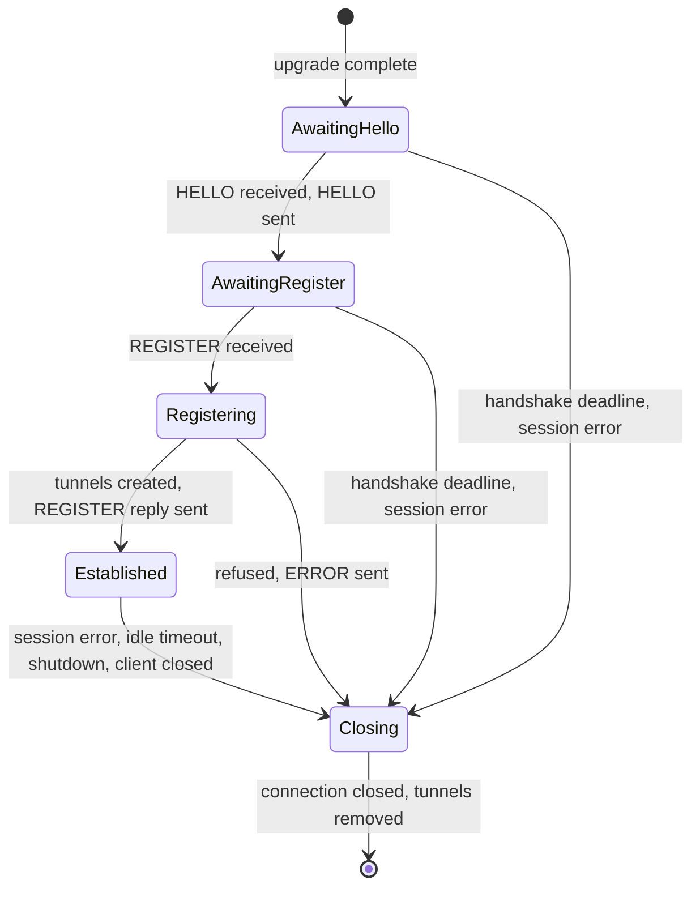
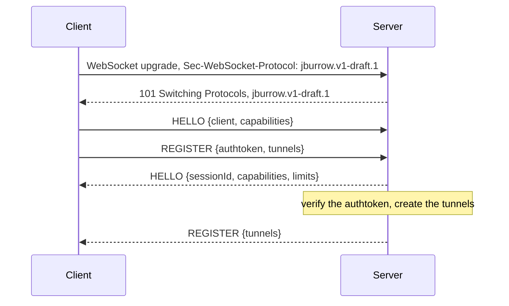
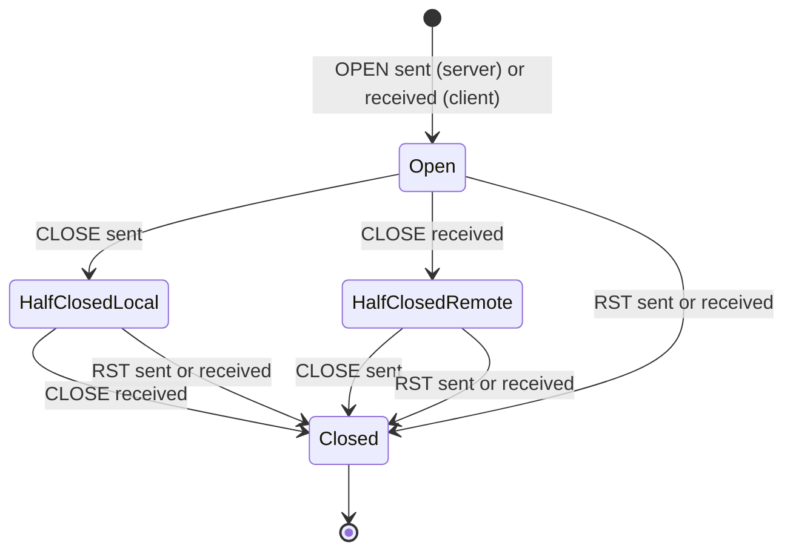

# JBurrow wire protocol

Version `jburrow.v1-draft.1`.

This document specifies the protocol between a JBurrow client and a JBurrow server: how the client
connects, how the two sides agree on a version, the frames they exchange, and what a receiver does
with every byte sequence it can be sent. It is written for someone implementing a client or a
server in any language, without reading JBurrow's code. The conformance vectors (§14) let such an
implementation test its frame decoder against the same cases as the reference implementation.

The key words "MUST", "MUST NOT", "REQUIRED", "SHALL", "SHALL NOT", "SHOULD", "SHOULD NOT",
"RECOMMENDED", "NOT RECOMMENDED", "MAY", and "OPTIONAL" in this document are to be interpreted as
described in BCP 14 ([RFC 2119](https://www.rfc-editor.org/rfc/rfc2119),
[RFC 8174](https://www.rfc-editor.org/rfc/rfc8174)) when, and only when, they appear in all
capitals, as shown here.

## Contents

1. [Status and version](#1-status-and-version)
2. [Conventions](#2-conventions)
3. [Transport](#3-transport)
4. [Versioning and capabilities](#4-versioning-and-capabilities)
5. [Frame format](#5-frame-format)
6. [Frame types](#6-frame-types)
7. [Control payloads](#7-control-payloads)
8. [Sessions](#8-sessions)
9. [Streams](#9-streams)
10. [Liveness](#10-liveness)
11. [Errors](#11-errors)
12. [Receiver rules](#12-receiver-rules)
13. [Limits](#13-limits)
14. [Conformance](#14-conformance)
15. [Security considerations](#15-security-considerations)
16. [Reference implementation](#16-reference-implementation)

## 1. Status and version

This document specifies `jburrow.v1-draft.1`. It is the authority on the wire. Other JBurrow
documents that describe the protocol summarize this one, and where they disagree, this one is
right.

The protocol is a **draft** until JBurrow v1.0.0. Each wire-incompatible change before then gets a
new draft number, and drafts are not compatible with each other: a client and a server of different
drafts refuse each other at the upgrade (§4.1), before any frame is exchanged. At v1.0.0 the version
freezes as `jburrow.v1`, and from then on it only grows through capabilities (§4.2).

### Change log

Section numbers refer to the document of the draft in the same row.

| Draft | Date | Sections | Change |
|---|---|---|---|
| `jburrow.v1-draft.1` | 2026-10-19 | 1–16 | First draft: WebSocket transport, the frame format and type registry, `HELLO`, `REGISTER`, `OPEN`, `DATA`, `CLOSE`, `PING`, `PONG` and `ERROR`, one stream at a time, TCP tunnels only. `HEADERS`, `WINDOW_UPDATE` and `GOAWAY` are assigned type codes but may not be sent. |
| `jburrow.v1-draft.1` | 2026-10-25 | 3.3, 3.5 | Clarified, not a wire change: a request that isn't valid HTTP/1.1 is refused with `PROTOCOL_ERROR` before the checks; `SERVER_SHUTTING_DOWN` refusals carry `Retry-After` too. |
| `jburrow.v1-draft.1` | 2026-10-25 | 10 | A side that has paused reading keeps sending `PING` every `pingIntervalMs`, so its peer doesn't end a healthy session during a long stall. Not a wire change: every peer already answers a `PING`. |

## 2. Conventions

### 2.1 Terms

| Term | Meaning |
|---|---|
| client | The side that opens the connection, usually the `jburrow` command on a developer's machine. |
| server | The side that accepts the connection and the public traffic. |
| peer | The other side of the connection, from the point of view of the side being described. |
| sender, receiver | The side that sends, or receives, the frame being described. |
| message | One WebSocket message (RFC 6455 §5.6), after reassembly of its fragments. |
| frame | The protocol unit of §5. Exactly one frame is carried in each binary message. |
| session | One WebSocket connection between a client and a server, from the upgrade to the close (§8). |
| tunnel | A public endpoint the server creates for the client in a session: in this draft, a public TCP port. |
| visitor | Anyone who connects to a tunnel's public endpoint. |
| local target | The address on the client's side a tunnel forwards to. Only the client knows it. |
| stream | One visitor connection carried over a session (§9). |
| control stream | Stream `0`. It carries the frames about the session itself. |
| data stream | Any stream other than `0`. |
| code | An error code from the registry in §11. |

### 2.2 Notation

- Integers on the wire are unsigned and big-endian (network byte order). `u8` is one byte, `u32`
  four bytes. `0x` introduces a hexadecimal number. Sizes are in bytes. 1 KiB is 1,024 bytes.
- The **length of a string** in a control payload is counted in UTF-16 code units, after JSON
  escapes are decoded. For the ASCII strings most fields hold, that is the number of characters.
  The one exception is the length of a JSON object key, counted in bytes (§7.1).
- A pattern in square brackets, such as `[a-z0-9_]{1,32}`, is a regular expression that must match
  the whole string. Every pattern in this document is ASCII.
- An **example** shows a whole message in hexadecimal, two lower-case digits per byte, with a space
  between bytes. The first line is the 10-byte frame header, and each following line holds up to
  16 bytes of the payload. Line breaks mean nothing. A control frame's example also shows its JSON
  payload, pretty-printed for reading; the hex is the exact bytes a sender produces, which carry
  the same JSON without whitespace. Every example is checked against the reference implementation
  (§16).

### 2.3 Session errors and stream errors

Each error a receiver detects is either a session error or a stream error, and each has a code
from §11.

- **A session error** ends the session. The receiver sends an `ERROR` frame with the code, if the
  connection can still carry it, and then closes the connection (§8.6). Every stream of the session
  ends with it.
- **A stream error** ends one stream. The receiver sends a `CLOSE` frame with the `RST` flag and the
  code on that stream (§6.7), and the stream is closed. The session and its other streams continue.

"X is `PROTOCOL_ERROR`" means that X is a session error with the code `PROTOCOL_ERROR`. Stream
errors are always called stream errors.

## 3. Transport

### 3.1 The connect URL

A client connects to `wss://<connect-host>/v1/connect`, for example
`wss://connect.example.dev/v1/connect`, with the port defaulting to 443. The connect host is the
server's own name for the endpoint; how a client learns it is outside this document.

The transport is WebSocket ([RFC 6455](https://www.rfc-editor.org/rfc/rfc6455)) over TLS. A
WebSocket connection on 443 gets through networks that block unusual ports and through proxies
that inspect TLS.

### 3.2 TLS

The authtoken travels inside the connection (§7.5), so the connection's confidentiality is the
token's. A client:

- MUST verify the server's certificate chain against its trust store, and the server's host name
  against the certificate, as an HTTPS client does
  ([RFC 9110 §4.3.4](https://www.rfc-editor.org/rfc/rfc9110#section-4.3.4)).
- MUST send the host name in the TLS Server Name Indication extension.
- MUST offer only TLS 1.3 and TLS 1.2.
- MUST offer exactly one ALPN protocol, `http/1.1`. Offering `h2` could let an intermediary
  negotiate HTTP/2, where a WebSocket needs [RFC 8441](https://www.rfc-editor.org/rfc/rfc8441)
  support that the path to the server may not have.
- MUST refuse a `ws://` URL (WebSocket without TLS) unless its host is `localhost` or a loopback
  address (`127.0.0.0/8` or `::1`). Plain `ws://` exists for development on one machine only.

### 3.3 The upgrade request

The client sends an HTTP/1.1 `GET` request for `/v1/connect` that is a valid WebSocket opening
handshake (RFC 6455 §4.1), with these headers:

| Header | Rule |
|---|---|
| `Host` | The connect host. |
| `Upgrade`, `Connection`, `Sec-WebSocket-Key` | As RFC 6455 §4.1 requires. |
| `Sec-WebSocket-Version` | `13`. |
| `Sec-WebSocket-Protocol` | REQUIRED. One or more subprotocol tokens (§4.1), most preferred first. |
| `Origin` | MUST NOT be sent. Browsers always send it and a client never does, so a server that refuses it keeps any web page from turning a visitor's browser into a client. |
| `Sec-WebSocket-Extensions` | SHOULD NOT be sent. A server never accepts an extension (§3.6). |
| `User-Agent` | SHOULD be `<name>/<version> (<os>; <arch>)`, with the same values as the client's `HELLO` (§7.3), for example `jburrow-cli/0.2.0 (linux; amd64)`. For logs only; it has no effect on the protocol. |

The request carries no credentials. The client authenticates inside the session (§8.4).

A server checks the request in this order and refuses it with the first check that fails, as
described in §3.5:

| # | Check | Refused with |
|---|---|---|
| 1 | The method is `GET` and the path is `/v1/connect`. | `NOT_FOUND` |
| 2 | `Host`, compared without case and without any port, is the connect host. | `NOT_FOUND` |
| 3 | There is no `Origin` header. | `FORBIDDEN_ORIGIN` |
| 4 | At least one token in `Sec-WebSocket-Protocol` is a version the server speaks. | `UNSUPPORTED_PROTOCOL_VERSION` |
| 5 | The server is not shutting down. | `SERVER_SHUTTING_DOWN` |
| 6 | The server has room for another session. | `SERVER_AT_CAPACITY` |
| 7 | The request is a valid RFC 6455 opening handshake. | `PROTOCOL_ERROR` |

A request that is not valid HTTP/1.1 at all has no method, path or headers to check, and is
refused with `PROTOCOL_ERROR` before check 1.

### 3.4 The upgrade response

A server that accepts the request answers `101 Switching Protocols` as RFC 6455 §4.2.2 describes.
Its `Sec-WebSocket-Protocol` header names exactly one token: the first one in the client's list
that the server speaks. The response carries no `Sec-WebSocket-Extensions` header.

As RFC 6455 §4.1 requires, a client fails the connection if the response names no subprotocol, a
subprotocol it didn't offer, or any extension.

The session starts when the upgrade completes. That moment starts the handshake deadline (§8.3).

### 3.5 A refused upgrade

A server refuses an upgrade with an ordinary HTTP response: the status that §11 gives the code,
`Connection: close`, `Content-Type: application/json`, and this body:

| Field | Type | Rule |
|---|---|---|
| `success` | boolean | Always `false`. |
| `code` | string | The code, from §11. Only codes with upgrade scope appear here. |
| `message` | string | For a person to read. |
| `supported` | array of string | Only with `UNSUPPORTED_PROTOCOL_VERSION`: every token the server speaks. |
| `timestamp` | string | The time of the refusal, as an RFC 3339 date-time in UTC. |
| `path` | string | The request path. |

```json
{
  "success": false,
  "code": "UNSUPPORTED_PROTOCOL_VERSION",
  "message": "This server speaks jburrow.v1-draft.2. Upgrade the jburrow CLI.",
  "supported": ["jburrow.v1-draft.2"],
  "timestamp": "2026-10-19T10:15:30Z",
  "path": "/v1/connect"
}
```

A `SERVER_AT_CAPACITY` or `SERVER_SHUTTING_DOWN` refusal also carries a `Retry-After` header
(RFC 9110 §10.2.3), a number of seconds after which the client may try again.

The body is not a control payload, and the rules of §7 don't apply to it. A client ignores fields
it doesn't know, decides on `code` alone, and treats a refusal it can't read a known code from (no
body, a body that isn't this JSON, a code it doesn't know) as a failure to connect. Such a refusal
usually comes from something between the client and the server.

### 3.6 Messages

- Every frame is exactly one **binary** WebSocket message. A message never carries part of a
  frame, or more than one frame.
- A text message is `PROTOCOL_ERROR`.
- A message MAY be fragmented (RFC 6455 §5.4), since intermediaries may fragment. A receiver
  reassembles the whole message before it decodes the frame.
- A message is at most 65,546 bytes: a 10-byte header and the largest payload (§13). A longer
  message is `FRAME_SIZE_ERROR`. A receiver MAY instead close the connection with WebSocket status
  `1009` (Message Too Big) as soon as a message grows past 65,546 bytes, without sending `ERROR`,
  so that it never has to buffer it.
- Client messages are masked and server messages are not, as RFC 6455 §5.3 requires.
- No WebSocket extension is ever negotiated. In particular `permessage-deflate` is not: it would
  compress bytes an attacker chooses in the same context as the authtoken (§15).
- WebSocket `Ping` frames are answered with `Pong` as RFC 6455 §5.5.2 requires, but WebSocket
  `Ping` and `Pong` play no part in this protocol and do not count as proof of life (§10). The
  protocol's own `PING` and `PONG` frames do that, so liveness works the same over a future
  transport without WebSocket.

How a session's connection is closed is in §8.6.

## 4. Versioning and capabilities

The protocol changes on two levels. The major version, negotiated in the WebSocket upgrade, names
the frame format and the meaning of every frame. Within a version, capabilities negotiated in
`HELLO` add to it without changing what is already there.

### 4.1 Subprotocol tokens

The version is the WebSocket subprotocol. Tokens are compared exactly, case included.

| Token | Meaning |
|---|---|
| `jburrow.v1-draft.1` | This document. |
| `jburrow.v1-draft.N` | Each later wire-incompatible change before JBurrow v1.0.0 increments `N`. |
| `jburrow.v1` | Frozen at JBurrow v1.0.0. |

A client offers every token it speaks, most preferred first. A server selects the first offered
token it speaks (§3.4), or refuses the upgrade with `UNSUPPORTED_PROTOCOL_VERSION` and the list of
the tokens it speaks (§3.5). Before v1.0.0, a server speaks exactly one draft.

### 4.2 Capabilities

A capability is a name matching `[a-z0-9.-]{1,64}` for an optional feature of a version. The client
lists the capabilities it supports in its `HELLO` (§7.3). The server answers in its own `HELLO`
(§7.4) with the subset of those it also supports.

- A frame type, flag, field, field value or error code that a capability introduces MUST NOT be
  sent in a session unless the capability is in the server's list.
- A server ignores capabilities in the client's list that it doesn't know.
- A client ignores capabilities in the server's list that it didn't offer.

`jburrow.v1-draft.1` defines no capabilities. A client of this draft sends an empty list, and a
server of this draft answers with an empty list.

### 4.3 What a receiver doesn't know

A receiver ignores JSON object keys it doesn't know (§7.1). That is the only thing it ignores:

| Unknown | Is |
|---|---|
| A key in a control payload | ignored |
| A capability | ignored (§4.2) |
| A frame type | `PROTOCOL_ERROR` |
| A flag bit | `PROTOCOL_ERROR` |
| A code in a `CLOSE` reset | `PROTOCOL_ERROR` |
| A code in an `ERROR` | `VALIDATION_FAILED` |
| A value of an enumerated field, such as a tunnel kind | `VALIDATION_FAILED` |

So a new optional field in a control payload needs no negotiation, and anything else new needs a
capability or a new version. A receiver never has to guess whether something unknown is safe to
skip.

## 5. Frame format

Every frame is a 10-byte header followed by its payload.

```
 0                   1                   2                   3
 0 1 2 3 4 5 6 7 8 9 0 1 2 3 4 5 6 7 8 9 0 1 2 3 4 5 6 7 8 9 0 1
+-+-------------------------------------------------------------+
|R|                    Stream ID (31)                           |
+-+-------------+---------------+-------------------------------+
|   Type (8)    |   Flags (8)   |          Length (32) ...      |
+---------------+---------------+-------------------------------+
|   ... Length  |              Payload (Length bytes) ...       |
+---------------+-----------------------------------------------+
```

| Field | Size | Rule |
|---|---|---|
| `R` | 1 bit | Reserved. MUST be 0. A receiver treats 1 as `PROTOCOL_ERROR`. |
| Stream ID | 31 bits | `0` is the control stream. `1` to `2^31 - 1` are data streams, allocated by the server (§9.1). |
| Type | `u8` | A code from the registry in §6. |
| Flags | `u8` | Defined per type. Every bit a type doesn't define MUST be 0. |
| Length | `u32` | The payload length. MUST equal the message length minus 10, and MUST be allowed for the type (§6). |

The length field repeats what the WebSocket message already says. It is there so that a raw
stream transport can carry the same frames later, and a receiver that checks the two agree catches
truncation and framing bugs at the first bad frame.

## 6. Frame types

| Code | Type | Stream | Sent by | Payload | Flags | In this draft |
|---|---|---|---|---|---|---|
| `0x01` | `HELLO` | 0 | both, once each | JSON, 0–16,384 | none | §6.1 |
| `0x02` | `REGISTER` | 0 | both: client once, server once | JSON, 0–16,384 | none | §6.2 |
| `0x03` | `OPEN` | new data stream | server | JSON, 0–16,384 | none | §6.3 |
| `0x04` | `HEADERS` | data stream | client | 0–16,384 | none | reserved (§6.4) |
| `0x05` | `DATA` | data stream | both | bytes, 1–65,536 | none | §6.5 |
| `0x06` | `WINDOW_UPDATE` | data stream | both | `u32`, exactly 4 | none | layout only (§6.6) |
| `0x07` | `CLOSE` | data stream | both | empty, or a code of 1–64 | `0x01` `RST` | §6.7 |
| `0x08` | `PING` | 0 | both | exactly 8 | none | §6.8 |
| `0x09` | `PONG` | 0 | both | exactly 8 | none | §6.9 |
| `0x0A` | `GOAWAY` | 0 | server | 0–16,384 | none | reserved (§6.10) |
| `0x0B` | `ERROR` | 0 | both | JSON, 0–16,384 | none | §6.11 |

Type `0x00` and types `0x0C` to `0xFF` are unassigned, and receiving one is `PROTOCOL_ERROR`. An
assigned code is never reused for another type.

"Sent by" is part of the type: a server that receives `OPEN` or `GOAWAY`, or a client that receives
`HEADERS`, raises `PROTOCOL_ERROR` before looking at anything else about the frame (§12, step 4).
"none" in the flags column means that no flag is defined, so the flags byte MUST be `0x00`.

A JSON payload of length 0 passes the length check and then fails to parse, as `PROTOCOL_ERROR`
(§7.1).

### 6.1 `HELLO` (0x01)

Opens the session. The client's `HELLO` says who it is and which capabilities it supports. The
server's `HELLO` gives the session its id, the capabilities both sides support and the limits the
client must stay within. Each side sends exactly one, first (§8.2).

- Stream 0. No flags. Payload: one JSON object, which differs by direction: §7.3 from the client,
  §7.4 from the server. Examples are in those sections.

### 6.2 `REGISTER` (0x02)

The client asks for tunnels and authenticates; the server answers with the tunnels it created. The
client sends exactly one, and the server answers it with exactly one or with an `ERROR` (§8.4).

- Stream 0. No flags. Payload: one JSON object, which differs by direction: §7.5 from the client,
  §7.6 from the server.

### 6.3 `OPEN` (0x03)

The server opens a new stream for a visitor connection to one of the client's tunnels (§9.4).

- Sent by the server only, on the new stream's id. No flags. Payload: one JSON object (§7.7).

### 6.4 `HEADERS` (0x04)

Reserved for HTTP tunnels, defined in a later draft. In this draft no peer may send it.

- Sent by the client only, on a data stream. No flags. Payload: up to 16,384 bytes, which a
  receiver of this draft doesn't parse.
- A client that receives `HEADERS` raises `PROTOCOL_ERROR` at step 4 of §12. A server that receives
  one decodes the header, checks the length and the flags, and then raises `PROTOCOL_ERROR` at
  step 9.

### 6.5 `DATA` (0x05)

Carries stream bytes, in either direction.

- A data stream. No flags.
- Payload: 1 to 65,536 bytes of stream data, opaque to the protocol. An empty `DATA` frame is
  `FRAME_SIZE_ERROR`: it carries nothing, and allowing it would let a peer make the receiver work
  for free. A server MAY announce a lower maximum in `limits.maxFramePayload` (§7.4), and a client
  MUST NOT send `DATA` longer than that.
- When `DATA` may be sent and received is in §9.2.

The server sends a visitor's first bytes, `SSH-2.0-OpenSSH_9.6` and a CRLF, on stream 1:

<!-- example:data -->
```text
00 00 00 01 05 00 00 00 00 15
53 53 48 2d 32 2e 30 2d 4f 70 65 6e 53 53 48 5f
39 2e 36 0d 0a
```
<!-- /example -->

### 6.6 `WINDOW_UPDATE` (0x06)

Reserved for per-stream flow control. A later draft defines when it is sent; this draft fixes its
payload so that the receiver rules cover it. In this draft no peer may send it, and receiving a
well-formed one is `PROTOCOL_ERROR` at step 9 of §12.

- A data stream. No flags.
- Payload: exactly 4 bytes, a `u32` credit increment from `1` to `2^31 - 1`. Any other value is
  `PROTOCOL_ERROR`, at step 8.

The layout, for an increment of 65,536 on stream 1:

<!-- example:window-update -->
```text
00 00 00 01 06 00 00 00 00 04
00 01 00 00
```
<!-- /example -->

### 6.7 `CLOSE` (0x07)

Ends one direction of a stream, or the whole stream.

| Flags | Payload | Meaning |
|---|---|---|
| `0x00` | empty (length 0) | **Half-close.** The sender will send no more `DATA` on this stream. Like a TCP `FIN`. |
| `0x01` `RST` | a code, 1 to 64 bytes | **Reset.** The stream is over in both directions, at once, and data in flight on it is discarded. Like a TCP `RST`. |

- A data stream. Bits other than `RST` MUST be 0.
- The allowed length depends on the `RST` bit alone: 0 without it, 1 to 64 with it. Any other
  length is `FRAME_SIZE_ERROR`.
- A reset's payload is a code from §11 in ASCII, with no terminator. Each byte MUST be one of
  `A`–`Z`, `0`–`9` or `_`; the code MUST be in the registry; and it MUST have stream scope.
  Anything else is `PROTOCOL_ERROR`: a peer may not invent codes, and a session-only code such as
  `AUTHTOKEN_INVALID` can't end a stream.

Every stream ends with `CLOSE`. There is no end-of-stream flag on `DATA`, so there is only one way
to say it.

The client half-closes stream 1:

<!-- example:close-half -->
```text
00 00 00 01 07 00 00 00 00 00
```
<!-- /example -->

The client resets stream 1 because its local target refused the connection:

<!-- example:close-reset -->
```text
00 00 00 01 07 01 00 00 00 19
4c 4f 43 41 4c 5f 53 45 52 56 49 43 45 5f 55 4e
52 45 41 43 48 41 42 4c 45
```
<!-- /example -->

### 6.8 `PING` (0x08)

Asks the peer for proof of life (§10).

- Stream 0. No flags. Payload: exactly 8 bytes, chosen by the sender and opaque to the receiver. A
  counter is a good choice.

The server pings with the opaque value 1:

<!-- example:ping -->
```text
00 00 00 00 08 00 00 00 00 08
00 00 00 00 00 00 00 01
```
<!-- /example -->

### 6.9 `PONG` (0x09)

Answers a `PING` (§10).

- Stream 0. No flags. Payload: exactly 8 bytes, the payload of the `PING` it answers.

The client answers the `PING` above:

<!-- example:pong -->
```text
00 00 00 00 09 00 00 00 00 08
00 00 00 00 00 00 00 01
```
<!-- /example -->

### 6.10 `GOAWAY` (0x0A)

Reserved for a server that is draining before a restart, defined in a later draft. In this draft no
peer may send it.

- Sent by the server only, on stream 0. No flags. Payload: up to 16,384 bytes, which a receiver of
  this draft doesn't parse.
- A server that receives `GOAWAY` raises `PROTOCOL_ERROR` at step 4 of §12. A client that receives
  one decodes the header, checks the length and the flags, and then raises `PROTOCOL_ERROR` at
  step 9.

### 6.11 `ERROR` (0x0B)

Reports a session error. The sender closes the connection right after it (§8.6).

- Stream 0. No flags. Payload: one JSON object (§7.8), the same in both directions.

## 7. Control payloads

`HELLO`, `REGISTER`, `OPEN` and `ERROR` each carry one JSON object
([RFC 8259](https://www.rfc-editor.org/rfc/rfc8259)) encoded in UTF-8, at most 16,384 bytes.

### 7.1 Encoding rules

A receiver MUST reject a payload, as `PROTOCOL_ERROR`, that:

1. Isn't valid UTF-8. Decoding is strict: overlong forms, encoded surrogates and bytes that can't
   start or continue a sequence are invalid.
2. Starts with a byte order mark, or contains a `0x00` byte anywhere. No JSON text contains a raw
   `0x00`, and refusing it and the byte order mark leaves a lenient parser nothing to guess UTF-16
   or UTF-32 from. (An escaped `\u0000` inside a string is valid JSON and is allowed.)
3. Isn't well-formed JSON, or has a top-level value that isn't an object. An empty payload is not
   well-formed. Whitespace before and after the object is allowed; anything else after it,
   including a second value, is not.
4. Repeats a key in any object, including objects the receiver ignores.
5. Exceeds a parser limit anywhere in the document, including in values the receiver ignores:
   - more than 8 levels of nesting, where each object or array is one level and the top-level
     object is level 1;
   - a string longer than 4,096 UTF-16 code units after its escapes are decoded;
   - a key longer than 64 bytes when encoded in UTF-8 after its escapes are decoded;
   - a number with more than 20 digits, counting the digits of its integer part, its fraction and
     its exponent together, and not counting signs, the decimal point or the exponent marker.
6. Gives a known field a value of the wrong JSON type. Nothing is coerced: a string is not a
   number, `"5"` is not `5`, `1.0` and `1e3` are not integers, a single value is not a one-element
   array, and `null` is never valid for a known field, required or optional. An optional field
   that is absent is omitted, not `null`.
7. Gives an integer field a value outside the range of the field's integer type, which the field
   tables give as 32-bit (`-2^31` to `2^31 - 1`) or 64-bit (`-2^63` to `2^63 - 1`) signed.

A payload that is well-formed under these rules but breaks a field rule of §7.3 to §7.8 (a missing
required field, a length, a range, a pattern, an unknown enumerated value, a uniqueness rule) is
`VALIDATION_FAILED`. Its message names the field by its path from the payload root, for example
`tunnels[0].ref must match [a-z0-9][a-z0-9-]{0,31}`, and never quotes any part of the payload.

A receiver MUST ignore keys it doesn't know, at any depth, whatever their values, as long as the
payload as a whole follows the rules above. That is what lets a later version add an optional field
without negotiation (§4.3).

A receiver checks rules 1 to 5 over the whole payload before it looks at any field, so a payload
that breaks one of them is `PROTOCOL_ERROR` whatever else it breaks. When a payload breaks rule 6
or 7 and also a field rule, which of them the receiver reports is not specified; both end the
session. The conformance vectors (§14) each break exactly one rule.

Every JSON string may use any escape RFC 8259 allows. An escaped unpaired surrogate such as
`\ud800` is not an error; it can only appear where the field rules allow any text, and a sender
SHOULD NOT produce one.

A sender MAY write keys in any order and with any insignificant whitespace, and a receiver MUST NOT
depend on either. The examples in this document are compact, with keys in the order of the field
tables.

### 7.2 Field conventions

- Field names are camelCase.
- Enumerated values are lower-case strings, such as `"tcp"`, and compared exactly.
- Durations are integer milliseconds, in fields whose names end in `Ms`.
- Identifiers the server issues (`sessionId`, `tunnelId`) are UUIDs in the canonical lower-case
  form `xxxxxxxx-xxxx-xxxx-xxxx-xxxxxxxxxxxx` of hexadecimal digits `[0-9a-f]`. Any other form,
  including upper case, is `VALIDATION_FAILED`. They are not secrets.
- In the field tables, "integer (32-bit)" and "integer (64-bit)" give the integer type of rule 7
  of §7.1, and "1–64" in a length column is a string length (§2.2). A field the tables mark
  optional may be omitted; every other field is required, and a missing one is
  `VALIDATION_FAILED`.

### 7.3 `HELLO`, client to server

| Field | Type | Rule |
|---|---|---|
| `client` | object | Who the client is. |
| `client.name` | string | `[A-Za-z0-9._-]{1,64}`. The implementation's name, such as `jburrow-cli`. |
| `client.version` | string | `[A-Za-z0-9.+_-]{1,64}`. The implementation's version. |
| `client.os` | string | Optional. `[a-z0-9_]{1,32}`. The operating system, such as `linux`. |
| `client.arch` | string | Optional. `[a-z0-9_]{1,32}`. The processor architecture, such as `amd64`. |
| `capabilities` | array of string | 0 to 32 entries, each `[a-z0-9.-]{1,64}`, no two equal (§4.2). |

`client` is for logs and diagnostics only; it has no effect on the protocol.

<!-- example:hello-client -->
```json
{
  "client": { "name": "jburrow-cli", "version": "0.2.0", "os": "linux", "arch": "amd64" },
  "capabilities": []
}
```

```text
00 00 00 00 01 00 00 00 00 61
7b 22 63 6c 69 65 6e 74 22 3a 7b 22 6e 61 6d 65
22 3a 22 6a 62 75 72 72 6f 77 2d 63 6c 69 22 2c
22 76 65 72 73 69 6f 6e 22 3a 22 30 2e 32 2e 30
22 2c 22 6f 73 22 3a 22 6c 69 6e 75 78 22 2c 22
61 72 63 68 22 3a 22 61 6d 64 36 34 22 7d 2c 22
63 61 70 61 62 69 6c 69 74 69 65 73 22 3a 5b 5d
7d
```
<!-- /example -->

### 7.4 `HELLO`, server to client

| Field | Type | Rule |
|---|---|---|
| `sessionId` | string | A UUID (§7.2), new for every session. |
| `server` | object | Who the server is. For logs and diagnostics only. |
| `server.name` | string | The rule of `client.name`. |
| `server.version` | string | The rule of `client.version`. |
| `capabilities` | array of string | The rule of the client's `capabilities`: the client's capabilities that the server also supports (§4.2). |
| `limits` | object | The server's terms for this session. |
| `limits.maxFramePayload` | integer (32-bit) | 1 to 65,536. The longest `DATA` payload the client may send. |
| `limits.maxTunnels` | integer (32-bit) | At least 1. The most tunnels the client may ask for in its `REGISTER`. |
| `limits.maxConcurrentStreams` | integer (32-bit) | At least 1. The most streams the server will have open at once on this session. |
| `limits.pingIntervalMs` | integer (64-bit) | At least 1,000. Silence after which a side sends `PING` (§10). |
| `limits.idleTimeoutMs` | integer (64-bit) | At least twice `pingIntervalMs`. Silence after which a side declares its peer dead (§10). |

The limits are announced, not fixed, so that a server's operator can tune them and a later draft
can raise `maxConcurrentStreams` without a new frame. The client MUST stay within them, and the
server enforces them (§8.5). `maxFramePayload` can only lower the protocol's 65,536-byte maximum,
never raise it.

<!-- example:hello-server -->
```json
{
  "sessionId": "0b8e5c1e-7c55-4c46-9a3e-2f1d0c9e4b7a",
  "server": { "name": "jburrow-server", "version": "0.2.0" },
  "capabilities": [],
  "limits": {
    "maxFramePayload": 65536,
    "maxTunnels": 1,
    "maxConcurrentStreams": 1,
    "pingIntervalMs": 15000,
    "idleTimeoutMs": 45000
  }
}
```

```text
00 00 00 00 01 00 00 00 00 f3
7b 22 73 65 73 73 69 6f 6e 49 64 22 3a 22 30 62
38 65 35 63 31 65 2d 37 63 35 35 2d 34 63 34 36
2d 39 61 33 65 2d 32 66 31 64 30 63 39 65 34 62
37 61 22 2c 22 73 65 72 76 65 72 22 3a 7b 22 6e
61 6d 65 22 3a 22 6a 62 75 72 72 6f 77 2d 73 65
72 76 65 72 22 2c 22 76 65 72 73 69 6f 6e 22 3a
22 30 2e 32 2e 30 22 7d 2c 22 63 61 70 61 62 69
6c 69 74 69 65 73 22 3a 5b 5d 2c 22 6c 69 6d 69
74 73 22 3a 7b 22 6d 61 78 46 72 61 6d 65 50 61
79 6c 6f 61 64 22 3a 36 35 35 33 36 2c 22 6d 61
78 54 75 6e 6e 65 6c 73 22 3a 31 2c 22 6d 61 78
43 6f 6e 63 75 72 72 65 6e 74 53 74 72 65 61 6d
73 22 3a 31 2c 22 70 69 6e 67 49 6e 74 65 72 76
61 6c 4d 73 22 3a 31 35 30 30 30 2c 22 69 64 6c
65 54 69 6d 65 6f 75 74 4d 73 22 3a 34 35 30 30
30 7d 7d
```
<!-- /example -->

### 7.5 `REGISTER`, client to server

| Field | Type | Rule |
|---|---|---|
| `authtoken` | string | Length 1 to 256. The client's credential. A receiver never logs it and never repeats it, not even in an error message. |
| `tunnels` | array of object | 1 to 32 entries. More than `limits.maxTunnels` but no more than 32 is well-formed, and the server refuses it as `TUNNEL_LIMIT_EXCEEDED` (§8.4). |
| `tunnels[].ref` | string | `[a-z0-9][a-z0-9-]{0,31}`, no two equal in the request. Chosen by the client to match the reply and errors to the request. |
| `tunnels[].kind` | string | `"tcp"`, the only kind in this draft. |
| `tunnels[].remotePort` | integer (32-bit) | Optional. 1 to 65,535. Asks for this public port. Without it, the server chooses. |

The tunnel's local target is not part of `REGISTER`. The server never needs it, and the client maps
each `ref` to its local target itself.

<!-- example:register-request -->
```json
{
  "authtoken": "jb_LOCAL-DEVELOPMENT-ONLY-unlocks-localhost-00",
  "tunnels": [{ "ref": "default", "kind": "tcp", "remotePort": 20417 }]
}
```

```text
00 00 00 00 02 00 00 00 00 7c
7b 22 61 75 74 68 74 6f 6b 65 6e 22 3a 22 6a 62
5f 4c 4f 43 41 4c 2d 44 45 56 45 4c 4f 50 4d 45
4e 54 2d 4f 4e 4c 59 2d 75 6e 6c 6f 63 6b 73 2d
6c 6f 63 61 6c 68 6f 73 74 2d 30 30 22 2c 22 74
75 6e 6e 65 6c 73 22 3a 5b 7b 22 72 65 66 22 3a
22 64 65 66 61 75 6c 74 22 2c 22 6b 69 6e 64 22
3a 22 74 63 70 22 2c 22 72 65 6d 6f 74 65 50 6f
72 74 22 3a 32 30 34 31 37 7d 5d 7d
```
<!-- /example -->

The token in this example is the documented development token of the reference server, which only
unlocks a server running on the developer's own machine.

### 7.6 `REGISTER`, server to client

| Field | Type | Rule |
|---|---|---|
| `tunnels` | array of object | 1 to 32 entries, no two with the same `ref`. One entry per requested tunnel, in request order (§8.4). |
| `tunnels[].ref` | string | The rule of the request's `ref`: the `ref` of the request entry it answers. |
| `tunnels[].tunnelId` | string | A UUID (§7.2). Identifies the tunnel in `OPEN`. |
| `tunnels[].kind` | string | `"tcp"`, the request entry's kind. |
| `tunnels[].publicHost` | string | A lower-case DNS name or an IPv4 address, at most 253 characters: dot-separated labels of 1 to 63 characters from `[a-z0-9-]` that neither start nor end with `-`, with no trailing dot. An IPv6 host would need brackets in `url`, and this draft has no IPv6 tunnels. |
| `tunnels[].publicPort` | integer (32-bit) | 1 to 65,535. With a `remotePort` in the request, that port. |
| `tunnels[].url` | string | Exactly `<kind>://<publicHost>:<publicPort>`, with `publicPort` in decimal without leading zeros. |

<!-- example:register-reply -->
```json
{
  "tunnels": [
    {
      "ref": "default",
      "tunnelId": "5d0f4f0e-31a6-4a39-8d51-0c0f7f1f6c23",
      "kind": "tcp",
      "publicHost": "tcp.example.dev",
      "publicPort": 20417,
      "url": "tcp://tcp.example.dev:20417"
    }
  ]
}
```

```text
00 00 00 00 02 00 00 00 00 b4
7b 22 74 75 6e 6e 65 6c 73 22 3a 5b 7b 22 72 65
66 22 3a 22 64 65 66 61 75 6c 74 22 2c 22 74 75
6e 6e 65 6c 49 64 22 3a 22 35 64 30 66 34 66 30
65 2d 33 31 61 36 2d 34 61 33 39 2d 38 64 35 31
2d 30 63 30 66 37 66 31 66 36 63 32 33 22 2c 22
6b 69 6e 64 22 3a 22 74 63 70 22 2c 22 70 75 62
6c 69 63 48 6f 73 74 22 3a 22 74 63 70 2e 65 78
61 6d 70 6c 65 2e 64 65 76 22 2c 22 70 75 62 6c
69 63 50 6f 72 74 22 3a 32 30 34 31 37 2c 22 75
72 6c 22 3a 22 74 63 70 3a 2f 2f 74 63 70 2e 65
78 61 6d 70 6c 65 2e 64 65 76 3a 32 30 34 31 37
22 7d 5d 7d
```
<!-- /example -->

### 7.7 `OPEN`, server to client

| Field | Type | Rule |
|---|---|---|
| `tunnelId` | string | A UUID (§7.2): the tunnel the visitor connected to, from the `REGISTER` reply. |
| `kind` | string | `"tcp"`, the tunnel's kind. |
| `remote` | object | The visitor's address, as the server saw it. |
| `remote.address` | string | An IP address literal, checked by its text alone and never resolved: an IPv4 address in dotted-decimal form with no leading zeros (`203.0.113.9`, not `203.0.113.09`), or an IPv6 address in any text form of [RFC 4291 §2.2](https://www.rfc-editor.org/rfc/rfc4291#section-2.2), hexadecimal digits in either case, an embedded IPv4 part following the IPv4 rule, at most 45 characters, without brackets and without a zone. |
| `remote.port` | integer (32-bit) | 0 to 65,535. The visitor's port. |

<!-- example:open -->
```json
{
  "tunnelId": "5d0f4f0e-31a6-4a39-8d51-0c0f7f1f6c23",
  "kind": "tcp",
  "remote": { "address": "203.0.113.9", "port": 51234 }
}
```

```text
00 00 00 01 03 00 00 00 00 70
7b 22 74 75 6e 6e 65 6c 49 64 22 3a 22 35 64 30
66 34 66 30 65 2d 33 31 61 36 2d 34 61 33 39 2d
38 64 35 31 2d 30 63 30 66 37 66 31 66 36 63 32
33 22 2c 22 6b 69 6e 64 22 3a 22 74 63 70 22 2c
22 72 65 6d 6f 74 65 22 3a 7b 22 61 64 64 72 65
73 73 22 3a 22 32 30 33 2e 30 2e 31 31 33 2e 39
22 2c 22 70 6f 72 74 22 3a 35 31 32 33 34 7d 7d
```
<!-- /example -->

### 7.8 `ERROR`, either direction

| Field | Type | Rule |
|---|---|---|
| `code` | string | A code from §11 whose scope includes session or upgrade, spelled exactly. A code the registry doesn't have, or one with stream scope only, is `VALIDATION_FAILED`. |
| `message` | string | Length 1 to 512. For a person to read. It never contains a secret, a stack trace, an internal address or any part of a payload the sender received. |
| `ref` | string | Optional. The rule of a tunnel `ref`: the tunnel the error is about. |

Codes are for programs and messages are for people. A receiver MUST decide what to do on `code`
alone. A server of this draft only sends codes with session scope in `ERROR`.

<!-- example:error -->
```json
{ "code": "PORT_UNAVAILABLE", "message": "Port 20417 is already in use.", "ref": "default" }
```

```text
00 00 00 00 0b 00 00 00 00 55
7b 22 63 6f 64 65 22 3a 22 50 4f 52 54 5f 55 4e
41 56 41 49 4c 41 42 4c 45 22 2c 22 6d 65 73 73
61 67 65 22 3a 22 50 6f 72 74 20 32 30 34 31 37
20 69 73 20 61 6c 72 65 61 64 79 20 69 6e 20 75
73 65 2e 22 2c 22 72 65 66 22 3a 22 64 65 66 61
75 6c 74 22 7d
```
<!-- /example -->

## 8. Sessions

A session is one WebSocket connection. It begins when the upgrade completes and ends when the
connection closes.

### 8.1 States

Both sides track the session through these states. The server's view:



| State | Meaning |
|---|---|
| AwaitingHello | Connected; the client's `HELLO` hasn't arrived. |
| AwaitingRegister | `HELLO`s exchanged; the client's `REGISTER` hasn't arrived. |
| Registering | The server is checking the `REGISTER` and creating the tunnels. |
| Established | The `REGISTER` reply is sent. Streams may be opened. |
| Closing | The session is ending; nothing new starts. |

The client's view is the same, with "sent" and "received" swapped: it is established when it
receives the `REGISTER` reply.

### 8.2 Frame order

| From | Before the session is established | Once it is established |
|---|---|---|
| Client | `HELLO` first; then `REGISTER`, exactly once; `PING`, `PONG` | `DATA` and `CLOSE` on streams the server opened; `PING`, `PONG` |
| Server | `HELLO` first, after the client's `HELLO` arrives; then the `REGISTER` reply, exactly once, after the client's `REGISTER` arrives; `PING`, `PONG` | `OPEN`, `DATA`, `CLOSE`; `PING`, `PONG` |

Either side may send `ERROR` at any point, including first, and it ends the session (§8.6).

Any frame outside this table is `PROTOCOL_ERROR`, in either direction. In particular: a frame
other than `HELLO` or `ERROR` before the peer's `HELLO`; a second `HELLO`; a second `REGISTER`;
`OPEN`, `DATA` or `CLOSE` before the session is established; and in this draft any `HEADERS`,
`WINDOW_UPDATE` or `GOAWAY`.

Stream 0 is processed in order. A receiver handles each control frame completely, including any
error it raises, before the next one.

### 8.3 Handshake

The client SHOULD send `REGISTER` immediately after its `HELLO`, without waiting for the server's
`HELLO`. The server processes them in order, so if it refuses the `HELLO`, it never acts on the
`REGISTER` behind it. Session setup then takes one round trip after the upgrade.



**The handshake deadline.** A server MUST establish the session, or end it, within its handshake
timeout of the upgrade completing. When the deadline passes first, the server sends
`ERROR HANDSHAKE_TIMEOUT` and closes. The deadline includes the time the server spends checking the
authtoken. The server chooses the timeout and doesn't announce it; the reference server uses 10
seconds.

A client SHOULD give up on a server whose `HELLO` hasn't arrived within a timeout of its own. Until
that `HELLO` arrives, the client has no liveness intervals (§10).

### 8.4 Registration

The server handles a `REGISTER` with these checks, in this order, and refuses it with the first
that fails:

| # | Check | Refused with |
|---|---|---|
| 1 | No more tunnels than `limits.maxTunnels`. | `TUNNEL_LIMIT_EXCEEDED` |
| 2 | The authtoken is valid. | `AUTHTOKEN_INVALID` |
| 3 | The token's owner may open another session. | `SESSION_LIMIT_EXCEEDED` |
| 4 | Each tunnel can be created. A requested `remotePort` that is outside the server's range or in use fails; so does running out of ports. | `PORT_UNAVAILABLE`, `PORT_POOL_EXHAUSTED` |

A payload that breaks a field rule fails earlier, as `VALIDATION_FAILED` (§7.1), and an unexpected
failure in the server is `INTERNAL_ERROR`.

Registration is **all or nothing**. If every check passes, the server creates every requested
tunnel and sends the `REGISTER` reply: one entry per request entry, in the same order, with the same
`ref` and `kind`. If any check fails, it creates none, sends `ERROR` with the code (and the `ref` of
the tunnel concerned, where there is one), and closes the session.

A client SHOULD treat a reply that doesn't match its request (a different number of entries, a
different order, `ref` or `kind`) as `PROTOCOL_ERROR`.

### 8.5 Limits

The server's `HELLO` announces the session's limits (§7.4). The client MUST stay within them, and
the server enforces them:

- A `DATA` payload longer than `limits.maxFramePayload` is `FRAME_SIZE_ERROR`.
- A `REGISTER` with more than `limits.maxTunnels` tunnels is refused with `TUNNEL_LIMIT_EXCEEDED`.
- `limits.maxConcurrentStreams` binds the server. It MUST NOT send `OPEN` while that many streams
  of the session are open in its own view, which is to say not Closed (§9.2). A server at the limit
  refuses further visitor connections to the session's tunnels without telling the client. The
  client doesn't check this limit: its view of which streams are open can lag behind the server's.

### 8.6 Closing

A session ends in one of three ways:

- **With an error.** The side that detects a session error sends `ERROR` with its code, then a
  WebSocket close frame whose status is the code's close code (§11), and then closes the TCP
  connection, waiting at most 2 seconds for the peer's close frame. A side that receives `ERROR`
  sends no further frames and completes the WebSocket close. The WebSocket close status is advisory,
  for intermediaries and logs; a receiver decides on the `ERROR` code (§11.3).
- **On purpose, by the client.** A client that stops sends a WebSocket close frame with status
  `1000` and no `ERROR`.
- **By losing the connection.** The TCP connection fails, or one side declares the other dead
  (§10).

A side that closes without being able to send `ERROR`, because the connection is already gone,
just closes. When a session ends, for any reason, every stream on it is reset on both sides, and the
server removes every tunnel the session created. A tunnel never outlives its session in this draft.

## 9. Streams

A stream carries one visitor connection: in this draft, one TCP connection to a tunnel's public
port.

### 9.1 Stream ids

- The server allocates every stream id. The first stream of a session is `1`, and each `OPEN`
  uses the id after the last one: ids increase by exactly 1 and are never reused within a session.
- A client MUST treat an `OPEN` whose id is not greater than every id it has seen in the session as
  `PROTOCOL_ERROR`.
- A server that has used every id up to `2^31 - 1` ends the session with `INTERNAL_ERROR`. At one
  new visitor connection per millisecond, that takes 24 days.

### 9.2 States

Each side tracks each stream through the same states. "Local" is the side doing the tracking,
"remote" its peer.



| State | Meaning |
|---|---|
| Open | Both directions carry data. |
| HalfClosedLocal | This side sent `CLOSE`; the peer may still send `DATA`. |
| HalfClosedRemote | The peer sent `CLOSE`; this side may still send `DATA`. |
| Closed | The stream is over. Its id stays used. |

The complete table. "CLOSE" is the half-close, and "RST" is `CLOSE` with the `RST` flag.

| State | `DATA` received | `CLOSE` received | `RST` received | `DATA` sent | `CLOSE` sent | `RST` sent |
|---|---|---|---|---|---|---|
| Open | delivered | → HalfClosedRemote | → Closed | allowed | → HalfClosedLocal | → Closed |
| HalfClosedLocal | delivered | → Closed | → Closed | MUST NOT | MUST NOT | → Closed |
| HalfClosedRemote | stream error `STREAM_CLOSED` | stream error `STREAM_CLOSED` | → Closed | allowed | → Closed | → Closed |
| Closed | discarded | discarded | discarded | MUST NOT | MUST NOT | MUST NOT |

- A stream error closes the stream: the receiver sends `CLOSE RST STREAM_CLOSED` and the stream
  is Closed.
- A side that receives `RST` discards whatever it still holds for that stream and sends no reply.
- "discarded" means dropped without a reply and without an error.

### 9.3 Closed versus never opened

A frame for a data stream that isn't open is handled by its id:

- **An id no greater than the highest id opened in the session** belongs to a stream that existed
  and is now Closed. The frame is discarded silently: it was in flight when the stream ended. Treating
  it as an error would turn every reset into a session failure, since the peer goes on sending until
  it learns of the reset.
- **A higher id** belongs to a stream that was never opened. Except for an `OPEN` from the server,
  which creates it, a frame for it is `PROTOCOL_ERROR`.

### 9.4 Opening a stream

When a visitor connects to a tunnel, the server sends `OPEN` on the next stream id, naming the
tunnel and the visitor's address, and the stream is Open on both sides as soon as `OPEN` is sent or
received.

Opening is **optimistic**: the server MAY send the visitor's bytes as `DATA` right behind the
`OPEN`, without waiting for the client. This saves a round trip per connection. The client:

- MUST treat an `OPEN` naming a `tunnelId` that isn't one of its tunnels as `PROTOCOL_ERROR`.
- Connects to the tunnel's local target. `DATA` that arrives before that connection is ready is
  not an error: the client holds it, and when it holds more than it is willing to buffer, it stops
  reading the session's connection until the local connection is ready or has failed (§10 covers
  how pausing affects liveness).
- Writes what it holds once the local connection is ready, or, if the connection fails, discards
  it and resets the stream with `LOCAL_SERVICE_UNREACHABLE`.

### 9.5 Streams and TCP

A stream behaves like the TCP connection it carries, including when only one direction is closed.

| On the visitor's or the local target's connection | The side sends |
|---|---|
| Bytes read | `DATA`, at most 65,536 bytes each (or `limits.maxFramePayload`, for the client) |
| End of input: the other end sent `FIN` | `CLOSE` (half-close) |
| The connection is reset, or fails with an I/O error | `CLOSE RST PEER_RESET` |
| The local target refuses the connection (client only) | `CLOSE RST LOCAL_SERVICE_UNREACHABLE` |

| The side receives | Done to the visitor's or the local target's connection |
|---|---|
| `DATA` | The bytes are written. |
| `CLOSE` | Its write side is shut down, which sends `FIN`, while it can still be read. |
| `CLOSE RST` | It is closed with a TCP `RST`. |

A side MUST shut down only the write side of a connection on `CLOSE`, never close it entirely, so
that a protocol which closes one direction first (as SSH and `nc -N` do) behaves the same through a
tunnel as it does directly.

### 9.6 Streams when the session ends

When a session ends, every stream on it ends as if it had been reset. A side that is ending a
session while its connection still works MAY first send `CLOSE RST CANCELLED` for each of its open
streams. Either way, each side closes the connections its streams carried with a TCP `RST`.

## 10. Liveness

Each side detects a dead peer on its own: the server, to remove a vanished client's tunnels; the
client, to tell its user the tunnels are gone. The two intervals are the ones the server announces in
its `HELLO` (§7.4). The reference server announces a `pingIntervalMs` of 15,000 and an
`idleTimeoutMs` of 45,000; those values are given for information, and an implementation MUST use
the announced ones.

- **Every frame received counts as proof of life**, not only `PONG`. A busy session never needs a
  `PING`. WebSocket control frames don't count (§3.6).
- When a side has received nothing for `pingIntervalMs`, it sends a `PING`. It then sends no
  other `PING` until something arrives.
- When a side has received nothing for `idleTimeoutMs`, its peer is dead. It sends
  `ERROR HEARTBEAT_TIMEOUT` if it can and closes the connection.
- A side MUST answer each `PING` with a `PONG` carrying the same 8 bytes, as soon as it can. A
  `PONG` that answers no `PING` this side sent, or answers one already answered, is discarded,
  though it still counts as a frame received.
- **Paused reading pauses the clock.** A side that stops reading the connection on purpose, for
  backpressure, MUST stop counting time towards both intervals while it isn't reading, and MUST
  restart the count from zero when it reads again. Without this rule, a visitor that stops reading
  would make the server stop reading the client, miss the client's `PONG`, and end a healthy
  session.
- **A paused side keeps sending `PING`.** While it isn't reading, a side MUST send a `PING` at
  once if it has never sent one, and then each time `pingIntervalMs` has passed since its last
  `PING`, answered or not. Its peer may still be reading, and counts each one as proof of life.
  Without this rule the peer hears nothing and ends the session after `idleTimeoutMs`: a local
  service that stops reading makes the client stop reading the server, and a visitor that stops
  reading leaves the client waiting on a server whose clock is paused. Under these rules a side's
  `PING`s are never less than `pingIntervalMs` apart.
- Before the server's `HELLO` arrives, the client has no intervals; the client's handshake timeout
  applies instead (§8.3).
- A side SHOULD NOT send `PING` other than as these rules say.
- A server MAY limit how often it answers `PING`s, and end a session that exceeds the limit with
  `PING_RATE_EXCEEDED`. Every `PING` forces a write, so an unlimited rate is a cheap way to make a
  server work. The reference server allows a burst of 5 and one per second after that, far above
  what these rules ever produce.

## 11. Errors

### 11.1 Where codes appear

Every error has a code: an ASCII string of 1 to 64 characters from `[A-Z0-9_]`. A code appears in
one of three places, which make up its **scope**:

| Scope | Where | What it ends |
|---|---|---|
| upgrade | The body of a refused upgrade (§3.5) | The connection, before a session exists |
| session | The `code` of an `ERROR` frame (§7.8) | The session |
| stream | The payload of a `CLOSE` frame with `RST` (§6.7) | One stream |

### 11.2 The registry

The registry for `jburrow.v1-draft.1`. The upgrade status is the HTTP status of a refused upgrade;
the close code is the WebSocket close status that follows an `ERROR` (§8.6).

| Code | Scope | Meaning | Upgrade status | Close code |
|---|---|---|---|---|
| `NOT_FOUND` | upgrade | The request is not `GET /v1/connect` on the connect host. | 404 | |
| `FORBIDDEN_ORIGIN` | upgrade | The request carries an `Origin` header. | 403 | |
| `UNSUPPORTED_PROTOCOL_VERSION` | upgrade | No offered subprotocol is one the server speaks. The body lists those it does. | 400 | |
| `SERVER_AT_CAPACITY` | upgrade | The server has no room for another session. `Retry-After` is set. | 503 | |
| `SERVER_SHUTTING_DOWN` | upgrade, session | The server is stopping. | 503 | 1001 |
| `PROTOCOL_ERROR` | upgrade, session | A rule of this document was broken. For the upgrade, the request is not a valid WebSocket opening handshake. | 400 | 1002 |
| `FRAME_SIZE_ERROR` | session | A frame's length is wrong for its type or its message. | | 1002 |
| `HANDSHAKE_TIMEOUT` | session | The session wasn't established within the server's handshake timeout. | | 1008 |
| `AUTHTOKEN_INVALID` | session | The authtoken is malformed or unknown. | | 1008 |
| `VALIDATION_FAILED` | session | A control payload field broke its rule. | | 1008 |
| `TUNNEL_LIMIT_EXCEEDED` | session | More tunnels were requested than `limits.maxTunnels`. | | 1008 |
| `SESSION_LIMIT_EXCEEDED` | session | The authtoken's owner already has the most sessions the server allows. | | 1008 |
| `PORT_UNAVAILABLE` | session | A requested `remotePort` is outside the server's range or in use. | | 1008 |
| `PORT_POOL_EXHAUSTED` | session | The server has no free port left. | | 1008 |
| `HEARTBEAT_TIMEOUT` | session | Nothing was received for `limits.idleTimeoutMs`. | | 1008 |
| `PING_RATE_EXCEEDED` | session | The client sent `PING`s faster than the server allows. | | 1008 |
| `INTERNAL_ERROR` | session, stream | A bug or an unexpected failure in the sender. | | 1011 |
| `PEER_RESET` | stream | The visitor's or the local target's connection was reset. | | |
| `LOCAL_SERVICE_UNREACHABLE` | stream | The client couldn't connect to the tunnel's local target. | | |
| `STREAM_CLOSED` | stream | A frame arrived for a direction of the stream that was already closed. | | |
| `CANCELLED` | stream | The stream was cut because its session is ending. | | |

### 11.3 Rules

- A receiver MUST decide what to do on the code alone. The WebSocket close status and the
  `message` are for intermediaries, logs and people.
- The registry is closed for each version. A code outside it is an error (§4.3), and so is a code
  in a place its scope doesn't allow (§6.7, §7.8), so a code is never sent to a peer that might not
  know it.
- A code, once released in a version, is never renamed and never given a new meaning. Later drafts
  add codes.
- A code means the same thing in JBurrow's REST API as on the wire. `NOT_FOUND`,
  `VALIDATION_FAILED` and `INTERNAL_ERROR` appear in both.

## 12. Receiver rules

A receiver checks every message in this order and stops at the first check that fails, with that
check's error. The order is part of the protocol: it decides which code a broken message produces,
and it guarantees that a receiver never parses or allocates anything a bad header could make
expensive.

| Step | Check | Otherwise |
|---|---|---|
| 1 | The message is binary, and at least 10 bytes long. | `PROTOCOL_ERROR` for a text message, `FRAME_SIZE_ERROR` for a short one |
| 2 | The reserved bit `R` is 0. | `PROTOCOL_ERROR` |
| 3 | The length field equals the message length minus 10. | `FRAME_SIZE_ERROR` |
| 4 | The type is assigned (§6), and the peer's role sends it: a server never receives `OPEN` or `GOAWAY`, a client never receives `HEADERS`. | `PROTOCOL_ERROR` |
| 5 | The stream id is 0 for a type sent on stream 0, and not 0 for a type sent on a data stream. | `PROTOCOL_ERROR` |
| 6 | The length is allowed for the type (§6), for `CLOSE` given its `RST` bit. | `FRAME_SIZE_ERROR` |
| 7 | Every flag bit the type doesn't define is 0. | `PROTOCOL_ERROR` |
| 8 | The payload is valid for the type: a control payload follows §7 (`PROTOCOL_ERROR` for an encoding rule, `VALIDATION_FAILED` for a field rule); a `CLOSE` reset holds a known stream code (§6.7); a `WINDOW_UPDATE` increment is 1 to `2^31 - 1` (§6.6). `DATA`, `PING` and `PONG` payloads are opaque, and `HEADERS` and `GOAWAY` payloads are not parsed in this draft. | `PROTOCOL_ERROR`, or `VALIDATION_FAILED` |
| 9 | The frame is allowed in the session's state (§8.2) and in its stream's state (§9.2, §9.3), and respects the limits the receiver announced (§8.5). | The error those sections give |

Steps 1 to 8 depend only on the bytes of the message and on which side receives it, and the
conformance vectors cover them (§14). Step 9 depends on the session.

## 13. Limits

| Limit | Value | Set by |
|---|---|---|
| Frame header | 10 bytes | protocol |
| WebSocket message | at most 65,546 bytes | protocol |
| `DATA` payload | 1 to 65,536 bytes | protocol; `limits.maxFramePayload` may lower it for the client |
| Control payload (`HELLO`, `REGISTER`, `OPEN`, `ERROR`), and `HEADERS` and `GOAWAY` in this draft | at most 16,384 bytes | protocol |
| `PING` and `PONG` payload | exactly 8 bytes | protocol |
| `WINDOW_UPDATE` payload | exactly 4 bytes | protocol |
| Code | 1 to 64 ASCII characters, `[A-Z0-9_]` | protocol |
| JSON nesting | 8 levels | protocol |
| JSON string | 4,096 UTF-16 code units | protocol |
| JSON key | 64 bytes of UTF-8 | protocol |
| JSON number | 20 digits | protocol |
| Capabilities in a `HELLO` | 32 | protocol |
| Tunnels in a `REGISTER` and its reply | 32 | protocol; `limits.maxTunnels` lowers it |
| Stream ids per session | `2^31 - 1` | protocol |
| Tunnels per session | `limits.maxTunnels` | server; 1 in the reference server |
| Concurrent streams per session | `limits.maxConcurrentStreams` | server; 1 in the reference server |
| Ping interval and idle timeout | `limits.pingIntervalMs`, `limits.idleTimeoutMs` | server; 15 s and 45 s in the reference server |
| Handshake timeout | not announced | server; 10 s in the reference server |
| Close handshake wait | 2 s | protocol |

## 14. Conformance

The conformance vectors are in
[`jburrow-protocol/src/test/resources/io/jburrow/protocol/vectors/`](../jburrow-protocol/src/test/resources/io/jburrow/protocol/vectors/):

- `valid.json`: messages that MUST decode, each with the frame it decodes to.
- `invalid.json`: messages that MUST be rejected, each with the code of the first broken rule in
  the order of §12.

Each vector names the side that receives the message, since what a message means depends on it.
The format of the files, including the hex notation and the neutral description of a decoded frame,
is in the [`README.md`](../jburrow-protocol/src/test/resources/io/jburrow/protocol/vectors/README.md)
next to them.

**An implementation conforms to the framing layer of `jburrow.v1-draft.1` when it passes every
vector for each role it implements.** A client runs the vectors whose role is `client`, and a
server those whose role is `server`.

The vectors cover steps 1 to 8 of §12. They don't cover the session and stream rules of step 9, the
transport, liveness or registration, which need a running peer. JBurrow tests those against a
scripted peer that can send any sequence of frames, valid or not.

The reference decoder is fuzzed continuously, and every input that ever found a bug is kept. A bug
found that way, or in production, becomes a new vector.

## 15. Security considerations

**The authtoken is sent inside the connection.** Whoever can read the connection can take the
token, and whoever can impersonate the server can collect it. That is why TLS with certificate and
host name verification is mandatory, and `ws://` is refused except to the client's own machine
(§3.2).

**No compression.** Compressing bytes an attacker chooses in the same context as a secret lets the
attacker learn the secret from the compressed length (the CRIME and BREACH attacks). A visitor
chooses the bytes of every `DATA` frame, and the authtoken shares the connection, so no WebSocket
extension is accepted (§3.6). Tunnel payloads are often compressed or encrypted already, so
compression would gain little.

**No browsers.** A server refuses an upgrade with an `Origin` header (§3.3). Without that, any web
page a visitor opened could make their browser connect to a server and act as a client.

**Limits bound the receiver's work.** Every size in a frame is checked before anything is read or
allocated for it (§12), every message is bounded (§13), and JSON payloads have fixed parser limits
(§7.1). A peer can't make a receiver hold more than one maximum-size message per connection, or
parse anything larger than 16 KiB of JSON. Receivers fail closed: anything they don't recognize is
an error rather than something to skip (§4.3), so a mistaken or hostile peer is found at its first
bad frame.

**`PING` costs the receiver a write.** A server should limit the rate at which it answers them
(§10).

**What a server logs.** A server SHOULD log codes, session and stream ids, sizes, durations and
addresses. It MUST NOT log `DATA` payloads, the authtoken, or the text of a control payload it
received; and an error message sent to a peer never quotes a payload (§7.1, §7.8).

**The visitor's address goes to the client.** `OPEN` tells the client each visitor's IP address and
port (§7.7), as other tunnelling services do for HTTP through `X-Forwarded-For`. A tunnel owner
learns who connects to their tunnel.

**Session ids are not secrets.** A `sessionId` identifies a session in logs and support requests.
Nothing in the protocol accepts one as proof of anything.

## 16. Reference implementation

The `jburrow-protocol` module of the [JBurrow repository](../README.md) is a Java implementation of
this document: the frame codec, the control payloads, and the stream and liveness rules that both
JBurrow's server and its client use. Every example in this document is checked against it, and it
passes every conformance vector. It is not normative: where it and this document disagree, the
document is right, and the difference is a bug to fix in one or the other.
